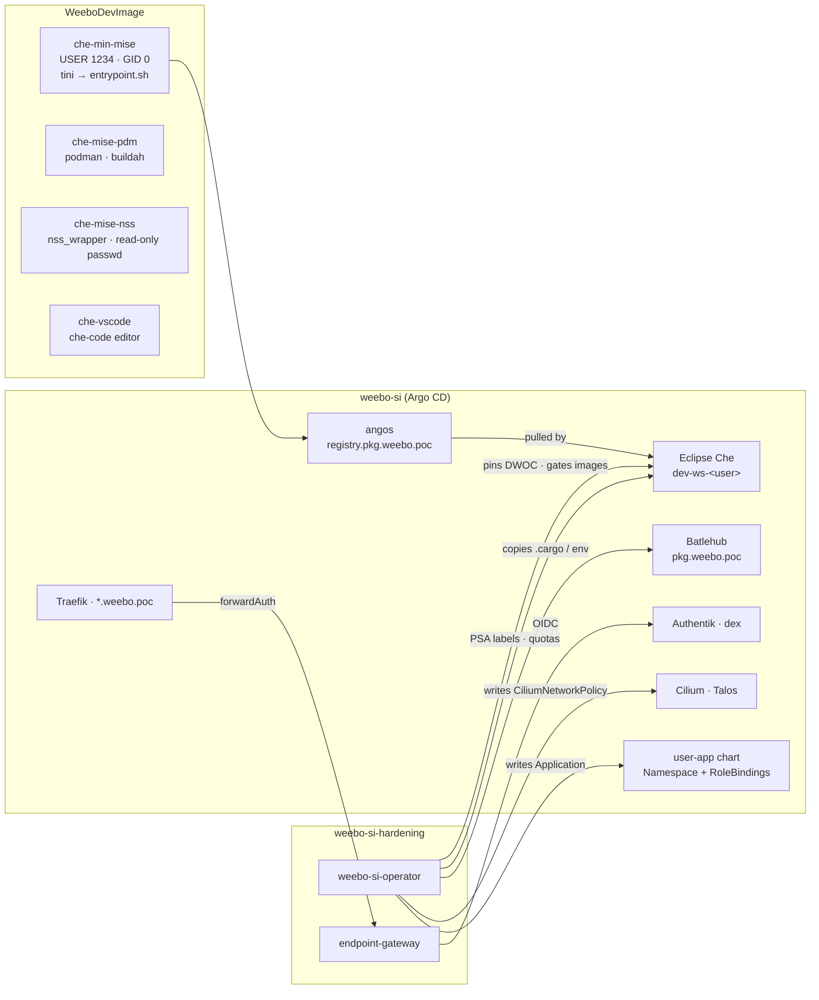

# The weebo-si standard

How to harden the Eclipse Che workspaces of [weebo-si](https://github.com/batleforc/weebo-si) with
`weebo-si-hardening`, one step at a time, for workspaces built on
[WeeboDevImage](https://github.com/batleforc/WeeboDevImage)'s `che-min-mise`. Each step says what
it turns on, what a developer can no longer do, what they still can, and why the line sits where
it does.

Everything this page applies is in [`deploy/weebo-si/`](../../deploy/weebo-si/README.md), and
`task deploy:check` proves every stage of it is a configuration the operator accepts. The field
references are [`weebosiconfig.md`](../weebosiconfig.md) and [`weebositeam.md`](../weebositeam.md);
the *why* behind each feature is its RFC. This page is the *why here*: the choices that follow from
weebo-si's cluster and from what `che-min-mise` does when it starts.

## Three repositories, one workspace

A running workspace on weebo-si is the product of three repositories. Most surprises in a
rollout come from one of them assuming something the other two do not do.



| Repository | Owns | Hands to the others |
| --- | --- | --- |
| **WeeboDevImage** | what is inside the container: `che-min-mise` (USER 1234, group 0, `tini` → `entrypoint.sh`, mise, chezmoi, kubectl), and its children `che-mise-pdm` (podman, buildah), `che-mise-nss` (nss_wrapper, read-only passwd, no apt), `che-mise-webkit` (WebKitGTK, build-essential), `che-vscode` (che-code) | an image at `ghcr.io/batleforc/weebodevimage/<name>:main`, rebuilt nightly |
| **weebo-si** | the cluster: Talos v1.13 / Kubernetes v1.36, single node, Cilium with kube-proxy replacement, Traefik on `*.weebo.poc`, Authentik + dex, angos (`registry.pkg.weebo.poc`), Batlehub (`pkg.weebo.poc`), Che at `cde.dev.weebo.poc` with `dev-ws-<username>` namespaces rendered by `2.helm/user-app` | the namespaces, their labels, the routing, the mirrors |
| **weebo-si-hardening** | what a workspace may do: which DWOC it runs with, what it reaches, which images it runs, at what Pod Security level, in what quota, behind which gate | objects it writes into the namespaces weebo-si creates, about the image WeeboDevImage builds |

The contract between them is small, and every line of it is load-bearing:

- **weebo-si labels every workspace namespace** `hardening.weebo.io/workspace-namespace: "true"` and
  `weebo.io/team: <team>`, and annotates it `che.eclipse.org/username: <user>`
  ([`examples/namespace.yaml`](../../deploy/weebo-si/examples/namespace.yaml)). Every feature's
  `namespaceSelector` selects on the first label, every team on the second, `endpoint-auth`'s
  owner check reads the annotation. A namespace missing the first label is invisible to the
  operator.
- **Every image is pulled through angos.** `che-min-mise` is
  `registry.pkg.weebo.poc/ghcr/batleforc/weebodevimage/che-min-mise:main`, never `ghcr.io/…`.
- **Every package comes through Batlehub.** The baseline network profile reaches `*.weebo.poc` and
  nothing outside the cluster.
- **`che-min-mise` runs as UID 1234 with GID 0**, and its start-up writes to `/etc/passwd`,
  `/etc/group`, `$HOME` and (for builds) `/etc/subuid`. Every control below was checked against
  that start-up.

## What is in `deploy/weebo-si/`

| Path | What | Applied by |
| --- | --- | --- |
| `values/weebo-si-operator.yaml` | the operator chart's RBAC switches and failure policies | Helm (weebo-si: `che.hardening.operator`) |
| `values/endpoint-gateway.yaml` | the gateway: Authentik issuer, hosts, audience | Helm (weebo-si: `che/endpoint-gateway`) |
| `dwoc/` | the two DevWorkspaceOperatorConfigs: `weebo-workspace`, `weebo-build` | `kubectl apply` in `eclipse-che` |
| `templates/network/` | the `CiliumNetworkPolicy` every profile is copied from | `kubectl apply` in `weebo-si-hardening` |
| `templates/kubearmor/` | the `KubeArmorPolicy` templates | same |
| `templates/registry/` | the Batlehub settings, as ConfigMaps DevWorkspace Operator mounts | same |
| `templates/quotas/` | `ResourceQuota` + `LimitRange` per profile | `kubectl apply` in `weebo-si-hardening-templates` |
| `config/weebosiconfig.yaml` | the singleton, every feature written out and `Off` | `kubectl apply` |
| `stages/NN-*.yaml` | one merge patch per step below: only `mode` changes | `kubectl patch --type merge` |
| `teams/` | `weebo` (everyday work) and `weebo-build` (container builds) | `kubectl apply` |
| `users/example.yaml` | one member | `kubectl apply` |
| `examples/` | a devfile and a namespace, annotated | read, not applied |

**On weebo-si itself, do not `kubectl apply` any of this.** The singleton, the teams, the users
and the templates are rendered by `2.argo/helm/che/hardening` from its `values.yaml`, and Argo CD
self-heals them: a manual patch is reverted within a sync. Each file here maps onto a block of
that `values.yaml` (`config.features.<feature>`, `teams.<name>`, `users.<name>`, a feature's
`templates`); write each stage there instead. The plain manifests are what the chart renders, in a
form `task deploy:check` can validate and a reader can diff.

## Where weebo-si stands today

Read off `weebo-si` at the time of writing, against this standard:

| Feature | weebo-si today | Standard | Gap to close |
| --- | --- | --- | --- |
| `dwocPin` | DryRun, catalogue `che` → `devworkspace-config` | Enforce, `weebo-workspace` / `weebo-build` | **the catalogue names `devworkspace-config`, but the DWOC weebo-si ships is `devworkspace-operator-config`.** Under Enforce with `onMissingTarget: Skip`, every workspace would start unpinned and say so in the logs. |
| `networkProfiles` | Enforce | Enforce, `onNotGranted: Deny` | none in the templates (this standard reuses them); the policy on ungranted keys |
| `policyGuard` | DryRun | Enforce | flip once network has converged |
| `imagePolicy` | Enforce | Enforce, narrower defaults, `onNotGranted: Deny` | **team `weebo` grants `ghcr.io/batleforc/weebodevimage/**` directly**, which bypasses angos; its default grants all of angos, Docker Hub included |
| `kubearmorPolicy` | not configured | Enforce with Audit rules | KubeArmor is not installed (BPF-LSM on Talos, planned in `runbooks/bascule-weebo-si`) |
| `registryConfig` | not configured (placeholder `.npmrc` → npmjs.org) | Enforce, env + Cargo config → Batlehub | RBAC switch, then the templates |
| `endpointAuth` | Enforce | Enforce | gateway at 1 replica, operator at 1 replica — both fail closed |
| `identity` | Enforce | Enforce | none |
| `podSecurity` | not configured (draft: `baseline` default) | `restricted` default, `baseline` ceiling | needs the `weebo-workspace` DWOC first |
| `resourceQuotas` | not configured | Enforce, `standard` / `build` | **Kyverno's `default-container-limits` generates a LimitRange in every namespace**; see step 5 |

## Step 0 — install, with everything off

**Prerequisites**, each of which a later step depends on:

| Prerequisite | Needed by | On weebo-si |
| --- | --- | --- |
| cert-manager | the webhook's serving certificate | yes, `vault-issuer` |
| Cilium enforcing policy | `network-profiles` | yes |
| kubelet `seccompDefault: true` | `baseline` teams (step 5) | **not set in the repo**: add it to the Talos machine config |
| the `weebo-container-build.json` Localhost profile on the node | the `weebo-build` DWOC | ship [`deploy/seccomp/talos-patch.yaml`](../../deploy/seccomp/talos-patch.yaml) |
| `UserNamespacesSupport`, containerd 2 | `hostUsers: false` (step 5) | yes (feature gate on in `pulu-init`) |
| KubeArmor with BPF-LSM | step 8 only | no |

```bash
helm upgrade --install weebo-si-operator oci://ghcr.io/batleforc/charts/weebo-si-operator \
  --version 0.4.0 -n weebo-si-hardening -f deploy/weebo-si/values/weebo-si-operator.yaml
helm upgrade --install endpoint-gateway oci://ghcr.io/batleforc/charts/endpoint-gateway \
  --version 0.4.0 -n weebo-si-hardening -f deploy/weebo-si/values/endpoint-gateway.yaml

kubectl apply -f deploy/weebo-si/dwoc/
kubectl apply -R -f deploy/weebo-si/templates/
kubectl apply -f deploy/weebo-si/config/weebosiconfig.yaml
kubectl apply -f deploy/weebo-si/teams/ -f deploy/weebo-si/users/
```

Nothing changes on the cluster yet: every feature is `Off`, and an `Off` feature does not run.

**Why the chart values are what they are.**

- **Two webhook replicas and two controllers, even on one node.** Every webhook here is
  `failurePolicy: Fail`. With one replica, a rollout or a crash is a window where no DevWorkspace is
  admitted and, through the Pod floor, no workspace pod is created or rescheduled. The
  anti-affinity is `preferred`, so both replicas still schedule on a single node.
- **`policyGuard.failurePolicy: Fail`.** A Che user is admin of `dev-ws-<user>`. If anything ever
  grants them `networkpolicies`, the guard is the only thing standing between them and
  `kubectl delete cnp weebo-base`. A control bypassed by making the webhook unavailable is not a
  control.
- **`imagePolicy.podWebhook.failurePolicy: Fail`.** The Pod half is the only layer that sees what
  DevWorkspace Operator injects and the sidecars a devfile pulls by URI. It costs a workspace
  restart during an operator outage, which is why the replicas are two.
- **`registryConfig.rbac.enabled: true`, `failurePolicy: Ignore`.** The RBAC is the strongest this
  project asks for (create/update/delete `secrets` cluster-wide), granted because the catalogue
  holds only ConfigMaps. `Ignore`, because the guard rule covers ConfigMap writes, and `Fail` would
  turn an operator outage into "no ConfigMap can be written in any workspace namespace".
- **`kubearmorPolicy.rbac.enabled: false`** until KubeArmor exists. A feature whose RBAC is off says
  so at start-up and does nothing.
- **The endpoint gateway at two replicas with a PDB.** It fails closed: with no replica, every
  workspace endpoint answers an error.

## Step 1 — observe everything

```bash
kubectl patch weebosiconfig cluster --type merge --patch-file deploy/weebo-si/stages/01-observe.yaml
```

Every feature now runs in `DryRun`: the same computation `Enforce` would do, counted and logged,
with nothing written and nothing refused. A feature is never told its own mode, so a dry run cannot
measure something different from what enforcement will do.

Stay here for a normal working week, then read:

```bash
kubectl get weebosiconfig cluster -o jsonpath='{range .status.features[*]}{.name}{"\t"}{.state}{"\t"}{.message}{"\n"}{end}'
kubectl get weebositeam -o wide       # Ready, and the violation list if any
weebo-si-operator images audit --all-namespaces   # what step 4 would refuse
weebo-si-operator pods audit --all-namespaces     # what step 5 would refuse
weebo-si-operator quotas audit                    # what step 5's quotas would cap
weebo-si-operator registry check                  # every registry template, resolved
```

On weebo-si, `networkProfiles`, `imagePolicy`, `endpointAuth` and `identity` are already enforced.
Leave them in `Enforce` and apply only the other lines of this stage: moving an enforced feature
back to `DryRun` does not delete what it wrote, but it stops reconciling it.

## Step 2 — pin every workspace to an admin's DWOC

```bash
kubectl patch weebosiconfig cluster --type merge --patch-file deploy/weebo-si/stages/02-workspace-shape.yaml
```

**Refused from now on:** a devfile that brings its own DevWorkspaceOperatorConfig
(`controller.devfile.io/devworkspace-config`). The attribute is rewritten to the DWOC the team is
granted.

**Why first.** The DWOC decides the pod's security context, and step 5's Pod Security levels judge
the pod spec. `restricted` refuses a pod with no seccomp profile *even if* the kubelet would apply
one by default. The `weebo-workspace` DWOC therefore sets every field `restricted` checks
explicitly:

| Field | Value | Why |
| --- | --- | --- |
| `runAsUser` / `runAsGroup` / `fsGroup` | 1234 / 0 / 1234 | `che-min-mise` is `USER 1234` in group 0; its entrypoint, `/home/tooling` and `/etc/passwd` are group-0-writable on that assumption |
| `runAsNonRoot` | `true` | required by `restricted`; satisfied because 1234 is numeric |
| `seccompProfile` | `RuntimeDefault` | required by `restricted`; the node default does not count |
| `allowPrivilegeEscalation` | `false` | required by `restricted`; sets `no_new_privs`, so the setuid binaries in the image (`su`, `passwd`, `newuidmap`) cannot elevate |
| `capabilities.drop` | `[ALL]` | required by `restricted`; nothing in `che-min-mise` needs one |

The `weebo-build` DWOC is step 5's. Both repeat weebo-si's `routing.clusterHostSuffix`: a pinned
DWOC replaces the matching fields of the global one.

**`onMissingTarget: Skip`** lets a workspace start unpinned when the DWOC it resolves to does not
exist (counted and logged), instead of refusing every workspace in the cluster for an admin's
typo. Check for it before moving on: the gap in the table above is exactly this case.

## Step 3 — the network, the mirrors, and the guard

```bash
kubectl patch weebosiconfig cluster --type merge --patch-file deploy/weebo-si/stages/03-network.yaml
```

Three features at once, because each is broken or pointless without the other two:
`network-profiles` without `registry-config` breaks `npm install`; `registry-config` without
`network-profiles` is a suggestion a project-local `.npmrc` overrides; either one without
`policy-guard` is undone by `kubectl delete cnp weebo-base -n dev-ws-<me>`.

### What a workspace reaches

`weebo-base` is copied into every workspace namespace and selects every pod in it. Profiles add to
it, per workspace.

| Destination | Baseline | Profile | Why |
| --- | --- | --- | --- |
| Pods of the same namespace | ✅ | | a multi-component devfile (`tools` + `db`) talks to itself |
| `kube-dns` | ✅ | | through Cilium's DNS proxy, which is what makes `toFQDNs` rules work at all |
| Traefik (`*.weebo.poc`) | ✅ | | CoreDNS rewrites every `*.weebo.poc` to Traefik: this one rule reaches angos, Batlehub, Forgejo, Authentik and other workspaces' endpoints, **each gated on its own side** |
| `eclipse-che` on 8080, che-gateway on 8089 | ✅ | | che-code's forwardAuth through che-gateway; without 8089 the IDE never opens |
| kube-apiserver :6443 | ✅ | `kube-api` | che-code and its extensions read the DevWorkspace, the gitconfig and the secrets through it; measured on weebo-si, a workspace without it never finishes starting. RBAC bounds what it may do there |
| `github.com`, `git.batleforc.fr` (443, 22) | | `dev-registries` | git, and che-min-mise's chezmoi step (below) |
| `api.anthropic.com` | | `anthropic` | Claude Code |
| anything else outside the cluster | ❌ | `internet` | the escape hatch, granted and never a default |
| another workspace's pod directly | ❌ | | only through its endpoint, through the gate |
| `vault`, `database`, `s3`, `argocd`… | ❌ | | a workspace has no business there; a service that needs one exposes it through Traefik |

**Refused from now on**, and the error a developer meets:

| Action | Result |
| --- | --- |
| `curl https://example.com` (no `internet`) | DNS resolves, the connection hangs and times out; Hubble shows `Policy denied` |
| `npm install` with a project `.npmrc` → `registry.npmjs.org` | same timeout. The fix is to remove the line, not to ask for `internet`: Batlehub serves npm |
| `pip install -i https://pypi.org/simple …` | same |
| `go get` with `GOPROXY=…,direct` for a module Batlehub lacks | `direct` times out; the fix is Batlehub |
| `psql -h postgres.database` | timeout |
| a devfile asking `hardening.weebo.io/network-profiles: internet` when the team does not grant it | **the workspace is refused at start**, naming `internet` (`onNotGranted: Deny`) |
| `kubectl delete cnp weebo-base` / editing it | refused by `policy-guard`: *managed by weebo-si-operator and may not be modified* |
| creating your own `CiliumNetworkPolicy` in `dev-ws-<me>` | refused: authorship belongs to the platform (`allowedIdentities: []`) |

**Still allowed:** everything on `*.weebo.poc`, git over HTTPS and SSH to the two forges, Claude
Code, and kubectl within the user's RBAC.

**Why `onNotGranted: Deny`.** With `Default`, a workspace asking for an ungranted profile starts on
the team default, and the developer finds out from a timeout twenty minutes later, with nothing to
tell them it was a grant. `Deny` refuses the DevWorkspace at admission with the key in the message.
The cost: removing a grant from a team stops the workspaces that ask for it from starting, which is
the honest outcome.

**Why `backend: Cilium`, not `Auto`.** The templates exist only as `CiliumNetworkPolicy`, and on
Talos the apiserver runs on the node, where a plain `NetworkPolicy` cannot select it. `Auto` would
pick Cilium anyway; explicit means a change in Cilium's CRDs cannot silently move the cluster to
another backend.

### Mirrors: what changes for che-min-mise

`che-min-mise` ships no mirror configuration at all. Out of the box, mise downloads from GitHub
releases and from each tool's upstream; npm, pip, cargo and go go to their public registries. Under
the baseline, all of that is refused. Two places now point it at Batlehub:

- **weebo-si's CheCluster** sets `MISE_URL_REPLACEMENTS` for every workspace
  (`che.workspaceTrust.extraEnv`). Today it rewrites only `mise-versions.jdx.dev`. Tool downloads
  still go to `github.com`, which works only because `dev-registries` is in the team default. **Add
  the GitHub release mapping to Batlehub's `github` registry there**, and the `go-dist` /
  `helm-dist` / `k8s-dist` mappings already drafted in the comment. Then `github.com` serves git
  only, and a mise install no longer depends on the forge profile.
- **`registry-config`** mounts, per team:
  - `batlehub-env` ([`weebo-pkg-env.yaml`](../../deploy/weebo-si/templates/registry/weebo-pkg-env.yaml)):
    `NPM_CONFIG_REGISTRY`, `PIP_INDEX_URL`, `UV_DEFAULT_INDEX`, `GOPROXY` (no `,direct`),
    `RUSTUP_DIST_SERVER`, `RUSTUP_UPDATE_ROOT`, as environment variables (`mount-as: env`).
  - `batlehub-cargo` ([`weebo-cargo-config.yaml`](../../deploy/weebo-si/templates/registry/weebo-cargo-config.yaml)):
    `~/.cargo/config.toml`, because Cargo reads `[source]` replacement only from files.

**Why environment variables rather than files.** `che-min-mise`'s home is a PVC that the
entrypoint populates on first start (`stow` from `/home/tooling`, then copy-if-absent for
`.bashrc`, `.zshrc`, `starship.toml`). A file mounted into it shadows what the user keeps there; an
environment variable does not. The one file, `~/.cargo/config.toml`, is mounted `subpath`: one key,
one file, read-only. `file` would mount a directory over `~/.cargo` and hide the registry cache and
every installed binary. The operator refuses that template outright.

**Why mise's settings stay on the CheCluster.** They are platform-wide, and the same variable from
two sources (CheCluster env and a DWO automount) has no defined winner.

**Known gap: `GOSUMDB`.** `sum.golang.org` is outside the cluster. Until Batlehub proxies the
checksum database, `go` refuses modules it cannot verify. Do not paper over it with `GOSUMDB=off`
in the template: that disables verification for every module, mirrored or not.

### che-min-mise's start-up and the network

The entrypoint runs `chezmoi init --apply "$CHEZMOI_URL"` when the variable is set (weebo-si sets
it to a GitHub repository through `externalConfig`), with a 120-second timeout. With
`dev-registries` in the team default this works. A workspace whose devfile names its profiles
explicitly and leaves `dev-registries` out **starts 120 seconds late and without dotfiles**. Either
keep `dev-registries` in every explicit list, or move the dotfiles to Forgejo (`git.weebo.poc`,
reachable through the baseline).

## Step 4 — only images pulled through angos

```bash
weebo-si-operator images audit --all-namespaces      # every DENIED row stops a workspace
kubectl patch weebosiconfig cluster --type merge --patch-file deploy/weebo-si/stages/04-images.yaml
```

| Key | Patterns | Who |
| --- | --- | --- |
| `weebo-devimages` | `registry.pkg.weebo.poc/ghcr/batleforc/weebodevimage/**` | everyone, including a namespace of no team |
| `weebo-local` | `registry.pkg.weebo.poc/weebo/**` | both teams' default |
| `hub-official` | `registry.pkg.weebo.poc/hub/library/**` | `weebo` default: postgres, redis… as devfile sidecars |
| `angos` | `registry.pkg.weebo.poc/**` (all of Docker Hub, ghcr.io and quay.io, cached) | `weebo`, granted but not default |
| platform set | Che's four compiled-in images, upstream and — derived through `imageRewrite`'s `quay.io` rule — from angos' quay cache, by digest; the hand-written `extra` entries; `che-vscode` | every namespace, no grant can withhold it |

The same patch puts `imageRewrite` in `Enforce`: `docker.io`, `quay.io` and `ghcr.io` names are
rewritten onto `registry.pkg.weebo.poc/{hub,quay,ghcr}` in every DevWorkspace and workspace pod
before `imagePolicy` judges them (RFC 0017, [`bricks/image-rewrite.md`](../bricks/image-rewrite.md)).
A devfile's `postgres:18` therefore starts, as `registry.pkg.weebo.poc/hub/library/postgres:18`.

**The platform set, in order.** Step 4 keeps the hand-written `registry.pkg.weebo.poc/quay/…/**`
entries in `extra`, so nothing is refused that was allowed. Once `weebo-si-operator images audit
--all-namespaces` shows no running Che image permitted *only* by them, they may go: the derived
patterns cover the four compiled-in images, **by digest**. A CheCluster or DWOC overriding a Che
image with a mirror name by tag is refused after that, which is what the audit finds first.

**Refused from now on:**

| Action | Result | Why |
| --- | --- | --- |
| `image: ghcr.io/batleforc/weebodevimage/che-min-mise:main` with `imageRewrite` `Off` | refused: *not permitted* | the same bytes, but not through angos: no cache, no scan, and the node's egress, not the workspace's, decides whether it can be pulled at all. With the rewrite on it is pulled as `registry.pkg.weebo.poc/ghcr/…`. weebo-si's current team grant allows the upstream name and should drop it |
| `image: docker.io/library/postgres` or `postgres:18` with `imageRewrite` `Off` | refused | normalised to `docker.io/library/postgres`, not angos; with the rewrite on it is pulled from `hub/library` instead |
| `image: registry.pkg.weebo.poc/hub/bitnami/redis` in `weebo` | refused unless the devfile asks for `angos` | `hub-official` covers `library/` only |
| a devfile attribute naming `angos` in `weebo-build` | **the workspace is refused**, naming the key (`onNotGranted: Deny`) | `weebo-build` is not granted it |
| a plugin sidecar pulled by URI, an image DWO injects | judged by the Pod floor, same rules | the reason the Pod webhook exists |

**Not covered, and why that is acceptable here.** An image pulled *inside* the workspace (`podman
pull`, a build's `FROM`) never appears in a pod spec, so `image-policy` never sees it. What bounds it
is the network: `che-mise-pdm`'s `registries.conf` sends docker.io, ghcr.io and quay.io through
angos, and the build team has no `internet` grant, so nothing else answers.

**Mutable tags.** `che-min-mise:main` is rebuilt every night, and a pattern cannot tell yesterday's
`main` from today's. `image-policy` controls *where* an image comes from, not *which build* it is.
Pinning is WeeboDevImage's to fix (see *Asked of WeeboDevImage*): until it publishes versioned or
dated tags, every workspace start may run a different image.

## Step 5 — Pod Security levels and quotas

```bash
weebo-si-operator pods audit --all-namespaces
weebo-si-operator quotas audit
kubectl patch weebosiconfig cluster --type merge --patch-file deploy/weebo-si/stages/05-pods.yaml
```

### Pod Security

| Team | Level | DWOC | Why |
| --- | --- | --- | --- |
| no team, `weebo` | `restricted` | `weebo-workspace` | everything che-min-mise does fits once step 2's DWOC sets the security context |
| `weebo-build` | `baseline`, warned at `restricted` | `weebo-build` | `newuidmap`/`newgidmap` are setuid, so `allowPrivilegeEscalation` must stay true, which `restricted` refuses |
| anyone | never `privileged` | | `ceiling: baseline` clamps any looser request and reports it on the team |

**Refused from now on** in a `restricted` namespace, by the apiserver's own PodSecurity plugin
(the operator only writes the labels):

| Action | Result |
| --- | --- |
| a pod with `privileged: true`, `hostPID`, `hostNetwork`, a `hostPath` volume | refused: *violates PodSecurity "restricted:v1.36"* |
| a container running as UID 0, or `runAsNonRoot: false` | refused |
| `allowPrivilegeEscalation: true`, an added capability | refused |
| `kubectl run debug --image=… -it` without a security context | refused. The DWOC applies to workspaces only; a pod written by hand must set it itself |
| `su`, `sudo` (absent anyway), any setuid binary inside the workspace | runs, cannot elevate: `no_new_privs` |
| `podman` / `buildah` | not in che-min-mise; in che-mise-pdm, needs `weebo-build` |

**Why `baseline` for builds is still safe here.** The `weebo-build` DWOC gives the pod its own user
namespace (`hostUsers: false`): UID 0 inside maps to an unprivileged UID on the node, and its
capabilities count only inside that namespace. On top of it, the `weebo-container-build.json`
seccomp profile opens only what a build was measured to need (`unshare`, `mount`, `pivot_root`…)
and keeps the rest of what upstream reserves for `CAP_SYS_ADMIN` closed. `procMount: Unmasked` is
admitted at `baseline` only because the pod is user-namespaced (KEP-4265, measured on 1.35+), and
only with `version` at or above that, hence `v1.36`, pinned to the cluster's minor so an upgrade
cannot tighten a level overnight.

**The chain this closes, concretely.** In che-min-mise, `/etc/passwd` is group-0-writable (the
entrypoint appends the user to it). In a `baseline` pod, without `no_new_privs`, a user can append
`r00t:<a hash they chose>:0:0::/root:/bin/bash` and `su r00t`. They are now root, inside the user
namespace, which is worth nothing on the node. In a `restricted` pod the same `su` cannot elevate
at all. Step 8 removes even the in-namespace root, and *Asked of WeeboDevImage* removes the writable
`passwd`.

### Quotas

| Profile | requests cpu/mem | limits cpu/mem | PVCs / storage | NodePort / LB |
| --- | --- | --- | --- | --- |
| `standard` | 4 / 12Gi | 16 / 24Gi | 12 / 120Gi | 0 / 0 |
| `build` | 6 / 16Gi | 24 / 40Gi | 12 / 200Gi | 0 / 0 |

Sized from weebo-si's own numbers: Che allows 5 running workspaces per user, che-min-mise's
devfile requests 1Gi and caps at 8Gi, the editor and che--traefik sidecars add about 1.5Gi, and
storage is per-workspace at 10Gi. Two heavy workspaces fit at once, five light ones fit, five heavy
ones do not. On a single node, that is the point.

**`services.nodeports: 0` and `services.loadbalancers: 0` are about `endpoint-auth`, not capacity.**
A NodePort or a LoadBalancer reaches a workspace without going through Traefik, and so without the
gate. With both at zero, the only way into a workspace is the gated one.

**Refused from now on:** a component whose limits exceed the LimitRange `max` (12Gi in `standard`),
a sixth PVC over 120Gi, any `Service` of type `NodePort` or `LoadBalancer`. The error comes from the
apiserver: *exceeded quota: weebo-quota*.

**Kyverno.** weebo-si's `default-container-limits` ClusterPolicy generates a LimitRange named
`default-resources` in every namespace, workspace namespaces included. With `weebo-limits` beside
it, two LimitRanges apply to the same pod and their defaults conflict. **Add the workspace label to
that policy's `exclude`** (a `namespaceSelector` on `hardening.weebo.io/workspace-namespace`) before
this stage.

## Steps 6 and 7 — the gate on workspace endpoints

```bash
kubectl patch weebosiconfig cluster --type merge --patch-file deploy/weebo-si/stages/06-endpoints-observe.yaml
# a week later, with the gateway chart's config.enforcement set to Enforce in the same change:
kubectl patch weebosiconfig cluster --type merge --patch-file deploy/weebo-si/stages/07-endpoints-enforce.yaml
```

Every `Ingress` Che generates in a workspace namespace gets Traefik's forwardAuth to
`endpoint-gateway`. In `Observe` the gateway computes every decision and answers 200 anyway: the
step that finds the health check nobody knew about before it breaks.

| Who calls `https://alice-ws-base.cde.dev.weebo.poc` | `private` (default) | `team` | `shared` + allow-users |
| --- | --- | --- | --- |
| Alice in her browser (Authentik session) | ✅ | ✅ | ✅ |
| Bob, same team | ❌ 403 | ✅ | ✅ |
| Carol, other team, named in `allow-users` | ❌ | ❌ | ✅ |
| anyone not signed in | ❌ → sign-in | ❌ → sign-in | ❌ → sign-in |
| Alice's other workspace, calling with its ServiceAccount token | ✅ | ✅ | ✅ |
| a NodePort / port-forward | impossible (quota 0) / needs RBAC | | |

A developer opens their endpoint to the team with one annotation, on the devfile endpoint (durable)
or with `kubectl annotate` (until the next start): `hardening.weebo.io/access: team`.

**Refused from now on:**

| Action | Result | Why |
| --- | --- | --- |
| an `Ingress` whose Traefik middleware chain is not exactly the gate's (one prepended, appended or replaced) | refused | the guard pins the whole chain; with `allowedMiddlewares: []` the chain is the gate alone, and a middleware before forwardAuth could rewrite what it judges ([`endpoint-gateway.md`](../bricks/endpoint-gateway.md#the-traefik-middleware)) |
| a host outside `{user}-{workspace}-{endpoint}.cde.dev.weebo.poc` | refused at admission | host ownership is how the gate knows whose endpoint it is |
| a host naming another user | refused | same |
| removing the gate annotation | refused by the guard rows, re-added by the sweep | |
| `hardening.weebo.io/access: open` | falls back to the team default | no anonymous profile is catalogued at cluster level; a team that needs a public endpoint gets one, named |

**Why the choices.**

- **`owner.devworkspaceOperatorIdentity: system:serviceaccount:eclipse-che:che-operator`.** Under
  Che, che-operator writes the routing objects, not DevWorkspace Operator. Wrong here, every
  workspace endpoint stops being created.
- **`claims.username: preferred_username`** on the gateway, equal to Che's
  `CHE_OIDC_USERNAME__CLAIM` and to the namespace annotation's value. Three systems must agree on
  the username; if they do not, every owner is locked out of their own endpoint.
- **`bearer.audiences: [endpoint-gateway]`**, with an audience mapper on the Authentik provider.
  Without it, a token minted for any weebo application (Argo CD, Forgejo…) would open workspace
  endpoints.
- **`anonymous: false` written out** on every catalogue entry: the apiserver fills it in, and Argo
  CD compares list items whole, so leaving it implicit keeps the Application OutOfSync forever.

## Step 8 — what a process may do (KubeArmor)

Only once KubeArmor runs with BPF-LSM on the node, and `kubearmorPolicy.rbac.enabled: true`:

```bash
weebo-si-operator backends kubearmor --verbose     # CRD served, and which nodes can enforce
kubectl patch weebosiconfig cluster --type merge --patch-file deploy/weebo-si/stages/08-runtime.yaml
```

This stage writes the policies. **Every rule in them is still `Audit`**, and so is the
`defaultPosture`. Nothing is blocked yet. Watch `kubearmor-relay` for a week, then move rules to
`Block` in the templates, one at a time, narrowest first. A template edit reaches every workspace at
the next reconcile, without a workspace restart.

| Rule (template `weebo-armor-base`) | Starts | Becomes | Why it is there, and why it waits |
| --- | --- | --- | --- |
| exec of `su`, `passwd`, `chsh`, `chfn`, `gpasswd`, `newgrp`, `mount`, `umount` | Audit | **Block** first | nothing in a workspace's day needs them. It is the `su` half of the step 5 chain |
| write to `/home/tooling/`, `/globals/`, `/usr/local/bin/` | Audit | Block second | binaries on `PATH` and the rc files every shell sources are group-writable in che-min-mise: anything running as the user can replace `mise` for every later shell. Check first that nobody runs `mise self-update`, which writes there |
| write to `/etc/passwd`, `/etc/group`, `/etc/subuid`, `/etc/subgid` | Audit | **stays Audit** while che-min-mise appends at start | a blocked append is a workspace whose `whoami` fails and whose `git commit` refuses to run. Block-able once the image stops writing there (below) |
| read of `/var/run/secrets/kubernetes.io/serviceaccount/` | Audit | **never Block** | che-code authenticates to the apiserver with it, and `endpoint-auth` lets one workspace call another by presenting it. The audit answers "which process reads the token", the question a compromised npm dependency raises |

`weebo-armor-build` labels what `weebo-build` workspaces are expected to run (`newuidmap`,
`newgidmap`, `crun`, `fuse-overlayfs`), so their audit stream separates "podman doing its job" from
"something else using the same syscalls".

**Why `defaultPosture` stays `Audit`.** It decides what happens to an operation *no rule matched*.
`Block` turns the templates into an allow-list, and che-min-mise's start-up (stow into the PVC,
chezmoi, mise installs under `~/.local/share/mise`) writes to more places than any allow-list
written today anticipates.

**The posture annotations are not guarded.** `policy-guard` protects the `KubeArmorPolicy` objects,
not the three `kubearmor-*-posture` annotations on the namespace. A Che user cannot patch their
`Namespace` object (it is cluster-scoped, and `2.helm/user-app` grants no such right). Keep it that
way.

## Step 9 — people as objects

```bash
kubectl patch weebosiconfig cluster --type merge --patch-file deploy/weebo-si/stages/09-identity.yaml
```

Each `WeeboSiUser` with `che.mode: Ensure` gets an Argo CD `Application` (`che-user-<name>`),
rendered from its team's `workspace.che` template into `dev-ws-<username>` from weebo-si's
`2.helm/user-app`. That chart creates the namespace with the four lines every step above depends
on. This is where the contract of *Three repositories* is enforced rather than hoped for: a
namespace created any other way lacks the labels, and no feature sees it.

| Choice | Why |
| --- | --- |
| `allowedProjects: [che-users]` | the AppProject that may deploy only to `dev-ws-*` and `argocd`, with a namespaced whitelist |
| `allowedRepoUrls` pinned to weebo-si | a team template cannot render a chart from anywhere else |
| `allowedGroupRefs: ["weebo-*"]` | a person can be put in weebo's groups, not in Authentik's admin groups |
| `syncPolicy.automated.prune: false` | a chart change must never take the namespace, and every workspace in it, with it |
| `username` = Authentik `preferred_username` | the one field Che, the gateway and the namespace annotation must agree on; never rename it |

## What a developer sees

The whole standard, from the developer's side, at the end of step 7 (step 8 adds nothing visible
until rules move to `Block`):

| They try | In `weebo` | In `weebo-build` | Control |
| --- | --- | --- | --- |
| start che-min-mise from angos | ✅ | ✅ | image-policy |
| start it from `ghcr.io` | ✅ pulled through angos | ✅ | image-rewrite + image-policy |
| add `postgres:18` as a sidecar | ✅ pulled from `hub/library` | ❌ unless granted | image-rewrite + image-policy |
| `npm install`, `pip install`, `cargo build`, `go get` | ✅ via Batlehub | ✅ | registry-config + network |
| the same, pointed at the public registry | ❌ timeout | ❌ | network |
| `mise use node@24` | ✅ (versions via Batlehub, download via GitHub until the mapping lands) | ✅ | network + CheCluster env |
| `git clone` from GitHub / git.batleforc.fr / git.weebo.poc | ✅ | ✅ | `dev-registries` / baseline |
| `curl` any other site | ❌ unless `internet` is asked for and granted | ❌ (not granted) | network |
| `kubectl get pods` in their namespace | ✅ | ✅ | baseline + RBAC |
| `kubectl delete cnp weebo-base` | ❌ | ❌ | policy-guard |
| `podman build` | ❌ not in the image | ✅ in che-mise-pdm | DWOC + PSA + seccomp |
| run a privileged pod | ❌ | ❌ | pod-security |
| expose a NodePort | ❌ | ❌ | resource-quotas |
| open their endpoint to the team | ✅ one annotation | ✅ | endpoint-auth |
| reach a teammate's private endpoint | ❌ 403 | ❌ | endpoint-auth |
| `su` | runs, cannot elevate | elevates inside the user namespace, until step 8's Block | pod-security / KubeArmor |

## Asked of WeeboDevImage

`che-min-mise` was written before this standard. Four changes make the controls above tighter
and their exceptions unnecessary. The measured, prioritised version, with image size, is
[`che-min-mise-review.md`](../che-min-mise-review.md).

1. **Stop writing `/etc/passwd`.** `entrypoint.sh` already registers the user through
   nss_wrapper whenever `libnss_wrapper.so` is present, and `che-mise-nss` turns that on with a
   package and a `chmod`. Do the same in `che-min-mise`: install `libnss-wrapper` and put
   `/etc/passwd` and `/etc/group` back to `root:root 0644`. Then export the nss_wrapper variables
   from `/globals/shellrc` too, so che-code's terminals see them. The in-container root chain of
   step 5 disappears, and step 8 can `Block` writes to `/etc/passwd`.
2. **Publish immutable tags.** A dated or versioned tag next to `:main` (CI already knows the
   date), so devfiles and the CheCluster can pin a digest. Until then, `image-policy` controls the
   source, not the build.
3. **Drop `/projects` from `MISE_TRUSTED_CONFIG_PATHS`.** Every repository cloned into `/projects`
   is trusted by mise without a prompt, so its `[env]` and hooks run as soon as a shell enters the
   directory. A malicious repository runs code at `cd`. With the network baseline, that code
   reaches only `*.weebo.poc`. It still reads the ServiceAccount token. `mise trust` once per
   repository is the cost.
4. **Stop making `/home/tooling` and `/globals` group-writable** once the stow step no longer needs
   it. Then step 8's second rule can `Block` with nothing to measure first.

## Asked of weebo-si

1. Point `dwocPin` at a DWOC that exists (the `devworkspace-config` / `devworkspace-operator-config`
   mismatch), or adopt `weebo-workspace` and `weebo-build`.
2. Drop the `ghcr.io/batleforc/weebodevimage/**` grant from team `weebo`.
3. Two replicas for the operator's webhook and for `endpoint-gateway`.
4. `seccompDefault: true` and the build seccomp profile in the Talos machine config.
5. Exclude workspace namespaces from Kyverno's `default-container-limits` before step 5.
6. Extend `MISE_URL_REPLACEMENTS` to GitHub releases and the dist mirrors, so `github.com` is for
   git only.

## Rolling back

Every step rolls back by moving its features' `mode` to the previous value: patch the singleton
with the previous stage's values. What `Off` does differs per feature, so roll back to `DryRun`
unless you mean it:

| Feature | `DryRun` | `Off` |
| --- | --- | --- |
| network-profiles, kubearmor-policy, registry-config, resource-quotas | stops reconciling; what was written stays | **deletes** everything it wrote |
| pod-security | stops reconciling | **restores** the labels each namespace had before |
| endpoint-auth | stops refusing | strips the annotations the sweep wrote |
| dwoc-pin, image-policy, policy-guard | admits everything | admits everything |

For an emergency, deleting a feature's `ValidatingWebhookConfiguration` is the break-glass for that
feature alone. [`bricks/weebo-si-operator.md`](../bricks/weebo-si-operator.md#rollback) lists them.

## Keeping `deploy/weebo-si/` honest

```bash
task deploy:check     # every stage deserialized, resolved and validated as the controller does;
                      # every templateRef resolves to a file here; every policy template selects no pod
task envtest:run      # the same stages applied to a real apiserver with strict field validation
```

The test is [`crates/weebo-si-crd/tests/deploy_weebo_si.rs`](../../crates/weebo-si-crd/tests/deploy_weebo_si.rs).
A change to a CRD that breaks this example fails CI the same day.
