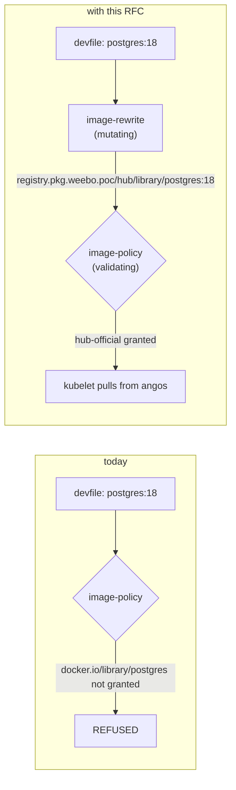
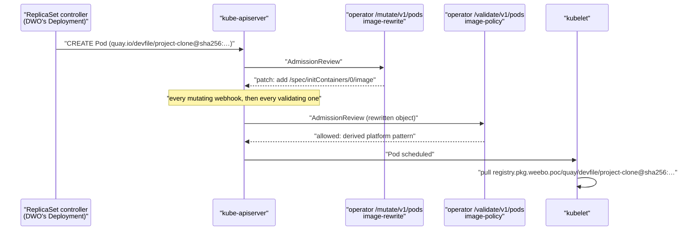
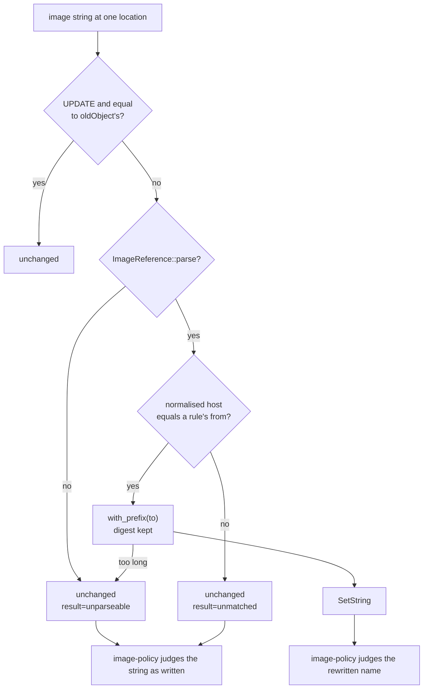
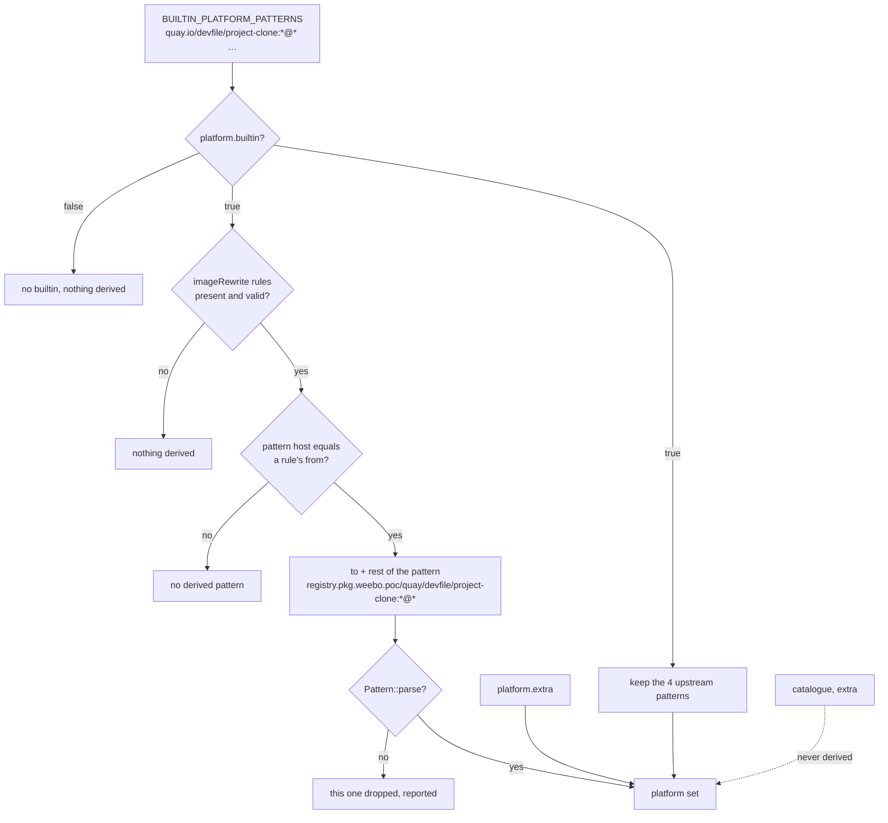
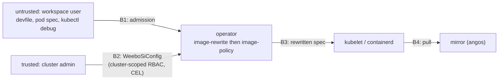

# RFC 0017 — image-rewrite

| Field     | Value                                                                                                                                                                                                                                    |
| --------- | ---------------------------------------------------------------------------------------------------------------------------------------------------------------------------------------------------------------------------------------- |
| Short     | rewrite workspace image names onto a mirror                                                                                                                                                                                              |
| Settles   | an image named from an upstream registry is pulled through the mirror                                                                                                                                                                    |
| Co-author | Claude Opus 5.5                                                                                                                                                                                                                          |
| Touches   | `crates/weebo-si-image-policy`, `crates/weebo-si-image-policy-adapters`, `crates/weebo-si-crd`, `crates/weebo-si-runtime`, `crates/weebo-si-controller`, `crates/weebo-si-operator`, `charts/weebo-si-operator`, `deploy/weebo-si`, docs |
| Risk      | medium (*Security considerations*)                                                                                                                                                                                                       |

> Reference material (~8 000 words). A reviewer short on time reads *Summary*,
> *Security considerations* and *Unresolved questions*.

## Summary

A new feature, `image-rewrite`, lets the cluster admin map an upstream
registry host onto a mirror prefix — `quay.io` → `registry.pkg.weebo.poc/quay`
— and has the operator's mutating webhooks rewrite every matching image in a
workspace before it is pulled. It runs at the same two points as RFC 0005's
`image-policy`: the `DevWorkspace` (what the user wrote) and the `Pod` (what
DevWorkspace Operator and Che actually start, injected images included).
`image-policy` keeps judging, and because Kubernetes runs every mutating
webhook before any validating one, it judges the rewritten name: the rewrite
turns a refusal into a working pull, it never widens what a catalogue allows.
The one place it adds to what is allowed is the platform set, by exactly the
four compiled-in Che images served from the mirror (*Platform set*).

### Before / after

```yaml
# devfile, under the weebo-si standard's imagePolicy (deploy/weebo-si/config/weebosiconfig.yaml)
components:
  - name: db
    container:
      image: postgres:18          # refused once imagePolicy is Enforce: docker.io/library/postgres
# the user has to know angos' layout and write
#     image: registry.pkg.weebo.poc/hub/library/postgres:18

# WeeboSiConfig with this RFC
spec:
  features:
    imageRewrite:
      mode: Enforce
      namespaceSelector:
        matchLabels: { hardening.weebo.io/workspace-namespace: "true" }
      rules:
        - { from: docker.io, to: registry.pkg.weebo.poc/hub }
        - { from: quay.io,   to: registry.pkg.weebo.poc/quay }
        - { from: ghcr.io,   to: registry.pkg.weebo.poc/ghcr }
# the same devfile line `image: postgres:18` now starts
#     registry.pkg.weebo.poc/hub/library/postgres:18
```



The request refused today is the one rewritten tomorrow; `image-policy` sits
after the rewrite in both paths and its rules do not change.

## Motivation

1. **Every public devfile is refused under the weebo-si standard.** The
   standard's catalogue (`deploy/weebo-si/config/weebosiconfig.yaml`, the
   `imagePolicy` block) grants only `registry.pkg.weebo.poc/**` patterns, and
   `docs/guides/weebo-si-standard.md` *Step 4* lists `image: postgres:18` as
   refused. The reference config ships `imagePolicy` at `mode: "Off"` (it is
   staged), so this is the state *Step 4* moves to, not what a cluster running
   the file as committed sees. Every sample in the devfile registry and every
   upstream project's `devfile.yaml` names `docker.io`, `quay.io` or
   `ghcr.io`, so each one has to be edited by hand, by someone who knows
   angos' path layout (`/hub`, `/quay`, `/ghcr`), before it starts.
2. **Images Che and DevWorkspace Operator inject are refused unless each one
   was re-pointed by hand.** The standard turns `platform.builtin` off and
   lists only `registry.pkg.weebo.poc/quay/che-incubator/**`,
   `…/quay/devfile/**` and `…/quay/eclipse/**` in `platform.extra`. The
   compiled-in set it replaces (`BUILTIN_PLATFORM_PATTERNS` in
   `crates/weebo-si-image-policy/src/platform.rs`) names
   `quay.io/devfile/project-clone`, `quay.io/che-incubator/che-code`,
   `…/configbump` and `quay.io/eclipse/che--traefik`: every one of those has
   to be overridden in the CheCluster and DevWorkspaceOperatorConfig.
   This RFC solves it for those four images. **It does not solve it for an
   image a future Che adds:** that image is rewritten to the mirror, but no
   derived platform pattern names it, so it is judged like any user image —
   allowed only if `extra` or a grant covers it (*Drawbacks*).
3. **The "one pull path" rule is enforced only by refusal.** RFC 0005 and the
   standard make angos the only allowed source, but the operator's answer to a
   wrong name is an error message. The intended path is a fixed, admin-owned
   function of the name (`host` → `mirror/prefix`), which is the kind of thing
   an admission webhook should apply rather than ask a human to apply.

## Guide-level explanation

The admin adds one block to `WeeboSiConfig`:

```yaml
spec:
  features:
    imageRewrite:
      mode: DryRun                 # Off | DryRun | Enforce, as every feature
      namespaceSelector:
        matchLabels: { hardening.weebo.io/workspace-namespace: "true" }
      rules:                       # at most 64
        - from: docker.io          # a registry host, normalised as image-policy normalises it
          to: registry.pkg.weebo.poc/hub   # a host and at least one path component
        - from: quay.io
          to: registry.pkg.weebo.poc/quay
```

A rule set the API server refuses never reaches the operator — the CRD
carries the structural checks as CEL rules (*Contract*):

```text
$ kubectl apply -f weebosiconfig.yaml
The WeeboSiConfig "cluster" is invalid: spec.features.imageRewrite.rules: Invalid value: "array": a rule's `to` host must not be another rule's `from` (chain or loop)
```

With `DryRun`, nothing changes; each admission that *would* have rewritten an
image is counted and logged, in `image-policy`'s log style
(`log_decision` in `crates/weebo-si-image-policy-adapters/src/image_policy.rs`,
references quoted through `escape_reference`):

```text
INFO image-rewrite dry-run resource=Pod subject=dev-ws-alice/workspace8c1-7d9 container="project-clone" from="quay.io/devfile/project-clone@sha256:4f1…" to="registry.pkg.weebo.poc/quay/devfile/project-clone@sha256:4f1…"
```

With `Enforce`, the same line reads `rewrite` instead of `dry-run`, and the
image is changed:

```text
INFO image-rewrite rewrite resource=DevWorkspace subject=dev-ws-alice/my-ws container="db" from="docker.io/library/postgres:18" to="registry.pkg.weebo.poc/hub/library/postgres:18"
$ kubectl -n dev-ws-alice get pod workspace8c1-7d9 -o jsonpath='{.spec.initContainers[0].image}'
registry.pkg.weebo.poc/quay/devfile/project-clone@sha256:4f1…
```

(The digest in these mocks is illustrative; the real DWO v0.43.0 default for
`project-clone` is checked in e2e observation 2.) Where the original name is
recorded on the object: the `hardening.weebo.io/image-rewrite` annotation
(resolved 5).

An image no rule matches is left exactly as written, and `image-policy`
decides about it as it does today. Devfiles keep their upstream names.

The admin also simplifies the platform set. Today the standard turns
`platform.builtin` off and hand-writes the mirror's Che patterns in
`platform.extra`; with this RFC, `builtin: true` follows the rewrite rules on
its own:

```yaml
imagePolicy:
  platform:
    builtin: true            # quay.io/devfile/project-clone:*@* and its three siblings,
                             # plus their rewritten form registry.pkg.weebo.poc/quay/devfile/project-clone:*@*
    extra:
      - "registry.pkg.weebo.poc/ghcr/batleforc/weebodevimage/che-vscode:*"   # not a Che default, stays explicit
```

`weebo-si-operator images platform` keeps its current behaviour — offline,
the compiled-in list, one pattern per line (`print_platform` in
`crates/weebo-si-operator/src/images_cmd.rs`). A new `--cluster` flag reads
the live `WeeboSiConfig` the way `images check` already does (`kube::Client`
from the ambient kubeconfig) and prints the effective set:

```text
$ weebo-si-operator images platform --cluster
PATTERN                                                            SOURCE
quay.io/devfile/project-clone:*@*                                  builtin
registry.pkg.weebo.poc/quay/devfile/project-clone:*@*              builtin, rewritten by rule quay.io
quay.io/che-incubator/che-code:*@*                                 builtin
registry.pkg.weebo.poc/quay/che-incubator/che-code:*@*             builtin, rewritten by rule quay.io
…
registry.pkg.weebo.poc/ghcr/batleforc/weebodevimage/che-vscode:*   extra

$ weebo-si-operator images platform --cluster     # imagePolicy.platform.builtin: false, no extra
PATTERN   SOURCE
(empty: no platform pattern — every image needs a grant)

$ weebo-si-operator images platform --cluster     # no kubeconfig
error: cannot reach the cluster: <kube client error>; run without --cluster for the compiled-in list
(exit 1)
```

That listing decides that the derived patterns are never hidden: the admin
sees each one next to the builtin pattern it comes from and the rule that
produced it.

`images check` applies the live rules before judging, so it answers as
admission does, and says so:

```text
$ weebo-si-operator images check --namespace dev-ws-alice postgres:18
rewritten  docker.io/library/postgres:18 → registry.pkg.weebo.poc/hub/library/postgres:18 (rule docker.io)
ALLOWED    registry.pkg.weebo.poc/hub/library/postgres:18 (entry hub-official)
```

What the user sees when it does not work is `image-policy`'s refusal,
unchanged in format (`render_denial` in
`crates/weebo-si-image-policy/src/feature/core.rs`), naming the rewritten
image — the name that would have been pulled:

```text
$ kubectl apply -f devworkspace.yaml
Error from server (Forbidden): admission webhook "images.hardening.weebo.io" denied the request: component "cache": image "registry.pkg.weebo.poc/hub/bitnami/redis:7" is not permitted (team weebo, entries [weebo-devimages, weebo-local, hub-official]); permitted patterns are in WeeboSiConfig/cluster .spec.features.imagePolicy.catalog
```

That message decides that `image-policy` does not learn about the rewrite: it
names what it judged. The user recognises `bitnami/redis:7` from their devfile;
the host prefix is the mirror's. Adding "rewritten from" would make
`image-policy` read another feature's record, which is *Unresolved questions*
5's to settle.

## Design

### Contract

**`spec.features.imageRewrite`** on `WeeboSiConfig` (`crates/weebo-si-crd`,
new `image_rewrite.rs`, field `image_rewrite: Option<ImageRewriteConfig>` on
`Features` in `spec.rs` next to `image_policy`, and on `ResolvedFeatures`):

| Field | Type | Required | Meaning |
| --- | --- | --- | --- |
| `mode` | `FeatureMode` | yes | no implicit default, as every feature (`feature_mode.rs`) |
| `namespaceSelector` | `Selector` | yes | where it runs |
| `rules` | list, `maxItems: 64` | yes | may be empty |
| `rules[].from` | string | yes | a registry host (`docker.io`, `quay.io`, `registry.example:5000`) |
| `rules[].to` | string | yes | a host followed by at least one `/`-separated path component |

- **Absent block** = `Off`, as every feature, and no derived platform pattern:
  `image-policy`'s behaviour is byte-identical to today.
- **Empty `rules`** with `Enforce` is accepted and rewrites nothing — a
  warning, not an error (*Operational considerations*).
- **Not team-overridable.** `TeamFeatures` (`crates/weebo-si-crd/src/team.rs`)
  gains no field: a rule chooses which server receives every pull of a
  namespace, and that is the cluster admin's decision only (T5).

**How a rule is parsed.** Not by `ImageReference::parse`: it treats a first
component as a host only when a `/` follows it (`reference.rs`, the
`first.contains('.') || …` test), so `from: quay.io` alone would parse as the
Docker Hub path `library/quay.io`, and it defaults a tag. Two new public
functions in `reference.rs`, over the parser's own private pieces:

- `parse_host(&str) -> Result<String, ParseError>` — `normalize_host`
  exposed: lowercase, one trailing dot stripped, labels and port validated.
  Used for `from`, and for the host part of `to`.
- `parse_prefix(&str) -> Result<(String, Vec<String>), ParseError>` — a host
  by `parse_host`, then one or more components each checked by
  `validate_path_component`; no tag, no digest, no `*`, no `{`, no empty
  component, no trailing `/`. Used for `to`.

So a rule and an image cannot disagree on what a host is, and a `to` can never
carry a glob or a variable into the platform set (T9).

**Hard errors.** Two layers, so a typo is refused at `kubectl apply` instead of
silently disabling every rule:

| Condition | Where | Why it must fail |
| --- | --- | --- |
| more than 64 rules | CRD `maxItems` | bounds the per-image work (T7) |
| two rules with the same `from` (compared lowercased) | CRD CEL rule | which one wins would be declaration order, invisible in review |
| a `to` host equal to any `from` (lowercased) | CRD CEL rule | a chain or a loop; forbidding it makes the rewrite idempotent (*Architecture*) |
| `to` with no `/` | CRD CEL rule | a bare-host target maps `quay.io/devfile/…` onto the mirror's root namespace, which another tenant of the mirror may be able to push to (T9) |
| `from` not a host, `to` not a host + path, by `parse_host` / `parse_prefix` | operator, `validate()` | the CEL rules cannot run the parser; this is the exact check, after normalisation |

CEL rules are new to this repository's CRDs (the generated
`charts/weebo-si-operator/crds/*.yaml` carry none today); they are emitted
with `#[schemars(extend("x-kubernetes-validations" = …))]` on
`ImageRewriteConfig`, and `CLAUDE.md` gains one paragraph on when a check
belongs in CEL (refused at write, structural) versus `validate()`
(normalisation-dependent). A rule set that passes CEL but fails `validate()`
— a host CEL could not judge — is reported as every feature's violations are:
one `Degraded` condition with reason `InvalidConfiguration` and the joined
messages (`reconcile.rs`, the condition built after the `validate()` calls),
plus the `image-rewrite` entry of `status.features[]` in state `Degraded`.
**While it is invalid, no rule applies and no platform pattern is derived**:
the rewrite is off, `image-policy` behaves as with the block absent.

**Webhooks.**

- `POST /mutate/v1/pods` — new path, served by
  `weebo-si-image-policy-adapters` next to `/validate/v1/pods`. New
  `MutatingWebhookConfiguration` `<fullname>-pods`, webhook name
  `images-rewrite.hardening.weebo.io`, rules identical to the pod validating
  rule (`CREATE`, `UPDATE`; `pods`, `pods/ephemeralcontainers`),
  `namespaceSelector` identical to it (opt-in on
  `hardening.weebo.io/workspace-namespace`), `reinvocationPolicy: IfNeeded`,
  `failurePolicy` from `imagePolicy.podWebhook.failurePolicy` (resolved 2).
  Rendered only when the chart value `imageRewrite.webhooks.enabled` is true
  (default `false` in the release that ships the route; *Upgrade*).
- `POST /mutate/v1alpha1/devworkspaces/images` — new path, served by
  `weebo-si-image-policy-adapters` (resolved 8). A second webhook,
  `images-rewrite.devworkspaces.hardening.weebo.io`, in the existing
  DevWorkspace `MutatingWebhookConfiguration`, with the same rules and
  selector as `dwoc-pin`'s, `reinvocationPolicy: IfNeeded` and
  `failurePolicy: Fail`, behind the same chart flag.

**What is rewritten, and when.**

| Location | `CREATE` | `UPDATE` |
| --- | --- | --- |
| `spec.template.components[*].container.image` (DevWorkspace) | yes | only an entry whose image differs from `oldObject`'s at the same index |
| `spec.containers[*].image`, `spec.initContainers[*].image` (Pod) | yes | only an entry whose image differs from `oldObject`'s (the kubelet restarts a container whose image changes) |
| `spec.ephemeralContainers[*].image` (Pod, `pods/ephemeralcontainers`) | — | only an entry absent from `oldObject` (the existing ones are immutable) |
| `spec.volumes[*].image.reference` (Pod, OCI image volumes) | yes | never (immutable) |

The `oldObject` rule is what keeps switching to `Enforce`, or editing a rule,
from restarting running workspaces: a label or finalizer update on an object
admitted before the switch leaves its images alone. Volumes are included
because `image-policy` already judges them (`pod_images_from_object`
reads `spec.volumes[*].image.reference`), so a mirror-only catalogue refuses
an un-rewritten one.

**Mutation.** The existing `Mutation::SetString { path, value }`, with array
indices as path segments (`["spec", "initContainers", "0", "image"]`). It
renders as one RFC 6902 `add`, which on an existing member replaces it:
`render_patch` creates a parent only when `is_map` reports it absent or null,
and an existing array is neither (`render.rs`, `is_map`). No new chassis
variant; one `render_patch` unit test pins this for an array path.

**Platform set** (`imagePolicy.platform`, RFC 0005; resolved 4). When
`platform.builtin` is `true` and the `imageRewrite` rules are valid, the
platform set is the union of:

1. `BUILTIN_PLATFORM_PATTERNS`, unchanged;
2. for each of those patterns whose host equals a rule's `from`, the same
   pattern with that host replaced by the rule's normalised `to` — host *and*
   path prefix: `quay.io/devfile/project-clone:*@*` under
   `{from: quay.io, to: registry.pkg.weebo.poc/quay}` gives
   `registry.pkg.weebo.poc/quay/devfile/project-clone:*@*`;
3. `platform.extra`, unchanged and **never rewritten**.

What this deliberately does not do:

- **Only the builtin list is derived.** `extra` and every catalogue pattern
  are written by the admin, who writes the mirror name if that is what they
  mean; deriving from them would turn `quay.io/**` in a catalogue into a
  second, unwritten grant on the mirror.
- **The derivation reads `rules`, never `mode` or `namespaceSelector`.** The
  set is one value per configuration. So a `DryRun` or `Off` rewrite still
  derives, which costs nothing: the derived patterns name the same four
  images, and where the rewrite does not run the upstream patterns (1) still
  match.
- **Upstream patterns are kept, not replaced.** Where `image-rewrite` is not
  `Enforce` — a namespace outside its selector, `DryRun`, the minutes before
  it is switched on — Che's pods still carry `quay.io/…` and must still
  start. Where it is `Enforce`, the upstream names never reach the Pod floor.
- **A derivation can never shrink the set.** Rules are derived from only once
  `validate()` passed; if a derived text still fails `Pattern::parse`, that
  one derived pattern is dropped and reported, and (1) and (3) stand. Today
  `platform_patterns(..).unwrap_or_default()` at its admission call site
  empties the whole set on any error; the derived half must not inherit that.
- **`builtin: false` derives nothing**: the rules alone never add a platform
  pattern.

**Metrics.** `weebo_si_image_rewrites_total{resource, result}`,
`resource` ∈ {`DevWorkspace`, `Pod`}, `result` ∈ {`rewritten`, `unmatched`,
`unparseable`, `error`}; `weebo_si_feature_mode{feature="image-rewrite"}`
from the config store as every feature; the chassis' existing
`weebo_si_admission_requests_total{feature="image-rewrite",…}` and
`weebo_si_admission_duration_seconds` cover the rest.

### Architecture

Hexagonal, inside the existing `image-policy` pair rather than a new crate
pair. The rewrite is a pure function over `reference.rs`' parser, the module
RFC 0005 calls "the security-critical part": a second copy of it in another
crate would be two normalisations free to disagree, which is the bypass
generator that module exists to prevent.

- **CRD** (`crates/weebo-si-crd`): `ImageRewriteConfig`,
  `ResolvedImageRewriteConfig`, the CEL rules, the field on `Features` and
  `ResolvedFeatures`; the generated CRD in `charts/weebo-si-operator/crds/`
  and the site's CRD reference regenerated (`.tasks/crd.yaml`, `task docs:gen`).
- **Domain** (`crates/weebo-si-image-policy`):
  - `reference.rs`: `parse_host`, `parse_prefix` (above), and
    `ImageReference::with_prefix(&self, host, path) -> Result<Self, _>`, which
    re-validates the joined length against `MAX_REFERENCE_LEN`.
  - new `rewrite.rs`: `Rules` (validated, built once per config) and
    `rewrite(&ImageReference, &Rules) -> Option<ImageReference>`.
  - new `feature/image_rewrite.rs`: `PodImageRewriteFeature` and
    `WorkspaceImageRewriteFeature`, `Feature<S>` over two new subjects,
    `RewritePodImages` / `RewriteWorkspaceImages`, each a list of
    `(location: Vec<String>, image: String)`. New subjects rather than a
    location field on `ContainerImage`, whose ~20 construction sites in
    `image-policy` have no use for it. `FeatureId` `image-rewrite`.
  - `platform.rs`: `platform_patterns(&PlatformConfig, Option<&Rules>)`.
    The derivation works on the compiled-in *text*: each builtin entry's host
    is the text before its first `/` (a unit test asserts every entry parses
    to `HostPattern::Labels` with literal labels and no port, so this split
    and an equality with a normalised `from` are the same thing); the derived
    text is `to-host/to-path…/rest` and goes through `Pattern::parse`.
    Its call sites: `feature/core.rs` (admission), `validate.rs`,
    `images_cmd.rs` (`check`), the `resolve.rs` test and the six tests in
    `platform.rs` itself; `print_platform` gains the `--cluster` path.
- **How the rules reach `image-policy`.** The config store
  (`crates/weebo-si-runtime/src/config_store.rs`) already resolves each
  feature's block into its own hot-reloaded handle. It gains an
  `image_rewrite` handle and accessor, an `"image-rewrite"` arm in the gate's
  per-feature mode match (without it the feature is always `Off`), and —
  when it resolves `imagePolicy` — it stores the validated `Rules` next to
  the resolved `ResolvedImagePolicyConfig`, so `image-policy`'s two routes
  read one value per reload and never a second lock. The platform set is
  then built once per reload instead of per request (today `core.rs` parses
  it per admission).
- **Adapters** (`crates/weebo-si-image-policy-adapters`): the
  `/mutate/v1/pods` route, its pod extraction shared with
  `pod_images_from_object` so the two routes read the same locations — the
  guard test `the_admitted_objects_data_field_is_read_in_exactly_one_place`
  is updated to allow the shared extractor, not a second read. The
  DevWorkspace half on its own path (resolved 8); `weebo-si-webhook` is
  untouched.
- **Composition root** (`crates/weebo-si-operator`): one `FeatureDescriptor`
  (`id: "image-rewrite"`, `rfc: "RFC 0017"`, `resource: "DevWorkspace, Pod"`),
  shown by `weebo-si-operator features` as one more row:

```text
$ weebo-si-operator features
…
image-rewrite      RFC 0017   DevWorkspace, Pod
```



This proves the ordering claim the design rests on: `image-policy` only ever
sees the post-rewrite object. That ordering is the apiserver's (admission
runs `MutatingAdmissionWebhook` before `ValidatingAdmissionWebhook`), not
ours.





This shows where the platform set's widening stops: only the four compiled-in
patterns are derived, only from a validated `to`, and a failure removes the
derived pattern, never the rest of the set.

**Invariant: the rewrite is idempotent within one rule set.** Because no `to`
host may equal any `from` host, a rewritten name never matches a rule, so
`rewrite(rewrite(x)) = rewrite(x)`; the DevWorkspace half rewrites
`postgres:18`, DWO builds the Deployment from the rewritten DevWorkspace, and
the Pod half sees `registry.pkg.weebo.poc/…` and does nothing. Across a rule
edit, two operator replicas can briefly hold different rule sets, and a
reinvocation landing on the other one could rewrite a second time (yesterday's
`to` being today's `from`). Accepted: it lasts one reload, `image-policy`
judges the final name, and a digest survives any number of rewrites.

**Invariant: the derived platform set names no image the builtin list does
not.** A derived pattern is a builtin pattern with only its host replaced by a
`to` that `parse_prefix` proved carries no glob or variable — the path, the
tag wildcard and the required digest are copied — so every image it permits is
one of the four Che images, served from a mirror the cluster admin named.

**Invariant: the rewrite cannot change the bytes of a digest-pinned image.**
The digest is copied verbatim, and the container runtime verifies the pulled
manifest against it.

Behaviour rules, uninteresting cases included:

- **No rule matches**: the image is untouched; no patch at all when no
  location matched (an empty patch is no `patch` field).
- **Matching** is on the host *after* `reference.rs`' normalisation:
  lowercase, trailing dot stripped, default host `docker.io`. `postgres` and
  `docker.io/library/postgres` both match `from: docker.io`. The match is
  equality including the port: `quay.io:443` does not match `quay.io`, and is
  left to `image-policy`.
- **Output** is the normalised form with the host replaced: `to` + `/` + the
  normalised path (Docker Hub's implicit `library/` written out) + either the
  digest, when there is one — the parser drops a tag that sits next to a
  digest, so `x:v1@sha256:…` becomes `mirror/x@sha256:…` — or the tag,
  `:latest` when the original carried none. Joined longer than
  `MAX_REFERENCE_LEN`: unchanged, `result="unparseable"`.
- **`imagePullPolicy`** is not touched. For a pod created directly, the
  apiserver defaulted it from the original string before any webhook ran, so
  a bare `postgres` keeps `Always`; for a DWO pod it is whatever the
  DevWorkspaceOperatorConfig sets, as today.
- **Mode `DryRun`**: identical evaluation, no patch (the chassis' `admit`
  discards mutations), counted and logged.
- **The rewrite never denies, including on its own errors.** A parse failure
  leaves the image as written. A chassis error — in particular
  `NamespaceNotObserved` for a namespace the config store has not seen yet,
  which `image-policy`'s routes turn into a denial — is turned into *allow,
  unchanged* on the mutate routes, counted as `result="error"` and logged at
  `warn`. Whatever then needs refusing, `image-policy` refuses, with its own
  message. One feature, one job.

### Data and state

Stateless. The rules are resolved and validated once per config reload, held
by the config store next to the `image-policy` config; nothing else is cached.
What is written: the rewritten image strings, stored in the DevWorkspace for
as long as it lives (*Operational considerations*, *Rollback*), and in pods,
which die with the workspace; and the record of the original per *Unresolved
questions* 5.

### Proof against a real client

The real clients are DevWorkspace Operator v0.43.0 and Eclipse Che 7.122.0 in
the nightly kind cluster (`scripts/e2e.sh`, kind node v1.35.0), driven by the
`workspace` suite in `crates/weebo-si-e2e/tests/workspace.rs`. No new image:
the suite already builds `localhost/e2e-workspace:e2e` and `kind load`s it;
the rewrite rows also `kind load` it under a second name,
`localhost/e2e/e2e-workspace:e2e`, and map the unresolvable `example.invalid`
onto `localhost/e2e`. A pull that was *not* rewritten cannot succeed, and one
that was finds the image on the node.

1. With `imageRewrite: Enforce` and
   `rules: [{from: example.invalid, to: localhost/e2e}]`, a DevWorkspace whose
   component names `example.invalid/e2e-workspace:e2e` reaches
   `status.phase: Running`, and the DevWorkspace stored in the apiserver names
   `localhost/e2e/e2e-workspace:e2e`. That settles the DevWorkspace half.
2. The DWO-injected `project-clone` init container. The suite's DevWorkspace
   has no `projects` today (`crates/weebo-si-e2e/src/lib.rs`, the spec it
   builds), and DWO adds `project-clone` only for a workspace with projects,
   so this row adds one, cloned from a `file://` repository baked into the
   e2e image. Before writing the assertion, the row reads DWO v0.43.0's
   default `project-clone` image from its deployment (`RELATED_IMAGE_project_clone`)
   and loads that exact reference — tag and digest — under
   `localhost/quay/devfile/project-clone`. With
   `{from: quay.io, to: localhost/quay}` and the DevWorkspace naming nothing
   from quay.io, the pod's `project-clone` init container image starts with
   `localhost/quay/`. That settles the Pod half on an image the user never
   wrote. If DWO v0.43.0 turns out not to inject it, the row asserts on the
   first init container DWO does inject, and this text is corrected at land.
3. **Refusal.** With `image-rewrite` `Off` and `image-policy` granting only
   `localhost/**`, the same DevWorkspace as (1) is refused by
   `images.hardening.weebo.io` naming `example.invalid/e2e-workspace:e2e`;
   `kubectl get events` in the namespace shows no `Pulling` event for
   `example.invalid`, so the refused name was never pulled.
4. **DryRun.** With `mode: DryRun`, (1)'s DevWorkspace is refused exactly as
   in (3), and `weebo_si_image_rewrites_total{result="rewritten"}` moved by
   at least one: the dry run reports what enforcement would have done.
5. **Chain refused at write.** `kubectl apply` of rules
   `[{from: example.invalid, to: localhost/e2e}, {from: localhost, to: example.invalid/x}]`
   exits 1 with the CEL message; `kubectl get weebosiconfig cluster` still
   shows the previous rules.
6. **No restart on enable.** A workspace started with `image-rewrite` `Off`,
   then the switch to `Enforce`, then a label patch on its DevWorkspace and
   on its pod: neither object's images change, and the pod's `restartCount`
   is unchanged.

**Deliberately untouched**, so reviewers do not go looking:

- `crates/weebo-si-registry-config` — it configures what runs *inside* a
  workspace (`registries.conf` for podman); pulls by the kubelet are not its
  surface.
- `crates/weebo-si-image-policy/src/pattern.rs` and `resolve.rs` — the
  rewrite changes the input `image-policy` judges, not how it judges.
- `reference.rs`' existing normalisation — `parse_host`/`parse_prefix` expose
  pieces of it; no alias folding (`index.docker.io`) is added (resolved 3).
- `render_denial` — unchanged (*Guide-level explanation*).
- Deployments, ReplicaSets, StatefulSets — DWO owns the Deployment; rewriting
  its template would fight DWO's reconcile. Pods are where the image is
  pulled.

## Security considerations

**Rating: medium.** A mutating webhook on every workspace pod chooses which
server receives every pull; it grants nothing through a catalogue, because
`image-policy` judges its output, and it widens the platform set only by the
four compiled-in images on the mirror. A wrong rule redirects a whole
cluster's pulls.

**Attack surface.** Attacker-controlled inputs: every image string in a
DevWorkspace's components (any workspace user), and in a Pod's containers,
init containers, ephemeral containers and image volumes (anyone who can create
pods or ephemeral containers in a workspace namespace, which includes the
workspace user through the kube API); the `oldObject` of an UPDATE, which is
the stored object and not attacker-chosen beyond what they already wrote.
Admin-controlled: the rules. Data moved: none — the operator makes no network
call; the kubelet's pull goes to the rewritten host instead of the original.



| # | Threat (STRIDE) | Where | Mitigation, and the code that enforces it | Residual risk |
| --- | --- | --- | --- | --- |
| T1 | Elevation: a crafted name rewritten into an allowed name it should not reach (`quay.io.evil.com/x`, `quay.io/../x`, `QUAY.IO./x`) | B1 | match is equality on the host normalised by `ImageReference::parse`; `..` is an illegal path component there; the output is judged by `image-policy` anyway | none beyond RFC 0005's parser; accepted by the RFC author |
| T2 | Elevation: the rewrite bypasses `image-policy` | B1 | apiserver ordering (mutating before validating); `image-rewrite` emits no denial and no allow decision, only a patch; `image-policy` reads the object it is sent | another mutating webhook reinvoked after ours could rewrite again; `reinvocationPolicy: IfNeeded` re-runs ours, and `image-policy` still judges last |
| T3 | Tampering: the mirror serves other bytes for a tag | B4 | digests are copied verbatim and verified by the runtime; tags are trusted to the mirror | tags through angos are as trusted as angos — the same as the standard today; accepted |
| T4 | Tampering / DoS: a rewrite on UPDATE changes an image the user did not touch (container restart) or an immutable one (update refused, `kubectl debug` blocked) | B1, B3 | the `oldObject` rule (*What is rewritten, and when*), in `feature/image_rewrite.rs` | none |
| T5 | Spoofing the rule source: a team or user redirects pulls to their own registry (credential capture via `imagePullSecrets`, malicious image) | B2 | rules exist only in cluster-scoped `WeeboSiConfig`; `TeamFeatures` has no `imageRewrite` field, enforced by the type; no annotation or attribute selects a rule | a cluster admin can redirect pulls — already true of node config; accepted |
| T6 | Info disclosure: a pod's `imagePullSecrets` offered to the mirror | B4 | none in this RFC. **Assumed, not verified**: the kubelet offers a secret whose registry key matches the image's host, here the *rewritten* one, so an upstream secret is not sent to the mirror. Consequence either way: a private upstream image needs the mirror to hold the upstream credential (*Drawbacks*) | the assumption is checked by a manual probe before `Accepted` → `Implemented`, recorded at land |
| T7 | DoS: slow or huge input on a `Fail` admission path | B1 | `MAX_REFERENCE_LEN` (512) and the single-pass parser, re-checked on the joined output; container count bounded by the apiserver's request size; 64 rules by CRD `maxItems` | none measured; see *Capacity* |
| T8 | Repudiation: nobody can tell an object runs something other than what was written | B3 | the `info` log line per rewrite with both references, and the counter; the `hardening.weebo.io/image-rewrite` annotation (resolved 5) | an on-object record is writable by whoever can update the object — a record, not a proof; the log is the proof |
| T9 | Elevation: the derived platform set allows, in every namespace and against every grant, something the builtin list did not | B2 | derivation only over `BUILTIN_PLATFORM_PATTERNS`, only from a `to` that `parse_prefix` proved is a host plus ≥1 literal path component; path, `*` tag and `@*` copied; re-parsed by `Pattern::parse`; `extra` and the catalogue never derived — `platform_patterns` in `platform.rs` | whoever controls the `to` prefix on the mirror can serve any digest under those four repository names; the CEL "`to` has a path" rule keeps that prefix out of the mirror's root namespace. Same trust as T3, T5; accepted |
| T10 | Elevation (gap): a namespace selected by the DevWorkspace webhooks (opt-out) but not by the pod webhooks (opt-in label) has its devfile images rewritten and its injected images not | B1 | `image-policy`'s pod floor does not run there either, so this is no weaker than today; the `ImageRewriteSelectorWider` warning (*Operational considerations*) | DWO-injected images in such a namespace are pulled upstream; accepted, as RFC 0005 accepted the same selector split |

**Authn/z.** No new endpoint outside the webhook server, which the apiserver
alone calls over the existing TLS. Writing rules needs `update` on the
cluster-scoped `WeeboSiConfig`, already admin-only.

**Input handling.** `ImageReference::parse` for images, `parse_host` and
`parse_prefix` (the same module's pieces) for rules. An unparseable image is
logged by container name and `ParseError` kind only — never the raw string,
for the reason `ParseError` carries no input (`reference.rs`). Rewritten and
original references are logged quoted through `escape_reference`.

**Secrets.** None new. Logs carry image references, the namespace and the
object name, never the object.

**Existing defences that still hold.** `image-policy`'s two enforcement points
and their `failurePolicy`; RFC 0004's egress baseline (a workspace still cannot
reach upstream registries itself); the namespace exclusion label on every
webhook.

**Negative tests**, one per row, each landing in the phase that ships the
surface it guards (*Implementation plan*):

| Row | Test | Layer |
| --- | --- | --- |
| T1 | `rewrite_ignores_lookalike_hosts` | unit, `rewrite.rs` |
| T2 | `rewritten_image_still_judged_by_image_policy` | envtest, `admission_envtest.rs` |
| T3 | `rewrite_keeps_the_digest_byte_for_byte` | unit, `rewrite.rs` |
| T4 | `update_leaves_unchanged_images_alone`, `ephemeral_update_rewrites_only_new_entries`, `volume_image_not_rewritten_on_update`; e2e observation 6 | unit, `feature/image_rewrite.rs`; e2e |
| T5 | `team_features_has_no_image_rewrite_field` (a compile-time check on the `TeamFeatures` type) | unit, `weebo-si-crd` |
| T6 | none of ours: a kubelet behaviour; manual probe, recorded at land | — |
| T7 | `rewrite_bounded_on_max_length_input`, `joined_output_over_max_len_is_unchanged`; CRD `maxItems` | unit |
| T8 | e2e observation 1 asserts the log line; annotation asserted too (resolved 5) | e2e |
| T9 | `derived_patterns_keep_path_tag_and_digest`, `extra_and_catalogue_are_never_derived`, `builtin_false_derives_nothing`, `every_builtin_host_is_literal`, `to_rejects_glob_variable_bare_host_tag_digest`, `invalid_rules_derive_nothing_and_keep_the_set` | unit, `platform.rs`, `reference.rs` |
| T10 | `selector_wider_than_pod_webhook_warns` | unit, `validate.rs` |

## Supply chain

No new dependency, image, action or tool: the rewrite reuses
`weebo-si-image-policy`'s parser, the renderer and `SetString` are unchanged,
the CEL rules are emitted by `schemars` already in `Cargo.lock`, and the e2e
proof re-tags `localhost/e2e-workspace:e2e` and the DWO image the cluster
already pulls. `task audit` is unchanged.

## Data and privacy

No personal data is added. The new data are image references (in the info
log, the stored DevWorkspace and pod, and the annotation of resolved 5) and
bounded metric labels; an image name is not personal, and the log already
carries the namespace, which in weebo-si is `dev-ws-<username>` — no more than
the existing admission logs carry. Nothing leaves the cluster.

## Operational considerations

**Failure modes.**

| Failure | Detected by | Behaviour | Recovery |
| --- | --- | --- | --- |
| operator down or slow | apiserver webhook errors; existing `weebo_si_admission_*` | `imagePolicy.podWebhook.failurePolicy`; at `Fail`, workspace pods are not created — which the `images` pod validating webhook at `Fail` already causes, so this adds no new outage | restore the operator |
| namespace not yet observed by the config store | `result="error"`, `warn` log | allow unchanged; `image-policy` decides | none needed: the next admission sees it |
| rules invalid past CEL | `Degraded`, `status.features[image-rewrite]` | closed: no rule applies, nothing derived, upstream names reach `image-policy` | fix the config |
| mirror lacks the image | `ErrImagePull` on the pod, naming the rewritten image | fails closed: no fallback to upstream | add it to the mirror, or remove the rule |
| mirror slow | pod stuck in `ContainerCreating`, kubelet events | the kubelet's pull back-off, not ours | the mirror's own operations |
| a private upstream image | `ErrImagePull` (auth) naming the mirror | the user's upstream pull secret does not match the mirror host | the mirror holds the upstream credential, or a rule is not used for that host |

The direction is closed everywhere: a rewrite that cannot happen leaves the
upstream name, and `image-policy` refuses it under the standard.

**Timeout budget.** A workspace pod now passes two of our webhooks (mutate,
then validate), each bounded by `webhook.timeoutSeconds` (5 s by default,
`values.yaml`), plus a possible reinvocation of the mutate one: three calls
worst case, one more than today, against the apiserver's own request budget.

**Warnings**, and where the operator sees them. All three land in the
`image-rewrite` entry of `WeeboSiConfig.status.features[]` (its `message`),
the per-feature status every feature already has, without flipping the
config to `Degraded`:

| Condition | Behaviour | `status.features[image-rewrite].message` |
| --- | --- | --- |
| `Enforce` with empty `rules` | runs, rewrites nothing | `no rules: nothing is rewritten` |
| a rule's `to` is matched by no catalogue pattern, no `extra` entry and no derived platform pattern | every image it rewrites will be refused | `rule quay.io → registry.pkg.weebo.poc/quay: no imagePolicy pattern permits anything under it` |
| `imageRewrite.namespaceSelector` selects a namespace the pod webhook's label does not | T10 | `selects namespaces without hardening.weebo.io/workspace-namespace: injected images there are not rewritten` |

```text
$ kubectl get weebosiconfig cluster -o jsonpath='{.status.features[?(@.name=="image-rewrite")]}'
{"name":"image-rewrite","state":"Active","message":"configuration valid"}                       # nominal
{"name":"image-rewrite","state":"Active","message":"no rules: nothing is rewritten"}           # warning
{"name":"image-rewrite","state":"Degraded","message":"rule 2: to \"registry.pkg.weebo.poc/Quay\": illegal path component"}   # invalid
```

These decide the wording; the `state` values (`Disabled`, `DryRun`, `Active`,
`Degraded`) are the ones `FeatureState`
already uses. An alert on `Degraded` belongs to whoever already alerts on it
for the other features (*Alerts*).

**Rollout.** `DryRun` first, watching
`weebo_si_image_rewrites_total{result="rewritten"}`, then `Enforce`. The
`oldObject` rule means switching modes restarts nothing that is running;
workspaces pick the rewrite up at their next start.

For the standard's platform set, in this order:

1. `platform.builtin: true`, keeping the hand-written
   `registry.pkg.weebo.poc/quay/…/**` entries in `extra` — nothing is refused
   that was allowed;
2. check with `weebo-si-operator images audit --all-namespaces` that no
   running Che image is permitted *only* by those entries;
3. optionally drop them. **Precondition:** the derived patterns require a
   digest, as the builtin ones do; a CheCluster or DevWorkspaceOperatorConfig
   that overrides a Che image with a mirror name *by tag* is refused after
   step 3, and step 2 is what finds it. **Trade-off:** without them, an image
   a future Che adds under `quay.io/che-incubator/…` is refused until it is
   added to `extra` (Motivation 2's limit); with them, the whole organisation
   is allowed by tag in every namespace. How weebo-si configures its
   CheCluster lives outside this repository and was not checked.

**Rollback.** `mode: Off`: new pods keep upstream names, and `image-policy`
refuses them again under the standard — the state before this RFC. Pods
already running keep the rewritten image. DevWorkspaces already rewritten keep
the mirror name in their spec for good, which is harmless while the mirror
serves it.

**Changing a rule's `to` (a mirror move).** Stored DevWorkspaces still name
the old `to`, which matches no `from`, so they keep pulling from the old
mirror; pods built from them follow. This is a migration, not a rewrite:
`weebo-si-operator images audit --all-namespaces` gains a `stale-mirror` row
for a DevWorkspace naming a host that is some removed or changed rule's former
`to` — reported, not fixed; the admin (or the user) edits the DevWorkspace.

**GitOps and re-applies.** A tool that re-applies a DevWorkspace with upstream
names (Argo CD, the Che dashboard re-applying a devfile) sees it rewritten each
time — idempotent, no storm, but a permanent diff. Argo CD's server-side diff
with mutation webhooks included (`ServerSideDiff=true,IncludeMutationWebhook=true`)
shows the rewritten object as in sync; the docs page carries that recipe.

**Upgrade.** Two traps, both closed:

- **CRDs.** The CRDs ship in `charts/weebo-si-operator/crds/`, which `helm
  upgrade` never touches. The upgrade notes say to apply them first
  (`kubectl apply -f charts/weebo-si-operator/crds/`); without it the API
  server prunes `imageRewrite` from the stored config and the feature stays
  `Off` — the safe direction, but silent, so `upgrade.rs` gains an assertion
  that `imageRewrite` round-trips after the CRD step.
- **The new path.** A `MutatingWebhookConfiguration` pointing at
  `/mutate/v1/pods` while old operator replicas still roll out would get 404
  from them, refused at `Fail`. Helm cannot order a configuration after a
  Deployment's rollout, so the route ships one release before its
  configuration: `imageRewrite.webhooks.enabled` defaults to `false` in that
  release and to `true` in the next. `upgrade.rs` creates a pod in a
  workspace namespace during the roll to prove it.

**Capacity.** One parse and one host comparison per image location per rule
(≤ 64) per admission, and the platform set built once per reload rather than
per request — a net saving on the `image-policy` path. `perf_envtest.rs` has
no image-policy case today; this RFC adds one (pods with 10 containers, 64
rules) and records its p99 at land rather than claiming a number now.

**Alerts.** None new: a broken rule shows up as `image-policy` denials,
already counted and logged, and as `ErrImagePull`, which any cluster
monitoring alerts on.

### Other concerns

- **Accessibility**: no UI; the visible text is the log lines, the status
  messages, the CEL message and the CLI rows drawn above.
- **Internationalisation**: none; operator messages are English, as all of
  them.
- **Compliance**: the "one pull path" control of the weebo-si standard gains
  an enforcement that does not depend on users; its evidence is the log line
  plus the counter.
- **Licensing**: unchanged.
- **Documentation**: `docs/bricks/` page for `image-rewrite` (rules, the
  platform derivation, the mirror-move migration, the Argo CD recipe);
  `docs/weebosiconfig.md` gains the block, and its `platform.builtin` entry
  says it follows `imageRewrite.rules`; `docs/guides/weebo-si-standard.md`
  *Step 4* loses `postgres:18` from the refused table once
  `deploy/weebo-si/config/weebosiconfig.yaml` enables it, and its platform-set
  row describes the derivation; the site's CRD reference is regenerated
  (`task docs:gen`); `CLAUDE.md` gains the CEL-versus-`validate()`
  paragraph.

## Alternatives considered

| Alternative | Why rejected |
| --- | --- |
| Do nothing: users write mirror names | Motivations 1 and 2 stand: every public devfile edited by hand, every Che image overridden by hand |
| Node-level mirrors (containerd `hosts.toml`, Talos `machine.registries.mirrors`, OpenShift `ImageTagMirrorSet`) | the pod spec keeps `quay.io/…`, so `image-policy` must grant upstream patterns and can no longer tell a mirrored pull from a direct one; containerd falls back to the upstream when the mirror fails unless each node is configured otherwise; needs node access, differs per distribution, and applies to every namespace including the operator's |
| Rewrite only at the Pod | the DevWorkspace validating half judges `postgres:18` as written and refuses it before any pod exists, so Motivation 1 is not solved (resolved 1) |
| Have the DevWorkspace validation judge `rewrite(x)` instead of rewriting the DevWorkspace | two features would need to agree on whether the rewrite applies in this namespace, under selectors of opposite polarity; a rewritten DevWorkspace makes the agreement structural |
| Kyverno `mutate` policy | a second admission engine with its own failure policy in front of the same pods, a new dependency and image, and image parsing that is not `reference.rs`' — the normalisation disagreement RFC 0005 exists to prevent |
| Keep the last valid rule set instead of applying none | the config store deliberately has no "last good config" (`config_store.rs`); one exception for one feature would make the others' semantics unclear. CEL refusing at write removes most of the case instead |
| Path-prefix `from` (`ghcr.io/batleforc` → …) or regex rules | angos is laid out per upstream host; a prefix needs longest-match precedence and a regex is an unbounded input on a `Fail` path; addable later without breaking the host form |

## Drawbacks and risks

- One more mutating webhook on the pod path, in front of every workspace pod,
  and one more call in the timeout budget.
- The user's DevWorkspace is changed in place: the dashboard, `kubectl get dw
  -o yaml` and any GitOps diff show the mirror name, not what they wrote.
- A mirror move leaves stored DevWorkspaces on the old mirror until migrated
  (*Changing a rule's `to`*).
- A wrong rule redirects every pull of every selected namespace; CEL, `DryRun`
  and the warnings are the guards before it bites.
- **A private upstream image stops working** under a rule for its host: the
  user's pull secret names the upstream host, the pull goes to the mirror.
  The mirror must hold the upstream credential.
- **Motivation 2 is solved for the four builtin images only.** A Che upgrade
  that injects a new image still needs `extra` or a grant (*Rollout*, step 3).
- For DWO-*injected* images only, the Deployment template and the pod disagree
  on the image; user images were rewritten in the DevWorkspace before DWO
  built the Deployment.
- CEL rules are a new convention in this repository's CRDs.

## Unresolved questions

### Resolved

| # | Question | Decision |
| --- | --- | --- |
| 1 | Rewrite the DevWorkspace, or only the Pod? | **Both.** The DevWorkspace half makes the DevWorkspace validation agree with what will run (Motivation 1), and because the rewrite is idempotent the Pod half then has nothing left to do for images the user wrote; it remains for the images DWO and Che inject (Motivation 2). The cost, the user's object changed in place, is accepted (*Drawbacks*). |
| 2 | `failurePolicy` of the Pod mutating webhook? | **Reuse `imagePolicy.podWebhook.failurePolicy`** (default `Fail`), no new value: the two webhooks guard the same pods and fail for the same reason. |
| 3 | Fold the Docker Hub aliases (`index.docker.io`, `registry-1.docker.io`) into `docker.io`? | **No.** That would change RFC 0005's normalisation for everyone; an alias is not rewritten and `image-policy` refuses it. An admin who meets one adds a rule for it. |
| 4 | The platform set once Che's images arrive rewritten: hand-written `extra` (a) or builtin patterns derived through the rules (b)? | **(b), derived.** It is the narrower set (four images, digest required) where the standard's `extra` allows whole organisations by tag; how it works is in *Contract*, *Platform set*, and *Architecture*. Its limit for future Che images is stated in Motivation 2 and *Rollout*. |
| 6 | Separate feature or an `imagePolicy` sub-block? | **Separate `FeatureId` `image-rewrite`, same crate.** One mode per behaviour: an admin can dry-run the rewrite while `image-policy` enforces, and the reverse. |
| 7 | May teams declare rules? | **No.** A rule picks the server receiving pulls and pull secrets (T5); cluster admin only. |
| 5 | Record the original name on the object? (reopened by the last review) | **(a) annotate both objects**, as recommended: `hardening.weebo.io/image-rewrite`, a JSON object (component or container name → original reference), on the DevWorkspace for the images the user wrote and on the pod for the injected ones, merged with an existing value so a later rewrite does not erase an earlier record. On the `pods/ephemeralcontainers` path the apiserver keeps only `spec.ephemeralContainers`, so `kubectl debug` leaves the log as the only record. The annotation is a record, not a proof (T8). `render_denial` is unchanged. |
| 8 | Where is the DevWorkspace half served? | **(a) a second webhook in the same `MutatingWebhookConfiguration`**, as recommended, on `/mutate/v1alpha1/devworkspaces/images` served by `weebo-si-image-policy-adapters`: the shape `image-policy` already has for its validating routes, no dependency cycle, `weebo-si-webhook` untouched. Cost: one more call per DevWorkspace admission. |

### Still open

None.

## Future work

- Path-prefix `from` with longest-match precedence, if a mirror is ever laid
  out other than per host.
- Rewriting images of non-workspace namespaces (Che's own, the operator's) —
  that is node mirror territory and not this operator's scope.
- Signature verification of mirrored images (cosign) — a different control.

## Implementation plan

Each box a mergeable PR leaving the tree green; `image-policy`, the control
that judges the rewrite's output, already ships, and every negative test lands
with the surface it guards.

- [x] Phase 1 — contract and domain, nothing runs: `ImageRewriteConfig` with
  CEL and `maxItems`; `parse_host`, `parse_prefix`, `with_prefix`;
  `rewrite.rs`; the config store's handle, gate arm and mode metric; the
  derived platform set built once per reload, the `--cluster` flag and
  `SOURCE` column of `images platform`, `images check` applying the rules;
  the warnings; `FeatureDescriptor`. Tests: T1, T3, T5, T7, T9, T10, and an
  `images platform --cluster` test against a fixture config. Useful alone:
  `builtin: true` follows the rules for clusters whose Che images are already
  mirrored.
- [x] Phase 2 — Pod half, route only: `/mutate/v1/pods`, the subject and
  feature, the `oldObject` rule, the chart's `MutatingWebhookConfiguration`
  behind `imageRewrite.webhooks.enabled: false`. Tests: T2, T4 (unit), the
  envtest for the route.
- [x] Phase 3 — DevWorkspace half on `/mutate/v1alpha1/devworkspaces/images`
  (route only, same chart flag), the annotation on both objects, the `perf_envtest.rs` case, the
  `stale-mirror` audit row.
- [x] Phase 4 (shipped in v0.4.0 with phases 1–3; e2e observations 1–6 and `upgrade.rs` pass in CI since #12; T6 probed on the weebo-si lab) — `imageRewrite.webhooks.enabled` defaults to
  `true`; `upgrade.rs` (CRD round trip, pod created during the roll); e2e
  observations 1–6; `deploy/weebo-si` enables the feature in `DryRun` and
  follows the platform-set rollout.
- [x] Docs updated (*Other concerns*), including the T6 probe result
- [x] RFC flipped to `Implemented`

## References

- RFC 0002 — `dwoc-pin`, the DevWorkspace mutating webhook and the modes.
- RFC 0005 — `image-policy`, its two enforcement points and `reference.rs`.
- RFC 0007 — `registry-config`, the in-workspace (`podman`) half of the same
  "one pull path" goal.
- `docs/guides/weebo-si-standard.md`, *Step 4*.
- Kubernetes, *Dynamic Admission Control*: mutating webhooks run before
  validating ones; `reinvocationPolicy`; *CRD validation rules* (CEL).

Verified against the source at `5c598ef`: every symbol and file named above,
the denial format, the status shape, the platform call sites, `is_map`, the
parser's tag-with-digest rule. Verified by the last review panel (six
reviewers, 2026-11-12) against the same tree. **Assumed, not probed**: angos'
`/quay`, `/hub`, `/ghcr` layout (taken from `deploy/weebo-si/`; the host did
not resolve from the authoring environment); the kubelet's pull-secret choice
by rewritten host (T6); that DWO v0.43.0 injects `project-clone` only for a
workspace with projects, and its default image reference (e2e observation 2
reads it); Che 7.122.0's images being digest-pinned by default; how weebo-si's
CheCluster overrides images.

## Revision against the tree (2026-11-12)

Shipped in v0.4.0 (#11, released 2026-11-12), with the e2e corrections of #12,
the T6 probe of #14 and this change. Measured on the nightly kind cluster
(DevWorkspace Operator v0.43.0, Che 7.122.0) and on the weebo-si lab (Talos
v1.13.12, kubelet v1.36.2, containerd 2.2.10, angos as the mirror), upgraded
from 0.3.0 in the documented two steps through Argo CD.

**What differs from the text above**, each with its reason:

1. **One release, not two** (*Changelog*, decision changed): the routes and
   their webhooks shipped together; the upgrade from 0.3.x is two `helm
   upgrade`s instead of two releases. The lab took exactly that path:
   operator and webhook on 0.4.0 with no rewrite webhook registered, then
   both rewrite webhooks registered with their `caBundle` and the feature
   `Active`, "configuration valid".
2. **Observation 2** clones from an unresolvable `https://example.invalid`
   remote, not a `file://` repository, and needs `mountSources: true`:
   without it DWO has no `projects` volume for `project-clone` and its
   Deployment is invalid. The mirrored `project-clone` is not loaded on the
   node, so DWO fails the workspace and deletes the pod within seconds; the
   row reads the image from the pod while it exists, else from the kubelet's
   `Pulling image` event. Observed: `localhost/quay/devfile/project-clone:…`.
3. **Observation 6** uses `localhost → example.invalid/x` with both granted,
   so a rewrite of the running workspace would be admitted and visible.
4. `upgrade.rs` upgrades from `E2E_PREVIOUS_VERSION`, **0.3.0** by default
   (an earlier changelog row says 0.4.0; it was never changed), and waits,
   bounded, for the lease to move to a 0.4.0 pod instead of a fixed 20s.
5. **The log line** (*Guide-level explanation*) reads
   `image-rewrite match resource=Pod subject="<name>" from="…" to="…"` in
   both modes: no `container=`, no namespace, and `match` rather than
   `rewrite`/`dry-run`. The mode is the `WeeboSiConfig`'s, and the
   `result` label of `weebo_si_image_rewrites_total` separates the outcomes.
   `image-policy`'s line for the same admission follows within milliseconds
   and carries `namespace=`. Left as *Future work*.
6. **The CEL refusal**, on apiserver v1.36, reads
   ``Invalid value: a rule's `to` host must not be another rule's `from` (chain or loop)``
   after the field path: the mock's `"array":` prefix is not printed.
7. **`images check`** took its reference as the first argument not starting
   with `--`, so the mock's `images check --namespace NS postgres:18` judged
   `NS`. Fixed here (`check_reference`, tested); on the lab it now prints
   `rewritten docker.io/library/postgres:18 →
   registry.pkg.weebo.poc/hub/library/postgres:18 (rule docker.io)` and
   `permitted by entry angos`. `images platform --cluster` prints the mock's
   `PATTERN SOURCE` table, and exits 1 with "cannot reach the cluster … run
   without --cluster" with no kubeconfig; the lab has `builtin: false`, so
   the derived rows were observed only in
   `the_cluster_platform_listing_names_each_derived_pattern_and_its_rule`.
8. **Negative tests** shipped under other names than *Security
   considerations* lists:

| Row | Test that now proves it |
| --- | --- |
| T1 | `a_lookalike_host_or_another_port_is_left_alone`, `the_host_is_matched_after_normalisation` (`rewrite.rs`) |
| T2 | `an_upstream_image_is_rewritten_onto_the_mirror_before_image_policy_judges_it` (`admission_envtest.rs`) |
| T3 | `the_digest_survives_and_the_tag_beside_it_is_dropped` (`rewrite.rs`), `with_prefix_keeps_the_digest_and_writes_dockers_implicit_library` (`reference.rs`) |
| T4 | `an_update_offers_only_what_changed_so_nothing_running_restarts`, `the_ephemeral_subresource_offers_only_new_debug_containers_and_records_nothing`, `an_update_that_changes_no_image_sends_no_patch` (adapters); e2e observation 6 |
| T5 | `team_features_has_no_image_rewrite_field` (`weebo-si-crd`) |
| T6 | the probe below |
| T7 | `an_over_long_reference_is_capped_before_any_structural_scan`, `with_prefix_refuses_a_result_past_the_length_cap` (`reference.rs`); `image_rewrite_cel_rules_accept_the_standard_and_refuse_each_mistake` (CRD envtest); the `perf_envtest.rs` image case |
| T8 | e2e observation 1 asserts the annotation, not the log line; the log line was read on the lab (point 5); `a_hostile_name_cannot_break_out_of_the_annotation_json` |
| T9 | `a_rule_derives_the_mirrored_form_of_the_four_platform_images_only`, `nothing_is_derived_without_builtin_or_without_a_matching_rule`, `every_compiled_in_host_is_a_plain_host_so_the_text_split_is_the_parsed_one`, `a_rule_target_is_a_host_and_a_path_with_no_glob_or_variable`, `a_reload_derives_the_platform_set_once_and_an_invalid_set_derives_nothing` |
| T10 | `selector_wider_than_pod_webhook_warns` (`validate.rs`) |

**T6, probed.** `scripts/t6-probe.sh` on the lab, namespace
`dev-ws-batleforc-test`, `quay.io/libpod/busybox@sha256:a9286def…` rewritten
to `registry.pkg.weebo.poc/quay/libpod/busybox@sha256:a9286def…`, three pulls
with `imagePullPolicy: Always`. All three pulled, so the probe's own verdict
was "inconclusive": the lab's kubelet authenticates to angos with the pod's
service-account token through a credential provider, and falls back to it
when a pod secret fails. angos' log settles it, one line per decision:

| Case | Pull secret (bogus, user `t6-probe-cd70e9cf`) | What angos received |
| --- | --- | --- |
| C | none | anonymous `HEAD` 401, `GET /token` 200 (the provider's token), pulled |
| B | keyed on `registry.pkg.weebo.poc` | anonymous 401, `GET /token` with the bogus Basic: `Basic auth validation failed`, 401; then `/token` 200, pulled |
| A | keyed on `quay.io` | anonymous 401, `GET /token` 200 directly: no Basic attempt |

The only `Basic auth validation failed` in the window is B's. **The
assumption holds**: the kubelet matches pull secrets on the rewritten image,
and a secret keyed on the upstream host never reaches the mirror. A private
upstream image still needs the mirror to hold the upstream credential
(*Drawbacks*). On a mirror authenticated per node or per service account,
the probe reads inconclusive by construction; its exit code 2 points at the
mirror's log, which is where the answer was.

**Supply chain**, as shipped: no new dependency; the release's `cargo-deny`
gate passed on v0.4.0.

## Changelog

| Date | Change |
| --- | --- |
| 2026-11-12 | Last review (six lenses): `ReplaceString` dropped (its premise about `SetString` was wrong); rules parsed by new host/prefix functions, not `ImageReference::parse`; CEL at write; UPDATE rewrites only changed entries; image volumes included; errors allow on the mutate routes; platform derivation from validated rules only and never shrinking the set; CRD and webhook upgrade order; question 5 reopened, question 8 added. |
| 2026-11-12 | Questions 5 and 8 resolved as recommended (annotate both objects; own DevWorkspace route); `Accepted`. |
| 2026-11-12 | Phases 1–2 and the routes of phase 3 implemented. Where the code differs from the text, to be carried into §17 at landing: no `ResolvedImageRewriteConfig` (the block passes through `resolve_teams` unchanged, like `policyGuard`); `namespaceSelector` optional, as every feature's; the rules reach `image-policy` through a second handle (`with_rewrite`) and the platform set is still built per admission, not once per reload; one subject `RewriteImages` carrying its `resource` and one `ImageRewriteFeature`, not two of each; the log line is `image-rewrite match …` from the observer, without the mode word (a feature cannot learn its mode); `images check` prints a `rewritten` line, then its existing verdict format, and does not check the rewrite's mode or selector; the DevWorkspace webhook is named `images-rewrite.devworkspaces.hardening.weebo.io`. |
| 2026-11-12 | Code review (two lenses). Fixed: a single-label `to` host (`harbor/quay`) was accepted and would have sent rewritten pulls to the Docker Hub namespace `docker.io/harbor/…` and derived a platform pattern for it (T9) — `parse_host` now refuses a host with no `.` or `:` other than `localhost`, a fourth CEL rule refuses it at write, and `with_prefix` re-parses its output and refuses anything that does not read back identical; `ToIsFrom` named the wrong rule after a refused one; a failed serialisation of the admitted object fell back to `Null` and a destructive patch, now allowed unchanged; `weebo_si_image_rewrites_total`'s `resource` label is `pod`/`devworkspace` like its siblings; a `DevWorkspace` UPDATE matches components to `oldObject` by name, not index. Not done, still owed before `Implemented`: the rules are validated and the platform set derived per admission, not once per reload (*Architecture*, *Capacity*); the T10 `ImageRewriteSelectorWider` warning and the "no `imagePolicy` pattern permits" warning are not emitted, and the empty-rules message reads `warning: no rules, nothing is rewritten`, not the §10 wording; the tests `team_features_has_no_image_rewrite_field` (T5) and `selector_wider_than_pod_webhook_warns` (T10) do not exist; `rewrite_images_from_object` walks the pod's image lists itself rather than sharing `pod_images_from_object`'s walker; `parse_prefix` returns `(host, path)`, not a component list, and `Rules::rewrite` returns an enum; no test drives the `mutate` handler (DryRun discarding the patch, the DevWorkspace route, the ephemeral subresource and UPDATE against an apiserver), the observer's `image_rewritten` calls, or the controller's `image-rewrite` status. |
| 2026-11-12 | Phase 1 completed. The config store builds a `LoadedRewrite` once per reload (`rewrite.rs`): the `imageRewrite` block, its validated `Rules` (or every error) and `imagePolicy`'s platform set derived through them; the rewrite feature and both `image-policy` features read that one handle, so no admission validates a rule or parses a platform pattern (catalogue entries are still parsed per admission, as before this RFC). The three *Operational considerations* warnings, worded as its table fixes them, come from `rewrite_warnings` in `validate.rs` and fill `status.features[image-rewrite].message`, `configuration valid` otherwise; the "no pattern permits" check is `Pattern::may_match_under`, which reads a variable as matching anything so it never warns on a configuration that works. The T10 warning fires with no `namespaceSelector` at all, which is the default: the DevWorkspace webhook is opt-out and the pod one opt-in, so an admin who wants it silent selects on `hardening.weebo.io/workspace-namespace`. Tests `team_features_has_no_image_rewrite_field` (T5, `team.rs`: an exhaustive destructure plus a serde round trip dropping `imageRewrite`) and `selector_wider_than_pod_webhook_warns` (T10, `validate.rs`). Still owed from the review row above: the shared pod walker and the `mutate`, observer and controller-status tests. |
| 2026-11-12 | Phase 3 completed. **`perf_envtest.rs`**: `a_pod_with_ten_images_under_sixty_four_rules_is_admitted_within_its_budget` (63 rules that never match, then `quay.io`'s, the worst case of the scan) measures in-process, on the release build, `/mutate/v1/pods`' extraction, rewrite and patch and then `image-policy`'s judgement of the rewritten pod, through the `registries()` the webhook role builds; the apiserver hop is left out, being `webhook.timeoutSeconds`' business, not CPU this RFC adds. First run, laptop: mutate p50 19 µs, p99 48 µs; validate p99 43 µs; both p99 92 µs, against a 5 ms budget (`PERF_BUDGET_IMAGE_P99_MS`, recorded in `docs/operator-performance.md`). **`stale-mirror`**: `images audit` lists, after its pod table, the `DevWorkspace` components whose image is an earlier rewrite of the original the `hardening.weebo.io/image-rewrite` annotation records — another host, the original's whole path at its end, same tag and digest — and is not what today's rules make of it. That reads the rule's *former* `to` off the object instead of a history of the configuration, which nothing keeps; a component its user re-pointed after the rewrite fails the "earlier rewrite" check and is not reported. A cluster without the DevWorkspace CRD prints no table. |
| 2026-11-12 | The review's remaining items closed. One walker, `image_entries` over `POD_IMAGE_LISTS` in `image_policy.rs`, feeds both `pod_images_from_object` and `rewrite_images_from_object`, so the two routes read the same locations by construction. `mutate` is unit-tested over the production `registries()` (Enforce patch, `DryRun` counting without a patch, an UPDATE changing nothing, the DevWorkspace route, the ephemeral subresource, an unobserved namespace allowed and counted `error`); the test observer records `image_rewritten`, and a feature test asserts one call per image with its result; the controller's `image-rewrite` entry is `image_rewrite_status` in `reconcile.rs`, unit-tested for each state. Against a real apiserver, the admission envtest now also registers the DevWorkspace route and proves a component rewritten in the stored object with its annotation, a pod UPDATE rewriting the new image while a label patch keeps the record, and a `pods/ephemeralcontainers` write rewriting the debug container. The site's CRD reference is regenerated (`task docs:gen`). Left for landing (§17): phase 4. |
| 2026-11-12 | Phase 4 written, as its own commit for the release after the one shipping phases 1–3 (the routes must be served one release before their webhooks are registered). `imageRewrite.webhooks.enabled` defaults to `true`; the values comment and `docs/bricks/image-rewrite.md` give the two-step upgrade from 0.3.x or older. `workspace.rs` carries observations 1–6 as written in §6.P, with two corrections: (2) asserts the pod spec's `project-clone` image starts with `localhost/quay/` and does not wait for `Running` (the mirrored `project-clone` is not loaded on the node, and the rewrite is what the row proves), and its project is cloned from an unresolvable `https://example.invalid` remote rather than a `file://` repository, which the `project-clone` container could not reach anyway; (6) uses the rule `localhost → example.invalid/x` with both granted, so a rewrite of the running workspace would be admitted and visible rather than refused. `upgrade.rs` applies the CRDs first and reads `imageRewrite` back, probes a workspace-namespace pod through `/mutate/v1/pods` every half second during the roll, and checks the rewrite after it; it upgrades from `E2E_PREVIOUS_VERSION`, now 0.4.0 by default. `scripts/e2e.sh` loads the suite image a second time as `localhost/e2e/e2e-workspace:e2e`. `deploy/weebo-si`: `imageRewrite` in stage 0 (`Off`, three rules, the workspace-namespace selector), `DryRun` at stage 1, `Enforce` with `imagePolicy` at stage 4; `platform.builtin: true` with the hand-written `extra` kept (the platform-set rollout's step 1). Docs: `docs/bricks/image-rewrite.md`, `docs/weebosiconfig.md`, `docs/guides/weebo-si-standard.md` step 4 and the developer table, the bricks and features indexes. **Not run**: the e2e cluster needs `fs.inotify.max_user_instances` ≥ 512 and the authoring host stays at 128, so observations 1–6 and the T6 probe wait for the nightly `e2e` workflow (or a host that allows it), and `upgrade.rs` for 0.4.0 to be published. The RFC stays `Accepted` until they have run; §17 records what they observed. |
| 2026-11-12 | Phase 4 code review. Fixed: the upgrade that turns the webhooks on creates the `-pods` configuration and a new entry in `-devworkspaces` with no `caBundle` until cainjector or service-ca patches it, and under `failurePolicy: Fail` that window refuses every DevWorkspace and workspace pod — the template now copies the bundle already injected into `dwoc-pin`'s webhook (same Service) through `lookup`, so only a first install or a `helm template` render waits for the injector, as every webhook of this chart already does. `docs/weebosiconfig.md` said a rewrite keeps tag and digest; it keeps the digest alone when there is one. The upgrade row's default `E2E_PREVIOUS_VERSION: 0.4.0` fails until 0.4.0 is published, which is why this phase is a separate commit applied after that release. |
| 2026-11-12 | **Decision changed: one release, not two.** The maintainer chose to ship the routes and their webhooks (on by default) together. The upgrade invariant is kept by the operator's own procedure instead of the release cadence: from 0.3.x or older, `helm upgrade` with `imageRewrite.webhooks.enabled=false` first, then with the default (values comment, `docs/bricks/image-rewrite.md`). `upgrade.rs` now runs exactly those two steps from `E2E_PREVIOUS_VERSION`, back to 0.3.0, so the nightly upgrade row proves the documented path; a one-step upgrade from 0.3.x remains refused-pods territory for the length of the roll, and nothing in the chart prevents it. |
| 2026-11-12 | Released in v0.4.0 (release notes carry the two-step upgrade). The first E2E run after it failed on every suite; #12 fixed it: the CI image job lacked the `localhost/e2e/e2e-workspace:e2e` tag, observation 2's workspace had `mountSources: false` (so DWO had no `projects` volume for `project-clone` and its Deployment was invalid; the row now also reads the image from the kubelet pull event, since DWO removes the pod once the mirrored `project-clone` fails to pull), and `upgrade.rs` waited a fixed 20s for a lease handover an old pod in its grace period had not made yet. Observations 1–6 and `upgrade.rs` from 0.3.0 now pass. The T6 probe is written as `scripts/t6-probe.sh` (`task deploy:t6-probe`): three pulls with `imagePullPolicy: Always`, no secret, a bogus secret keyed on the mirror, the same keyed on the upstream host, read from outcomes so it needs no mirror log; it waits for a cluster with the real mirror. |
| 2026-11-12 | `Implemented`. T6 probed on the weebo-si lab and holds (*Revision against the tree*); the lab runs 0.4.0 with `imageRewrite` in `Enforce`. `images check` reads its reference past a flag's value. |
| 2026-11-12 | The rewrite's log line carries `namespace=` (*Revision against the tree*, point 5, and T8): `ImagePolicyObserver::image_rewritten` takes the namespace, and the recording observer asserts it. The line now reads `image-rewrite match resource=Pod namespace=<ns> subject="<name>" from="…" to="…"`; removed from *Future work*. |
