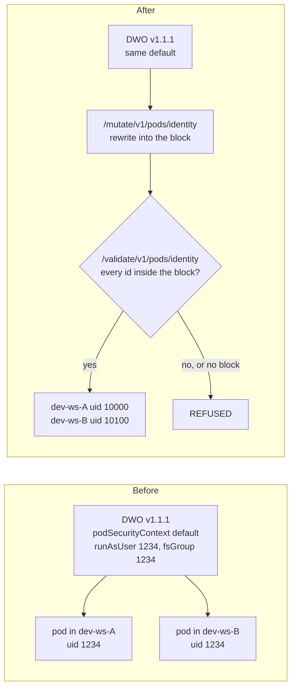
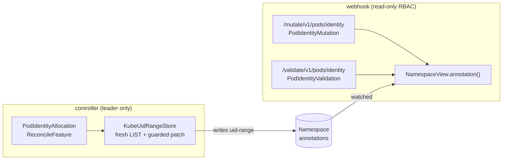
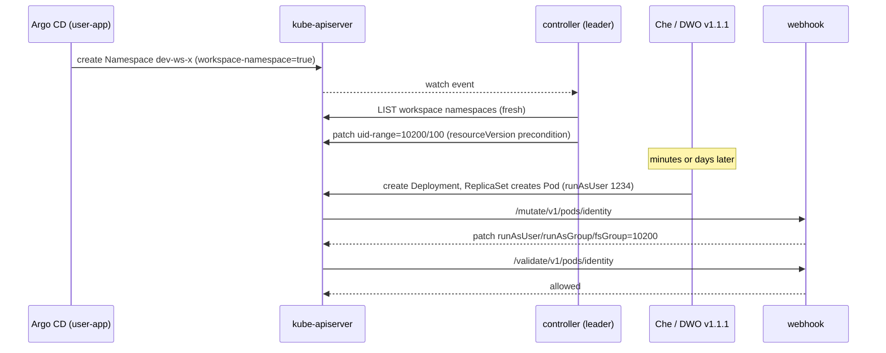
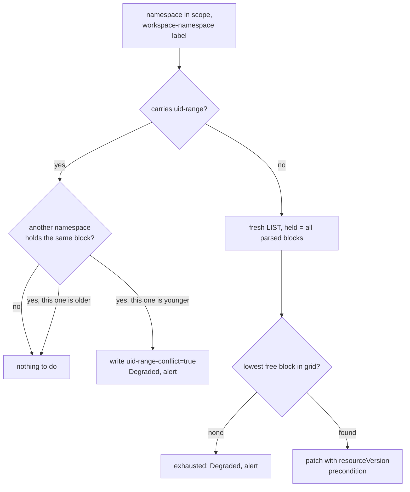
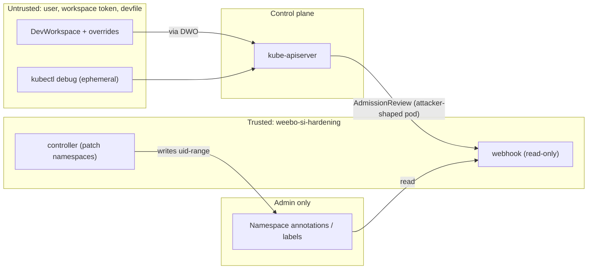

# RFC 0018 — namespace UID range

> Reference material: past 4 000 words. Read *Summary*, *Motivation*, *Goals and non-goals* and
> *Unresolved questions* for the decision; the rest is the argument.

## Summary

`podIdentity` gives every workspace namespace its own block of Unix ids and makes every pod in
that namespace run inside it. The controller hands each namespace in scope the lowest free block
of 100 ids between 10000 and 65535 and records it as the namespace annotation
`hardening.weebo.io/uid-range: <start>/<size>`. A mutating Pod webhook sets the pod's
`runAsUser`, `runAsGroup` and `fsGroup` to the block's first id; a validating Pod webhook refuses
any id outside the block, and refuses every pod of a namespace that has no block yet. Today every
workspace of every user runs as uid 1234; after this RFC, `dev-ws-batleforc` runs as 10000 and
`dev-ws-batleforc-test` as 10100, on their volumes, in their processes, and in any log that
records a uid.

It is a new feature, a crate pair `weebo-si-pod-identity` + `weebo-si-pod-identity-adapters`,
independent of `podSecurity` ([RFC 0013](./0013-pod-security.md)), and it works with and without
user namespaces (`hostUsers: false`), which it does not set.

### Before / after

```text
# before: two users, one identity               # after: one block per namespace
dev-ws-batleforc       $ id                     dev-ws-batleforc       $ id
uid=1234 gid=0(root) groups=0(root),1234        uid=10000 gid=10000 groups=10000
dev-ws-batleforc-test  $ id                     dev-ws-batleforc-test  $ id
uid=1234 gid=0(root) groups=0(root),1234        uid=10100 gid=10100 groups=10100
```



The pod DevWorkspace Operator builds is **rewritten** at the pod level; a container that asks for
an id outside its namespace's block is **refused**.

## Motivation

1. **Every workspace runs as the same uid.** DevWorkspace Operator v1.1.1's Kubernetes default
   pod security context is `runAsUser: 1234`, `runAsGroup: 0`, `fsGroup: 1234` [R16], and the
   pinned DWOC sets no `podSecurityContext` [R24], so that default is what every workspace pod
   gets. *Falsifiable*: `id` in a workspace of `dev-ws-batleforc` and of `dev-ws-batleforc-test`
   prints the same `uid=1234`.
2. **Unix permissions separate nothing between two users.** A file written by one workspace
   belongs to the same uid as every other workspace's files: on any volume two pods could share,
   in any node path a process reaches after an escape. *Falsifiable*: after an escape (T-30) or
   on a shared mount, uid 1234's files are writable by every other workspace.
3. **A uid in a log does not say which namespace acted.** Node-side records (kernel audit,
   process accounting, files left on the node) carry a uid and nothing else; 1234 names every
   workspace at once. KubeArmor events already carry the namespace, so the gain there depends on
   V-07 (see Q5). *Falsifiable*: a node-side record with uid 1234 cannot be
   attributed.
4. **The fix cannot come from the DWOC.** One DWOC serves every namespace [R24], and a single
   value there gives the same uid everywhere again. DWO merges a DWOC's `podSecurityContext` onto
   its default with a strategic merge patch [R17], so even an empty one keeps 1234.
5. **The plan's own example range breaks user namespaces.** With `hostUsers: false` only ids
   0–65535 inside the pod are valid [R20]; the OpenShift-style `1010000/10000` from the plan [R28]
   would make every file owned by the overflow id and unmodifiable. Phase 5 of the plan turns
   user namespaces on later [R28], so the range must already fit.

**Outcome we are buying:** two workspace namespaces never share a uid or a gid, every pod in a
workspace namespace runs inside its namespace's block however it was created, a namespace without
a block runs nothing, and the block is the same for the namespace's whole life.

## Goals and non-goals

**Goals:** one stable, non-overlapping block per workspace namespace; every pod in scope runs
inside it; fail closed; `Off`, `DryRun`, `Enforce` independent of the PSA level.

**Non-goals:**

- **Setting `hostUsers: false`.** A DWOC field, owned by `dwocPin` and the pinned DWOC, decided
  in phase 5 [R28]. This RFC must work with and without it.
- **Choosing the PSA level.** `restricted` is RFC 0013's and V-10's call; this feature only sets
  `runAsNonRoot: true`, which `restricted` also needs.
- **Chowning existing volumes.** That needs a root container writing into user volumes, the
  opposite of the plan; migration is a runbook (*Operational considerations*).
- **Per-team ranges, or a block size per namespace.** One grid for the cluster; nothing asks for
  more.
- **Pods outside workspace namespaces.** The webhooks select on
  `hardening.weebo.io/workspace-namespace`, like every Pod webhook of this repo [R6][R7].
- **OpenShift.** The SCC already allocates a range per namespace (`openshift.io/sa.scc.uid-range`)
  [R28]; leave the feature `Off` there.
- **A new CLI command.** `kubectl` reads the annotation; see *Mocks*.
- **Changing `passwd-append`.** Without gid 0 it cannot write `/etc/passwd` and becomes a
  no-op with a `WARN` on this path [R14][R37]; the passwd entry comes from the runtime or from
  nss_wrapper in the image, decided by V-27 (*Guide-level explanation*).

## Guide-level explanation

The feature starts `Off`. The admin adds one block to the `WeeboSiConfig`:

```yaml
spec:
  features:
    podIdentity:
      mode: DryRun
      namespaceSelector:          # the rollout knob: the test namespace first
        matchLabels:
          kubernetes.io/metadata.name: dev-ws-batleforc-test
      range:
        start: 10000              # first id handed out; 0 is never in a block
        end: 65535                # exclusive; must be <= 65536 (user namespaces)
        blockSize: 100            # ids per namespace; (65535-10000)/100 = 555 blocks
      grantGroupZero: false       # last resort, see below; true grants write on every
                                  # group-0-writable (g=u) file of every workspace image
```

There is no team block: a team does not change which ids a namespace gets.

**What the controller does.** For each namespace in the feature's scope that carries
`hardening.weebo.io/workspace-namespace` and has no `hardening.weebo.io/uid-range`, it picks the
lowest block no other namespace holds and writes the annotation. A namespace that already has one
keeps it, forever: the controller never rewrites a block, even when `range` changes. The user
namespaces are created by GitOps (`2.helm/user-app`) [R27], long before Che starts a workspace in
them, so the block is there first.

**What the webhooks do, for a pod created in a workspace namespace:**

| Pod | Result |
| --- | --- |
| DWO's workspace pod, `runAsUser: 1234`, `runAsGroup: 0` at pod level | rewritten: `runAsUser`, `runAsGroup`, `fsGroup` = block start; no gid 0 anywhere (unless `grantGroupZero: true`, which adds `0` to `supplementalGroups`) |
| pod-level id already inside the block | kept |
| no pod-level `securityContext` at all | filled the same way, plus `runAsNonRoot: true` and `fsGroupChangePolicy: OnRootMismatch` |
| a container (init, regular or ephemeral) with `runAsUser`/`runAsGroup` outside the block | **refused** |
| a container id inside the block (a sidecar wanting its own uid) | allowed |
| `supplementalGroups` entry outside the block (`0` included, unless `grantGroupZero: true`) | **refused** |
| namespace without a block, or with a malformed one, or in conflict | **refused** |
| namespace outside the feature's scope, or `mode: Off` | untouched, as today |

**Why the pod level is rewritten rather than refused.** DWO always sends `runAsUser: 1234` [R16]
[R17]; refusing it would refuse every workspace. The pod-level identity belongs to the namespace,
so the webhook writes it. What a pod adds on top, per container, is checked and refused.

**No gid 0, and where the passwd entry comes from.** DWO's default puts every workspace in gid 0
[R16]. Images built for arbitrary uids, Che's and Weebo's, make `/etc/passwd`, `/etc/group` and
the home writable by gid 0, "the only identity we are sure to have" [R14]: whoever holds gid 0
can rewrite them. This feature drops gid 0: the primary group is the block's, and no
supplementary 0 is added. The price is that `passwd-append` can no longer write `/etc/passwd`; it
logs `WARN … is not writable, leaving it unchanged` and exits 0 [R37], a no-op on this path. The
arbitrary uid's entry then has to come from somewhere else. The upstream test **V-27** weighed
three mechanisms; it ran on 2026-11-24 on runc and settled the choice: **nss_wrapper** [R39].

1. **The runtime adds it at container start.** CRI-O does: when the uid has no entry and the
   image's `/etc/passwd` is group- or other-writable, it generates a passwd file with the entry
   and bind-mounts it over `/etc/passwd` [R36], from outside the container, so the process needs
   no gid 0 (this is the Red Hat behaviour seen in recent tests). containerd 2.3.7 has no
   equivalent in its source: it only reads `/etc/passwd` to resolve a uid, and falls back to the
   bare uid with gid 0 when there is none [R35]. **V-27 on runc: no entry.** In the real workspace
   image (`che-min-mise:main`, `/etc/passwd` `-rw-rw-r--+ root root`) with uid and gid 54321,
   `id` prints `cannot find name for user ID 54321`, `/etc/passwd` has no `:54321:` line and
   `whoami` fails [R39]. youki was run on 2026-11-24 with the same result (no entry); the result is not expected to
   differ, since the runtime spec is containerd's either way.
2. **nss_wrapper in WeeboDevImage — the chosen mechanism** (the other Red Hat/OpenShift
   pattern). It needs a WeeboDevImage change, listed under *Integration in weebo-si*.
   The entrypoint writes a passwd and a group file into a writable emptyDir or the home and runs
   with `LD_PRELOAD=libnss_wrapper.so`, `NSS_WRAPPER_PASSWD` and `NSS_WRAPPER_GROUP` pointing at
   them [R38]. `getpwuid`, `whoami`, `git`, `ssh` resolve; no group membership is needed.
   Processes that clear `LD_PRELOAD` or are statically linked do not see the entry.
3. **`grantGroupZero: true`** (last resort, default `false`). Adds `0` to `supplementalGroups`
   so `passwd-append` works as on OpenShift. Its field doc says plainly: it grants write on every
   `g=u` file of every workspace image (`/etc/passwd`, `/etc/group`, the home), and every
   namespace shares that group again.

**Existing pods** keep running as 1234 until they restart: admission runs at creation only.

### Validation

| Check | Kind | Where it is seen |
| --- | --- | --- |
| `start >= 1`, `start < end`, `end <= 65536`, `1 <= blockSize <= 65535`, `end - start >= blockSize` | hard error, CEL on the CRD | `kubectl apply` refuses the `WeeboSiConfig` |
| an existing annotation outside the new `range` or off its grid | warning | `Degraded` on `WeeboSiConfig` (`PodIdentityBlockOutsideRange`), log `result=outside_range`; the block is kept |
| range exhausted: a namespace in scope gets no block | warning | `Degraded` (`PodIdentityRangeExhausted`), metric `weebo_si_pod_identity_blocks{state="free"}` = 0, alert |
| two namespaces carry the same block | warning | `Degraded` (`PodIdentityBlockConflict`) naming both namespaces, alert; the later namespace's pods are refused |
| `start < 10000` | warning | `Degraded` (`PodIdentityLowRange`): image users (UDI's 10001, distro users below 1000) may collide |
| `grantGroupZero: true` | warning | `Degraded` (`PodIdentityGroupZeroGranted`) for as long as it is on, and log `result=group_zero_granted` at each pod: an opt-in that weakens the default is never silent |

`Degraded` is on the `WeeboSiConfig` status, where every feature reports, and in ClickStack
through the controller logs.

### Mocks

The allocation, as the admin reads it (nominal, one namespace in scope during the pilot):

```text
$ task k -- get ns -l hardening.weebo.io/workspace-namespace \
    -o custom-columns='NAME:.metadata.name,UID-RANGE:.metadata.annotations.hardening\.weebo\.io/uid-range'
NAME                    UID-RANGE
dev-ws-batleforc        <none>
dev-ws-batleforc-test   10000/100
```

The same command before `Enforce` prints `<none>` on every row (empty state). It decides that no
CLI is needed.

`DryRun` controller log (nothing written):

```text
INFO  feature=pod-identity mode=DryRun ns=dev-ws-batleforc-test result=would_allocate block=10000/100
INFO  feature=pod-identity mode=DryRun ns=dev-ws-batleforc-test resource=Pod name=workspace4f…-7d9c result=would_rewrite from=1234/0/1234 to=10000/10000/10000
WARN  feature=pod-identity mode=DryRun ns=dev-ws-batleforc-test resource=Pod name=workspace4f…-7d9c result=no_block
```

In `DryRun` the namespace has no annotation yet, so every pod also logs `no_block`: `DryRun`
measures the container-level ids pods carry and the allocation plan, not the refusal of
unallocated namespaces.

The refusal, a container asking for 1234 through a devfile `container-overrides` attribute, as
it lands on the workspace's ReplicaSet and in the DevWorkspace status:

```text
$ task k -- get events -n dev-ws-batleforc-test --field-selector reason=FailedCreate
Warning  FailedCreate  replicaset/workspace4f…-7d9c  Error creating: admission webhook
  "pod-identity-validate.hardening.weebo.io" denied the request: pod-identity: container "tools":
  securityContext.runAsUser=1234 is outside this namespace's block 10000-10099
```

The same with a direct pod, as an admin (exit code 1):

```text
$ task k -- run -n dev-ws-batleforc-test probe --image=<angos image> --restart=Never \
    --overrides='{"spec":{"containers":[{"name":"probe","image":"<angos image>","securityContext":{"runAsUser":0}}]}}'
Error from server (Forbidden): admission webhook "pod-identity-validate.hardening.weebo.io"
  denied the request: pod-identity: container "probe": securityContext.runAsUser=0 is outside
  this namespace's block 10000-10099
```

A namespace without a block (error state):

```text
Error creating: admission webhook "pod-identity-validate.hardening.weebo.io" denied the request:
  pod-identity: namespace dev-ws-new has no UID block yet; the controller allocates one within
  seconds of the namespace's creation, retry, or ask an admin if it persists
```

A namespace in conflict. The message names no other namespace: a namespace name is a username
(*Data and privacy*); the controller log names both for the admin:

```text
Error creating: admission webhook "pod-identity-validate.hardening.weebo.io" denied the request:
  pod-identity: this namespace's UID block 10000/100 is also held by another namespace; an admin
  must resolve it (runbook: pod-identity)
```

## Design

### Contract

#### `spec.features.podIdentity`

| Field | Rust-ish type | Default | Meaning |
| --- | --- | --- | --- |
| `mode` | `Mode` (`Off`\|`DryRun`\|`Enforce`) | — | required, per the chassis |
| `namespaceSelector` | `Option<LabelSelector>` | none | per the chassis |
| `range.start` | `u32` | `10000` | first id of the first block |
| `range.end` | `u32` | `65535` | exclusive; CEL `<= 65536` |
| `range.blockSize` | `u32` | `100` | ids per block; changing it after the first allocation affects new blocks only (Q6) |
| `grantGroupZero` | `bool` | `false` | add `0` to `supplementalGroups`; grants write on every `g=u` file of the image (Q3) |

`Features` gains `pub pod_identity: Option<PodIdentityConfig>` beside `pod_security` [R1].

#### Namespace annotations (written by the controller only)

| Key | Value | Meaning |
| --- | --- | --- |
| `hardening.weebo.io/uid-range` | `<start>/<size>`, decimal, e.g. `10000/100` | the block; never rewritten |
| `hardening.weebo.io/uid-range-conflict` | `true` | this namespace's block is also held by an older namespace; its pods are refused |

Parse rule (one function, `UidBlock::parse`, fuzzed): two decimal `u32` without sign or leading
`+`, `size >= 1`, `start >= 1`, `start + size <= 65536`. Anything else is "no block".

#### Webhooks

| Name | Path | Rules | `failurePolicy` | Notes |
| --- | --- | --- | --- | --- |
| `pod-identity-mutate.hardening.weebo.io` | `/mutate/v1/pods/identity` | `pods` CREATE | `Fail`, fixed | `reinvocationPolicy: IfNeeded`; never denies |
| `pod-identity-validate.hardening.weebo.io` | `/validate/v1/pods/identity` | `pods` CREATE, UPDATE; `pods/ephemeralcontainers` UPDATE | `Fail`, fixed | the gate |

Both: `namespaceSelector` `hardening.weebo.io/workspace-namespace Exists` and
`hardening.weebo.io/exclude DoesNotExist`, as the existing Pod webhooks [R6][R7]; no
`objectSelector` (a pod label is user-writable [R7]). Chart value
`podIdentity.webhooks.enabled` (default `true`) registers them, with the same two-step upgrade
note as `imageRewrite.webhooks.enabled` [R8].

#### Metrics

| Metric | Labels | Meaning |
| --- | --- | --- |
| `weebo_si_pod_identity_blocks` (gauge) | `state` = `allocated`\|`free`\|`conflict` | bounded, no namespace label |
| `weebo_si_pod_identity_allocations_total` | `result` = `allocated`\|`would_allocate`\|`conflict`\|`exhausted`\|`error` | controller |
| `weebo_si_admission_requests_total`, `weebo_si_admission_duration_seconds` | existing, `feature="pod-identity"` | the chassis's own [R2] |

No exit code changes; `weebo-si-operator features` lists `pod-identity` (RFC 0018, `Namespace,
Pod`) [R29].

### Architecture

**Hexagonal: yes.** All three criteria of `hexagonal.md` hold: a real decision (the allocation,
in/out of block, conflict), the Kubernetes API, and both wanted tested without it. The fake
namespace store is smaller than the real one.

- `crates/weebo-si-pod-identity` (domain): `UidBlock`, `Grid`, `allocate(grid, held) ->
  Option<UidBlock>` (lowest free), `NamespaceSubject` + `PodIdentityAllocation:
  ReconcileFeature` [R3], `PodSubject` + `PodIdentityMutation: Feature` and
  `PodIdentityValidation: Feature` returning `Decision` [R2]. Port: `UidRangeStore` (list held
  blocks fresh, write one annotation with a precondition).
- `crates/weebo-si-pod-identity-adapters`: `KubeUidRangeStore`, the controller loop, the metrics,
  and `admission_routes()` with the two handlers, merged in the composition root beside
  image-policy's [R30].

**Why its own two paths, not the existing Pod routes.** `/mutate/v1/pods` already exists: it is
RFC 0017's image rewrite, which never denies, accepts `UPDATE` and takes its `failurePolicy` from
the admin-chosen `imagePolicy.podWebhook.failurePolicy` [R5][R6][R8]. `/validate/v1/pods` takes
the same value [R7]. A second registry on either would make this identity check fail open the
day an admin sets `Ignore` for images. RFC 0017 met the same choice on DevWorkspaces and gave its
rewrite its own path beside dwoc-pin's [R15]; this follows it. (This deviates from the
coordinator's draft, see Q2.)



The graph proves the single-writer rule: only the controller writes the annotation, the webhook
only reads it through the namespace watch it already has [R9], so the webhook gains no RBAC.



The sequence proves the ordering the fail-closed rule relies on: the block exists before any pod,
because the namespace is created by GitOps well before Che uses it [R27].



**Invariant:** *because the controller is the only writer, allocates under the leader lease
[R10] from a fresh LIST rather than its cache, and writes one namespace per step with a
`resourceVersion` precondition, two namespaces cannot be given the same block by this operator;
a duplicate can only come from outside (a restored namespace, a hand edit), and then the younger
namespace runs nothing.*

### Data and state

- **State:** the annotation on each namespace. No ConfigMap, no CR, no cache of its own. The
  free list is recomputed from a LIST at each allocation (≤ 555 objects).
- **Lost:** a namespace deleted takes its block with it; the block is free for the next
  namespace (lowest free, Q4). An annotation removed by hand makes the controller
  allocate again, possibly a different block: the PVC's files then belong to the old uid
  (Q8).
- **Stale:** the webhook reads the namespace through its watch; in the seconds between the
  controller's write and the watch event, pods of that namespace are refused and the ReplicaSet
  retries. Backup and restore: the annotation travels with the namespace in any backup of the
  Namespace object; a restored copy next to its original is the conflict case.
- **`Off`:** no allocation, no mutation, no refusal. The annotations stay: they are inert
  without the webhooks, and removing them would hand a block that files already carry to the
  next namespace. This is the one point where `Off` is not a full teardown, argued in
  *Operational considerations*.

### Detailed design

| File | Change |
| --- | --- |
| `crates/weebo-si-crd/src/spec.rs` | `Features::pod_identity` [R1]; new `crates/weebo-si-crd/src/pod_identity.rs`: `PodIdentityConfig`, `UidRangeConfig` with CEL rules |
| `crates/weebo-si-pod-identity/src/model/block.rs` | `UidBlock { start: u32, size: u32 }`, `parse`, `contains(u32)`, `Display` |
| `crates/weebo-si-pod-identity/src/model/grid.rs` | `Grid::from(&UidRangeConfig)`, `allocate(&self, held: &BTreeSet<UidBlock>) -> Option<UidBlock>`, `on_grid(UidBlock) -> bool` |
| `crates/weebo-si-pod-identity/src/feature/allocation.rs` | `PodIdentityAllocation`, `desired()` = `Allocate(UidBlock)` \| `Keep` \| `Conflict` \| `Exhausted` |
| `crates/weebo-si-pod-identity/src/feature/pod.rs` | `PodIdentityMutation::evaluate` (mutations on `/spec/securityContext/*`), `PodIdentityValidation::evaluate` (walks `containers`, `initContainers`, `ephemeralContainers`, pod level, `supplementalGroups`) |
| `crates/weebo-si-pod-identity/src/port.rs` | `UidRangeStore` |
| `crates/weebo-si-pod-identity-adapters/src/{store,controller,admission,metrics}.rs` | the adapters; `admission_routes(&shared)` |
| `crates/weebo-si-operator/src/{webhook_cmd,controller_cmd,features}.rs` | composition root: merge routes [R30], start the loop, register the descriptor [R29] |
| `charts/weebo-si-operator/templates/mutatingwebhookconfiguration.yaml`, new `validatingwebhookconfiguration-identity.yaml` | the two webhooks |
| `charts/weebo-si-operator/templates/rbac.yaml`, `values.yaml` | `podIdentity.rbac.enabled` (controller `patch namespaces`, as RFC 0013 [R11]), `podIdentity.webhooks.enabled` |

**DWO's other pods.** The PVC cleanup Job, the async-storage Deployment and the backup CronJob all
copy the workspace `podSecurityContext` [R18], so they arrive with `runAsUser: 1234` and are
rewritten into the block like the workspace pod. That is what they need: the cleanup Job deletes
files the workspace (block uid) wrote. Files still owned by 1234 from before the migration are
deletable through the group, since `fsGroup` re-groups the volume on mount. The e2e suite
asserts that a cleanup Job completes (observation 6 below).

**DWO's own override restrictions** refuse `runAsUser=0` in `pod-overrides` and
`container-overrides` on Kubernetes [R19]. That is a layer in front of ours, not a substitute: it
does not see 1234 or another namespace's block, and it does not see pods DWO did not build.

### Proof against a real client

**Consumers, pinned:** Che dashboard `ghcr.io/weebo-si/che-dashboard:develop` (floating tag: the
run records the image digest), DevWorkspace Operator `v1.1.1` (commit `bdd4530`) [R16],
`kubectl` against Kubernetes 1.36.2, containerd 2.3.7 [R25]; and the kind + Che e2e cluster of
`crates/weebo-si-e2e`.

1. **Allocation.** With `mode: Enforce` scoped to both namespaces, the mock command prints
   `dev-ws-batleforc 10000/100` and `dev-ws-batleforc-test 10100/100` (or the reverse, by
   reconcile order), and `weebo_si_pod_identity_blocks{state="allocated"}` reads 2.
2. **Two identities, no gid 0.** A workspace started from the dashboard in each namespace: `id`
   prints `uid=10000 gid=10000 groups=10000` in one and `uid=10100 gid=10100 groups=10100` in the
   other; `test -w /etc/passwd` fails; `whoami` answers in both through nss_wrapper (`echo
   $LD_PRELOAD` names `libnss_wrapper.so`); the workspace log shows passwd-append's `WARN … is not
   writable` [R37].
3. **Refusals, three ids.** A devfile with `container-overrides` setting `runAsUser` to `1234`,
   then to `70000`, then to `10000` in `dev-ws-batleforc-test` (another namespace's block):
   each workspace stays `Starting`, and the ReplicaSet event carries the exact message of the
   mock, `securityContext.runAsUser=1234 is outside this namespace's block 10100-10199`. A
   direct pod with container-level `runAsUser: 0` as admin exits 1 with the same message. No pod
   object exists afterwards (`get pod probe` → `NotFound`): the refused pod never ran.
4. **Volume ownership.** In a fresh workspace, `touch /projects/x && ls -n /projects/x` prints
   owner `10100` and group `10100`.
5. **No block, no pod.** A namespace created with the label while the controller is scaled to 0:
   a pod creation is refused with the "no UID block yet" message; once the controller is back,
   the ReplicaSet's next retry is admitted.
6. **DWO's cleanup Job.** Deleting a workspace runs DWO's PVC cleanup Job; its pod shows
   `runAsUser: 10100` and the Job completes.
7. **Annotation is not the user's.** `kubectl annotate ns dev-ws-batleforc-test
   hardening.weebo.io/uid-range=10000/100 --overwrite` as `labsso:batleforc-test@weebo.internal`
   is `Forbidden` [R22] (T-12).
8. **V-27, the passwd entry (run 2026-11-24, runc).** A pod in `dev-ws-batleforc-test`, image
   `che-min-mise:main` (its `/etc/passwd` is `g=u`), `runAsUser: 54321`, `runAsGroup: 54321`, no
   gid 0, no nss_wrapper: `id` → `cannot find name for user ID 54321`, `grep :54321:
   /etc/passwd` → nothing, `whoami` → `No such id: 54321` [R39]. Result: **FAIL on runc, no
   entry**, so containerd provides nothing and nss_wrapper is required; youki: same (2026-11-24). To
   repeat with the nss_wrapper image once built: `whoami` prints the name.

**Suites:** e2e `crates/weebo-si-e2e/tests/pod_identity.rs` (observations 1–6 on kind + Che);
envtest cases in `crates/weebo-si-operator/tests/admission_envtest.rs`. **Cluster ids:** T-11
(obs. 3), T-12 (obs. 7), V-05 and V-06 (obs. 2 and 4 repeated with `hostUsers: false` on runc and
youki), V-07 (which uid KubeArmor reports), V-10 (no `restricted` warning caused by this
feature), T-30 (inventory shows the block uid), T-10 (webhook down → refused) [R28], and the
new upstream test V-27 (obs. 8: runc and youki, FAIL = no entry) [R39].

**Deliberately untouched:**

- `hostUsers`, the DWOC and the CheCluster: no field set by this feature.
- RFC 0017's `/mutate/v1/pods` and RFC 0005's `/validate/v1/pods`, their handlers and their
  `failurePolicy` value.
- The DevWorkspace routes and `pod-overrides`: nothing is written into a DevWorkspace.
- PSA labels (RFC 0013), KubeArmor policies (RFC 0006), network policies (RFC 0004).
- `bins/passwd-append`: unchanged, a no-op on this path without gid 0.
- Existing PVC contents: no chown, no Job, no init container from the operator.
- Pods outside namespaces labelled `hardening.weebo.io/workspace-namespace`.

## Security considerations

**Rating:** High — two new admission webhooks on every workspace pod, at `Fail`, and an
allocation whose error would give two users the same identity.



The pod body is attacker-shaped; the namespace annotation is trusted because only an admin and
the operator can write it [R22].

| # | Threat | Where | Mitigation + enforcing fn | Negative test | Residual |
| --- | --- | --- | --- | --- | --- |
| 1 | E: container asks for uid 0, 1234 or another block | devfile `container-overrides`, direct pod | `PodIdentityValidation::evaluate` refuses any container `runAsUser`/`runAsGroup` outside the block | `container_uid_outside_block_is_refused` (0, 1234, other block, 70000) | none |
| 2 | E: ephemeral container with a foreign uid | `kubectl debug`, `pods/ephemeralcontainers` UPDATE | same fn, rule covers the subresource | `ephemeral_container_outside_block_is_refused` | none |
| 3 | E: pod-level id outside the block survives | a later mutating webhook, reinvocation | mutation rewrites; validation (runs after all mutations) refuses pod-level ids outside | `pod_level_outside_block_refused_when_unmutated` | none |
| 4 | E: join another block's files by group | `supplementalGroups`, `fsGroup` | validation: entries in block only (`0` refused unless opted in) | `supplemental_group_of_another_block_is_refused`, `group_zero_refused_by_default` | none by default |
| 5 | T: user writes their own `uid-range` or `exclude` | namespace annotation/label | RBAC: neither user nor workspace SA can patch the namespace [R22] | T-12; e2e obs. 7 | an admin hand-editing it (accepted) |
| 6 | T: duplicate block after a restore | namespace annotations | `PodIdentityAllocation::desired` → `Conflict`, younger namespace refused | `duplicate_block_refuses_the_younger_namespace` | seconds between restore and reconcile where both run |
| 7 | T: malformed annotation read as a block | parser | `UidBlock::parse`, strict; failure = no block = refused | fuzz target `uid_block_parse`; `malformed_annotation_is_no_block` | none |
| 8 | E: pod admitted before allocation | new namespace | validation refuses a namespace with no block; `NamespaceNotObserved` = deny, like `validate_pods` [R5] | `pod_in_namespace_without_block_is_refused` | none |
| 9 | D: webhook unavailable → no workspace pod starts | both webhooks at `Fail` | 2 replicas + PDB required before `Enforce` [R12]; selector limited to workspace namespaces | T-10; envtest `identity_webhooks_skip_excluded_namespaces` | outage of both replicas blocks workspaces (accepted, *Operational*) |
| 10 | I: refusal leaks another user's namespace | admission message | conflict message names no namespace | `conflict_message_names_no_other_namespace` | blocks are guessable, not secret |
| 11 | R: uid cannot be tied to a namespace in node logs | KubeArmor, node audit | one block per namespace, never shared at the same time | V-07 | under `hostUsers: false` node logs may show mapped host ids (Q5); a reused block names two namespaces at two times |
| 13 | E/T: `grantGroupZero: true` — every workspace can rewrite its image's `/etc/passwd`, `/etc/group` and other `g=u` files, and gid 0 is shared across namespaces again | config opt-in | default `false`; `Degraded` while on; mutation adds `0` only when the flag is set | `group_zero_absent_unless_opted_in` | accepted by whoever sets the flag, recorded in the campaign page |
| 14 | S: a process without the nss_wrapper preload sees no passwd entry and falls back to the bare uid | nss_wrapper (mechanism 2) | identity is the uid itself, not the name; separation does not depend on the name | V-27 | tools that need a name and clear `LD_PRELOAD` fail (availability, not security) |
| 12 | E: two allocations race | controller | leader lease [R10], fresh LIST, `resourceVersion` precondition | `concurrent_allocation_retries_on_conflict` (envtest) | none |

- **Privileges.** Controller: `patch namespaces` behind `podIdentity.rbac.enabled`, the same
  verb RFC 0013 and the KubeArmor feature already hold behind their own switches [R11]; RBAC
  cannot narrow it to one annotation key. Webhook: nothing new; the namespace watch exists [R9].
- **Trust boundary.** The `AdmissionReview` pod is attacker-controlled (any field, any number of
  containers); the walk is bounded by the pod's own size limit. The annotation is admin-only.
- **Bypass.** `hardening.weebo.io/exclude` and the workspace label are admin-only (same probe);
  pods created before the webhook is registered keep 1234 until they restart (documented in the
  runbook: stop workspaces before `Enforce`); UPDATE of pod-level ids is impossible
  (immutable), ephemeral containers are covered.
- **Blast radius.** A wrong allocation shares an identity between two users, the very thing this
  closes; a broken webhook stops workspace pods, never other namespaces'.
- **Secrets.** None read; no secret reaches a log.

## Supply chain

No new dependency in this repo: both crates use `kube`, `serde_json` and the chassis already in
`Cargo.lock`; the fuzz target uses the repo's existing `cargo-fuzz` setup. WeeboDevImage (outside this
repo) gains the distribution's `nss_wrapper` package [R38], chosen by V-27 [R39], checked on
2026-11-24 [R40]:

| Dependency | Version | Why this one | Licence | Known CVEs | Maintenance |
| --- | --- | --- | --- | --- | --- |
| `libnss-wrapper` (Ubuntu package of `nss_wrapper`) | upstream 1.1.16; Ubuntu 26.04 `nss-wrapper 1.1.16-5`, `universe` | the only way to resolve an arbitrary uid without group 0 when the runtime adds no passwd entry (V-27); the alternative is writing our own `LD_PRELOAD` shim | BSD-3-Clause | none in NVD (keyword `nss_wrapper`, 0 results) | Samba's cwrap project; release 1.1.16 on 2024-07-05, last commit 2025-07-24, essentially one maintainer (Andreas Schneider) |

The `universe` component means Canonical does not commit to security updates for it: the
WeeboDevImage weekly rebuild and its `trivy` scan are what keep it current. One maintainer is the
real supply-chain risk; it is accepted because the library is small, stable, and replaceable by a
fallback the RFC already describes (opt-in gid 0).

## Data and privacy

New datum: the block, on the namespace. A namespace name is `dev-ws-<username>` [R27], so the
pair (namespace, block) links a uid to a person; that link is the purpose (attribution). It lives
on the Namespace object, read by admins and the operator, and dies with the namespace. Logs carry
the namespace name, as every feature's logs already do, and go to ClickStack under its existing
retention. Metrics carry no namespace label. The conflict refusal names no other namespace. After
a block is reused, old logs with that uid refer to the previous owner: an investigation must join
on time, not uid alone.

## Operational considerations

**Failure modes.**

| Failure | Direction | Why |
| --- | --- | --- |
| webhook down or timing out | closed: workspace pods refused | a floor removable by causing an error is not a floor; same argument as image-policy's Pod half [R7] |
| mutation fails, validation answers | closed: the unrewritten 1234 is refused | security rests on validation; the mutation's `Fail` only makes the error name the right webhook |
| namespace not observed by the webhook | closed | `NamespaceNotObserved` = deny |
| controller down | new namespaces get no block, their pods refused; existing namespaces unaffected | allocation is rare and namespaces are created long before use |
| range exhausted | the new namespace runs nothing, `Degraded` + alert | sharing a block is worse than refusing |

`failurePolicy: Fail` on both, fixed in the chart. Availability: the cluster runs the webhook at
1 replica today [R26] while the chart defaults to 2 with a PDB [R12]; phase 1's "make the
webhook reliable" item [R28] (2 replicas, PDB) **must land before `Enforce`**, or a webhook
restart blocks every workspace start and every reschedule.

**Rollout.** `Off` → `DryRun` (≥ 7 days, logs read for container-level ids and `would_allocate`)
→ `Enforce` scoped by `namespaceSelector` to `dev-ws-batleforc-test` with its workspaces stopped,
then the migration runbook there, then T-11/T-12, then `dev-ws-batleforc`, then all.

**Migration (runbook `pod-identity-migration`).** `fsGroup` re-groups the volume on mount and adds
group read/write; it never changes the owner [R34]; Longhorn RWO volumes honour it (`fsGroupPolicy: ReadWriteOnceWithFSType`) [R23]. Files tools check by owner (`~/.ssh` keys,
`~/.gnupg`) are then refused. Per namespace: stop the workspace; move the namespace out of
`podIdentity`'s `namespaceSelector` (not the global `exclude` label, which would also take it out
of `podSecurity` and `networkProfiles`); run a one-shot Job as root mounting the PVC: `chown -R
<block>:<block>` and `chmod go-rwx` on `~/.ssh`; put the namespace back; start the workspace.
Alternative: recreate the workspace. Tested on `dev-ws-batleforc-test` first.

**Rollback.** `mode: Off`: new pods run as 1234 again; annotations stay; files on the PVC now
owned by the block uid stay group-accessible through `fsGroup: 1234`, owner-checked files need
the runbook in reverse.

**Observability.** Metrics above to ClickStack through the existing OTel scrape; alerts:
`weebo_si_pod_identity_blocks{state="conflict"} > 0` (page), `state="free"` below 10 % (ticket),
`allocations_total{result="exhausted"}` increase (page), refusal rate by `feature="pod-identity"`
(ticket). Every decision logs `feature=pod-identity` with namespace, pod, result.

**Upgrade.** The webhooks are registered by the chart; during a roll from a release without the
paths, old webhook pods answer 404 under `Fail`. Same two-step as RFC 0017 [R8]: upgrade with
`podIdentity.webhooks.enabled=false`, then with the default. Controller roll: the lease hands over
[R10]; the new leader's allocation LISTs fresh, so a write by the old leader is never missed.

**Capacity.** 555 blocks with the default grid; 2 namespaces today. One annotation lookup in an
in-memory cache per pod, no apiserver call; `perf_envtest.rs` gains the two paths beside
`/mutate/v1/pods` p50/p99 [R32]. One LIST of workspace namespaces per allocation.

## Other concerns

- **Accessibility:** no UI; the refusal text is plain, names the field and the block.
- **i18n:** admission messages are English, as every other webhook of this repo.
- **Compliance:** strengthens per-user separation and attribution (ISO 27001 A.8.2/A.8.15
  evidence: `id` per namespace, campaign page).
- **Licensing:** nothing new.
- **Documentation:** `docs/bricks/pod-identity.md`, `docs/weebosiconfig.md` (`podIdentity`), the
  install checklist (webhook HA first), the weebo-si runbook and campaign page.

## Alternatives considered

| Alternative | Rejected because |
| --- | --- |
| Do nothing | motivations 1–3 stand; user namespaces alone separate host ids, not volume or in-container ids [R20] |
| Extend `podSecurity` (the plan's other option) | `podSecurity` only writes namespace labels from a reconcile [R13]; this needs allocation state, a Pod mutation and a Pod validation, and staging "`restricted` without UID ranges" or the reverse would be impossible under one `mode` |
| The plan's literal range `1010000/10000` | ids above 65535 cannot be mapped under `hostUsers: false` [R20]; phase 5 turns it on |
| DevWorkspace `pod-overrides` | only DevWorkspace pods (not DWO's cleanup Jobs or any other pod in the namespace), and the workspace token can patch the DevWorkspace [R22], so a user-written override competes with ours |
| One DWOC per namespace through `dwocPin` | 555 copies of a che-operator-generated object that drift [R28] |
| Block = hash of the namespace name | no state, but with 555 blocks two of 30 namespaces collide with ~55 % probability |
| An allocation record of our own (ConfigMap/CR) | a second source of truth to reconcile with the annotation; the RBAC fact already protects the annotation [R22] |
| Kyverno mutate policy | a second admission engine for one rule, still needing the allocator, and already part of the reboot admission cycle [R28] |
| A second registry on the existing Pod routes | the routes' `failurePolicy` is the admin's image choice [R7][R8]; see Q2 |
| Operator chowns existing PVCs | a root container writing into user volumes from the operator |

## Drawbacks and risks

- Two more webhooks at `Fail` on the workspace path: more admission latency and one more reason a
  workspace does not start.
- `Off` does not remove what it wrote; the annotations outlive the feature by design.
- Migration is manual per namespace, and owner-checked files break without it.
- Reused blocks make historical uids ambiguous without a time join.
- The design relies on GitOps creating namespaces long before use; a flow that creates the
  namespace and the workspace at once would see a few refused pod creations before the retry.

## Unresolved questions

### Resolved

| # | Question | Decision |
| --- | --- | --- |
| D1 | New feature or extend `podSecurity`? | **New feature `podIdentity`, crate pair `weebo-si-pod-identity` + `-adapters`.** Allocation state, a Pod mutation and a Pod validation, rollable back and dry-run independently of the PSA level. |
| D2 | Who allocates, where is it recorded? | **The leader controller, as `hardening.weebo.io/uid-range: <start>/<size>`, range 10000–65535, blocks of 100, lowest free wins, never rewritten, duplicates → `Degraded` and the younger namespace refused.** Under 65536 so it fits user namespaces [R20]; one writer, so no race. |
| D3 | How is the annotation protected? | **By RBAC alone: neither the user nor the workspace SA can patch the namespace [R22]; T-12 is the negative test; an admin hand-editing it is accepted residual.** A second record would be a second truth. |
| D4 | Where is it enforced? | **At the Pod, not via `pod-overrides`.** The Pod is the last point every path crosses (as OpenShift's SCC); DWO's cleanup/async/backup pods copy the same security context [R18] and are rewritten like the workspace. |
| D5 | `failurePolicy` of the mutating webhook? | **`Fail`, namespace selector limited to workspace namespaces plus the exclusion label.** Depends on webhook HA (2 replicas + PDB) landing before `Enforce`. |
| D6 | Chown existing PVCs automatically? | **No: runbook, tested on `dev-ws-batleforc-test` first.** A root container in user volumes is the opposite of the plan; `fsGroup` fixes the group, not the owner. |
| D7 | Set `hostUsers: false` here? | **No: a DWOC field for phase 5.** This feature works with and without; the < 65536 bound is what makes it compatible. |
| D8 | The `/etc/passwd` entry? | **`passwd-append` (RFC 0001), unchanged.** It writes the entry for whatever uid it runs as [R14]. |
| Q1 | (was Still open 1) Pod-level ids: rewrite or fill when absent? | **Rewrite pod-level ids outside the block; refuse container-level ones.** DWO always sends `runAsUser: 1234` and a DWOC cannot remove it [R16][R17]; "fill when absent" would never fire. Deviation from D4's draft wording, accepted as recommended. |
| Q2 | (was Still open 2) Own paths, or registries on the existing Pod routes? | **Own paths `/mutate/v1/pods/identity` and `/validate/v1/pods/identity`, `Fail` fixed.** The existing routes take the admin's image `failurePolicy` [R7][R8] and would fail open under `Ignore`. Accepted as recommended. |
| Q3 | (was Still open 3) Primary group, and gid 0? | **`runAsGroup` = the block's first id, and no supplementary gid 0 by default; the passwd entry comes from nss_wrapper in WeeboDevImage; gid 0 only behind `grantGroupZero` (default `false`), the documented last resort.** Went against the draft's recommendation (block + supplementary 0): maximise separation; gid 0 grants write on every `g=u` file of the image [R14]. V-27 (runc, 2026-11-24) showed containerd adds no entry, unlike CRI-O [R36][R39], so the runtime mechanism is out. |
| Q4 | (was Still open 4) Reuse of a freed block? | **Lowest free.** PVCs die with the namespace and storage is RWO-only; the residual (old logs, restored backups) is joined on time. |
| Q5 | (was Still open 5) Which uid does KubeArmor report under user namespaces? | **Ship regardless; V-07 settles the claim in the campaign page.** Files and in-container ids are separated whatever V-07 shows. V-07 ran on 2026-11-24 (runc, `hostUsers: false`): the `net_raw` Block held, and KubeArmor reported the node-side mapped uid `1094909952`, not the container uid, so under user namespaces motivation 3 holds for files and in-container logs only, not for KubeArmor events. |
| Q6 | (was Still open 6) Is 100 ids enough per namespace? | **`blockSize: 100`, configurable only before the first allocation.** Blocks are never rewritten; nothing asks for more than a handful of ids. |
| Q7 | (was Still open 7) DWO pods other than the workspace? | **Add the backup CronJob to the e2e suite when backups are switched on.** Source already shows it copies the workspace security context [R18]. |
| Q8 | (was Still open 8) A lost annotation on an old namespace? | **Allocate anyway, log `result=allocated_late`, and set `Degraded` when the namespace already holds PVCs, pointing to the runbook.** Refusing would block the namespace; a silent reallocation would hide the orphaned owner. |

### Still open

9. **Is `$HOME` writable without gid 0? (reopens Q3's consequences, not its decision)** Probe of
   2026-11-24 [R41]: the `che-browser` sidecar image, under `restricted` and `hostUsers: false`,
   runs Chrome steadily as `1234:0` but crash-loops as `54321:54321` (39 restarts in 40 s,
   `chrome_crashpad_handler: --database is required`), because the image's `/home/user` is
   `drwxrwx--- user:root`: only group 0 can write it. nss_wrapper fixes the name, not the
   directory mode. In a real workspace `persistUserHome` is on in Che's DWOC [R42], so
   `/home/user` should be a PVC whose group is the `fsGroup` (the block's gid) — **if** DWO
   mounts it in every container, sidecars included. That is the new upstream test **V-28**.
   Options if V-28 fails: (a) a writable `HOME` per sidecar (`emptyDir`, set in the devfile
   component), (b) images whose `HOME` does not rely on group 0 (`chmod` at build to a mode
   `fsGroup` can satisfy), (c) the `grantGroupZero` opt-in. **Recommendation: keep Q3 (no gid 0
   by default); run V-28 before `Enforce`; prefer (a) for sidecars, (c) only per namespace as a
   recorded exception.**

## Future work

- Auto-detect OpenShift (`security.openshift.io/v1`) and report `Degraded` if enabled there.
- A `weebo-si-operator pods identity` audit if `kubectl` columns stop being enough.
- Per-team block size, if a team ever needs many distinct uids.

## Test plan

- **Unit (domain):** `allocate_picks_lowest_free`, `allocate_skips_off_grid_blocks`,
  `allocate_returns_none_when_exhausted`, `block_parse_rejects_sign_overflow_and_zero`,
  `container_uid_outside_block_is_refused`, `ephemeral_container_outside_block_is_refused`,
  `pod_level_uid_rewritten_into_block`, `pod_level_inside_block_is_kept`,
  `pod_level_outside_block_refused_when_unmutated`,
  `supplemental_group_of_another_block_is_refused`, `pod_in_namespace_without_block_is_refused`,
  `malformed_annotation_is_no_block`, `conflict_message_names_no_other_namespace`,
  `group_zero_refused_by_default`, `group_zero_absent_unless_opted_in`,
  `duplicate_block_refuses_the_younger_namespace`.
- **Fuzz:** `uid_block_parse`.
- **envtest:** allocation and conflict against a real apiserver
  (`concurrent_allocation_retries_on_conflict`); both webhooks in
  `crates/weebo-si-operator/tests/admission_envtest.rs`, including
  `identity_webhooks_skip_excluded_namespaces`; `perf_envtest.rs` p50/p99 for the two paths.
- **e2e kind + Che:** new `crates/weebo-si-e2e/tests/pod_identity.rs` (obs. 1–6 of the proof).
- **Cluster:** V-05, V-06, V-07, V-10, **V-27** (passwd entry without gid 0, obs. 8: runc and youki FAIL = no entry; re-run with the nss_wrapper image), T-10,
  T-11, T-12, T-30, results on the campaign page.
- **Must stay green:** `pod_security.rs`, `workspace.rs`, `upgrade.rs` (the two-step), the image
  rewrite and image-policy envtests, `perf_envtest.rs` budgets.

## Implementation plan

- [ ] **PR 1 — CRD.** `podIdentity` config (with `grantGroupZero`, default `false`, and its
      warning doc), CEL rules, `docs/weebosiconfig.md`. Inert.
- [ ] **PR 2 — domain crate** `weebo-si-pod-identity`: block, grid, allocation, the two
      admission features, unit tests, fuzz target. No wiring.
- [ ] **PR 3 — controller adapter:** store, loop, conflict annotation, metrics, `Degraded`,
      envtest, RBAC switch (default off). Annotations are written only in `Enforce` and are inert
      without the webhooks.
- [ ] **PR 4 — webhooks:** both handlers, composition root, both chart webhooks in the same PR
      (validation never later than mutation), `podIdentity.webhooks.enabled`, admission and perf
      envtests.
- [ ] **PR 5 — e2e + docs:** `pod_identity.rs` (no gid 0 in `id`, `whoami` resolves),
      `docs/bricks/pod-identity.md`, install checklist, a note in `docs/bricks/passwd-append.md`
      that it is a no-op under `podIdentity` without gid 0.
- [ ] RFC flipped to `Implemented`.

### Estimate

An analogy with the measured RFCs, not a measurement.

| PR | Size | Compared to | Why |
| --- | --- | --- | --- |
| 1 CRD | S (≈ 800) | the CRD part of RFC 0014 | one small config block, CEL |
| 2 domain | M (≈ 3 000) | RFC 0017 (≈ 5 750, mutation in an existing feature) | two admission features + allocator, smaller than a rewrite engine |
| 3 controller | M (≈ 2 500) | RFC 0014's reconcile (≈ 6 800 total) | one annotation per namespace, simpler than two objects |
| 4 webhooks | M (≈ 3 500) | RFC 0017 | two new paths, chart, envtest, perf |
| 5 e2e + docs | M (≈ 2 000) | RFC 0013's e2e | one suite against kind + Che |
| **Total** | ≈ 11 800 | RFC 0013 (≈ 11 500, 2 days) | same shape: new feature + admission + e2e |
| WeeboDevImage nss_wrapper | S (≈ 100) | — | a package and a few entrypoint lines, outside this repo; required by V-27 |
| **Integration and validation on the cluster** | calendar-bound | — | webhook HA first; ≥ 7 days `DryRun`; migration and T-11/T-12 on `dev-ws-batleforc-test`, then `dev-ws-batleforc`; V-05/V-06/V-07 wait on phase 5 |

### Integration in weebo-si

- Prerequisite: `2.argo/helm/che/main/values.yaml` `che.hardening.replicas: 2` [R26] (phase 1).
- Chart version bump in the same file; two-step upgrade with `podIdentity.webhooks.enabled=false`
  first.
- `che.hardening.operator.podIdentity.rbac.enabled: true` (operator switches).
- `2.argo/helm/che/hardening/values.yaml`: `config.features.podIdentity` with `enabled`, `mode`,
  `namespaceSelector` on `dev-ws-batleforc-test` first, `range`.
- `0.docs/content/docs/runbooks/pod-identity-migration.md`: the chown Job, the scope dance,
  rollback.
- **WeeboDevImage change, before `Enforce`:** install `nss_wrapper`; the entrypoint writes a
  passwd and a group file (current uid and gid, name, home) into a writable emptyDir or the home
  and exports `LD_PRELOAD=libnss_wrapper.so`, `NSS_WRAPPER_PASSWD`, `NSS_WRAPPER_GROUP` [R38].
  Without it `whoami` breaks in every workspace (V-27 [R39]). Then V-27 re-run with the new
  image on runc (workspaces stay on runc: youki cannot do user namespaces, V-06, 2026-11-24).
- V-27 added to the validation table of `0.docs/content/todo/durcissement-workspaces.md`.
- Campaign page with V-05, V-06, V-07, V-10, V-27, T-10, T-11, T-12, T-30.

## References

| # | Source | Pinned at | Supports |
| --- | --- | --- | --- |
| R1 | `crates/weebo-si-crd/src/spec.rs:26`, `:54`, `:60` | `c412ee3` | `Features`, `pod_security`, `image_rewrite` fields |
| R2 | `crates/weebo-si-chassis/src/feature/value.rs:98` | `c412ee3` | `Decision<S>` shape, no warnings field |
| R3 | `crates/weebo-si-chassis/src/feature/reconcile.rs:22` | `c412ee3` | `ReconcileFeature::desired` |
| R5 | `crates/weebo-si-image-policy-adapters/src/image_policy.rs:40`, `:42`, `:114`, `:449`, `:534` | `c412ee3` | existing Pod paths, deny on error in `validate_pods`, rewrite never denies |
| R6 | `charts/weebo-si-operator/templates/mutatingwebhookconfiguration.yaml:93`–`132` | `c412ee3` | `/mutate/v1/pods` exists, CREATE+UPDATE, `failurePolicy` from value, selector `Exists` |
| R7 | `charts/weebo-si-operator/templates/validatingwebhookconfiguration-images.yaml:70`–`111` | `c412ee3` | `/validate/v1/pods`, its `failurePolicy` argument, no `objectSelector` |
| R8 | `charts/weebo-si-operator/values.yaml:356`, `:368` | `c412ee3` | `imagePolicy.podWebhook.failurePolicy`; two-step upgrade |
| R9 | `crates/weebo-si-chassis/src/port/namespace_view.rs:21` | `c412ee3` | `NamespaceView::annotation` |
| R10 | `crates/weebo-si-operator/src/controller_cmd.rs:19`, `:136`, `:152` | `c412ee3` | leader lease, loops only on the leader |
| R11 | `charts/weebo-si-operator/templates/rbac.yaml:146`–`172` | `c412ee3` | `patch namespaces` behind per-feature switches |
| R12 | `charts/weebo-si-operator/values.yaml:32`, `:42` | `c412ee3` | webhook `replicaCount: 2`, PDB |
| R13 | [RFC 0013](./0013-pod-security.md) | `c412ee3` | podSecurity writes labels only |
| R14 | [RFC 0001](./0001-passwd-append.md) lines 29, 131, 244 | `c412ee3` | passwd-append needs gid 0 to write `/etc/passwd` |
| R15 | `crates/weebo-si-image-policy-adapters/src/image_policy.rs:43`–`45`, [RFC 0017](./0017-image-rewrite.md) | `c412ee3` | own path beside an existing route (resolved 8) |
| R16 | devfile/devworkspace-operator `pkg/config/defaults.go:116`–`121` | `v1.1.1` (`bdd4530`), read 2026-11-24 | default `runAsUser 1234`, `runAsGroup 0`, `fsGroup 1234` |
| R17 | same repo `pkg/config/sync.go:345`–`346`, `:558`–`576` | `v1.1.1` | DWOC `podSecurityContext` strategic-merged onto the default |
| R18 | same repo `pkg/provision/storage/cleanup.go:158`, `pkg/provision/storage/asyncstorage/deployment.go:68`–`73`, `controllers/backupcronjob/backupcronjob_controller.go:423` | `v1.1.1` | DWO's other pods copy the workspace security context |
| R19 | same repo `pkg/config/defaults.go:129`–`146` | `v1.1.1` | restricted override fields on Kubernetes |
| R20 | <https://kubernetes.io/docs/concepts/workloads/pods/user-namespaces/> | read 2026-11-24 | valid ids 0–65535; outside = overflow, unmodifiable; volume inodes use in-container ids |
| R22 | probe `task k -- auth can-i patch namespace/dev-ws-batleforc-test --as=…` (user and workspace SA) | 2026-11-24 | neither can patch the namespace; SA can patch DevWorkspaces |
| R23 | probe `task k -- get csidriver driver.longhorn.io -o jsonpath='{.spec.fsGroupPolicy}'` → `ReadWriteOnceWithFSType` | 2026-11-24 | `fsGroup` applies to Longhorn RWO volumes |
| R24 | probe `task k -- get dwoc -A -o jsonpath='{…podSecurityContext}'` → empty for `devworkspace-config` and `devworkspace-operator-config` | 2026-11-24 | the pinned DWOC sets no pod security context |
| R25 | probe of cluster versions (images, `kubectl version`) | 2026-11-24 | DWO v1.1.1, Kubernetes 1.36.2, containerd 2.3.7, operator 0.5.0 |
| R26 | weebo-si `2.argo/helm/che/main/values.yaml:88` | working tree 2026-11-24 | the cluster runs the webhook at 1 replica |
| R27 | weebo-si `2.helm/user-app/templates/dev-ns.yaml:14`; probe `task k -- get ns -l hardening.weebo.io/workspace-namespace --show-labels` | 2026-11-24 | namespaces created by GitOps with the label; both test namespaces carry it |
| R28 | weebo-si `0.docs/content/todo/durcissement-workspaces.md` (phase 1 webhook item, phase 5 sections, test protocol) | working tree 2026-11-24 | plan, test ids, OpenShift uid-range analogy, Kyverno admission cycle |
| R29 | `crates/weebo-si-operator/src/features.rs:17` | `c412ee3` | feature descriptor registry |
| R30 | `crates/weebo-si-operator/src/webhook_cmd.rs:183`–`185` | `c412ee3` | adapters' routes merged in the composition root |
| R32 | `crates/weebo-si-operator/tests/perf_envtest.rs:773`–`785` | `c412ee3` | Pod path latency budgets |
| R35 | containerd/containerd `pkg/oci/spec_opts.go:758`–`762` (`WithUserID`) | `v2.3.7` (`6f589cf`), read 2026-11-24 | containerd reads `/etc/passwd`, never writes; unknown uid → bare uid, gid 0 |
| R36 | cri-o/cri-o `server/container_create.go:325`–`343`, `utils/utils.go:208`–`224`, `:313`–`324` | `main` at `232f699` (2026-11-23), read 2026-11-24 | CRI-O generates and bind-mounts a passwd entry when the uid is missing and `/etc/passwd` is group/other-writable |
| R37 | `docs/bricks/passwd-append.md:98`–`99` | `c412ee3` | passwd-append's `WARN` and exit 0 when the entry resolves or the file is not writable |
| R38 | <https://cwrap.org/nss_wrapper.html> | read 2026-11-24 | `LD_PRELOAD=libnss_wrapper.so`, `NSS_WRAPPER_PASSWD`, `NSS_WRAPPER_GROUP` |
| R39 | probe `task hardening:validate -- V-27` (`0.task/scripts/hardening-validate.sh` in weebo-si): pod in `dev-ws-batleforc-test`, image `registry.pkg.weebo.poc/ghcr/batleforc/weebodevimage/che-min-mise:main`, `runAsUser/runAsGroup: 54321`, runc on containerd 2.3.7 | 2026-11-24 ~08:32 UTC+1 | containerd/runc add no passwd entry; `id`/`whoami` fail; youki not tested |
| R40 | `git clone https://git.samba.org/nss_wrapper.git` (`LICENSE`: BSD 3-Clause; tag `nss_wrapper-1.1.16` 2024-07-05; HEAD `9415ad5` 2025-07-24); Launchpad `getPublishedSources` for `nss-wrapper` in `resolute` (`1.1.16-5`, `universe`, Release); NVD `keywordSearch=nss_wrapper` (0 results); WeeboDevImage `che-min-mise:main` `/etc/os-release` = Ubuntu 26.04.1 LTS, no `libnss_wrapper` installed | 2026-11-24 | §Supply chain: licence, version, CVE and maintenance of nss_wrapper |
| R41 | Probe: pods `registry.pkg.weebo.poc/ghcr/batleforc/weebodevimage/che-browser:main` (`NO_START=false`) in a scratch namespace, PSA `restricted`, `hostUsers: false`, `runAsUser/runAsGroup` `1234:0` vs `54321:54321`; `ls -ld /home/user`, count of `chrome exited` in the log after 40 s (0 vs 39) | 2026-11-24 | §Unresolved 9: HOME needs gid 0 in today's images |
| R42 | Probe: `task k -- -n eclipse-che get dwoc devworkspace-config` → `config.workspace.persistUserHome.enabled: true` | 2026-11-24 | §Unresolved 9: HOME is a PVC in a real workspace |
| R34 | <https://kubernetes.io/docs/tasks/configure-pod-container/security-context/> | read 2026-11-24 | `fsGroup` sets group, not owner; `runAsGroup` omitted = gid 0 |

## Changelog

| Date | Change |
| --- | --- |
| 2026-11-24 | Draft |
| 2026-11-24 | Still open 9 added: HOME needs gid 0 in today's images (che-browser probe, V-28) |
| 2026-11-24 | nss_wrapper checked: BSD-3-Clause, 1.1.16, no CVE, Ubuntu 26.04 universe (R40) |
