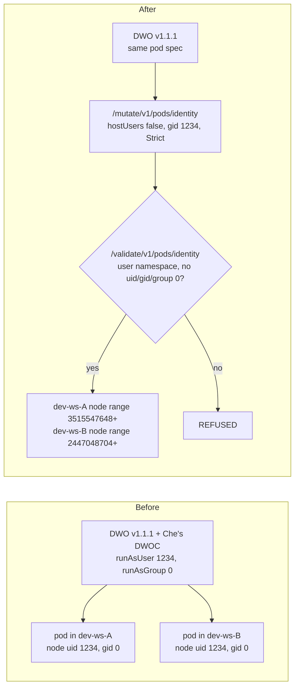
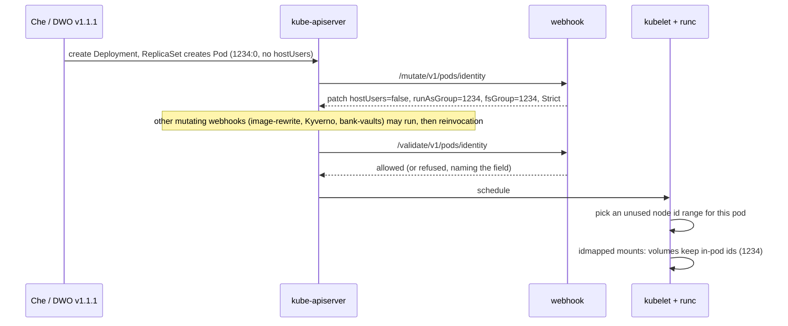
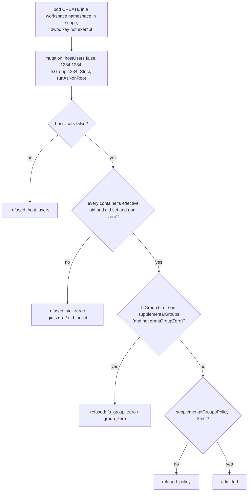
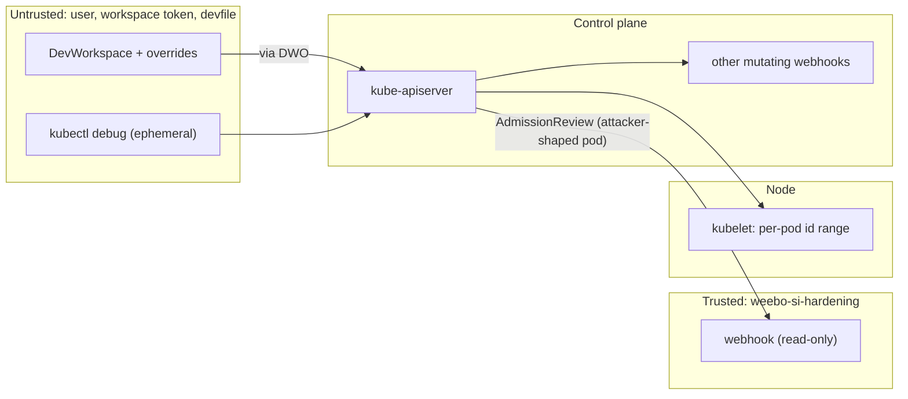

# RFC 0018 — workspace pod identity

> Reference material: past 4 000 words. Read *Summary*, *Motivation*, *Goals and non-goals* and
> *Unresolved questions* for the decision; the rest is the argument. The file keeps its first
> name (`namespace-uid-range`): this RFC began as a per-namespace uid block and was redesigned
> on 2026-11-24 (Q15); files are never renamed.

## Summary

`podIdentity` makes every pod DevWorkspace Operator builds in a workspace namespace run as one
fixed, non-root identity, `1234:1234`, **in its own user namespace** (`hostUsers: false`), with
**no group 0**. A mutating Pod webhook sets `hostUsers: false`, `runAsGroup: 1234`,
`fsGroup: 1234`, `runAsNonRoot: true` and `supplementalGroupsPolicy: Strict` at the pod level; a
validating Pod webhook refuses a pod that shares the node's user namespace, any effective uid or
gid 0, `fsGroup` 0 and any supplementary group 0. The decision is admission-only and stateless:
no allocator, no annotation, no object written.

Separation between users does not come from different uids: the kubelet maps each
user-namespaced pod to its own range of node ids and guarantees that no two pods on a node share
one [R20], so two workspaces both running as 1234 are two different, unprivileged users on the
node (measured: `0 3515547648 65536` and `0 2447048704 65536` for two pods [R58]). The uid
inside the pod stays 1234, the uid the images declare (`useradd -u 1234`, [R60]) and the uid
existing volumes are owned by, so `whoami` keeps working without a passwd mechanism. Not named
`identity`: that feature (RFC 0011) creates users in authentik; this one is the Unix identity of
a pod.

### Before / after

```text
# before: shared node identity, gid 0              # after: own node range per pod, no gid 0
dev-ws-batleforc       $ id                         dev-ws-batleforc       $ id
uid=1234 gid=0(root) groups=0(root),1234            uid=1234(user) gid=1234(user) groups=1234(user)
                       $ cat /proc/self/uid_map                            $ cat /proc/self/uid_map
         0          0 4294967295                             0 3515547648      65536
```

(The left column is a pod without a user namespace, whose map is the identity map; the right
one is measured [R58].)



The pod DWO builds is **rewritten** at the pod level; a pod that keeps the node's user namespace,
or that would run anything as uid, gid or group 0, is **refused**.

## Motivation

1. **Every workspace is the same user on the node.** DevWorkspace Operator v1.1.1's default pod
   security context is `runAsUser: 1234`, `runAsGroup: 0`, `fsGroup: 1234` [R16]; every
   workspace namespace is pinned to Che's own DWOC `eclipse-che/devworkspace-config` [R67],
   which sets no `podSecurityContext` [R24] and no `hostUsers`. Uid 1234 in a workspace is uid
   1234 on the node, for every user at once. *Falsifiable*: `cat /proc/self/uid_map` in any
   workspace prints `0 0 4294967295`, and an escaped process (T-30) can write every other
   workspace's node-side files owned by 1234.
2. **Every workspace is in group 0.** `runAsGroup: 0` [R16], and under the default
   `supplementalGroupsPolicy: Merge` the image's `/etc/group` adds `0(root)` even when the pod
   asks for 1234: che-min-mise puts `user` in `root` [R60]. Group 0 writes every `g=u` file of
   the image, `/etc/passwd` included [R14]. *Falsifiable*: a pod at `runAsGroup: 1234`,
   `Merge`, prints `groups=1234(user),0(root)` and `touch /etc/passwd` succeeds [R58].
3. **A node-side file or kernel-audit uid does not say which workspace acted.** Node files and
   kernel audit carry uid 1234 for every workspace. (KubeArmor events already carry the pod name
   [R46].) *Falsifiable*: a node-side record with uid 1234 cannot be attributed. This RFC solves
   it only while the pod runs (its `uid_map`); keeping the mapping afterwards is Q19's gap.
4. **The fix cannot come from the DWOC alone.** A DWOC sets nominal values, but a devfile's
   `pod-overrides` can change `runAsGroup` (DWO restricts only `runAsUser=0`, [R19] [R44]), DWO's
   other pods and any pod created directly in the namespace never read it, and a che-operator or
   DWO upgrade can change what is merged [R17]. Only the Pod is crossed by every path.

**Outcome we are buying:** no DWO-built pod in a workspace namespace in scope shares the node's
user namespace, none runs with uid, gid, `fsGroup` or supplementary group 0 (unless an admin
sets `grantGroupZero`), and two workspaces are never the same node user — however the pod was
created. Root reached *inside* a pod through a setuid binary is PSA `restricted`'s to close
(`allowPrivilegeEscalation: false`), which is why `restricted` is a precondition of `Enforce`
(L20).

## Goals and non-goals

**Goals:** every DWO-built pod in scope user-namespaced, `1234:1234`, no group 0; fail closed;
`Off`, `DryRun`, `Enforce` of its own; nothing to migrate on volumes.

**Non-goals:**

- **A different uid per namespace or per user.** The first draft allocated a block of 100 uids
  per namespace; under user namespaces the node-side separation it bought already exists per
  pod [R20], and it cost an allocator, a passwd mechanism and a `chown` of every volume (Q15,
  *Alternatives*).
- **Choosing the PSA level.** RFC 0013 sets it. This feature relies on `restricted` being
  enforced before its own `Enforce` (L20) and on `baseline` for `hostPath`, `privileged` and
  added capabilities, which it does not re-check.
- **Build teams' namespaces, for now.** The `build` DWOC keeps `runAsGroup: 0` because
  che-min-mise's entrypoint writes `/etc/subuid` through group 0 [R61]; a namespace whose
  `hardening.weebo.io/dwoc` names an exempt key is left untouched (L27, Q17). The `build` DWOC
  already sets `hostUsers: false` [R61], so build pods have per-pod node ranges today; only
  group 0 keeps them out.
- **Root inside a user namespace.** Pods a workspace creates itself (kubedock's containers, a
  `kubectl run` from the terminal) get 1234 when they set no uid and keep a non-zero uid they
  chose, but never run as 0 (Q21). Testcontainers images that insist on root need a non-root
  variant or kubedock's `--runas-user` [R86].
- **`passwd-append`.** uid 1234 already has its entry (`user`, [R60]); the entrypoint's
  registration only runs when `whoami` fails [R57].
- **Runtime choice.** Workspaces stay on runc: youki cannot run user-namespaced pods (V-06,
  [R45]).
- **Pods outside workspace namespaces.** The webhooks select on
  `hardening.weebo.io/workspace-namespace`, like every Pod webhook of this repo [R6] [R7].
- **OpenShift.** The restricted SCC assigns a uid range per namespace and handles user
  namespaces its own way; leave the feature `Off` there.

## Guide-level explanation

The feature starts `Off`. The admin adds one block to the `WeeboSiConfig`:

```yaml
spec:
  features:
    podIdentity:
      mode: DryRun
      namespaceSelector:          # the rollout knob: the test namespace first
        matchLabels:
          kubernetes.io/metadata.name: dev-ws-batleforc-test
      runAsUser: 1234             # the images' user (useradd -u 1234); never 0
      runAsGroup: 1234            # its own group; never 0
      exemptDwocKeys: [build]     # namespaces pinned to these dwoc-pin keys are left untouched
      grantGroupZero: false       # last resort; true adds group 0 back and grants write on
                                  # every group-0-writable (g=u) file of the image
```

There is no team block: a team does not change the identity a pod gets.

**What the webhooks do, for a pod created in a workspace namespace in scope:**

| Pod | Result |
| --- | --- |
| DWO's workspace pod (`runAsUser: 1234`, `runAsGroup: 0`, no `hostUsers`) | rewritten: `hostUsers: false`, `runAsGroup: 1234`, `fsGroup: 1234` (kept 1234), `fsGroupChangePolicy: OnRootMismatch`, `supplementalGroupsPolicy: Strict`, `runAsNonRoot: true` |
| pod-level `runAsUser`, `runAsGroup` or `fsGroup` absent (a kubedock pod, a `kubectl run`) | set to 1234 (Q21) |
| pod-level `runAsGroup: 0` or `fsGroup: 0` | rewritten to 1234: it is DWO's default, refusing it would refuse every workspace |
| pod-level `runAsUser: 0` | **refused**, not rewritten: nothing sends it by default, so it is a choice to run as root (Q21) |
| pod already in that shape | kept, nothing patched |
| no pod-level `securityContext` at all | filled the same way |
| a non-zero pod-level uid, gid or `fsGroup` other than 1234 (a devfile `pod-overrides` with 10100, as V-28 used; kubedock `--runas-user 999`) | kept: inside its own user namespace any non-zero id is unprivileged, and a uid someone chose is not changed silently (Q21) |
| after every mutation: `hostUsers` not `false`, an effective uid or gid of 0 or unset for any container, `fsGroup: 0`, a `0` in `supplementalGroups`, or a policy other than `Strict` | **refused**, one reason each |
| a container with another non-zero id (a sidecar image built for uid 999) | allowed: it runs inside the pod's own user namespace |
| a new ephemeral container (`kubectl debug`) on a pod still in the node's user namespace (created before `Enforce`) | **refused**: restart the workspace first |
| namespace whose `hardening.weebo.io/dwoc` names a key in `exemptDwocKeys` | untouched (L27) |
| namespace outside the feature's scope, or `mode: Off` | untouched, as today |

`hostNetwork`, `hostPID`, `hostIPC` and `volumeDevices` are refused by the apiserver's own
validation for a pod with `hostUsers: false` [R20]; `hostPath`, `privileged` and added
capabilities are refused by PSA `baseline` (RFC 0013). This feature adds no rule for them.

**Why the pod level is rewritten rather than refused.** DWO always sends `runAsGroup: 0` and no
`hostUsers` [R16]; refusing would refuse every workspace. The nominal values also go into Che's
DWOC once the rollout is complete (*Integration in weebo-si*), after which `rewrites_total` falls
to 0.

**Why 1234 everywhere is enough.** Inside the pod, 1234 is the user every WeeboDevImage declares
[R60]; on the node, each pod is a different range picked by the kubelet, never shared on that
node [R20] [R58]; on volumes, inodes carry the in-pod id, so turning user namespaces on changes
nothing for existing files [R20] (V-05: Longhorn RWO volume writable [R39]; ownership unchanged
is observation 6). What 1234 does *not* give is a different owner on disk per user (*Drawbacks*,
threats 7 and 8).

**What a developer may see break.** Images that write a group-0 directory at runtime lose that
write: che-lgtm's `/data`, che-android's SDK and Appium directories, che-min-mise's
`/home/tooling` and `/globals` [R68]. This is Q20, a prerequisite of `Enforce`; `DryRun` cannot
predict it (every pod reads `would_rewrite`).

**Existing pods** keep the node's user namespace until they restart: admission runs at creation
only.

### Validation

| Check | Kind | Where it is seen |
| --- | --- | --- |
| `runAsUser >= 1`, `runAsGroup >= 1`, both `<= 65535` | hard error, CEL on the CRD | `kubectl apply` refuses the `WeeboSiConfig` (mock below) |
| `grantGroupZero: true` | warning | feature `message` for as long as it is on, and log `result=group_zero_granted` at each pod |
| `mode: Enforce` while no admission request reached the feature for 15 min although workspace pods were created | alert, not a status | `weebo_si_admission_requests_total{feature="pod-identity"}` flat while workspace pods start: the webhooks are probably not registered (`podIdentity.webhooks.enabled`) (L24) |

Warnings leave the feature `Active` (or `DryRun`) and go in its `message`, as image-rewrite does
[R47] (L4); the controller writes the status (L25).

### Mocks

The configuration refused (exit code 1):

```text
$ task k -- apply -f weebosiconfig.yaml
The WeeboSiConfig "cluster" is invalid: spec.features.podIdentity.runAsGroup: Invalid value:
  0: runAsGroup must be between 1 and 65535 (group 0 writes the image's system files)
```

The feature's status: off, nominal, and with the warning:

```text
$ task k -- get weebosiconfig cluster -o jsonpath='{.status.features[?(@.name=="podIdentity")]}' | jq
{ "name": "podIdentity", "state": "Disabled", "message": "mode Off" }
{ "name": "podIdentity", "state": "DryRun", "message": "configuration valid" }
{ "name": "podIdentity", "state": "Active",
  "message": "grantGroupZero is on: group 0 is added to every pod in scope" }
$ task k -- exec deploy/weebo-si-operator-webhook -- weebo-si-operator features | grep identity
pod-identity        RFC 0018   Pod
```

`DryRun` logs, one pair per pod created. The pod's name is not known at admission for a
ReplicaSet pod, so its `generateName` is logged:

```text
INFO  feature=pod-identity mode=DryRun ns=dev-ws-batleforc-test resource=Pod name=workspace4f…-7d9c- result=would_rewrite hostUsers=unset->false runAsGroup=0->1234 supplementalGroupsPolicy=unset->Strict
INFO  feature=pod-identity mode=DryRun ns=dev-ws-batleforc-test resource=Pod name=workspace4f…-7d9c- result=would_allow fixable_by_mutation=host_users,run_as_group,policy
WARN  feature=pod-identity mode=DryRun ns=dev-ws-batleforc-test resource=Pod name=workspace4f…-7d9c- result=would_refuse reason=gid_zero container=tools fixable_by_mutation=false
```

The empty state, once Che's DWOC carries the values: one `result=unchanged` line per pod
created, and no `would_rewrite`. **No line at all** means the webhooks are not registered, not
that everything is clean (L24).

What a user sees in a workspace, nominal [R58]:

```text
user@workspace4f…:/projects$ id
uid=1234(user) gid=1234(user) groups=1234(user)
user@workspace4f…:/projects$ cat /proc/self/uid_map
         0 3515547648      65536
user@workspace4f…:/projects$ touch /etc/passwd
touch: setting times of '/etc/passwd': Permission denied
```

A refusal as the developer sees it. DWO does not retry: it fails the workspace and copies the
event into its status, as RFC 0014 measured for quota refusals [R69]. The dashboard and
`kubectl get dw` show:

```text
$ task k -- get dw -n dev-ws-batleforc-test
NAME      DEVWORKSPACE ID   PHASE    INFO
hv-test   workspace4f…      Failed   Detected unrecoverable deployment condition: FailedCreate
  pods "workspace4f…-7d9c-" is forbidden: admission webhook
  "pod-identity-validate.hardening.weebo.io" denied the request: container "tools":
  securityContext.runAsGroup=0 is not allowed in a workspace namespace; remove runAsGroup from
  the devfile's container-overrides or set a non-zero group
```

The fix is in the devfile, then a restart of the workspace. One message per refusal reason, each
naming what to change:

```text
hostUsers=true: pods in a workspace namespace run in their own user namespace; remove hostUsers
  from the pod spec (or the devfile's pod-overrides)
container "tools": securityContext.runAsUser=0 is not allowed in a workspace namespace; set a
  non-zero runAsUser or remove it
container "tools": no runAsUser at container or pod level, so the image's USER applies and may be
  root; set runAsUser at pod level
securityContext.fsGroup=0 is not allowed in a workspace namespace; remove fsGroup from the
  devfile's pod-overrides
securityContext.supplementalGroups contains 0; remove it from the devfile's pod-overrides
securityContext.supplementalGroupsPolicy=Merge lets the image's /etc/group add group 0; remove it
  from the devfile's pod-overrides
ephemeral container "debugger-x7": this pod still shares the node's user namespace (created before
  pod-identity was enforced); restart the workspace, then debug it
```

The same refusal on a direct pod, as an admin (exit code 1):

```text
$ task k -- run -n dev-ws-batleforc-test probe --image=<angos image> --restart=Never \
    --overrides='{"spec":{"securityContext":{"fsGroup":0}}}'
Error from server (Forbidden): admission webhook "pod-identity-validate.hardening.weebo.io"
  denied the request: securityContext.fsGroup=0 is not allowed in a workspace namespace; remove
  fsGroup from the devfile's pod-overrides
```

(The mutation rewrites `fsGroup: 0` to 1234 before validation; this message is what a pod gets
when a later mutating webhook writes it back, or when the mutating webhook is not registered.)

## Design

### Contract

#### `spec.features.podIdentity`

| Field | Rust-ish type | Default | Meaning |
| --- | --- | --- | --- |
| `mode` | `FeatureMode` (`Off`\|`DryRun`\|`Enforce`) | — | required, per the chassis |
| `namespaceSelector` | `Option<Selector>` | none | per the chassis |
| `runAsUser` | `i64` | `1234` | the pod-level uid set when a pod gives none; CEL `1 <= x <= 65535` |
| `runAsGroup` | `i64` | `1234` | the pod-level gid and `fsGroup` set when a pod gives none or gives 0; CEL `1 <= x <= 65535` |
| `exemptDwocKeys` | `Vec<String>` | `[]` | dwoc-pin keys whose namespaces are left untouched (L27); values write `[build]` |
| `grantGroupZero` | `bool` | `false` | add `0` to `supplementalGroups`; grants write on every `g=u` file of the image (Q3) |

`Features` gains `pub pod_identity: Option<PodIdentityConfig>` beside `pod_security` [R1];
`ResolvedFeatures` carries it unchanged, as `image_rewrite` (no team overrides) [R50]. The upper
bound keeps the ids inside the 0–65535 a user-namespaced pod can map [R20].

#### Webhooks

| Name | Path | Rules | `failurePolicy` | Notes |
| --- | --- | --- | --- | --- |
| `pod-identity-mutate.hardening.weebo.io` | `/mutate/v1/pods/identity` | `pods` CREATE | `Fail`, fixed | `reinvocationPolicy: IfNeeded`; never denies |
| `pod-identity-validate.hardening.weebo.io` | `/validate/v1/pods/identity` | `pods` CREATE; `pods/ephemeralcontainers` UPDATE | `Fail`, fixed | the gate (L21: no `pods` UPDATE) |

Both: `namespaceSelector` `hardening.weebo.io/workspace-namespace Exists` and
`{{ .Values.namespaceExclusionLabel }} DoesNotExist`, as the existing Pod webhooks [R6] [R7]; no
`objectSelector` (a pod label is user-writable [R7]). Chart value
`podIdentity.webhooks.enabled` (default **`false`**, L7) registers them; the paths answer in
every mode, `Off` included, so it is turned on **before** `DryRun` (L22).

#### Metrics

| Metric | Labels | Meaning |
| --- | --- | --- |
| `weebo_si_pod_identity_refusals_total` | `mode`, `reason` = `host_users`\|`uid_zero`\|`gid_zero`\|`uid_unset`\|`fs_group_zero`\|`group_zero`\|`policy`\|`ephemeral_on_host_userns`, `fixable_by_mutation` = `true`\|`false` | webhook; the alerts read `mode="Enforce"` (L23) |
| `weebo_si_pod_identity_rewrites_total` | `mode`, `field` = `host_users`\|`run_as_user`\|`run_as_group`\|`fs_group`\|`supplemental_groups_policy`\|`run_as_non_root` | webhook, counted per admission call (reinvocations included); falls to 0 once Che's DWOC carries the values |
| `weebo_si_admission_requests_total`, `weebo_si_admission_duration_seconds` | existing, `feature="pod-identity"` | the chassis's own [R2]; the "webhooks not registered" alert reads them (L24) |

No exit code changes; `weebo-si-operator features` lists `pod-identity` (RFC 0018, `Pod`) [R29].

### Architecture

**Hexagonal: one port, an observer.** `hexagonal.md` asks for all three of a real decision, an
external system and a wish to test the decision without it [R63]. The decision is a pure
function of the pod, the resolved config and the namespace's dwoc selection, so it reads no
cluster state. But the per-field counters and the `DryRun` lines need what the decision would
have changed, and the chassis's generic `Observer` only receives `{result, mutated, denied}`
[R70], so the domain gets a `PodIdentityObserver` port, as image-rewrite has
`ImagePolicyObserver` [R71].

The crate pair follows RFC 0012: routes live in the feature's adapters crate [R30]:

- `crates/weebo-si-pod-identity` (domain): `PodSubject` (`impl Subject`, like `PodImages`
  [R64]); `identity_rewrite(&PodSubject, &PodIdentityConfig) -> Vec<Rewrite>` and
  `identity_violations(&PodSubject, &PodIdentityConfig) -> Vec<Violation>`, the two pure
  functions both features share; `PodIdentityMutation` and `PodIdentityValidation`, each a
  `Feature<PodSubject>` returning `Decision` [R2] [R65]; the `PodIdentityObserver` port.
- `crates/weebo-si-pod-identity-adapters`: `admission_routes(&shared)` with the two handlers,
  and the Prometheus implementation of the port. No store, no controller loop.

**`DryRun` judges the pod as the mutation would leave it (L23).** The chassis discards a
feature's mutations in `DryRun` [R72], so the validating webhook sees DWO's raw pod. Validation
therefore computes `identity_violations` on the raw pod *and* on `identity_rewrite` applied in
memory, and reports a violation the mutation would fix as `fixable_by_mutation=true`. The
**decision** is always taken on the raw pod: in `Enforce` the mutation has already run, so a
`fixable_by_mutation=true` refusal there means the mutation did not run, which is the case the
gate exists for.

**Why its own two paths, not the existing Pod routes.** `/mutate/v1/pods` is RFC 0017's image
rewrite, which never denies, accepts `UPDATE` and takes its `failurePolicy` from the
admin-chosen `imagePolicy.podWebhook.failurePolicy` [R5] [R6] [R8]; `/validate/v1/pods` takes the
same value [R7]. A second registry on either would fail open the day an admin sets `Ignore` for
images (Q2).



The sequence proves why no state is needed: the only per-pod value, the node-side range, is
chosen by the kubelet after admission and is unique on the node [R20].



**Invariant:** *because validation runs after every mutation, at `Fail`, on every pod CREATE and
ephemeral-container UPDATE in a workspace namespace in scope, and refuses `hostUsers` other than
`false`, any effective uid or gid that is 0 or unset, `fsGroup` 0 and group 0 (unless
`grantGroupZero`), no admitted pod in scope can share the node's user namespace or start with
group 0; and because the kubelet never maps two pods of a node to the same range [R20], two
workspaces on a node are never the same node user.*

### Data and state

Stateless. The webhook reads the `AdmissionReview`, the resolved config [R50] and the
namespace's projected dwoc selection [R73], through the namespace watch it already has [R9];
mode lookups use `mode_for_admission`, so a namespace the watch has not seen yet is refused,
not waved through [R74]. Nothing is written to the cluster. The node-side mapping is the
kubelet's, and its lifetime is the pod's. **`Off` is not a teardown** while the webhooks stay
registered: they still answer at `Fail` (see *Rollback*).

### Detailed design

| File | Change |
| --- | --- |
| `crates/weebo-si-crd/src/spec.rs` | `Features::pod_identity` [R1]; new `crates/weebo-si-crd/src/pod_identity.rs`: `PodIdentityConfig` with CEL rules |
| `crates/weebo-si-runtime/src/config_store.rs` | a `pod_identity` handle beside `pod_security`, and a `"pod-identity"` arm in `resolve_mode`, whose fallthrough is `Off` [R50] [R74] |
| `crates/weebo-si-controller/src/reconcile.rs` | a `pod_identity` status block beside `image_rewrite_status`: state from mode, `grantGroupZero` warning in `message` [R47] (L25) |
| `crates/weebo-si-chassis/src/mutation.rs`, `crates/weebo-si-webhook/src/render.rs` | two `Mutation` variants, `SetInt { path, value: i64 }` and `SetBool { path, value: bool }` (Q18), and their `render_patch` arms; the missing-parent loop that only `SetString` has today becomes one helper all three arms share, with one `created` set per patch, so a mixed patch under a missing `/spec/securityContext` adds the parent once [R75] (L26). `supplementalGroupsPolicy` and `fsGroupChangePolicy` use `SetString`; ids use `SetInt`; `hostUsers` and `runAsNonRoot` use `SetBool` |
| `crates/weebo-si-pod-identity/src/{subject,rewrite,violation,feature,port}.rs` | `PodSubject`, `identity_rewrite`, `identity_violations`, the two features, `PodIdentityObserver` |
| `crates/weebo-si-pod-identity-adapters/src/{admission,metrics}.rs` | `admission_routes(&shared)`, the two handlers, the Prometheus observer |
| `crates/weebo-si-operator/src/{webhook_cmd,features}.rs` | composition root: merge routes [R30], register the descriptor [R29] |
| `charts/weebo-si-operator/templates/mutatingwebhookconfiguration.yaml`, new `validatingwebhookconfiguration-identity.yaml`, `values.yaml` | the two webhooks, `podIdentity.webhooks.enabled` (default `false`) |
| `scripts/e2e.sh` | `addons()`: `pod-identity` runs `kind-userns.sh` like `pod-security` [R62] |

No RBAC change: the webhook gains no verb.

**Other mutating webhooks on the same pods.** Image-rewrite (RFC 0017), Kyverno's
`add-certificates-volume` and bank-vaults' pod mutator all see workspace pods; bank-vaults'
`vault-secrets-webhook` v1.23.1 selects every namespace but `kube-system`, `cert-manager` and
`vault-infra`, at `Fail` [R81]. It changes a pod only when a container env value carries a
`vault:` reference or inline delimiters, or a vault agent/CT ConfigMap annotation is set, and
its `copy-vault-env` init container copies the **pod's** `runAsUser`, with `drop: [ALL]` and no
uid of its own unless an annotation asks [R82]: under this feature it runs as 1234 and passes
validation. Workspace pods carry no such reference today (their secrets come through
ExternalSecrets, not pod env), and none of them has an init container [R83]. Any container
another webhook injects at uid 0 is refused, and the message names it.

**DWO's other pods.** The PVC cleanup Job, the async-storage Deployment and the backup CronJob
copy the workspace `podSecurityContext` [R18] and are rewritten like the workspace pod. The
cluster uses `pvcStrategy: per-workspace` [R76], so it never runs the cleanup Job; that path is
proved on kind only (observation 5).

**DWO's own override restrictions** refuse `runAsUser=0` in `pod-overrides` and
`container-overrides`, and `hostNetwork`, `hostPID`, `hostIPC` [R19] [R44]. They do not refuse
`runAsGroup: 0`, `fsGroup: 0` or `hostUsers: true`, they do not see pods DWO did not build, and a
DWOC or a DWO upgrade can change them — which is why `/validate/v1/pods/identity` checks itself.

### Proof against a real client

**Consumers, pinned:** Che dashboard `ghcr.io/weebo-si/che-dashboard:develop` (floating tag: the
run records the image digest), DevWorkspace Operator `v1.1.1` (commit `bdd4530`) [R16],
`kubectl` against Kubernetes 1.36.2, containerd 2.3.7, runc [R25]; and the kind + Che e2e cluster
of `crates/weebo-si-e2e`, which needs `kind-userns.sh` and cannot run user-namespaced pods under
rootless podman (65536 ids only) [R62].

1. **Identity.** A workspace started from the dashboard in `dev-ws-batleforc-test`: `id` prints
   `uid=1234(user) gid=1234(user) groups=1234(user)` in every container; `whoami` prints `user`;
   `test -w /etc/passwd` fails.
2. **Own node range per pod.** `cat /proc/self/uid_map` prints `0 <start> 65536` with
   `<start> != 0`, and two workspaces started at once print two different `<start>`. Measured
   on 2026-11-24 with two bare pods: `3515547648` and `2447048704` [R58].
3. **Refusals.** A devfile with `container-overrides` setting `runAsGroup: 0`, then
   `pod-overrides` setting `fsGroup: 0` (with the mutating webhook unregistered, so it reaches
   validation): each workspace goes `Failed` with the mock's DWO-wrapped message. A direct pod
   with `hostUsers: true` while only the validating webhook is registered exits 1 with the
   `hostUsers=true` message. No pod object exists afterwards (`get pod probe` → `NotFound`).
4. **Group 0 cannot come back through the image.** `grep Groups /proc/self/status` prints
   `Groups: 1234` although che-min-mise's `/etc/group` lists `user` in `root`. Control case,
   measured on 2026-11-24: `supplementalGroupsPolicy: Merge` gives `Groups: 0 1234` and a
   writable `/etc/passwd`; `Strict` gives `Groups: 1234` and `Permission denied` [R58].
5. **DWO's cleanup Job (kind only).** Deleting a workspace with `pvcStrategy: common` runs DWO's
   cleanup Job; its pod shows `hostUsers: false` and `runAsUser: 1234`, and the Job completes.
6. **Existing volumes.** A workspace created before `Enforce`, restarted after it:
   `ls -n /projects` shows the same owners as before (1234), and the IDE writes to it.
7. **KubeArmor still blocks.** V-07 (2026-11-24): with `hostUsers: false` the `net_raw` Block
   holds, and the event carries the node-side uid (`1094909952`) and the pod [R46].
8. **`DryRun` is quiet on a clean pod.** With Che's DWOC carrying the values, a workspace start
   logs `result=unchanged` and `refusals_total{mode="DryRun",fixable_by_mutation="false"}` stays
   at 0.

**Suites:** e2e `crates/weebo-si-e2e/tests/pod_identity.rs` (observations 1–6, 8); envtest cases
in `crates/weebo-si-operator/tests/admission_envtest.rs`. **Cluster ids:** V-05, V-07, V-10
(`restricted` passes, L20), V-30 (obs. 2 and 4, manual: not in `hardening-validate.sh`) [R58],
T-10 (webhook down → refused, and after a node reboot), T-11 (obs. 3), T-30 (an escape lands as
an unmapped node id) [R28].

**Deliberately untouched:**

- `bins/passwd-append` and WeeboDevImage's entrypoint: uid 1234 already resolves. (The images'
  group-0 directories are Q20.)
- Existing PVC contents: no chown, no Job, no init container.
- RFC 0017's `/mutate/v1/pods` and RFC 0005's `/validate/v1/pods`, their handlers and their
  `failurePolicy` value.
- The DevWorkspace routes and `pod-overrides`: nothing is written into a DevWorkspace.
- PSA labels (RFC 0013), KubeArmor policies (RFC 0006), network policies (RFC 0004).
- The `build` DWOC and namespaces pinned to it (L27).
- Pods outside namespaces labelled `hardening.weebo.io/workspace-namespace`.

## Security considerations

**Rating:** High — two new admission webhooks on every workspace pod, at `Fail`, and a change of
user namespace for every workspace.



The pod body is attacker-shaped, and so is whatever another mutating webhook added; the config
and the namespace's dwoc annotation are admin-only [R22]; the node-side range is the kubelet's.

| # | Threat | Where | Mitigation + enforcing fn | Negative test | Residual |
| --- | --- | --- | --- | --- | --- |
| 1 | E: a pod keeps the node's user namespace | `hostUsers` unset or `true`, a later mutating webhook | mutation sets `false`; `PodIdentityValidation::evaluate` refuses anything else | `host_users_true_is_refused`, `host_users_unset_is_refused_when_unmutated` | none |
| 2 | E: a container runs as uid 0 or gid 0, explicitly or through the image's `USER` | overrides, direct pod, a mutation not registered | validation resolves each container's effective uid and gid (container, else pod) and refuses 0 or unset | `container_uid_zero_is_refused`, `container_gid_zero_is_refused`, `unset_uid_with_root_image_is_refused_when_unmutated` | none |
| 3 | E: ephemeral container as root, or on a pod still in the node's user namespace | `kubectl debug` | same fn on the new container; refused when `oldObject.spec.hostUsers != false` | `ephemeral_container_uid_zero_is_refused`, `ephemeral_on_host_userns_pod_is_refused` | none |
| 4 | E: group 0 through `fsGroup`, `supplementalGroups` or the image's `/etc/group` | pod spec, image | validation refuses `fsGroup: 0` and `0` in `supplementalGroups` unless opted in; `supplementalGroupsPolicy: Strict` set and required (L14); measured [R58] | `fs_group_zero_is_refused`, `group_zero_refused_by_default`, `merge_policy_is_refused` | none by default |
| 5 | E: root inside the pod through a setuid binary (che-min-mise ships `su`, `mount`, `newuidmap`…) | `allowPrivilegeEscalation` left true under `baseline` | PSA `restricted` (`allowPrivilegeEscalation: false`) is a precondition of `Enforce` (L20); with `no_new_privs` the setuid bit is ignored [R53] | V-10 | until `restricted` is enforced, this feature does not hold against it |
| 6 | E: one workspace reaches another's node-side files after an escape | node | each pod maps to its own node range [R20] [R58]; T-30 | T-30 | a kernel escape to node root is not addressed by any uid scheme |
| 7 | E: a process still running as node uid 1234 owns every workspace's files on disk (inodes are 1234 under idmapped mounts) | pods in the node's user namespace at uid 1234: today DWO's two `devworkspace-webhook-server` pods [R77]; pre-`Enforce` pods | none in this RFC: an escape from such a pod lands as the owner of every workspace volume | T-30 from a pod at node uid 1234 | **accepted, named**: the same exposure exists today for every workspace; it shrinks to those pods, and closes only with per-user owners on disk (Q16) |
| 8 | T/E: two users share files through one volume | a volume mounted by two namespaces | none today: Longhorn RWO, PVCs are namespaced; inodes carry the in-pod id [R20] | — | **accepted**: an RWX class or a restore into another namespace is shared by uid (Q16) |
| 9 | R: a node uid cannot be tied to a workspace after the pod ended | node audit, files | per-pod range while it runs; KubeArmor carries the pod [R46] | V-07 | not kept after the pod ends (Q19) |
| 10 | D: webhook unavailable → no workspace pod starts | both webhooks at `Fail` | selector limited to workspace namespaces; the lab keeps 1 replica (Q23), the chart's 2 replicas + PDB cover a pod restart on a multi-node cluster, never a node reboot (*Operational*) | T-10, T-10 after reboot; envtest `identity_webhooks_skip_excluded_namespaces` | outage blocks workspace starts (accepted); the image-policy Pod webhook already does at `Fail` [R78] |
| 11 | E: feature silently `Off` while believed on | webhooks not registered; `WeeboSiConfig` absent or unparsed → every feature `Off` [R74] | alert on `admission_requests_total{feature="pod-identity"}` flat while workspace pods start, and on the feature state leaving `Active` (L24) | alert rule test in the runbook | the config-absent → `Off` behaviour is house-wide, kept (L24) |
| 12 | E/T: `grantGroupZero: true` — every workspace can rewrite its image's `g=u` files | config opt-in | default `false`; warning while on; mutation adds `0` only when set | `group_zero_absent_unless_opted_in` | accepted by whoever sets the flag |
| 13 | S: a process claims another name | the image's `/etc/passwd`, read-only without group 0 | names are not rights: the kernel ids come from the pod spec [R53] | probe [R53] | none |

- **Privileges.** Webhook: nothing new; the namespace watch exists [R9].
- **Trust boundary.** The `AdmissionReview` pod is attacker-controlled (any field, any number of
  containers); the walk is bounded by the pod's own size limit.
- **Bypass.** `hardening.weebo.io/exclude`, the workspace label and the `hardening.weebo.io/dwoc`
  annotation are admin-only [R22]; pods created before the webhooks are registered keep the
  node's user namespace until they restart (runbook: stop workspaces before `Enforce` and each
  scope widening; the check is the one-liner in *Rollout*); `hostUsers` and the security contexts
  are immutable after creation; ephemeral containers are covered (row 3).
- **Blast radius.** A broken webhook stops workspace pods, never other namespaces'.
- **Secrets.** None read; no secret reaches a log.

## Supply chain

No new dependency, image or tool: the crates use `kube`, `serde_json`, `prometheus` and the
chassis already in `Cargo.lock`; no parser is added. nss_wrapper, checked for the first design
[R40], is not used.

## Data and privacy

No new datum. The webhook logs namespace and pod names as every feature does; a workspace
namespace is `dev-ws-<username>`, so those logs carry a username, already the case for every
feature, to ClickStack under its existing retention. The new metrics carry no namespace label.
The node-side id range is chosen by the kubelet and not recorded by this feature.

## Operational considerations

**Failure modes.**

| Failure | Direction | Why |
| --- | --- | --- |
| webhook down or timing out | closed: workspace pods refused | a floor removable by causing an error is not a floor [R7]; the image-policy Pod webhook, on the same Deployment at `Fail`, already makes this true today [R78] |
| an outage outlasting DWO's start timeout | closed, then the workspace stays `Failed` until restarted | DWO does not retry a `FailedCreate` it judged unrecoverable [R69] |
| node reboot or webhook restart (one replica on the lab, Q23) | closed until a webhook replica is Ready; workspaces started meanwhile go `Failed` | 2 replicas only cover a pod restart or a rolling update on one node [R79]; the boot runbook gains "restart failed workspaces once the webhook is Ready" |
| mutation fails, validation answers | closed: the unrewritten pod is refused | security rests on validation |
| mutation not registered, validation registered | closed: every DWO pod refused (`fixable_by_mutation=true`, page) | registering validation alone is a misconfiguration, not a bypass |
| `WeeboSiConfig` absent or unparsed | **open**: every feature reads `Off` [R74] | house-wide behaviour, kept; alerted (row 11, L24) |
| node cannot run user-namespaced pods (kernel, runtime, a filesystem without idmap mounts) | the pod fails at sandbox creation with the runtime's message [R20] | admission cannot see the node; V-05 measured the node and Longhorn ext4 [R39]; youki is the known case (V-06, [R45]) |

**Rollout (L22).**

1. PSA `restricted` on the namespaces about to enter scope (L20), Q20's image changes deployed.
   (No webhook HA on the lab: Q23.)
2. Release with the feature; `podIdentity.webhooks.enabled=true` once it runs (paths answer
   under `Off`).
3. `mode: DryRun` scoped to `dev-ws-batleforc-test`, ≥ 7 days: read `would_refuse` with
   `fixable_by_mutation=false` (real breakage) and check that `would_rewrite` lines appear at all.
4. `Enforce` on `dev-ws-batleforc-test` → `dev-ws-batleforc` → every workspace namespace.
   **Gate at each widening:** no pod of the namespaces entering scope still in the node's user
   namespace:
   `task k -- get pods -n <ns> -o json | jq -r '.items[]|select(.spec.hostUsers!=false)|.metadata.name'`
   prints nothing (stop or restart those workspaces first). V-10 and T-11 after the first step.
5. Last, Che's DWOC carries the same values (*Integration*), and `rewrites_total` falls to 0.

**Migration.** None for volumes: their files are owned by 1234 and inodes keep in-pod ids under
user namespaces [R20] (observation 6). Files a workspace created with primary group 0 keep group
0; their owner, 1234, still reads and writes them.

**Rollback**, in order:

1. `mode: Off`: new pods are no longer rewritten or refused.
2. If step 5 of the rollout ran: revert Che's DWOC values, then restart the workspaces (until
   then they keep `hostUsers: false` from the DWOC).
3. `podIdentity.webhooks.enabled=false`: removes the two `Fail` webhooks, the only way `Off`
   becomes a full teardown.

A chart **downgrade** to a release without the paths needs step 3 first, or the old pods answer
404 under `Fail`, the mirror of the upgrade rule [R8].

**Observability.** Metrics to ClickStack through the existing OTel scrape:
`refusals_total{mode="Enforce"}` increase (ticket; page when `fixable_by_mutation="true"`: the
mutation is not running), admission requests flat while workspace pods start (page, L24),
`rewrites_total` not at 0 a week after step 5 (ticket). Every decision logs
`feature=pod-identity` with namespace, pod (`generateName` when the name is not set yet), result.

**Upgrade.** `podIdentity.webhooks.enabled` defaults to `false` (L7), so an upgrade never
registers a path that old webhook pods answer 404 to under `Fail` [R8].

**Capacity.** One walk of the pod spec per admission call, no apiserver call; `perf_envtest.rs`
gains the two paths beside `/mutate/v1/pods`, measured with no budget like the existing rows
[R32]. Two more webhook calls per workspace pod CREATE, each bounded by the chart's
`timeoutSeconds: 5`. Node side, each user-namespaced pod takes a 65536-id range from the kubelet
[R20]; a single node runs a few dozen pods.

## Other concerns

- **Accessibility:** no UI; each refusal names the field, the reason and what to change.
- **i18n:** admission messages are English, as every other webhook of this repo.
- **Compliance:** strengthens per-user separation on the node and removes group 0 (ISO 27001
  A.8.2 evidence: `uid_map` per workspace, campaign page).
- **Licensing:** nothing new.
- **Documentation:** `docs/bricks/pod-identity.md` (refusals and their fixes, "my sidecar now
  gets Permission denied", the rollout gate one-liner), `docs/weebosiconfig.md` (`podIdentity`),
  the install checklist (webhook HA on multi-node clusters, PSA `restricted`, user-namespace node prerequisites as RFC
  0013 lists them), the weebo-si boot runbook and campaign page.

## Alternatives considered

| Alternative | Rejected because |
| --- | --- |
| Do nothing | motivations 1–3 stand |
| A block of 100 uids per namespace (this RFC's first design) | it gave each user a different owner on disk, which closes threats 7 and 8; under user namespaces its node-side separation is already per pod [R20]. It cost an allocator and its state, a passwd mechanism for uids the images do not declare (V-27 [R39]; V-29 [R52]), a `chown` of every existing volume, the same group-0 image rework as Q20, and a range bound by 65536. Threat 7 is today's exposure for every workspace narrowed to a few pods; threat 8 has no volume yet. Revisit if either grows (Q16) |
| Che's DWOC only (`hostUsers: false`, `runAsGroup: 1234`) | nominal values, not a control: `pod-overrides` can set `runAsGroup: 0` or `fsGroup: 0` [R19], DWO's other pods and direct pods are not covered, and an upgrade can change the merge [R17]. Kept as the nominal source, last in the rollout |
| Extend `podSecurity` | `podSecurity` only writes namespace labels from a reconcile [R13]; this needs a Pod mutation and a Pod validation with a mode of their own |
| PSA `restricted` alone | it does not require `hostUsers: false`, does not look at `runAsGroup: 0`, `fsGroup: 0` or group 0, and relaxes its non-root checks for user-namespaced pods [R20] |
| Kyverno mutate/validate policy | a second admission engine for one rule, already part of the reboot admission cycle [R28] |
| A second registry on the existing Pod routes | the routes' `failurePolicy` is the admin's image choice [R7] [R8]; see Q2 |
| nss_wrapper or a mounted passwd file | only needed for uids the images do not declare; 1234 is declared [R60] |

## Drawbacks and risks

- **One owner on disk for everyone** (threats 7 and 8): every workspace's files are 1234 on disk.
  A process at node uid 1234 outside a user namespace owns them all; a volume two users can mount
  is shared by uid.
- **The images' group-0 directories** stop being writable (Q20): che-lgtm's data, che-android's
  SDK and Appium, che-min-mise's `/home/tooling` and `/globals`, and the config files reached
  through stow symlinks from `/home/tooling/.config` [R68].
- **Workspaces now depend on user namespaces.** A node without idmap support for a volume's
  filesystem, or a runtime without user namespaces (youki, V-06 [R45]), cannot start them.
- **PSA `restricted` becomes a prerequisite** (L20), with V-10's DWOC fixes before it.
- Two more webhooks at `Fail` on the workspace path: more admission latency, and a node reboot
  leaves workspaces started too early `Failed`.
- Node-side attribution needs the pod's `uid_map` at the time (Q19).
- Build teams stay out of scope until their image no longer needs group 0 (Q17).
- Testcontainers images that insist on root fail under kubedock until a non-root variant or
  `--runas-user` is used (Q21).

## Unresolved questions

### Resolved

| # | Question | Decision |
| --- | --- | --- |
| D1 | New feature or extend `podSecurity`? | **New feature `podIdentity`, crate pair `weebo-si-pod-identity` + `-adapters`.** A Pod mutation and a Pod validation with a mode of their own; after Q15 the adapters crate holds the routes and the observer. |
| D2 | Who allocates, where is it recorded? | *Superseded by Q15: nothing is allocated.* ~~The leader controller, as `hardening.weebo.io/uid-range`.~~ |
| D3 | How is the annotation protected? | *Superseded by Q15: no annotation.* |
| D4 | Where is it enforced? | **At the Pod, not via `pod-overrides`.** The Pod is the last point every path crosses; DWO's cleanup/async/backup pods copy the same security context [R18] and are rewritten like the workspace. |
| D5 | `failurePolicy` of the mutating webhook? | **`Fail`, namespace selector limited to workspace namespaces plus the exclusion label.** ~~Depends on webhook HA (2 replicas + PDB) landing before `Enforce`.~~ *HA prerequisite waived for the lab by Q23.* |
| D6 | Chown existing PVCs automatically? | *Superseded by Q15: nothing to chown, owners stay 1234.* |
| D7 | Set `hostUsers: false` here? | *Superseded by Q15: yes, it is the separation.* ~~No: a DWOC field for phase 5.~~ |
| D8 | The `/etc/passwd` entry? | *Superseded by Q3 and L12, then by Q15: 1234's entry is in the image [R60].* |
| Q1 | Pod-level ids: rewrite or fill when absent? | **Rewrite pod-level ids.** ~~Refuse container-level ones (any id outside the block).~~ *Container part superseded by Q15 and L19: container-level ids are refused when 0 or unset, other non-zero ids allowed.* DWO always sends `runAsGroup: 0` [R16]; "fill when absent" would never fire. |
| Q2 | Own paths, or registries on the existing Pod routes? | **Own paths `/mutate/v1/pods/identity` and `/validate/v1/pods/identity`, `Fail` fixed.** The existing routes take the admin's image `failurePolicy` [R7] [R8] and would fail open under `Ignore`. |
| Q3 | Primary group, and gid 0? | **No supplementary gid 0 by default; gid 0 only behind `grantGroupZero` (default `false`).** ~~`runAsGroup` = the block's first id; the passwd entry from nss_wrapper.~~ *Group value and passwd part superseded by Q15: `runAsGroup` = 1234, entry from the image.* Gid 0 grants write on every `g=u` file [R14]. |
| Q4 | Reuse of a freed block? | *Superseded by Q15: no blocks.* |
| Q5 | Which uid does KubeArmor report under user namespaces? | **The node-side one, per pod.** V-07 (2026-11-24, runc, `hostUsers: false`): the `net_raw` Block held, uid `1094909952` [R46]. ~~Ship regardless; V-07 settles the claim.~~ *Superseded in part by Q15: now part of the attribution story (Q19).* |
| Q6 | Is 100 ids enough per namespace? | *Superseded by Q15.* |
| Q7 | DWO pods other than the workspace? | **Rewritten like the workspace; the backup CronJob joins the e2e suite when backups are switched on.** [R18] |
| Q8 | A lost annotation on an old namespace? | *Superseded by Q15: no annotation.* |
| Q9 | Is `$HOME` writable without gid 0? | **Yes in a real workspace, provided `persistUserHome` stays on in Che's DWOC (it is, [R42]).** V-28 (2026-11-24): the home PVC is mounted on `/home/user` in every container as `drwxrwsr-x root:<fsGroup>`; `che-browser`, postgres and dex run [R43]. Other group-0 directories are Q20. |
| L1 | Concurrent allocations? | *Superseded by Q15: no allocation.* |
| L2 | How does the mutation write non-strings? | **Typed chassis variants with their `render_patch` arms**, now `SetInt` and `SetBool` (Q18). [R49] |
| L3 | Does validation run on every pod UPDATE? | ~~On UPDATE only what differs from `oldObject` is checked.~~ *Superseded by L21: no `pods` UPDATE rule at all.* |
| L4 | Where are warnings reported? | **Warnings in the feature `message`, state from the mode, as image-rewrite.** ~~`Degraded` (reason `InvalidConfiguration`) only for a rejected config.~~ *The `Degraded` part is moot after Q15: CEL refuses every invalid config.* [R47] |
| L5 | Does `DryRun` write the annotations? | *Superseded by Q15: nothing is written.* |
| L6 | Grid changes and overlap? | *Superseded by Q15.* |
| L7 | Default of `podIdentity.webhooks.enabled`? | **`false`.** No upgrade registers paths old pods do not serve; the admin turns it on (before `DryRun`, L22). |
| L8 | Who refuses a duplicate? | *Superseded by Q15.* |
| L9 | Alerts when the controller is down? | *Superseded by Q15 and L24: alerts read the webhook's counters.* |
| L10 | When is `fsGroupChangePolicy` set? | **`OnRootMismatch` whenever pod-level ids are rewritten.** Volumes already belong to group 1234. |
| L11 | One message for every "no block"? | *Superseded by Q15; one message per refusal reason instead (L28).* |
| L12 | Does passwd-append provide the entry? | *Superseded by Q15: the image declares 1234.* |
| L13 | Is Q8 wired through? | *Superseded by Q15.* |
| L14 | Can the image's `/etc/group` add groups? | **Yes under `Merge`, so the mutation sets `supplementalGroupsPolicy: Strict` and validation requires it.** Measured: `Merge` gives `Groups: 0 1234` and a writable `/etc/passwd`; `Strict` gives `Groups: 1234` [R58]. |
| L15 | Fuzz the parser? | *Superseded by Q15: no parser.* |
| Q10–Q14 | The mounted identity ConfigMap (source, containers, refusal, protection, chassis) | *Superseded by Q15: not needed for 1234.* V-29 stays the evidence for that mechanism [R52]. |
| Q15 | (owner, 2026-11-24) A uid block per namespace, or 1234 under user namespaces? | **1234:1234 for every DWO-built workspace pod, `hostUsers: false` required, group 0 removed; no allocator, no state, no passwd mechanism, no volume migration.** Goes against the first design: under `hostUsers: false` the kubelet already gives each pod its own node range [R20] [R58]; what the block still bought is per-user ownership on disk (threats 7, 8; Q16). |
| Q16 | What replaces per-user ownership on disk? | **Nothing for now: threat 7 is today's exposure narrowed to the pods still at node uid 1234, threat 8 has no volume yet; re-examine when an RWX class, a cross-namespace restore, or more host-userns pods at 1234 appear.** The first design (git `8228ec5`) is the starting point then. |
| Q17 | Build teams (`build` DWOC, `runAsGroup: 0`)? | **Out of scope through `exemptDwocKeys: [build]` (L27) until che-min-mise ships `/etc/subuid` and `/etc/subgid` for 1234 at build time.** The entrypoint writes them through group 0 when `HOST_USERS=false` [R61]; with a fixed uid the range (`user:1235:64301`) is a constant. |
| Q18 | Which chassis variants? | **`SetInt` and `SetBool`.** `supplementalGroups` is validated, never written; `hostUsers` and `runAsNonRoot` are booleans. |
| Q22 | (owner, 2026-11-24) What if user namespaces become unusable tomorrow (a kernel or runtime regression, a filesystem without idmap mounts, Kata)? | **Fallback: static per-namespace UID/GID blocks (this RFC's first design, git `8228ec5`), with the passwd entry added at container creation by a containerd NRI plugin, as CRI-O does natively [R36] [R54].** User namespaces stay the primary mechanism. The fallback is documented, not built: NRI is enabled on the node (socket present, no plugin) [R85], but a plugin is node-root-equivalent and sees no image rootfs [R54], so it is only worth its cost when user namespaces are gone. The mounted-ConfigMap answer (V-29 [R52]) is the lighter variant if NRI is refused. |
| Q20 | (owner, 2026-11-24, was Still open) The images write group-0 directories at runtime (che-lgtm `/data`, `/etc/lgtm`, `/otel-lgtm`; che-android `$ANDROID_SDK_ROOT`, `$APPIUM_HOME`; che-min-mise `/home/tooling`, `/globals`, `.oh-my-zsh`, the `.config` files reached through stow) [R68] | **WeeboDevImage replaces `chgrp -R 0` by `chown -R 1234:0` and keeps `chmod -R g=u`, in the same `RUN` as each install; `COPY --chown=0:0` of user-edited config becomes `--chown=1234:0`. A prerequisite of `Enforce`.** Owner 1234 writes under this feature (fixed uid, no group 0) and group 0 still writes for an arbitrary uid on OpenShift, so the images serve both. A separate `RUN` would copy every file into a new layer (che-android warns about it for `chgrp`, `Containerfile:58`) [R68]. Rejected: `chown 1234:1234` (breaks arbitrary-uid use), `emptyDir` in every devfile, `grantGroupZero` per namespace (group 0 back). |
| Q21 | (owner, 2026-11-24, was Still open) Pods the workspace creates itself, and uids other than 1234 | **Set 1234 only where a pod gives no uid, gid or `fsGroup`; rewrite gid/`fsGroup` 0 (DWO's default) to 1234; keep any other non-zero id; refuse `runAsUser: 0` and any effective uid 0.** No silent change of an id someone chose, still no uid 0 and no group 0; inside its own user namespace any non-zero id is unprivileged. kubedock is used by one project only; its root-only images need non-root variants or `--runas-user` [R86]. Rejected: forcing 1234 everywhere (rewrites explicit choices such as V-28's 10100) and allowing root in a user namespace for non-DWO pods (one more exception, a wider kernel surface). Revisit if kubedock use grows. |
| Q23 | (owner, 2026-11-24) Must the webhook run 2 replicas before `Enforce` (D5)? | **No on the lab: it stays at 1 replica, single node accepted.** Two replicas on one node only cover a pod restart, not a node reboot [R79]; the image-policy Pod webhook already puts every workspace pod behind this single replica at `Fail` [R78], so this feature adds no new class of outage. Accepted residual: a webhook restart refuses workspace starts until it is Ready, and workspaces started meanwhile go `Failed` and are restarted by hand (reboot runbook). The chart keeps 2 replicas + PDB as its default for multi-node clusters. |
| Q19 | How is a node-side uid tied to a workspace after the pod ends? | **Deferred to phase 1's observability, recorded as a gap on the campaign page.** The range is in `/proc/<pid>/uid_map` while the pod runs, and KubeArmor events carry the pod [R46]; keeping the mapping is a node agent's job, not admission's. Motivation 3 is half-solved until then. |
| L16 | (last review 2, security) Is `fsGroup: 0` checked? | **Yes: refused unless `grantGroupZero`.** The kubelet adds `fsGroup` as a supplementary group, which `Strict` does not drop. |
| L17 | (last review 2, security) An unset uid falls back to the image's `USER`? | **Validation resolves each container's effective uid and gid and refuses 0 or unset.** PSA relaxes its non-root checks for user-namespaced pods [R20], so this webhook is the only guard. |
| L18 | (last review 2, security) `kubectl debug` on a pre-`Enforce` pod? | **Refused while `oldObject.spec.hostUsers != false`.** Otherwise a new container joins a pod with gid 0 in the node's user namespace. |
| L19 | (last review 2) Container-level ids other than 0? | **Allowed when non-zero.** The container is inside the pod's own user namespace. |
| L20 | (last review 2, security) Root through a setuid binary under `baseline`? | **PSA `restricted` on the namespaces in scope is a precondition of `Enforce`.** It sets `allowPrivilegeEscalation: false`, so the setuid bit is ignored [R53]; re-checking it here would duplicate RFC 0013. The Outcome is narrowed accordingly. |
| L21 | (last review 2, resilience/stability/code) `pods` UPDATE on the validating webhook? | **Dropped: `pods` CREATE plus `pods/ephemeralcontainers` UPDATE only.** `hostUsers` and security contexts are immutable on UPDATE; the rule checked nothing and blocked finalizer removal during an outage. Supersedes L3. |
| L22 | (last review 2, UX/resilience) Rollout order? | **Webhooks registered before `DryRun`; Che's DWOC changed last.** Otherwise `DryRun` sees no request, and a DWOC change would reach every workspace at once with no `DryRun` and no staged scope. |
| L23 | (last review 2, code/UX/resilience) `DryRun` discards the mutation, so validation sees the raw pod | **Validation reports `fixable_by_mutation` by also judging the pod after an in-memory `identity_rewrite`; the decision stays on the raw pod; counters carry `mode`.** Without it `DryRun` reports every workspace pod as refused. |
| L24 | (last review 2, security/UX) Silent `Off`: webhooks unregistered, or config absent | **Alert on admission requests flat while workspace pods start, and on the feature state leaving `Active`; the config-absent → `Off` rule stays house-wide.** Detecting registration from the controller would need new RBAC on webhook configurations. |
| L25 | (last review 2, code) Who writes the feature status? | **The controller, in a `pod_identity` block of `reconcile.rs`, as `image_rewrite_status`.** [R47] |
| L26 | (last review 2, code) Mixed variants under a missing parent | **One shared missing-parent helper for `SetString`, `SetInt`, `SetBool`.** Otherwise a later arm re-adds `{}` over a parent and wipes earlier fields [R75]. |
| L27 | (last review 2, stability) How are build namespaces excluded? | **`exemptDwocKeys`, matched against the namespace's projected `hardening.weebo.io/dwoc` annotation from `Context`.** A `namespaceSelector` cannot read annotations, and the annotation is what pins a namespace to `build` [R67] [R73]. |
| L28 | (last review 2, UX) What do refusals say? | **One message per reason, each naming the field and what to change; the DWO-wrapped form is mocked; one unit test per message.** As image-policy's denials do. |
| L29 | (last review 2, honesty) Motivation 3 premise | **Narrowed to node files and kernel audit; KubeArmor already carries the pod; half-solved until Q19.** |

### Still open

None: Q20, Q21 and Q23 were decided by the owner on 2026-11-24 (Q1 to Q23, L1 to L29 above).

## Future work

- Auto-detect OpenShift (`security.openshift.io/v1`) and report `Degraded` if enabled there.
- Per-user owners on disk, if threat 7 or 8 grows (Q16), or the fallback of Q22 if user
  namespaces become unusable: static per-namespace blocks plus an NRI plugin for the passwd
  entry.
- Bring build teams into scope once the image carries its subuid range (Q17).
- Keep the pod → node-range mapping for after-the-fact attribution (Q19).

## Test plan

- **Unit (domain):** `pod_level_rewritten_to_fixed_identity`, `pod_level_already_fixed_is_kept`,
  `host_users_set_false_on_rewrite`, `host_users_true_is_refused`,
  `host_users_unset_is_refused_when_unmutated`, `container_uid_zero_is_refused`,
  `container_gid_zero_is_refused`, `unset_uid_with_root_image_is_refused_when_unmutated`,
  `container_nonzero_other_uid_is_allowed`, `fs_group_zero_is_refused`,
  `ephemeral_container_uid_zero_is_refused`, `ephemeral_on_host_userns_pod_is_refused`,
  `group_zero_refused_by_default`, `group_zero_absent_unless_opted_in`,
  `merge_policy_is_refused`, `fs_group_change_policy_set_on_rewrite`,
  `exempt_dwoc_key_is_untouched`, `violation_fixable_by_mutation_is_flagged`,
  `pod_level_absent_ids_set_to_fixed_identity`, `pod_level_nonzero_uid_is_kept`,
  `pod_level_gid_zero_rewritten`, `pod_level_uid_zero_is_refused_not_rewritten`,
  `each_refusal_reason_has_its_message` (one case per reason, L28).
- **Render (chassis/webhook):** `mixed_variants_under_missing_security_context_add_parent_once`,
  `host_users_true_replaced_by_false`, `reinvocation_on_rewritten_pod_emits_no_patch`.
- **envtest:** both webhooks in `crates/weebo-si-operator/tests/admission_envtest.rs`, including
  `identity_webhooks_skip_excluded_namespaces`, `out_of_scope_namespace_is_untouched`,
  `enforce_refuses_host_users_true` (proves the `resolve_mode` arm), `fresh_namespace_is_refused`
  (`mode_for_admission`); controller `the_pod_identity_status_follows_the_rfc_wording`;
  `perf_envtest.rs` rows for the two paths.
- **e2e kind + Che:** new `crates/weebo-si-e2e/tests/pod_identity.rs` (obs. 1–6, 8), with
  `kind-userns.sh`; skipped with a clear message under rootless podman.
- **Cluster:** V-05, V-07, V-10, **V-30** (manual), T-10 (also after a node reboot), T-11, T-30
  (also from a pod at node uid 1234, threat 7), results on the campaign page.
- **Must stay green:** `pod_security.rs`, `workspace.rs`, `upgrade.rs` (the two-step), the image
  rewrite and image-policy envtests, `perf_envtest.rs`, the runtime matrix's build scenarios
  (build namespaces exempt, L27).

## Implementation plan

- [x] **PR 1 — CRD + status.** `podIdentity` config (`runAsUser`, `runAsGroup`,
      `exemptDwocKeys`, `grantGroupZero` with its warning doc), CEL rules, the `resolve_mode`
      arm, the controller status block (L25), `docs/weebosiconfig.md`. Inert.
- [x] **PR 2 — chassis + domain:** `Mutation::SetInt`/`SetBool`, the shared missing-parent
      helper and the render tests (L26); `weebo-si-pod-identity`: subject, `identity_rewrite`,
      `identity_violations`, the two features, `PodIdentityObserver`, unit tests. No wiring.
- [x] **PR 3 — webhooks:** adapters crate (handlers, Prometheus observer), composition root,
      both chart webhooks in the same PR (validation never later than mutation),
      `podIdentity.webhooks.enabled` default `false` (L7), admission and perf envtests.
- [x] **PR 4 — e2e + docs:** `pod_identity.rs`, the `scripts/e2e.sh` addon,
      `docs/bricks/pod-identity.md`, install checklist.
- [ ] **WeeboDevImage (outside this repo, required, done when `Enforce` approaches).** The dev
      images must change before any namespace reaches `Enforce` (Q20): `chgrp -R 0` becomes
      `chown -R 1234:0` with `chmod -R g=u` kept, in the same `RUN` as each install, and the
      `COPY --chown=0:0` of user-edited config becomes `--chown=1234:0` (che-min-mise, che-lgtm,
      che-android, and every image that inherits them). Not part of PRs 1–4: the feature ships and
      runs `DryRun` without it; the images are rebuilt and re-pinned in weebo-si at that point.
- [ ] **On the cluster (not done in this branch).** PSA `restricted` on the namespaces in scope,
      ≥ 7 days of `DryRun`, T-11, V-10 and V-30 on `dev-ws-batleforc-test`, then Che's DWOC values
      (rollout step 5) and the rest of *Integration in weebo-si*.
- [x] RFC flipped to `Implemented`.

### Estimate

An analogy with the measured RFCs, not a measurement.

| PR | Size | Compared to | Why |
| --- | --- | --- | --- |
| 1 CRD + status | S (≈ 700) | the CRD part of RFC 0014 | four fields, CEL, one status block |
| 2 chassis + domain | M (≈ 2 000) | the admission half of RFC 0017 | two pure functions, two features, an observer port, two `Mutation` variants |
| 3 webhooks | M (≈ 2 000) | RFC 0017's webhook PR | two paths, chart, envtest, perf |
| 4 e2e + docs | M (≈ 1 500) | RFC 0013's e2e | one suite against kind + Che |
| **Total** | ≈ 6 200 | half of RFC 0013 (≈ 11 500, 2 days) | admission-only, no state |
| **Outside this repo** | S | — | WeeboDevImage `chown` instead of `chgrp 0` (Q20); Che's DWOC values (rollout step 5) |
| **Integration and validation on the cluster** | calendar-bound | — | PSA `restricted`, Q20 images; ≥ 7 days `DryRun`; T-11 and V-10 on `dev-ws-batleforc-test`, then `dev-ws-batleforc` |

### Integration in weebo-si

- Not a prerequisite on the lab: the webhook stays at `che.hardening.replicas: 1` [R26] (Q23);
  the chart's default of 2 with its PDB [R12] applies to a multi-node cluster.
- Prerequisite: PSA `restricted` on the workspace namespaces in scope, after V-10's DWOC fixes
  (RFC 0013, L20).
- Prerequisite: `persistUserHome` stays enabled in Che's DWOC (Q9, [R42] [R43]).
- Prerequisite: the node runs user-namespaced pods on runc with Longhorn ext4 volumes (V-05
  PASS, [R39]); workspaces are not routed to the `youki` RuntimeClass (V-06, [R45]).
- Prerequisite: the dev images modified (Q20, *Implementation plan*), rebuilt and re-pinned
  before `Enforce`; `DryRun` can run before.
- Chart version bump; `podIdentity.webhooks.enabled: true` once the new release runs, before
  `DryRun` (L22).
- `2.argo/helm/che/hardening/values.yaml`: `config.features.podIdentity` with `mode`,
  `namespaceSelector` on `dev-ws-batleforc-test` first, `exemptDwocKeys: [build]`.
- **Last (rollout step 5):** Che's DWOC `eclipse-che/devworkspace-config` [R67] carries the
  values. `podSecurityContext` (`runAsUser: 1234`, `runAsGroup: 1234`, `fsGroup: 1234`,
  `supplementalGroupsPolicy: Strict`) goes through the CheCluster's
  `spec.devEnvironments.security.podSecurityContext`, whose CRD carries
  `supplementalGroupsPolicy` and which is empty today [R84]; `hostUsers: false` has no CheCluster
  field [R84], so it goes through the `che/sub` patch route V-12 proved survives che-operator's
  reconcile [R28]. DWO v1.1.1's DWOC type carries both fields (`hostUsers`, a full
  `corev1.PodSecurityContext` on `k8s.io/api v0.37.0`) [R66]. The repo's reference DWOC
  `deploy/weebo-si/dwoc/weebo-workspace.yaml` [R59] gets the same values for clusters that use
  it.
- V-30 in the validation table of `0.docs/content/todo/durcissement-workspaces.md`; the phase 5
  sections on per-namespace uids and on what to test before `hostUsers: false` point to this
  RFC.
- Campaign page with V-05, V-07, V-10, V-30, T-10, T-11, T-30.

## References

| # | Source | Pinned at | Supports |
| --- | --- | --- | --- |
| R1 | `crates/weebo-si-crd/src/spec.rs:26`, `:54`, `:60` | `c412ee3` | `Features`, `pod_security`, `image_rewrite` fields |
| R2 | `crates/weebo-si-chassis/src/feature/value.rs:98` | `c412ee3` | `Decision<S>` shape |
| R5 | `crates/weebo-si-image-policy-adapters/src/image_policy.rs:40`, `:42`, `:114`, `:449`, `:534` | `c412ee3` | existing Pod paths, deny on error in `validate_pods`, rewrite never denies |
| R6 | `charts/weebo-si-operator/templates/mutatingwebhookconfiguration.yaml:93`–`132` | `c412ee3` | `/mutate/v1/pods` exists, CREATE+UPDATE, `failurePolicy` from value, selector `Exists` |
| R7 | `charts/weebo-si-operator/templates/validatingwebhookconfiguration-images.yaml:70`–`111` | `c412ee3` | `/validate/v1/pods`, its `failurePolicy` argument, no `objectSelector` |
| R8 | `charts/weebo-si-operator/values.yaml:356`, `:368` | `c412ee3` | `imagePolicy.podWebhook.failurePolicy`; two-step upgrade |
| R9 | `crates/weebo-si-chassis/src/port/namespace_view.rs:21` | `c412ee3` | `NamespaceView` and the webhook's namespace watch |
| R12 | `charts/weebo-si-operator/values.yaml:32`, `:42` | `c412ee3` | webhook `replicaCount: 2`, PDB |
| R13 | [RFC 0013](./0013-pod-security.md) | `c412ee3` | podSecurity writes labels only |
| R14 | [RFC 0001](./0001-passwd-append.md) lines 29, 131, 244 | `c412ee3` | group 0 writes the image's `g=u` files, `/etc/passwd` included |
| R16 | devfile/devworkspace-operator `pkg/config/defaults.go:116`–`121` | `v1.1.1` (`bdd4530`), read 2026-11-24 | default `runAsUser 1234`, `runAsGroup 0`, `fsGroup 1234` |
| R17 | same repo `pkg/config/sync.go:345`–`346`, `:558`–`576` | `v1.1.1` | DWOC `podSecurityContext` strategic-merged onto the default |
| R18 | same repo `pkg/provision/storage/cleanup.go:158`, `pkg/provision/storage/asyncstorage/deployment.go:68`–`73`, `controllers/backupcronjob/backupcronjob_controller.go:423` | `v1.1.1` | DWO's other pods copy the workspace security context |
| R19 | same repo `pkg/config/defaults.go:129`–`146` | `v1.1.1` | restricted override fields on Kubernetes |
| R20 | kubernetes/website `content/en/docs/concepts/workloads/pods/user-namespaces.md` lines 75–93, 133–134, 253–282, 286–296 | `main` at `cd5dc586db87`, read 2026-11-24 | no two pods on a node share a mapping; `runAsUser`/`fsGroup` are in-pod ids and volume inodes keep them; ids 0–65535; PSA relaxes non-root checks for these pods; `hostNetwork`/`hostPID`/`hostIPC`/`volumeDevices` refused |
| R22 | probe `task k -- auth can-i patch namespace/dev-ws-batleforc-test --as=…` (user and workspace SA) | 2026-11-24 | neither can patch the namespace (labels, annotations) |
| R24 | probe `task k -- get dwoc -A -o jsonpath='{…podSecurityContext}'` → empty for `devworkspace-config` | 2026-11-24 | Che's DWOC sets no pod security context |
| R25 | probe of cluster versions (images, `kubectl version`) | 2026-11-24 | DWO v1.1.1, Kubernetes 1.36.2, containerd 2.3.7, operator 0.5.0 |
| R26 | weebo-si `2.argo/helm/che/main/values.yaml:88` | weebo-si `b3bf9d67` | the cluster runs the webhook at 1 replica |
| R28 | weebo-si `0.docs/content/todo/durcissement-workspaces.md` (phase 1 webhook item, phase 5 sections, V-12, test protocol) | weebo-si `b3bf9d67` | plan, test ids, V-12 (a field added to Che's DWOC survives), Kyverno admission cycle |
| R29 | `crates/weebo-si-operator/src/features.rs:17` | `c412ee3` | feature descriptor registry |
| R30 | `crates/weebo-si-operator/src/webhook_cmd.rs:169`–`185` | `5fa2018` | every feature's routes come from its adapters crate (RFC 0012), merged in the composition root |
| R32 | `crates/weebo-si-operator/tests/perf_envtest.rs:773`–`785` | `c412ee3` | Pod path latency rows, no budget |
| R39 | probes `task hardening:validate -- V-05` and `-- V-27` (weebo-si `0.task/scripts/hardening-validate.sh`), runc on containerd 2.3.7 | 2026-11-24 | V-05: `hostUsers: false` on runc, Longhorn RWO volume writable; V-27: no passwd entry for an undeclared uid |
| R40 | `git clone https://git.samba.org/nss_wrapper.git` (BSD 3-Clause, `nss_wrapper-1.1.16`), Launchpad `nss-wrapper` `resolute`, NVD keyword search | 2026-11-24 | nss_wrapper as checked for the first design |
| R42 | probe `task k -- -n eclipse-che get dwoc devworkspace-config` → `persistUserHome.enabled: true` | 2026-11-24 | Q9 |
| R43 | probe V-28: DevWorkspace from `batlehub/batlehub` `main` `f4fdaf6053ea`, `pod-overrides` 10100, in `dev-ws-batleforc-test` | 2026-11-24 | Q9: home PVC on `/home/user` in every container, writable through `fsGroup` |
| R44 | probe `task k -- -n devworkspace-controller logs deploy/devworkspace-controller-manager`, `resolvedConfig` (DWO `v1.1.1`) | 2026-11-24 | DWO's restricted override fields, live |
| R45 | probe `task hardening:validate -- V-06`; youki-dev/youki `crates/youki/src/commands/features.rs:82`–`83` at `v0.7.0` (`94ba653`); containerd `internal/cri/server/service.go:440` at `v2.3.7` | 2026-11-24 | youki cannot run user-namespaced pods |
| R46 | probe V-07 (run `20261124-084858`): runc, `hostUsers: false`, KubeArmor `net_raw` Block, event uid `1094909952` | 2026-11-24 | KubeArmor blocks and reports the node-side uid and the pod under user namespaces |
| R47 | `crates/weebo-si-controller/src/reconcile.rs:277`, `:483`–`505`; `crates/weebo-si-crd/src/spec.rs:289`–`300` | `c412ee3` | status reporting: `image_rewrite_status`, state by mode, warnings in `message` |
| R49 | `crates/weebo-si-chassis/src/mutation.rs:17`–`40` | `c412ee3` | `Mutation` = `SetConfigRef`, `Annotate`, `SetString`, string-only by design |
| R50 | `crates/weebo-si-runtime/src/config_store.rs:20`, `:79`; `crates/weebo-si-crd/src/spec.rs:111`, `:132` | `c412ee3` | `ResolvedFeatures`, per-feature handles, `image_rewrite` carried unchanged |
| R52 | probe V-29: ConfigMap mounted with `subPath` on `/etc/passwd`, `hostUsers: false`, uid 10100 | 2026-11-24 ~20:46 UTC+1 | the mounted-passwd mechanism of the first design works |
| R53 | probe `nss-demo`: `che-mise-nss:main`, `hostUsers: false`, 10100, `drop: [ALL]`, `allowPrivilegeEscalation: false`; `/proc/self/status`, `setuid(0)`, `su root` | 2026-11-24 ~20:20 UTC+1 | names are not rights; with `NoNewPrivs: 1` setuid binaries give nothing (`setuid(0)` refused) |
| R57 | WeeboDevImage `che-min-mise/entrypoint.sh:37`–`50` | WeeboDevImage `37f22bf`, read 2026-11-24 | the entrypoint registers a user only when `whoami` fails |
| R58 | probe V-30 (manual): pods `fixed-strict` and `fixed-merge` in `dev-ws-batleforc-test`, `che-min-mise:main`, `hostUsers: false`, `runAsUser/runAsGroup/fsGroup: 1234`, `Strict` vs `Merge`; `id`, `/proc/self/status`, `uid_map`, `touch /etc/passwd`, `status.containerStatuses[0].user` | 2026-11-24 ~21:30 UTC+1 | `Strict`: `Groups: 1234`, `/etc/passwd` not writable; `Merge`: `Groups: 0 1234`, writable; node ranges `3515547648` and `2447048704` |
| R59 | `deploy/weebo-si/dwoc/weebo-workspace.yaml:18`–`31` | `5fa2018` | the repo's reference DWOC sets `runAsUser 1234`, `runAsGroup 0`, no `hostUsers` |
| R60 | WeeboDevImage `che-min-mise/Containerfile:154` (`useradd -u 1234 -G root -d /home/user`), `:174` (`USER 1234`) | WeeboDevImage `37f22bf`, read 2026-11-24 | uid 1234 is declared as `user`, member of `root` |
| R61 | `deploy/weebo-si/dwoc/weebo-build.yaml:20`–`27`; WeeboDevImage `che-min-mise/entrypoint.sh:60`–`112` | `5fa2018`; WeeboDevImage `37f22bf`, read 2026-11-24 | the build DWOC sets `hostUsers: false` and keeps `runAsGroup: 0`; the entrypoint writes `/etc/subuid`/`/etc/subgid` when writable and `HOST_USERS=false` |
| R62 | `e2e/runtime-matrix/kind.yaml:9`–`12`; `scripts/e2e.sh:693`–`697` | `5fa2018` | kind accepts `hostUsers: false` since 1.33 but a node runs such pods only after `kind-userns.sh`, run today for `pod-security` only; rootless podman has 65536 ids |
| R63 | `docs/architecture/hexagonal.md:20`–`34` | `5fa2018` | the three criteria |
| R64 | `crates/weebo-si-image-policy/src/subject.rs:98` | `5fa2018` | `impl Subject for PodImages` |
| R65 | `crates/weebo-si-chassis/src/feature/registry.rs:88` | `5fa2018` | `pub trait Feature<S: Subject>` |
| R66 | devfile/devworkspace-operator `apis/controller/v1alpha1/devworkspaceoperatorconfig_types.go:238`, `:291`; `go.mod:27` (`k8s.io/api v0.37.0`) | `v1.1.1`, read 2026-11-24 | the DWOC carries a full `corev1.PodSecurityContext` and `hostUsers` |
| R67 | weebo-si `2.argo/helm/che/hardening/values.yaml:41`–`60` (`dwocPin` catalog: `che` → `eclipse-che/devworkspace-config`, `default: che`, `namespaceSelection.annotation: hardening.weebo.io/dwoc`); probe `task k -- get dw -A` → `devworkspace-config` | weebo-si `41623d7f`; 2026-11-24 | every workspace is pinned to Che's DWOC; the annotation selects the key |
| R68 | WeeboDevImage `che-lgtm/Containerfile:17`–`18`, `che-android/Containerfile:76`, `:85`, `che-min-mise/Containerfile:18`, `:118`, `:137`, `:166`–`167` | WeeboDevImage `37f22bf`, read 2026-11-24 | directories made writable through group 0 only |
| R69 | [RFC 0014](./0014-resource-quotas.md) lines 485–489 | `5fa2018` | DWO fails the workspace on `FailedCreate`, `Detected unrecoverable deployment condition: …`, no retry |
| R70 | `crates/weebo-si-chassis/src/port/observer.rs:8`–`13`; `crates/weebo-si-chassis/src/feature/value.rs:53`–`67` | `5fa2018` | the generic observer gets `{result, mutated, denied}` only |
| R71 | `crates/weebo-si-image-policy/src/port.rs:55` | `5fa2018` | `ImagePolicyObserver`, a domain observer port |
| R72 | `crates/weebo-si-chassis/src/admit.rs:24`–`85` | `5fa2018` | `DryRun` evaluates and discards mutations; one mode per feature id |
| R73 | `crates/weebo-si-chassis/src/namespace_facts.rs:12`–`21`; `crates/weebo-si-chassis/src/feature/registry.rs:77` (`Context::namespace`) | `5fa2018` | a feature sees the namespace's labels and its projected selection annotation |
| R74 | `crates/weebo-si-runtime/src/config_store.rs:874`–`990`, `:1015`; `crates/weebo-si-chassis/src/port/feature_gate.rs:11`–`18` | `5fa2018` | `resolve_mode` per kebab id, `_ => Off`, config absent → `Off`; `mode_for_admission` fails closed on an unobserved namespace |
| R75 | `crates/weebo-si-webhook/src/render.rs:17`–`69` | `5fa2018` | only `SetString` creates missing parents, with a per-patch `created` set |
| R76 | weebo-si `2.argo/helm/che/sub/templates/che-cluster.yaml:37` (`pvcStrategy: per-workspace`) | weebo-si `41623d7f` | the cluster never runs DWO's common-PVC cleanup Job |
| R77 | probe `task k -- get pods -A -o json \| jq` (pods without `hostUsers: false` running as uid 1234) → `devworkspace-controller/devworkspace-webhook-server-…` ×2 | 2026-11-24 ~22:00 UTC+1 | pods at node uid 1234 today (threat 7) |
| R78 | weebo-si `2.argo/helm/che/main/values.yaml:128`–`129` (`imagePolicy.podWebhook.failurePolicy: Fail`) | weebo-si `41623d7f` | every workspace pod already depends on the webhook at `Fail` |
| R79 | `charts/weebo-si-operator/values.yaml:36`–`38`, `:51`–`53` | `5fa2018` | `maxUnavailable: 0`, `maxSurge: 1`; anti-affinity is `preferred`, a single node schedules both replicas |
| R36 | cri-o/cri-o `server/container_create.go:325`–`343`, `utils/utils.go:208`–`224`, `:313`–`324` | `main` at `232f699`, read 2026-11-24 | CRI-O generates and bind-mounts a passwd entry for a missing uid when the image's `/etc/passwd` is not group/other-writable |
| R54 | <https://github.com/containerd/containerd/blob/main/docs/NRI.md>; <https://github.com/containerd/nri> (README, `pkg/api/api.proto` at `v0.12.5`) | read 2026-11-24 | NRI can add mounts at CreateContainer, gets no rootfs path, socket without fine-grained access control, API not declared stable |
| R80 | WeeboDevImage `che-kubedock/entrypoint.sh:16` | WeeboDevImage `37f22bf`, read 2026-11-24 | kubedock runs Docker containers as pods in the workspace namespace |
| R86 | joyrex2001/kubedock `README.md` (`--runas-user`, label `com.joyrex2001.kubedock.runas-user`); WeeboDevImage `versions.yaml:19` (`kubedock: 0.23.0`) | `master`, read 2026-11-24; WeeboDevImage `37f22bf` | kubedock can force the uid of the pods it creates |
| R81 | probe `task k -- get mutatingwebhookconfiguration vault-webhook-vault-secrets-webhook -o json`; `deploy/vault-webhook-vault-secrets-webhook` image | 2026-11-24 | bank-vaults `vault-secrets-webhook:v1.23.1` on `pods`, `failurePolicy: Fail`, namespaces all but `kube-system`, `cert-manager`, `vault-infra`, opt-out label `security.banzaicloud.io/mutate=skip` |
| R82 | bank-vaults/vault-secrets-webhook `pkg/webhook/pod.go:60`–`81`, `:164`, `:254`, `:734`–`736`, `:881`–`911` | `v1.23.1`, read 2026-11-24 | mutation only on `vault:` env values, inline delimiters or agent/CT ConfigMaps; `copy-vault-env` takes the pod's `runAsUser`, `drop: [ALL]`, uid/gid only from vault annotations |
| R83 | probe `task k -- get pods -A -o json \| jq` (init containers of pods in `dev-ws-*`) → none; weebo-si `2.helm/user-app/templates/secret-store.yaml:12` (vault as an ExternalSecrets store) | 2026-11-24; weebo-si `41623d7f` | workspace pods carry no bank-vaults injection today |
| R84 | probe `task k -- explain checluster.spec.devEnvironments.security.podSecurityContext` (has `supplementalGroupsPolicy`) and `checluster.spec.devEnvironments` (no `hostUsers`); `get checluster -o jsonpath='{…security}'` → `{}` | 2026-11-24 | the CheCluster can carry the pod security context, not `hostUsers` |
| R85 | probe `talosctl ls /var/run/nri` → `nri.sock`; no NRI section in `/etc/cri/conf.d/*` | 2026-11-24 | NRI is enabled on the node with containerd's default, no plugin installed |

## Revision against the tree (2026-11-26)

Shipped on the branch `feat/rfc-0018-0021` (PR #24): the `podIdentity` block and status, the
chassis's integer and boolean mutations, `weebo-si-pod-identity` and its adapters, both webhooks
behind `podIdentity.webhooks.enabled` (default `false`), admission and perf envtests, the
`pod-identity` e2e suite on kind and [`docs/bricks/pod-identity.md`](../bricks/pod-identity.md).

**What differs from the text above:**

1. **Refusals print a bare `Error from server:`**, not the mocks' `Error from server (Forbidden)`:
   a webhook denial carries no status reason (seen on kind, Kubernetes 1.35,
   `crates/weebo-si-e2e/tests/pod_identity.rs`). The messages themselves are as written.
2. **`grantGroupZero` never adds group 0.** It only stops the refusal of an `fsGroup: 0` or a `0`
   in `supplementalGroups` the pod asked for, and keeps the mutation from rewriting that
   `fsGroup: 0`. Nothing writes `0` into a pod. The status message reads `grantGroupZero is on:
   pods in scope may run with group 0`, not the *Validation* text.

**Not done here:** the WeeboDevImage change (Q20), PSA `restricted` and the `DryRun` week on the
cluster, and every item of *Integration in weebo-si*. `Enforce` waits for them.

## Changelog

| Date | Change |
| --- | --- |
| 2026-11-24 | Draft: a uid block per namespace (`namespace UID range`) |
| 2026-11-24 | Q9 resolved by V-28; DWO's restricted override fields confirmed live (R44); nss_wrapper checked (R40) |
| 2026-11-24 | Last review applied (6 lenses): L1–L15 (git `8228ec5`) |
| 2026-11-24 | Q10–Q14: passwd entry from a controller-written ConfigMap mounted by the Pod webhook (V-29, R52), an uncommitted revision superseded the same day |
| 2026-11-24 | **Redesign (Q15–Q19), title `workspace pod identity`:** fixed `1234:1234` under required user namespaces, group 0 removed, admission-only |
| 2026-11-24 | Last review 2 (6 lenses) applied: L16–L29 (fsGroup 0, effective uid, ephemeral on host userns, PSA `restricted` precondition, no `pods` UPDATE, rollout order, `fixable_by_mutation`, silent-`Off` alerts, status block, render helper, `exemptDwocKeys`, refusal texts, Motivation 3); Che's DWOC named as the live one (R67); threat 7 named; Q20 and Q21 left open for the owner |
| 2026-11-24 | Bank-vaults and CheCluster checked (R81–R84); Q22: fallback = static per-namespace blocks + NRI plugin for the passwd entry, documented, not built |
| 2026-11-24 | Q20 and Q21 decided by the owner: `chown 1234:0` + `g=u` in WeeboDevImage; keep non-zero ids, set 1234 when absent, refuse uid 0. Still open: none |
| 2026-11-24 | Accepted by the owner |
| 2026-11-24 | Q23: webhook HA prerequisite waived for the lab (1 replica, single node accepted) |
| 2026-11-26 | `Implemented` (PR #24): PRs 1–4 shipped; *Revision against the tree* records the bare `Error from server:` and `grantGroupZero` adding nothing. Q20 and the cluster validation are still owed. |
