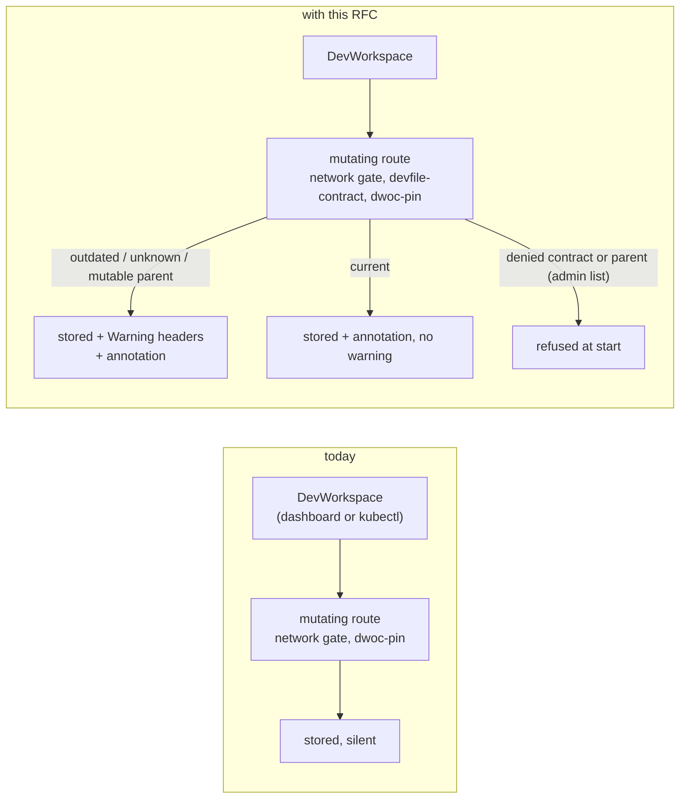
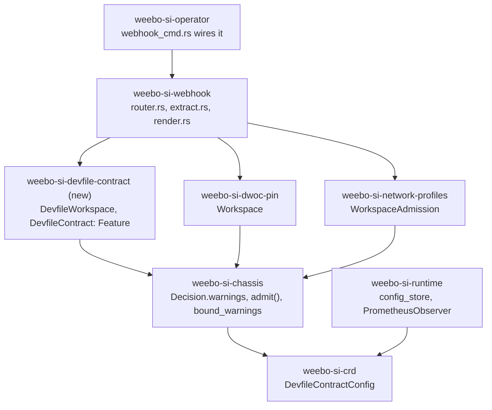
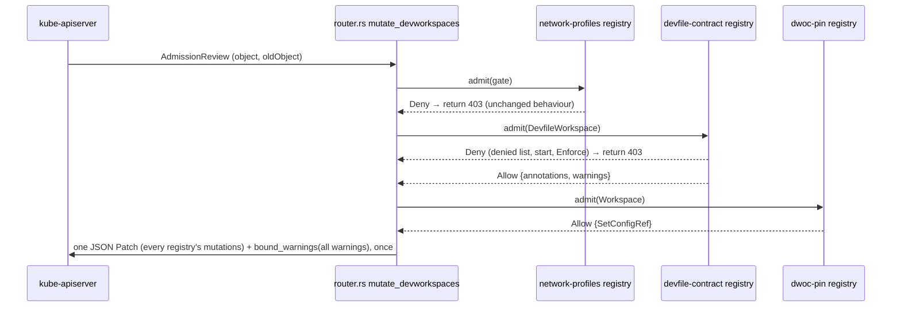
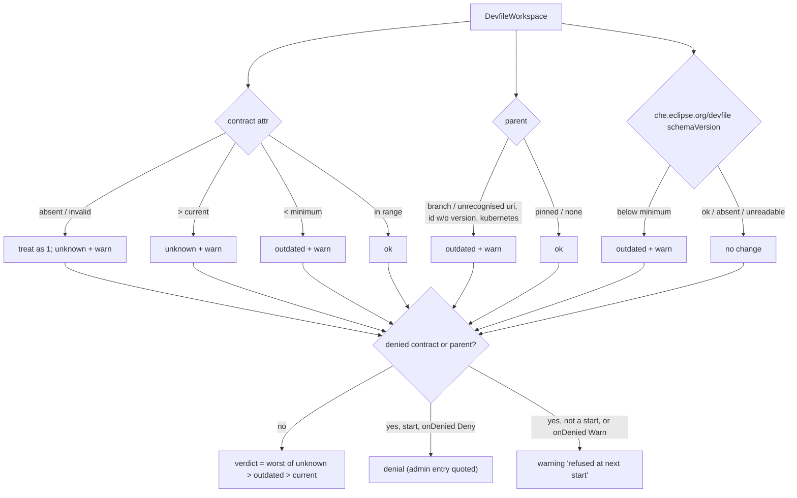
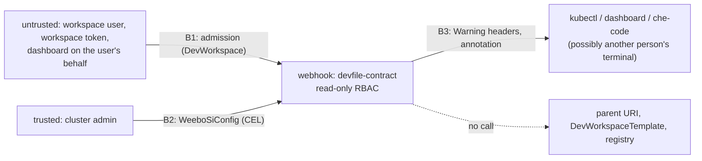

# RFC 0019 — devfile contract

| Field     | Value                                                                                                                                                                  |
| --------- | ---------------------------------------------------------------------------------------------------------------------------------------------------------------------- |
| Short     | tell a developer their devfile is outdated before the workspace refuses to start                                                                                        |
| Settles   | which platform rules a devfile was written for, whether its parent is pinned, and the only case where that refuses a workspace                                          |
| Co-author | Claude Opus 5.5                                                                                                                                                        |
| Touches   | `crates/weebo-si-chassis`, `crates/weebo-si-devfile-contract` (new), `crates/weebo-si-crd`, `crates/weebo-si-runtime`, `crates/weebo-si-webhook`, `crates/weebo-si-operator`, `crates/weebo-si-e2e`, every `*-adapters` crate that matches `AdmitOutcome`, docs |
| Risk      | low (*Security considerations*); availability of the DevWorkspace route is the residual                                                                                |

> Reference material (~10 000 words). A reviewer short on time reads *Summary*, *Guide-level
> explanation → Mocks*, *Security considerations* and *Unresolved questions*.

## Summary

`devfile-contract` is a new admission feature on the existing DevWorkspace mutating route. It
reads four things a devfile already carries into its DevWorkspace — a `weebo.io/platform-contract`
integer attribute, the `parent` reference, the generator's version attributes and the
`schemaVersion` the Che dashboard keeps in an annotation — and tells the developer, through
Kubernetes admission warnings, when the devfile was written against old platform rules or follows
a parent that can change under it. **Those warnings reach `kubectl` (and other API clients) only:
the Che dashboard drops them [R28], so on the dashboard path a developer sees nothing until a
refusal.** The verdict is also written on the DevWorkspace as the annotation
`hardening.weebo.io/devfile-contract: current|outdated|unknown`, the input a che-code extension
(or a che-dashboard fork patch) will read in its own, later RFC (D-12). It refuses a workspace in
exactly one case: the devfile names a contract or a parent an admin listed as denied, and that
list is empty by default — a refusal the dashboard does show as a failed start.

To carry the warnings, the chassis gains a contract change every later feature can use:
`Decision<S>` gets a `warnings` list, bounded in count and length, rendered into
`AdmissionResponse.warnings` under `Enforce` only. Hand-written and generated devfiles go through
exactly the same checks.

### Before / after

```text
# today — the weebo-che-project devfile, parent on a branch, no contract
$ kubectl apply -f weebo-che-project.devworkspace.yaml
devworkspace.workspace.devfile.io/weebo-che-project created
# …three weeks later WeeboDevImage's main changes a rule; the workspace fails at start,
# and the developer learns the rule from the failure.

# with this RFC (devfileContract: Enforce, currentContract: 1)
$ kubectl apply -f weebo-che-project.devworkspace.yaml
Warning: devfile has no weebo.io/platform-contract attribute; add "weebo.io/platform-contract: 1" to its attributes
Warning: devfile parent follows branch "main": pin parent.uri to a tag or a commit
devworkspace.workspace.devfile.io/weebo-che-project created
$ kubectl get dw weebo-che-project -o jsonpath='{.metadata.annotations.hardening\.weebo\.io/devfile-contract}'
unknown
```



## Motivation

1. **Nothing tells a developer their devfile is outdated.** The source plan's Phase 8 [R20] wants
   a warning when a devfile ages and a refusal only for a version marked vulnerable. Today the
   DevWorkspace route runs the network-profiles gate and `dwoc-pin` only
   (`router.rs` `mutate_devworkspaces` [R3]); neither looks at the devfile's provenance. Falsified
   when a DevWorkspace without `weebo.io/platform-contract` produces a `Warning:` line on
   `kubectl apply` (T-47, first row). This RFC solves it for `kubectl` users; on the dashboard path
   it only records the verdict in the annotation (D-12).
2. **Platform rules are discovered by failure.** A rule change (an image moved behind angos, a
   UID range, a network profile) breaks a devfile at start, with an error from the feature that
   enforced it, and nothing ties that error to "your devfile was written for older rules".
   Falsified when the `kubectl` warning names the contract number the devfile declares and the
   minimum the platform expects; dashboard users get the same text once the extension of D-12
   exists.
3. **The production devfile follows a branch.** The live DevWorkspace `weebo-dotfiles-che-owjk`
   carries `parent.uri: …/WeeboDevImage/refs/heads/main/che-min-mise/devfile.yaml` [R15], and the
   `weebo-che-project` devfile does the same [R19]: every commit on WeeboDevImage's `main` changes
   every workspace at its next start. Falsified when admitting either produces a "pin the parent"
   warning (T-47, second row).
4. **A parent can be a DevWorkspaceTemplate the workspace itself can edit.** `parent.kubernetes`
   points at a DevWorkspaceTemplate; the workspace ServiceAccount's
   `devworkspace-default-role` grants `create/patch/update/delete` on `devworkspacetemplates` in
   its namespace [R17]. Any process in the workspace can rewrite the parent of the next start.
   Falsified when such a parent produces a "mutable parent" warning.
5. **There is no way to stop a known-bad parent.** When a parent version ships a broken or
   vulnerable base, the admin can only ask people to move. Falsified when an admin-listed parent
   is refused at start with a message that says what to do (T-47, third row).
6. **The chassis cannot warn.** `Decision<S>` holds `mutations`, `denial`, `team`, `note`,
   `result` and nothing else [R1]; `AdmitOutcome` is `Allow(Vec<Mutation>)` or `Deny(String)`
   [R2]. Kubernetes has had admission warnings since `admission.k8s.io/v1` and kube-core 4.2.0
   exposes `AdmissionResponse.warnings` [R9], but no route of this repo can return one.
   Falsified when any feature returns a warning and it reaches the client.

## Goals and non-goals

Goals:

- A `weebo.io/platform-contract` integer on every devfile, read from the DevWorkspace, compared to
  an admin-set minimum.
- A warning for: no contract, a contract below the minimum, a parent on a branch, a registry
  parent without a version, a DevWorkspaceTemplate parent, a `schemaVersion` below a minimum
  (when the dashboard kept it).
- A refusal only for an admin-curated denied list (contracts, parents), empty by default.
- A verdict annotation on the DevWorkspace for later IDE display.
- Scope of visibility, stated plainly: warnings are for `kubectl` and API clients; on the Che
  dashboard path only a refusal is visible (D-12).
- Admission warnings as a chassis capability, bounded, `Enforce`-only.

Non-goals, each with why not:

- **The devfile generator** (Phase 8, step 1). A separate tool with its own release cycle; this
  RFC only reads the attributes it will write (`weebo.io/devfile-parent`, `weebo.io/generator`).
- **Renovate custom managers** for parent versions and component images (V-22). Cluster/GitOps
  configuration in `weebo-si`, not code in this repo; listed in *Integration in weebo-si*.
- **Making the catalogue a security boundary.** The plan's principle is that the catalogue helps
  and the cluster protects [R20]: image-policy, PSA, KubeArmor, network profiles and quotas stay
  the floor. A devfile that drops its parent and inlines the same components passes this feature
  and still meets every other control. This feature is advice with one admin-pulled brake.
- **Refusing outdated devfiles.** Outdated is never a refusal (decision 5). A brake on "old" would
  turn every rule bump into an outage for everyone who has not edited their devfile.
- **Resolving the parent.** The webhook never fetches `parent.uri` or reads a DevWorkspaceTemplate:
  no network call, no new RBAC, no SSRF surface. Pinning is judged from the reference string.
- **A status condition.** DevWorkspace `status` belongs to DevWorkspace Operator, which rewrites it
  on every reconcile (decision 3). The annotation is the channel.
- **The editor contribution.** `spec.contributions[editor]` is also a DevWorkspaceTemplate in the
  user's namespace [R15], created by the dashboard for every workspace. Warning on it would warn
  every workspace with nothing the developer can change; see *Deliberately untouched*.
- **Scanning component images** for vulnerabilities (angos' scan, Phase 10). Future work.
- **The che-code extension** that reads the annotation, or a che-dashboard fork patch that keeps
  the `Warning` header. Future work with its own RFC (D-12).

## Guide-level explanation

The admin adds one block under `spec.features` (here as written in weebo-si's chart values):

```yaml
config:
  features:
    devfileContract:
      enabled: true
      mode: DryRun                  # Off | DryRun | Enforce
      namespaceSelector:
        matchLabels:
          hardening.weebo.io/workspace-namespace: "true"
      currentContract: 1            # newest contract the User Guide publishes
      minimumContract: 1            # below this: outdated (warning, never refused)
      minimumSchemaVersion: "2.2.0" # optional; checked only when the dashboard kept it
      deniedContracts: []           # contracts refused at start; empty = nothing refused
      deniedParents: []             # e.g. [{uriPrefix: "https://…/WeeboDevImage/v1.2.0/"}]
                                    #      [{id: "che-min-mise", versions: ["1.2.0"]}]
      onDenied: Deny                # Deny | Warn
```

A developer writes one line in the devfile, at the top level (not under `metadata`):

```yaml
schemaVersion: 2.3.0
metadata:
  name: weebo-che-project
attributes:
  weebo.io/platform-contract: 1
parent:
  uri: https://raw.githubusercontent.com/batleforc/WeeboDevImage/v1.4.0/che-min-mise/devfile.yaml
```

Contract numbers start at 1 and are never reused. The platform team bumps `currentContract` each
time a rule changes in a way that can break a devfile, and the User Guide publishes what changed
for each number. `minimumContract` follows later, once people had time to move.

### Behaviour rules

- **The uninteresting case.** A devfile declaring a contract between `minimumContract` and
  `currentContract`, with no parent or a pinned one, and a `schemaVersion` at or above the minimum
  (or none kept): no warning, nothing printed, the DevWorkspace is admitted and annotated
  `current`. This is the outcome for every devfile the generator writes.
- **Contract absent.** Treated as contract `1`, the oldest one, as the plan asks [R20]. Verdict
  `unknown`, plus a warning naming the attribute to add and the current number. Because absent
  means `1`, an admin who lists `1` in `deniedContracts` refuses devfiles without the attribute:
  that is the one lever to make the attribute mandatory, and it is an explicit admin choice.
  Precedence when `1` is also below `minimumContract`: the devfile gets **only** the "add the
  attribute" warning (it already names the current number), never a second "below minimum" one,
  and its verdict is `unknown` (`unknown` outranks `outdated`); the reason list carries
  `contract-absent` only.
- **Contract not an integer** (`"three"`, `1.5`, an object): verdict `unknown`, one warning
  ("must be an integer"), and it is evaluated as absent. An integer written as a string (`"2"`)
  is accepted: devfile attributes are free-form JSON and YAML authors quote numbers.
- **Contract above `currentContract`:** verdict `unknown`, warning "newer than this platform",
  never refused (a typo is not a threat).
- **Contract below `minimumContract`:** verdict `outdated`, warning naming both numbers.
- **Parent checks**, on `spec.template.parent`, the reference as the developer wrote it (the
  dashboard keeps it unflattened [R15]):
  - `uri` recognised as pinned — a path segment that is a 40-hex commit, `refs/tags/…`,
    Forgejo/Gitea `raw/tag/…` or `raw/commit/…`, or a semantic version segment (`v1.4.0`,
    `2.1.0`) — no warning.
  - `uri` on `refs/heads/…`, Forgejo `raw/branch/…`, or a raw URL whose ref segment is `main` or
    `master` — verdict `outdated`, warning "follows branch".
  - `uri` that is none of the above — the same warning, worded "is not pinned to a tag or a
    commit". Unrecognised is treated as unpinned: the cost of a false warning is one line, the cost
    of a false "pinned" is the trap Motivation 3 describes.
  - `id` without `version` — verdict `outdated`, warning "no version". The devfile spec resolves
    it to the stack's default version [R27], which moves.
  - `kubernetes` — verdict `outdated`, warning "mutable parent" (Motivation 4).
  - no parent — nothing.
- **Generator attributes.** `weebo.io/devfile-parent` and `weebo.io/generator` are read and
  logged (bounded, see *Data and privacy*). They are decorative: every decision uses the real
  `parent` field, never what an attribute claims, because both are written by the same
  untrusted author.
- **`schemaVersion`.** The Che dashboard keeps it in the annotation `che.eclipse.org/devfile`,
  reduced to `schemaVersion: 2.3.0` [R15]. When present and below `minimumSchemaVersion`: verdict
  `outdated`, one warning. When absent (a DevWorkspace written with `kubectl`, which has no
  devfile) or unreadable: no warning, reason code `schema-unknown` in the annotation, verdict
  unaffected. The annotation is writable by the workspace token, so it can drive a warning and
  nothing else.
- **Denied list.** On a *start* — a `CREATE`, an `UPDATE` that turns `spec.started` from
  not-true to `true`, or an `UPDATE` that changes `spec.template` while `spec.started` is `true`
  (D-13) — a contract in `deniedContracts`, or a parent matching `deniedParents`, is a denial
  under `Enforce` with `onDenied: Deny`. Under `onDenied: Warn` it is a warning. Any other
  `UPDATE` (DevWorkspace Operator's finalizers, a stop, a label, an annotation) is never refused:
  it gets the warning "this workspace will be refused at its next start".
- **Modes.** `Off`: the feature does not run. `DryRun`: it evaluates exactly as `Enforce` does,
  counts and logs the outcome, and returns **no warning, no annotation, no denial** — the
  developer sees nothing. `Enforce`: warnings, annotation and denials as above. This is the house
  rule "DryRun runs the code Enforce runs, mode applied at the edge" [R8], extended to warnings.
- **Hand-written and generated devfiles** get exactly the same checks. Nothing in the evaluation
  reads `weebo.io/generator` to decide.
- **Teams.** No team contribution: the contract numbers and the denied list are cluster facts,
  the same call `imageRewrite` made [R13].

### Validation

Hard errors, refused at `kubectl apply` of the `WeeboSiConfig` by CEL on the CRD:

| Rule | Message |
| --- | --- |
| `1 <= minimumContract <= currentContract <= 1000` | "contracts start at 1 and minimumContract cannot exceed currentContract" |
| `deniedContracts` at most 64 items, each `1..=currentContract` | "a denied contract must be a published one" |
| `deniedParents` at most 64 items, each exactly one of `uriPrefix`, `id` | "a denied parent names a uriPrefix or an id, not both" |
| `uriPrefix` 8..2048 chars, starts with `https://` or `http://` | "uriPrefix must be an http(s) URL prefix" |
| `versions` only with `id`, at most 32, each 1..64 chars | "versions apply to a registry id only" |
| `minimumSchemaVersion` matches `^[0-9]+\.[0-9]+\.[0-9]+$` | "minimumSchemaVersion is MAJOR.MINOR.PATCH" |

Warnings to the admin: none beyond the CEL errors — every config the CEL rules accept is
meaningful. The developer-facing warnings are the feature's output, seen in the `kubectl`
`Warning:` lines (probe [R29]) and **not** in the Che dashboard, which drops them (D-10, [R28]).
DryRun's would-be warnings are seen by the admin in the log line and the metric (*Operational
considerations*).

### Mocks

Every mock is `kubectl` v1.37.2 [R16] against the webhook in `Enforce`, `currentContract: 3`,
`minimumContract: 2`, `minimumSchemaVersion: "2.2.0"`. kubectl prints each admission warning on
stderr prefixed `Warning: ` (the webhook never writes that prefix itself [R10]).

**Current (the uninteresting case)** — nothing at all:

```text
$ kubectl apply -f go-api.devworkspace.yaml
devworkspace.workspace.devfile.io/go-api created
$ echo $?
0
```

Decides: a correct devfile costs the developer zero lines of output.

**Outdated contract:**

```text
$ kubectl apply -f legacy.devworkspace.yaml
Warning: devfile written for platform contract 1, minimum is 2: see the User Guide changes for contracts 2 to 3
devworkspace.workspace.devfile.io/legacy created
```

**Unknown (contract absent, `minimumContract: 2`) and parent on a branch** — the real
`weebo-che-project` devfile [R19]. Absent counts as `1`, below the minimum, yet only the "add the
attribute" warning is printed (precedence rule above):

```text
$ kubectl apply -f weebo-che-project.devworkspace.yaml
Warning: devfile has no weebo.io/platform-contract attribute; add "weebo.io/platform-contract: 3" to its attributes
Warning: devfile parent follows branch "main": pin parent.uri to a tag or a commit
devworkspace.workspace.devfile.io/weebo-che-project created
```

**Unknown (not an integer / from the future):**

```text
$ kubectl apply -f typo.devworkspace.yaml
Warning: weebo.io/platform-contract must be an integer, read as absent; current is 3
devworkspace.workspace.devfile.io/typo created
$ kubectl apply -f future.devworkspace.yaml
Warning: weebo.io/platform-contract 9 is newer than this platform (3): check the value
devworkspace.workspace.devfile.io/future created
```

**Mutable parent and registry parent without version:**

```text
$ kubectl apply -f dwt-parent.devworkspace.yaml
Warning: devfile parent is a DevWorkspaceTemplate (parent.kubernetes): the workspace itself can change it
devworkspace.workspace.devfile.io/dwt-parent created
$ kubectl apply -f id-parent.devworkspace.yaml
Warning: devfile parent "che-min-mise" has no version: set parent.version
devworkspace.workspace.devfile.io/id-parent created
```

**Old schemaVersion** (dashboard-created; shown here as the annotation the dashboard writes):

```text
Warning: devfile schemaVersion 2.1.0 is below the platform minimum 2.2.0
```

**Refusal — denied parent** (`deniedParents: [{uriPrefix: "https://raw.githubusercontent.com/batleforc/WeeboDevImage/v1.2.0/"}]`):

```text
$ kubectl apply -f old-base.devworkspace.yaml
Error from server (Forbidden): error when creating "old-base.devworkspace.yaml": admission webhook "devworkspaces.hardening.weebo.io" denied the request: devfile parent is denied by the platform (deniedParents entry 1: https://raw.githubusercontent.com/batleforc/WeeboDevImage/v1.2.0/): move parent.uri to a newer version; contract 3 in the User Guide lists them
$ echo $?
1
```

Decides: the denial quotes the **admin's** entry, never the developer's URI, so the message is
trusted text and actionable. The same text, on an `UPDATE` that is not a start, becomes
`Warning: devfile parent is denied by the platform (deniedParents entry 1): this workspace will be refused at its next start`.

**Refusal — denied contract** (`deniedContracts: [1]`, devfile without the attribute):

```text
Error from server (Forbidden): error when creating "weebo-che-project.devworkspace.yaml": admission webhook "devworkspaces.hardening.weebo.io" denied the request: platform contract 1 is denied (devfiles without weebo.io/platform-contract count as 1): add "weebo.io/platform-contract: 3" and follow the User Guide
```

**The annotation** (any outcome, `Enforce`; this object was applied with `kubectl`, so it has no
`che.eclipse.org/devfile` and the schema reason is `schema-unknown`):

```text
$ kubectl get dw weebo-che-project -o json | jq '.metadata.annotations | with_entries(select(.key|startswith("hardening.weebo.io/devfile")))'
{
  "hardening.weebo.io/devfile-contract": "unknown",
  "hardening.weebo.io/devfile-contract-reason": "contract-absent,parent-branch,schema-unknown"
}
```

**Che dashboard, warnings:** nothing. The dashboard backend's `propagateHeaders` returns `{}`, so
the `Warning` headers never reach the frontend that would display them [R28] (D-10). An outdated
or unknown devfile starts from the dashboard exactly as today; only the annotation records it.

**Che dashboard, refusal** (wireframe; the frame is the dashboard's generic start-failure alert,
the text after the colon is the webhook's denial verbatim; the exact chrome is compared at land):

```text
┌ Create workspace ───────────────────────────────────────────────────────────────┐
│ ⚠ Failed to create the workspace                                                 │
│   admission webhook "devworkspaces.hardening.weebo.io" denied the request:       │
│   devfile parent is denied by the platform (deniedParents entry 1:               │
│   https://raw.githubusercontent.com/batleforc/WeeboDevImage/v1.2.0/): move       │
│   parent.uri to a newer version; contract 3 in the User Guide lists them         │
│                                                         [ Close ]                │
└──────────────────────────────────────────────────────────────────────────────────┘
```

Decides: on the dashboard path the denial text is the only thing a developer reads, so it must
stand alone — no reference to a warning they never saw.

## Design

### Contract

#### `spec.features.devfileContract`

```rust
pub struct DevfileContractConfig {
    pub mode: FeatureMode,                       // Off | DryRun | Enforce
    pub namespace_selector: Option<Selector>,
    pub current_contract: u32,                   // CEL: 1..=1000
    pub minimum_contract: u32,                   // CEL: 1..=current_contract
    pub minimum_schema_version: Option<String>,  // CEL: MAJOR.MINOR.PATCH
    pub denied_contracts: Vec<u32>,              // maxItems 64
    pub denied_parents: Vec<DeniedParent>,       // maxItems 64
    pub on_denied: OnDenied,                     // Deny (default) | Warn
}
pub struct DeniedParent {
    pub uri_prefix: Option<String>,              // exactly one of uri_prefix, id (CEL)
    pub id: Option<String>,
    pub versions: Vec<String>,                   // id only; empty = every version, absent included
}
```

No team block; `resolve_teams` passes it through, as for `imageRewrite` [R13].

#### Attributes and annotations read

| Where on the DevWorkspace | Key | Writer | Trust |
| --- | --- | --- | --- |
| `spec.template.attributes` | `weebo.io/platform-contract` | devfile author | untrusted, advisory |
| `spec.template.attributes` | `weebo.io/devfile-parent`, `weebo.io/generator` | generator or author | untrusted, logged only |
| `spec.template.parent` | `uri` / `id`+`version`+`registryUrl` / `kubernetes` | devfile author | untrusted; denial matches it against admin entries |
| `metadata.annotations` | `che.eclipse.org/devfile` (first 4 KiB, line scan for `schemaVersion:`) | Che dashboard, patchable by the workspace token | untrusted, warning only |
| `spec.started` (new and old object) | — | dashboard, user | used only to tell a start from another update |

#### Annotations written (`Enforce` only)

| Key | Values |
| --- | --- |
| `hardening.weebo.io/devfile-contract` | `current` \| `outdated` \| `unknown` |
| `hardening.weebo.io/devfile-contract-reason` | comma list from a fixed vocabulary: `contract-absent`, `contract-invalid`, `contract-future`, `contract-below-minimum`, `contract-ok`, `parent-branch`, `parent-unpinned`, `parent-no-version`, `parent-mutable`, `parent-pinned`, `parent-none`, `parent-denied`, `contract-denied`, `schema-below-minimum`, `schema-ok`, `schema-unknown` |

Written only when the stored value differs, so a reinvocation or a DevWorkspace Operator update
of an already-annotated object emits no patch. No user string ever reaches either value.

#### Chassis: admission warnings

```rust
// weebo-si-chassis/src/feature/value.rs
pub struct Decision<S> {
    pub mutations: Vec<Mutation>,
    pub denial: Option<String>,
    pub warnings: Vec<String>,          // new; Decision::new/deny leave it empty
    pub team: Option<TeamName>,
    pub note: Option<String>,
    pub result: &'static str,
    _subject: PhantomData<S>,
}
impl<S> Decision<S> { pub fn with_warnings(self, warnings: Vec<String>) -> Self; }

// weebo-si-chassis/src/admit.rs
pub enum AdmitOutcome {
    Allow { mutations: Vec<Mutation>, warnings: Vec<String> },
    Deny(String),
}
pub const MAX_WARNINGS: usize = 6;       // per admission response, all registries together
pub const MAX_WARNING_CHARS: usize = 120;
pub fn bound_warnings(raw: Vec<String>) -> Vec<String>;
```

`admit()` keeps a feature's warnings only under `Enforce`, exactly where it keeps its mutations
today [R2], and does **not** bound them: a route may run several registries, so
`bound_warnings` runs **once per response, after the route has merged every registry's
warnings**, inside the one rendering helper every route calls,
`weebo_si_webhook::render::with_warnings` (D-14). It replaces every control character (`char::is_control`, which covers
CR, LF and ESC) with a space, truncates each warning to 120 characters on a character boundary
with a trailing `…`, deduplicates, and keeps the first 6. Six times 120 is well under the
apiserver's 4 096-character ceiling for all warnings of a request, and 120 is the length the
Kubernetes documentation asks for [R10]. Each route renders `warnings` into
`AdmissionResponse.warnings` [R9] (`None` when empty, so today's responses are byte-identical).

#### Route and webhook configuration

No new path, no new webhook configuration, no chart template change: the feature runs on
`/mutate/v1alpha1/devworkspaces` [R3], already registered for `CREATE` and `UPDATE` with
`failurePolicy: Fail` and `reinvocationPolicy: IfNeeded` [R11]. The webhook already receives
`oldObject` on `UPDATE`.

#### Metrics

| Metric | Labels | Notes |
| --- | --- | --- |
| `weebo_si_admission_requests_total` (existing [R12]) | `feature="devfile-contract"`, `resource="DevWorkspace"`, `mode`, `outcome` | unchanged contract |
| `weebo_si_devfile_contract_total` (new) | `result` ∈ {`current`, `outdated`, `unknown`, `denied`}, `mode` | special-cased in `PrometheusObserver` like `weebo_si_dwoc_pin_total` [R12] |
| `weebo_si_admission_warnings_total` (new, chassis-wide) | `feature`, `mode` | counted in `admit()` before the mode drops them, so DryRun shows what Enforce would print |

All label values are compile-time constants. The contract number and the parent URI are not
labels (the contract number goes in the log line, resolved D-11).

#### Log line

One `info` line per decision from the router, the existing `log_admission` shape [R3] plus
`devfile=<verdict> reasons=<codes> contract=<n|absent> generator=<≤32 chars, [A-Za-z0-9.+-] only>`.
Never the parent URI, never the object.

### Architecture

**Hexagonal: yes**, in the house's thin form. The decision is real (four checks, a denied list,
several verdicts a user can get wrong in more than one way), it sits behind an external system
(admission), and we want it tested from a table of devfiles without a cluster — all three criteria
of `hexagonal.md` [R26]. The domain crate `weebo-si-devfile-contract` holds the subject, the
`Feature<DevfileWorkspace>` impl and the pure classifiers; it has **no port**, because everything
it needs is on the subject and in its config handle (a fake would be more code than nothing). It
has **no adapters crate**: the only adapter work is extraction, rendering and metrics, which live
where the route lives, in `weebo-si-webhook` and `weebo-si-runtime`. No controller, no store, no
new RBAC. Said plainly, this is the **network-profiles gate's exception** to "Adding a feature"
[R8]: that gate's admission half also lives in `weebo-si-webhook`, and like it this feature makes
shared crates gain code (`extract.rs`, `router.rs`, `prometheus.rs`). PR 4 amends
`operator-internals.md` "Adding a feature" to name the exception: a feature on the DevWorkspace
mutation route is wired in `weebo-si-webhook`, not through `admission_routes`.

**Deviation from the coordinator's decision 1 — read this.** The decision placed the feature *in
dwoc-pin's `Workspace` registry*. `Workspace` is defined in `weebo-si-dwoc-pin`
(`workspace.rs` [R5]) and carries only `name`, `namespace` and `config_ref`; `extract.rs` reads
"nothing beyond the two attributes those features name" [R4]. Registering in that registry means
either `weebo-si-devfile-contract` depending on `weebo-si-dwoc-pin` and `Workspace` growing
devfile fields, which is the exact coupling `AppState` documents it refused for network-profiles
[R3] and `operator-internals.md` forbids when adding a feature [R8]. The nearest workable design,
written here: **the same route and the same webhook configuration, but its own subject
`DevfileWorkspace` and a third registry on the route**, the network-profiles precedent. Resolved D-8
records the choice, accepted by the RFC owner.



Proves: the new crate depends on the chassis and the CRD only; no feature crate depends on
another, and nothing outside `weebo-si-webhook` and the composition root learns it exists.



Proves: registries run in a fixed order, as RFC 0002 requires [R21]. The order on
`/mutate/v1alpha1/devworkspaces` is global and stated identically in RFC 0020: **network-profiles
workspace gate → devfile-contract → dwoc-pin → team-tools (RFC 0020)** (D-14). A network-profiles
refusal still wins (its message explains the more fundamental problem); a denied parent is refused before
a pin is computed for it; the patch is one patch, and `render_patch` already handles two writers
into `metadata.annotations` [R6].



Proves: the denied list is the only path to a refusal, and every other branch ends in a warning
or nothing.

**The invariant.** *Because a denial requires both a match against an admin-written list and a
start transition, an outdated, unknown or unpinned devfile can never be refused, and DevWorkspace
Operator's own updates (finalizers, deletion, status-adjacent metadata) can never be refused by
this feature — so a workspace can always be stopped and deleted, whatever this feature decides.*
One existing exception of the route is not this feature's and is not changed: while the webhook's
namespace cache has not yet observed the namespace, `admit()` returns `NamespaceNotObserved` for
any feature that is on, and the route denies the request [R2] (`admit.rs:56-60`). `starting` is
computed in `extract.rs` from the object and `oldObject`: `CREATE`, `spec.started` going to `true`,
or `spec.template` changing while `spec.started` is `true` (D-13). Enforced by
`DevfileContract::evaluate` (the only `Decision::deny` call sits behind `denied_match(..) &&
subject.starting`), proved by `outdated_is_never_a_denial`,
`a_denied_parent_on_a_non_start_update_is_a_warning` and
`changing_parent_while_running_is_refused`.

Second invariant: *because `evaluate` has no fallible step (every parse failure becomes a verdict),
this feature never returns `Err`, so it cannot turn a malformed devfile into a refusal of every
workspace under `failurePolicy: Fail`.* Proved by the parser table tests and
`evaluate_never_errs_on_arbitrary_json`.

### Data and state

Stateless. The feature reads the admitted object and the hot-reloaded config handle; it writes
two annotations on the object it admits. Losing the annotations (an admin deletes them, the
feature is switched `Off`) loses nothing: the next `Enforce` admission writes them again. `Off`
does not remove annotations already written; they go stale and say so only by not changing
(*Drawbacks*). No cache, no persistent store, nothing to back up.

### Detailed design

| File | Change |
| --- | --- |
| `crates/weebo-si-chassis/src/feature/value.rs` | `Decision.warnings`, `with_warnings`; `FeatureOutcome.warnings: usize` |
| `crates/weebo-si-chassis/src/admit.rs` | `AdmitOutcome::Allow { mutations, warnings }`, Enforce-only collection (unbounded); `bound_warnings`, `MAX_WARNINGS`, `MAX_WARNING_CHARS` as pure functions/constants |
| `crates/weebo-si-chassis/src/port/observer.rs` | nothing: `FeatureOutcome` carries the count |
| every `AdmitOutcome` matcher: `weebo-si-webhook/src/router.rs`, `weebo-si-image-policy-adapters/src/image_policy.rs`, `weebo-si-policy-guard-adapters/src/{policy_guard,registry_guard}.rs`, `weebo-si-endpoint-auth-adapters/src/endpoint_auth.rs`, `weebo-si-operator/tests/perf_envtest.rs` | match the struct variant; render `warnings` via one helper `weebo_si_webhook::render::with_warnings(response, warnings)`, which calls `bound_warnings` once on the merged list (every adapters crate already depends on `weebo-si-webhook`) |
| `crates/weebo-si-crd/src/devfile_contract.rs` (new) | `DevfileContractConfig`, `DeniedParent`, `OnDenied`, CEL, constants for the two annotation keys and three attribute keys |
| `crates/weebo-si-crd/src/spec.rs` | `Features.devfile_contract` and its resolved form |
| `crates/weebo-si-runtime/src/config_store.rs` | publish the handle; `prometheus.rs`: `weebo_si_devfile_contract_total`, `weebo_si_admission_warnings_total` |
| `crates/weebo-si-devfile-contract/` (new) | `DevfileWorkspace` (subject), `DevfileContract` (`Feature`), `classify_parent_uri`, `parse_contract`, `scan_schema_version`, `denied_match`, `render_*` message builders, `excerpt` (≤32 chars, control-free) |
| `crates/weebo-si-webhook/src/extract.rs` | `devfile_workspace_from_object(namespace, obj, old_obj, operation)` — reads the three attributes, `parent`, the first 4 KiB of `che.eclipse.org/devfile`, the two existing annotation values, and computes `starting` (`CREATE`; `spec.started` old/new; `spec.template` old ≠ new while started, D-13) |
| `crates/weebo-si-webhook/src/router.rs` | `AppState.devfile_contract: Option<DevfileContractAdmission>`, run between the network-profiles gate and dwoc-pin (D-14 order); stop discarding the network-profiles registry's `Allow` payload (today `Ok(AdmitOutcome::Allow(_)) => None`, `router.rs:181-183`) and merge every registry's mutations and warnings; log fields. The fold into one loop over registries and the router test that every registry's payload is kept belong to RFC 0020 (D-14) |
| `crates/weebo-si-operator/src/{webhook_cmd,features}.rs` | one line each |
| `crates/weebo-si-e2e/src/lib.rs` | `try_apply_with_warnings` returning stderr on success (today stderr is dropped when kubectl exits 0 [R14]) |
| `crates/weebo-si-e2e/tests/workspace.rs` | the rows of *Proof* |
| `crates/weebo-si-operator/tests/admission_envtest.rs` | the envtest rows of *Test plan* (where `a_devworkspace_is_pinned_by_a_real_running_webhook` already lives) |
| `docs/architecture/operator-internals.md` | route table, registry order, and the "Adding a feature" exception (PR 4) |
| docs | `docs/bricks/devfile-contract.md`, `docs/weebosiconfig.md` section, `docs/architecture/operator-internals.md` route table and "two registries" paragraph |

### Proof against a real client

Real consumers: **kubectl v1.37.2** (the client the cluster's admins use) against Kubernetes
v1.36.2 [R16]; **DevWorkspace Operator v1.1.1** and the Che dashboard
`ghcr.io/weebo-si/che-dashboard:develop` on the cluster [R18]; in CI, DevWorkspace Operator
v0.43.0 and Che 7.122.0 in the nightly kind suite [R14]. The e2e rows run in
`crates/weebo-si-e2e/tests/workspace.rs` with `currentContract: 3`, `minimumContract: 2`.

1. **Current.** A DevWorkspace with `weebo.io/platform-contract: 3` and a parent pinned to a
   40-hex commit: `kubectl apply` exits 0, stderr is empty, the stored object carries
   `hardening.weebo.io/devfile-contract: current`, and it reaches `status.phase: Running`.
2. **The real-world case.** The `weebo-che-project` devfile [R19] (parent on `refs/heads/main`,
   no contract), converted to a DevWorkspace: `kubectl apply` exits 0 with exactly two stderr
   lines, `Warning: devfile has no weebo.io/platform-contract …` and
   `Warning: devfile parent follows branch "main" …`; annotation `unknown`, reasons
   `contract-absent,parent-branch,schema-unknown`. On the cluster, the same check is made by
   reading the annotation on `weebo-dotfiles-che-owjk` after its next start under `Enforce` (its
   parent is the same branch URL [R15]).
3. **Mutable parent.** `parent.kubernetes: {name: base}` with a DevWorkspaceTemplate `base` in
   the namespace: one `Warning: devfile parent is a DevWorkspaceTemplate …` line; the workspace
   still starts.
4. **Refusal.** `deniedParents: [{uriPrefix: <the fixture's parent prefix>}]`: `kubectl apply`
   exits 1 with the exact denial of the mock; `kubectl get dw` returns NotFound, and
   `kubectl get dwt,deploy -n <ns>` shows nothing created for it — the refused workspace never
   reached DevWorkspace Operator.
5. **No refusal of a running workspace's lifecycle.** The workspace of (1) is running; the admin
   adds its parent to `deniedParents`; `kubectl patch dw … spec.started=false` succeeds with the
   "refused at its next start" warning; `kubectl delete dw` completes (finalizer removed by
   DevWorkspace Operator); `spec.started=true` on a recreated copy is refused.
6. **DryRun is invisible.** Same object as (2) under `DryRun`: stderr empty, no
   `hardening.weebo.io/devfile-contract` annotation, and `weebo_si_admission_warnings_total
   {feature="devfile-contract",mode="dry_run"}` moved by 2.
7. **Bounds.** A DevWorkspace whose `weebo.io/generator` holds 10 KiB with `\x1b[31m` and CRLF:
   no warning line longer than 120 characters, no ESC byte in kubectl's stderr (`od -c`), log
   line's `generator=` field ≤ 32 characters.
8. **Reinvocation.** With `imageRewrite.webhooks.enabled` (its second webhook in the same
   configuration rewrites a component image, which makes the apiserver reinvoke
   `devworkspaces.hardening.weebo.io` under `reinvocationPolicy: IfNeeded` [R11]), apply (2)'s
   object with a component image from an upstream registry: record whether kubectl prints each
   warning once or twice. The documentation does not say whether the apiserver deduplicates
   [R10]; the row asserts the count observed at land, and if it is two, *Drawbacks* gains it.

Cluster test ids: T-47 is rows 2 (no contract → warning), 2 (branch parent → warning) and 4
(denied parent → refusal), in the plan's per-PR Chainsaw/e2e set [R20]; V-13 (a pinned parent
resolves in DWO v1.1.1) must pass before the warning tells people to pin; V-14 showed kubectl
prints admission warnings [R29] and the dashboard drops them [R28]; **V-23 (new)** "which devfile fields survive into the DevWorkspace":
partly answered by the probe [R15] — `schemaVersion` survives in `che.eclipse.org/devfile`,
`parent` is kept unflattened — and validated by the owner on 2026-11-24 for top-level
`attributes`, which reach `spec.template.attributes` (D-9, [R30]).

**Deliberately untouched**, so reviewers do not go looking:

- `spec.contributions` (the dashboard's editor DevWorkspaceTemplate) — dashboard-made for every
  workspace; a warning there is noise the developer cannot act on.
- `dwoc-pin`'s `Workspace`, its evaluation and its log line — unchanged (resolved D-8).
- The image-policy workspace layer on `/validate/v1alpha1/devworkspaces` [R23] — it judges
  component images; this feature judges provenance.
- `metadata.attributes` of the devfile — read nowhere: V-23 showed top-level `attributes` reach
  `spec.template.attributes`, which is where the contract is read [R30].
- The parent's content — never fetched, never resolved.
- Annotations already written when the feature goes `Off` — left in place.
- policy-guard — the two annotations are advisory; guarding them would add a rule for no gain,
  since the webhook rewrites them at every admission.

## Security considerations

**Rating: low.** The feature grants nothing, fetches nothing, needs no new privilege, and its
only refusal is pulled by an admin. Its risk is availability: it runs on the `failurePolicy:
Fail` DevWorkspace route, so a bug that errs or panics refuses every workspace start. The
chassis change is the wider surface: warnings become possible on every route, so their bounds
are enforced once per response, in the rendering helper every route calls (D-14).

**Attack surface.** Attacker-controlled inputs (any user who can create or patch a DevWorkspace,
including the workspace's own token [R17]): the three attributes, `parent` in all three forms,
the `che.eclipse.org/devfile` annotation, the two `hardening.weebo.io/devfile-contract*`
annotations, `spec.started` and `spec.template` (old and new, for the start test). Admin-controlled: the config. Data moved: none off the node.



| # | Threat | Where | Mitigation + enforcing fn | Negative test | Residual |
| --- | --- | --- | --- | --- | --- |
| S1 | Spoofing: an attribute claims "generated by the official generator, parent 9.9.9" to look current | B1 | decisions use `parent` and the contract only; `weebo.io/generator`/`devfile-parent` are logged, never evaluated — `DevfileContract::evaluate` | `generator_attributes_never_change_the_verdict` | none |
| T1 | Tampering: the user writes `devfile-contract: current` on an outdated workspace | B1 | the webhook overwrites both annotations at every `Enforce` admission — `DevfileContract::evaluate` emits them whenever they differ | `a_forged_current_annotation_is_overwritten` | stale under `Off`/`DryRun`; nobody trusts the annotation for a security decision (accepted, platform team) |
| T2 | Tampering: the workspace token patches a DevWorkspaceTemplate parent after admission | outside B1 | warning "mutable parent" at admission — `classify_parent`; prevention belongs to RBAC (Future work) | `a_kubernetes_parent_warns` | the parent still changes; this feature only tells (accepted, platform team) |
| T3 | Tampering: bypass the denied list by editing the URI (query string, other host, inlined components) | B1 | `denied_match` normalises (lowercase scheme and host, drop userinfo, query, fragment) and matches a prefix | `a_denied_prefix_matches_despite_query_and_userinfo` | a renamed host or inlined parent passes: not a security boundary (*Non-goals*), the cluster floor stays (accepted) |
| R1 | Repudiation: a refusal nobody can trace | B1 | one log line per decision with namespace, workspace, verdict, reasons; `weebo_si_admission_requests_total{outcome="denied"}` | `a_denial_is_logged_with_its_reasons` | none |
| I1 | Information disclosure: a parent URI with credentials (`https://user:token@…`) lands in logs, warnings or metrics | B1→logs, B3 | the URI is never logged nor labelled; a warning echoes at most the ref segment through `excerpt` (≤32 chars, after userinfo removal); a denial quotes the admin entry — `render_parent_warning`, `render_denial` | `a_token_in_parent_uri_never_reaches_a_warning_or_log` | none |
| I2 | Information disclosure: terminal escape or CRLF injection into another person's terminal (an admin re-applying a user's object) | B3 | `bound_warnings` strips control characters, truncates to 120, caps at 6 — called once per response by `render::with_warnings`; `excerpt` also allow-lists characters | `a_control_character_never_reaches_a_warning`, `warnings_are_capped_and_truncated` | none |
| D1 | DoS: a huge or deep `che.eclipse.org/devfile` annotation or attribute makes admission slow | B1 | no YAML parser: `scan_schema_version` reads the first 4 KiB line by line; `parse_contract` accepts a JSON number or ≤10 ASCII digits; apiserver caps all annotations of an object at 256 KiB [R31] | table tests of the three parsers (malformed, huge, deep); `a_4mib_annotation_is_scanned_in_bounded_time` | none |
| D2 | DoS: a malformed devfile makes `evaluate` err, and `failurePolicy: Fail` refuses every workspace | B1 | `evaluate` has no fallible step — every parse failure is a verdict | `evaluate_never_errs_on_arbitrary_json` (property test over arbitrary JSON) | a panic in a dependency; the house lints forbid `unwrap`/indexing (accepted) |
| D3 | DoS: a newly denied parent blocks deletion of running workspaces | B1 | denial only on a start transition — `DevfileContract::evaluate` | `a_denied_parent_on_a_non_start_update_is_a_warning`, e2e row 5 | a cold namespace cache refuses any request on the route (existing behaviour, `admit.rs:56-60`) |
| T4 | Tampering: swap a running workspace's parent to a denied one by patching `spec.template` without a stop/start | B1 | a `spec.template` change while started counts as a start (D-13) — `devfile_workspace_from_object` computes `starting`, `DevfileContract::evaluate` denies | `changing_parent_while_running_is_refused` | none |
| E1 | Elevation: the feature grants a profile, a DWOC or an image | — | it emits only `Annotate` mutations [R7] under its own two keys — `DevfileContract::evaluate` | `only_its_own_annotations_are_emitted` | none |

- **Privileges.** RBAC delta: none. The webhook role stays read-only; it never reads a
  DevWorkspaceTemplate or fetches a URL.
- **Trust boundary.** The whole DevWorkspace is attacker-controlled, including the dashboard's
  annotation (the workspace token can patch DevWorkspaces [R17]). The admin config is trusted and
  CEL-checked.
- **Bypass.** Namespaces labelled `hardening.weebo.io/exclude` skip the route entirely (existing
  rule [R11]). Objects created before the feature turns on are judged at their next
  `UPDATE`. Rewriting the parent so no denied entry matches is possible and accepted: the denied
  list protects people from accidents, the cluster floor protects the cluster.
- **Blast radius.** A misbehaving feature refuses or warns on workspace starts cluster-wide.
  Break-glass: `mode: Off` (hot-reloaded, no restart) or empty the denied list.
- **Secrets.** Reads none. The one secret-shaped input (credentials in a parent URI) is handled
  in I1.

## Supply chain

No new dependency, image, action or tool: parsing uses `serde_json` (already the admission
payload type) and `std`; no YAML crate is added because the schemaVersion scan is a line scan;
the parsers are covered by table-driven tests, not fuzzing, because the repo has no fuzz
infrastructure and this RFC does not add any (D-15). `task audit` is unchanged.

## Data and privacy

- **Personal data.** The namespace (`dev-ws-<user>`) and the workspace name are personal data;
  they already appear in the route's log line [R3] and appear there again, no new place. They are
  **not** metric labels (both metrics carry `result`, `mode`, `feature` only).
- **New log fields.** Verdict, reason codes, contract number (an integer or `absent`), and the
  generator version as an `excerpt` (≤32 chars, `[A-Za-z0-9.+-]`). Never the parent URI, which
  can name a private repository and carry credentials.
- **New annotation.** Verdict and reason codes only, on the user's own DevWorkspace, readable by
  whoever can read it today; it carries no identity and dies with the workspace.
- **Retention.** Logs follow ClickStack's existing retention; nothing new is stored. Nothing
  leaves the cluster.

## Operational considerations

**Failure modes.**

| Failure | Direction | Why |
| --- | --- | --- |
| webhook down | closed (`failurePolicy: Fail`, existing, fixed [R11]) | the route already carries dwoc-pin; this feature adds no new failure |
| config absent or `Off` | feature skipped | the house default [R8] |
| namespace facts not yet watched | closed for this request (existing `admit()` rule) | same as every feature on the route |
| malformed devfile input | verdict `unknown`, admitted | an advisory feature must not convert bad input into a refusal (D2) |
| `che.eclipse.org/devfile` absent | `schema-unknown`, no warning | kubectl-made workspaces have no devfile |
| denied list matches, not a start | warning only | lifecycle must never be blocked (D3) |

**Rollout.** (1) Ship with no `devfileContract` block: the chassis change renders no warning
anywhere, responses byte-identical. (2) `DryRun` on `dev-ws-batleforc-test` only
(`namespaceSelector` on its name), then all workspace namespaces, for at least 7 days, watching
`weebo_si_devfile_contract_total` by `result` and the log reasons. (3) Fix the real devfiles that
warn (weebo-che-project, weebo-dotfiles-che) — the point of the dry run. (4) After V-13 (pinned
parents resolve), which gates `Enforce` and is deferred until WeeboDevImage is tagged (V-14 and
V-23 are answered: D-10, D-9), `Enforce` on `dev-ws-batleforc-test`, then everywhere. The denied list
stays empty until the first incident that needs it.

**Rollback.** `mode: Off` in the chart values, synced by Argo CD, effective at the next admission.

**Observability.** To ClickStack via the existing scrape: `weebo_si_devfile_contract_total` (a
dashboard tile: share of `outdated`/`unknown` per day — the adoption curve of each contract bump),
`weebo_si_admission_warnings_total`, `weebo_si_admission_requests_total{feature=
"devfile-contract",outcome="denied"}`. Alert: any `denied` rate above 0 for 10 minutes while the
denied list was changed in the last day — a list that refuses more than intended; and the
existing "admission errors" alert covers D2.

**Upgrade.** Old and new webhook pods side by side during a rollout: the chart upgrades the CRD
first, an old pod deserialises the config without knowing `devfileContract` and never registers
the feature, so during the window a request may or may not get warnings and the annotation. No
state to migrate. The `AdmitOutcome` shape change is internal to one binary.

**Capacity.** Per admission: a handful of string comparisons and a ≤4 KiB line scan;
expected well under 1 ms against the route's existing budget (`docs/operator-performance.md`).
The `perf_envtest` suite measures it in PR 4 and records the p99 delta; the budget is "p99 of
`weebo_si_admission_duration_seconds{resource="DevWorkspace"}` grows by < 1 ms".

## Other concerns

- **Accessibility:** CLI text only; every warning is a full sentence readable by a screen reader,
  no colour carries meaning, no ASCII art.
- **i18n:** warnings are English, like every admission message of this repo; the User Guide in
  weebo-si may translate them, the API does not.
- **Compliance:** supports the plan's "devfile kept current" control (T-47); no regulated control
  changes evidence.
- **Licensing:** no new third-party code.
- **Documentation:** `docs/bricks/devfile-contract.md`, the `devfileContract` section of
  `docs/weebosiconfig.md`, the route table and the "two registries" paragraph of
  `docs/architecture/operator-internals.md`, and the User Guide page in weebo-si listing each
  contract number and what changed.

## Alternatives considered

| Alternative | Rejected because |
| --- | --- |
| Do nothing; rely on the User Guide | Motivations 1–3 stay true; the plan's "rules discovered by failure" is exactly what happens today |
| The literal plan: a status condition on the DevWorkspace | DevWorkspace Operator owns `status` and rewrites it; a webhook cannot write status on the main resource, and a controller patching it would fight DWO every reconcile |
| Register in dwoc-pin's `Workspace` registry (coordinator decision 1, literal) | makes a feature crate depend on another, against `AppState`'s and `operator-internals.md`'s rule [R3][R8]; rejected in D-8 |
| A separate webhook entry on a new path (RFC 0017's shape [R22]) | a second network round-trip and a second `caBundle` window for an advisory feature; RFC 0017 needed it to keep dwoc-pin's route untouched, here the route already runs two registries |
| A controller that labels outdated workspaces | needs write RBAC on every DevWorkspace, a watch, and still cannot speak at `kubectl apply` time |
| Kyverno `validate` with `failureAction: Audit` + warnings | a second admission engine for one rule set, with its own failure policy and upgrade cycle on the same DevWorkspace requests; the parent classifier and the start-only denial are awkward to state in its policy language and untestable from this repo's table tests |
| Fetch and inspect the parent | SSRF surface, network dependency in the admission path, new egress policy; pinning is decidable from the reference |
| Refuse outdated devfiles | every contract bump becomes an outage; the plan reserves refusal for vulnerable versions [R20] |
| Warnings in DryRun too | DryRun must be invisible to users so an admin can measure before anyone is told; contradicts [R8] |

## Drawbacks and risks

- **One more feature on a `failurePolicy: Fail` route.** Mitigated by an infallible `evaluate` and
  table tests of every parser; a remaining panic would still refuse workspaces until `mode: Off`.
- **The chassis contract grows.** Every route now renders warnings; a future feature can spam
  them. Bounded to 6 × 120 characters per response, once after the merge, but 6 is shared by all
  registries on a route, so a noisy one can crowd out another's (first come, global registry
  order, D-14).
- **Unrecognised parent URIs warn.** A host whose raw URLs carry a version in a shape the
  classifier does not know gets a false "not pinned" warning until the classifier learns it.
- **Stale annotations under `Off`.** Nothing clears them; a reader must check the feature's mode.
- **The contract number is only as good as the User Guide.** If the platform team forgets to bump
  it, every devfile stays `current` through a breaking rule change.
- **The dashboard shows no admission warning** (V-14, [R28]): on the most common creation path
  the warning reaches nobody until the che-code extension or a che-dashboard fork patch exists
  (D-12); the annotation still records the outcome.

## Unresolved questions

### Resolved

| # | Question | Decision |
| --- | --- | --- |
| D-1 | Where does the feature run? | **A new admission feature `devfileContract` on the existing mutating DevWorkspace route; no controller, no new webhook configuration.** Same subject, one route, no new failure point. (Registry placement: D-8.) |
| D-2 | How does a developer learn? | **The chassis gains admission warnings: `Decision.warnings` rendered into `AdmissionResponse.warnings`, bounded (6 × 120 chars) and control-character free.** Kubernetes' native channel, shown by kubectl and API clients [R10]. |
| D-3 | DryRun visibility, and status vs annotation | **Warnings and the annotation only in `Enforce`; DryRun is metrics and logs only. Verdict in the annotation `hardening.weebo.io/devfile-contract` (+ `-reason`), not a status condition.** DryRun runs Enforce's code with the mode applied at the edge [R8]; DWO owns status. |
| D-4 | What is checked? | **Contract attribute (absent = oldest + warning; below minimum = warning), parent pinning (branch, id without version, DevWorkspaceTemplate = warnings), generator attributes recorded only, schemaVersion minimum from `che.eclipse.org/devfile` when present.** The probe [R15] shows the dashboard keeps `schemaVersion` there; absent on kubectl-made workspaces → `schema-unknown`, no warning; the annotation is user-writable, so it drives a warning only. |
| D-5 | When is a workspace refused? | **Only for an admin-curated `deniedContracts`/`deniedParents` list, default empty, `onDenied: Deny` default; outdated is never a refusal.** Safe side, harmless while empty. This RFC adds: only on a start transition (invariant). |
| D-6 | Renovate and the generator | **Out of this RFC; follow-ups in weebo-si / weebo-che-project.** Different repos, different release cycles. |
| D-7 | Generated vs hand-written | **Exactly the same checks.** The plan insists hand-writing neither exempts nor adds [R20]. |
| D-8 | Registry placement (was Still open 1; deviates from D-1's wording) | **A third registry on the route with its own subject `DevfileWorkspace`; fold the registries of `mutate_devworkspaces` into one loop when a fourth arrives.** Keeps feature crates independent, as `AppState` and `operator-internals.md` require [R3][R8]; accepted by the RFC owner 2026-11-24. The fold itself moves to RFC 0020, the fourth registry (D-14). |
| D-9 | Do top-level devfile `attributes` reach `spec.template.attributes`? (was Still open 2) | **V-23 is validated (owner's statement, 2026-11-24 [R30]): top-level devfile `attributes` reach `spec.template.attributes`; the contract is read there, no fallback is built, and V-23 no longer gates `Enforce`.** Supersedes the earlier decision (block `Enforce` on V-23, fall back to a line scan of `metadata.attributes`); the probe [R15] alone did not prove the copy. |
| D-10 | Where does the Che dashboard show admission warnings? (was Still open 3) | **Run V-14 during the DryRun week; if the dashboard shows nothing, the che-code extension reading the annotation moves to the next RFC.** The annotation already gives that extension its input; V-14 also records whether a reinvocation prints a warning twice [R10][R11]. **Narrowed by D-12.** **V-14 answered on 2026-11-24 from source: the dashboard never shows them** — its frontend reads `headers.warning` on create, but its backend's `propagateHeaders` always returns `{}` since the move to `@kubernetes/client-node` 1.x [R28]. kubectl shows them (probe, same day). So the che-code extension is required for the dashboard path; a fork patch capturing the `Warning` header through a client-node middleware is the alternative. |
| D-11 | Contract number as a metric label (was Still open 4) | **The contract number goes in the log line only; a generic `detail: Option<&'static str>` on `FeatureOutcome` comes only if a second feature needs a bounded detail label.** `FeatureOutcome` carries `result` and `team` only [R1], and a field for one feature is the coupling `Decision`'s doc comment refuses. |
| D-12 | Who sees the warnings? (from last review, UX) | **This RFC informs `kubectl` users and records the verdict in the annotation; on the dashboard path only the refusal is visible. The che-code extension (or a che-dashboard fork patch keeping the `Warning` header) is Future work with its own RFC.** The dashboard drops the headers [R28]; promising dashboard warnings here would be a claim no PR of this RFC delivers. Narrows D-10's "the extension is required". |
| D-13 | Can a running workspace switch to a denied parent? (from last review, security) | **An `UPDATE` that changes `spec.template` while `spec.started` is `true` counts as a start, so the denied list applies; finalizer, stop, label and annotation updates stay always-allowed.** Otherwise the denied list is bypassed by a patch, without a stop. Extends D-5's "start transition". |
| D-14 | Registry order and where warnings are bounded (from last review, code quality; cross-RFC with 0020) | **One global order on `/mutate/v1alpha1/devworkspaces`: network-profiles workspace gate → devfile-contract → dwoc-pin → team-tools (RFC 0020). `bound_warnings` runs once per response after the router merges every registry, not per `admit()`. RFC 0020, the fourth registry, folds `mutate_devworkspaces` into one loop and adds the router test that every registry's `Allow` payload is kept; this RFC's PR 4 already stops discarding the network-profiles payload.** Per-`admit()` bounding would let two registries print 12 warnings; the fold belongs to the RFC that triggers it (refines D-8). |
| D-15 | Fuzzing the parsers (from last review, code quality) | **No fuzz target: table-driven tests of `classify_parent_uri`, `parse_contract` and `scan_schema_version`, plus the property test of `evaluate`.** The repo has no fuzz infrastructure; adding it for three small parsers costs more than the tables. Against the draft's fuzz-target claim. |

### Still open

None: every question is resolved above. V-13 remains the gating test for `Enforce`
(*Test plan*, *Operational considerations*), deferred on 2026-11-24: WeeboDevImage has no tag on
purpose for now. Until it has one, every devfile on its parent follows `refs/heads/main` and is
reported `outdated` ("follows branch") in `DryRun`; that is expected, not a fault. A 40-hex
commit in the parent URI already counts as pinned and would let V-13 run without a tag.
V-14 and V-23 are answered (D-10, D-9).

## Future work

- A che-code extension that reads `hardening.weebo.io/devfile-contract` and shows a notification
  (weebo-che-project), or a che-dashboard fork patch keeping the `Warning` header — its own RFC (D-12).
- The devfile generator and its golden path (Phase 8, step 1 and 2).
- Renovate custom managers for `parent` and `image:` fields (V-22).
- A warning when angos' scan marks a component image vulnerable.
- Removing `devworkspacetemplates` write access from the workspace role, which would make
  `parent.kubernetes` safe instead of warned about.
- `deniedParents` fed from angos/BatleHub vulnerability data instead of by hand.

## Test plan

- **Unit (`weebo-si-chassis`):** `warnings_are_dropped_in_dry_run`,
  `warnings_are_capped_and_truncated`, `a_control_character_never_reaches_a_warning`,
  `warnings_from_two_features_are_merged_in_registry_order`, and the existing
  `dry_run_and_enforce_observe_the_identical_outcome…` extended to warnings.
- **Unit (`weebo-si-devfile-contract`)**, a table of devfiles: every row of the *Behaviour rules*,
  plus one negative test per STRIDE row — `generator_attributes_never_change_the_verdict` (S1),
  `a_forged_current_annotation_is_overwritten` (T1), `a_kubernetes_parent_warns` (T2),
  `a_denied_prefix_matches_despite_query_and_userinfo` (T3), `changing_parent_while_running_is_refused`
  (T4), `a_token_in_parent_uri_never_reaches_a_warning_or_log` (I1),
  `a_control_character_never_reaches_a_warning` (I2), `a_4mib_annotation_is_scanned_in_bounded_time`
  (D1), `evaluate_never_errs_on_arbitrary_json` (D2, property test),
  `a_denied_parent_on_a_non_start_update_is_a_warning` (D3), `only_its_own_annotations_are_emitted`
  (E1), `outdated_is_never_a_denial` (invariant).
- **Parser tables (`weebo-si-devfile-contract`):** one table per parser — URIs (GitHub raw,
  Forgejo raw, registry, 40-hex, semver, userinfo, query, unicode, 8 KiB), contract values (every
  JSON type, signs, overflow, 11 digits), annotation bodies (empty, CRLF, 4 MiB, no newline)
  (D-15).
- **Unit (`weebo-si-webhook`):** `a_denial_is_logged_with_its_reasons` (R1), next to the
  existing `log_admission` test in `router.rs`; `the_bound_runs_once_after_the_merge`.
- **Envtest (`crates/weebo-si-operator/tests/admission_envtest.rs`):** the router over a real
  apiserver: warnings reach the
  `AdmissionReview` response, the patch merges dwoc-pin's `SetConfigRef` with this feature's
  annotations onto an object carrying no annotations, a network-profiles denial still wins.
- **E2E (kind + Che):** observations 1–8 of *Proof*.
- **Cluster:** V-13 gates `Enforce` (deferred until WeeboDevImage is tagged); V-14 and V-23 answered on 2026-11-24 (D-10, D-9); T-47 after.
- **Must stay green:** every existing suite, in particular `workspace.rs` (dwoc-pin, image-policy
  rows), the endpoint-auth, policy-guard and image-policy envtests that match `AdmitOutcome`, and
  `perf_envtest`.

## Implementation plan

- [ ] **PR 1 — chassis warnings.** `Decision.warnings`, `AdmitOutcome::Allow { … }`,
      `bound_warnings`, every route renders them once through `render::with_warnings`,
      `weebo_si_admission_warnings_total`. No feature emits one yet: tree green, responses
      unchanged. **Lands before RFC 0020 and RFC 0021 use warnings** (their
      `onNotGranted: Default` and restricted-refusal warnings build on it).
- [ ] **PR 2 — config.** `DevfileContractConfig` with CEL, resolution, config store handle,
      `docs/weebosiconfig.md`. Feature not registered: the block is accepted and does nothing.
- [ ] **PR 3 — domain.** `weebo-si-devfile-contract`: subject, `evaluate`, classifiers, denial
      and its start-only rule (D-13), unit, parser-table and property tests. Not wired.
- [ ] **PR 4 — wiring.** extraction, third registry on the route in the D-14 order, the
      network-profiles `Allow` payload kept, metrics, operator lines, envtest, perf delta, brick
      page and operator-internals (route table, order, "Adding a feature" exception). The denied list ships in the same PR
      as the surface it protects.
- [ ] **PR 5 — e2e.** `try_apply_with_warnings`, the eight rows of *Proof*.
- [ ] Docs updated; RFC flipped to `Implemented`.

### Estimate

An analogy with measured work in this repo [R25], not a measurement.

| PR | Size | Compared to | Why |
| --- | --- | --- | --- |
| 1 chassis warnings | S (~900 lines) | the chassis part of RFC 0017 | one field, one enum shape, six matchers, a bounded helper and its tests |
| 2 config | S (~800) | RFC 0017's `imageRewrite` config (CEL, no teams) | same shape: one block, CEL rules, no team merge |
| 3 domain | M (~2 500) | RFC 0017's rewrite feature | a pure feature with a table of cases and three small parsers with their own tables |
| 4 wiring | S (~1 000) | network-profiles' second-registry wiring | one extract function, one router block, two metrics |
| 5 e2e | S (~800) | RFC 0014's e2e rows | eight rows on the existing workspace suite, one harness helper |
| **total** | **L (~6 000)** | RFC 0014 (≈ +6 800, two days) and 0017 (≈ +5 750, one day) | same order as both: expect one to two days of effort |

**Integration and validation on the cluster** is calendar-bound, not effort-bound: ≥ 7 days of
`DryRun` on all workspace namespaces, V-13 runs on `dev-ws-batleforc-test` during
that week, fixing weebo-che-project and weebo-dotfiles-che's devfiles, then `Enforce` on the test
namespace for 2 days before everywhere. Expect two weeks end to end.

### Integration in weebo-si

- `2.argo/helm/che/hardening/values.yaml`: a `devfileContract` block under `config.features` next
  to `dwocPin` [R24], `enabled: true`, `mode: DryRun`, the workspace-namespace selector,
  `currentContract: 1`, `minimumContract: 1`, empty denied lists.
- The User Guide in `0.docs`: a "Platform contract" page listing contract 1 (the rules as of the
  rollout) and how to declare it; the "pin your parent" pitfall points to it.
- `weebo-che-project` and `weebo-dotfiles-che`: pin the parent to a tag or commit and add
  `weebo.io/platform-contract: 1` — the first two warnings this feature will print.
- Follow-ups outside this RFC: Renovate custom managers (V-22) in the weebo-si Renovate config;
  the generator; the che-code extension.
- No new Argo application, no runbook change beyond adding `devfileContract` to the
  "break-glass: set mode Off" list.

## References

| # | Source | Pinned at | Supports |
| --- | --- | --- | --- |
| R1 | `crates/weebo-si-chassis/src/feature/value.rs:87-112` | `c412ee3` | `Decision<S>` has no warnings; one shape shared by all features; `FeatureOutcome` fields |
| R2 | `crates/weebo-si-chassis/src/admit.rs:17-22`, `:34-85` (mode at the edge `:72-81`) | `c412ee3` | `AdmitOutcome`; DryRun discards mutations and denials |
| R3 | `crates/weebo-si-webhook/src/router.rs:31-59` (`log_admission`), `:62`, `:66-90` (`AppState`, second registry rationale), `:109-260` (`mutate_devworkspaces`) | `c412ee3` | the route, its two registries and order, the log line |
| R4 | `crates/weebo-si-webhook/src/extract.rs:1-4`, `:16-28` | `c412ee3` | extraction reads only named attributes |
| R5 | `crates/weebo-si-dwoc-pin/src/workspace.rs:10-18` | `c412ee3` | `Workspace` lives in dwoc-pin with three fields |
| R6 | `crates/weebo-si-webhook/src/render.rs:15-25` | `c412ee3` | `render_patch` handles several annotations onto a missing map |
| R7 | `crates/weebo-si-chassis/src/mutation.rs:17-25` | `c412ee3` | `Mutation::Annotate` exists |
| R8 | `docs/architecture/operator-internals.md:103-109`, `:176-178`, `:233-245` | `c412ee3` | feature never learns its mode; DryRun runs Enforce's code; two subjects → two registries; adding a feature touches no shared crate's files |
| R9 | kube-core 4.2.0 `src/admission.rs:307-314`, `:357-361` | crate 4.2.0 (`Cargo.lock:1620`) | `AdmissionResponse.warnings`; `deny` sets no code |
| R10 | Kubernetes, *Dynamic Admission Control*, "Response" (warnings: 120 chars recommended, >256 may be truncated, >4096 total ignored, no `Warning:` prefix) and "Reinvocation policy" — https://kubernetes.io/docs/reference/access-authn-authz/extensible-admission-controllers/ | read 2026-11-24 | warning bounds; reinvocation; no dedup stated |
| R11 | `charts/weebo-si-operator/templates/mutatingwebhookconfiguration.yaml:30-55`, `:56-61` | `c412ee3` | CREATE/UPDATE, `Fail`, `IfNeeded`, exclusion label; RFC 0017's second webhook |
| R12 | `crates/weebo-si-runtime/src/prometheus.rs:21-44`, `:56-75` | `c412ee3` | admission metric labels; `weebo_si_dwoc_pin_total` precedent |
| R13 | `crates/weebo-si-crd/src/image_rewrite.rs:1-5`, `:19-20` | `c412ee3` | a feature with no team contribution; bounded list via CEL |
| R14 | `crates/weebo-si-e2e/src/lib.rs:55-85`, `:110-123`; `scripts/e2e.sh:45-46` | `c412ee3` | stderr dropped on success; kind runs DWO v0.43.0, Che 7.122.0 |
| R15 | probe `task k -- -n dev-ws-batleforc get devworkspace weebo-dotfiles-che-owjk -o json` (and `get devworkspaces -A -o json \| jq …`) | 2026-11-24 | `che.eclipse.org/devfile` = `schemaVersion: 2.3.0`; other annotations; `spec.template` keys `attributes,parent,projects`; parent on `refs/heads/main`; editor contribution is a DevWorkspaceTemplate; attributes hold only `controller.devfile.io/*` |
| R16 | probe `task k -- version -o json` | 2026-11-24 | kubectl v1.37.2, server v1.36.2 |
| R17 | probes `task k -- get role devworkspace-default-role …`, `task k -- auth can-i … --as system:serviceaccount:…` | 2026-11-24 | workspace SA can patch devworkspaces and write devworkspacetemplates, cannot patch its namespace |
| R18 | probe `task k -- get pods -A -o jsonpath` (container images) | 2026-11-24 | DWO `quay.io/devfile/devworkspace-controller:v1.1.1`; `ghcr.io/weebo-si/che-dashboard:develop` |
| R19 | `/var/home/max/git/weebo-che-project/devfile.yaml:1-5` | read 2026-11-24 (file dated 2026-06-23) | the real devfile: parent on `refs/heads/main`, no contract attribute |
| R20 | weebo-si `0.docs/content/todo/durcissement-workspaces.md`, Phase 8 (`:510-539`), test protocol V-13, V-14, V-22, T-47 (`:794`), per-PR cadence (`:802`) | read 2026-11-24 | the source plan, paraphrased |
| R21 | `docs/rfc/0002-weebo-si-operator.md:604-607` | `c412ee3` | registry ordering contract |
| R22 | `docs/rfc/0017-image-rewrite.md` (resolved 8, a second webhook entry) | `c412ee3` | the separate-webhook alternative and its reason |
| R23 | `docs/rfc/0005-image-policy.md` | `c412ee3` | image-policy's workspace layer on the validating route |
| R24 | weebo-si `2.argo/helm/che/hardening/values.yaml:38-60` | read 2026-11-24 | where `devfileContract` goes, next to `dwocPin` |
| R25 | `git show --shortstat` summed over `rfc-0014` and `rfc-0017` commits | `c412ee3` | the estimate's references |
| R26 | `docs/architecture/hexagonal.md:19-31` | `c412ee3` | the three criteria for hexagonal |
| R27 | Devfile 2.3.0, *Referring to a parent devfile* — https://devfile.io/docs/2.3.0/referring-to-a-parent-devfile | read 2026-11-24 | parent by `id`+`registryUrl`+`version`, `uri`, `kubernetes`; no version → "the default version for the stack" |
| R28 | `weebo-si/che-dashboard` (deployed fork) `packages/dashboard-backend/src/devworkspaceClient/services/devWorkspaceApi.ts:84` (`propagateHeaders` returns `{}`) and `packages/dashboard-frontend/src/store/Workspaces/devWorkspaces/actions/actionCreators/createWorkspaceFromResources.ts:76` (reads `headers.warning`); same code in `eclipse-che/che-dashboard` `main` | `develop` at `d09699f` (2026-11-21), read 2026-11-24 | §Unresolved D-10, D-12: the dashboard drops admission warnings |
| R29 | probe `task hardening:validate -- V-14` (a test `ValidatingAdmissionPolicy` returning a warning on a DevWorkspace, applied with kubectl v1.37.2): output `Warning: Validation failed for ValidatingAdmissionPolicy 'hardening-validate-v14' …` | 2026-11-24 | kubectl prints admission warnings on this cluster |
| R30 | V-23, validated by the RFC owner — a statement, not a probe recorded in this repo | 2026-11-24 | top-level devfile `attributes` reach `spec.template.attributes` |
| R31 | Kubernetes apimachinery `pkg/api/validation/objectmeta.go`, `TotalAnnotationSizeLimitB = 256 * (1 << 10)` — not re-fetched from the authoring environment (fetch blocked); verify at land | 2026-11-24 (not fetched) | the 256 KiB total-annotation cap in D1 |

## Changelog

| Date | Change |
| --- | --- |
| 2026-11-24 | Draft |
| 2026-11-24 | V-13 deferred: WeeboDevImage is untagged on purpose; `Enforce` waits for it |
| 2026-11-24 | V-23 validated by the owner: top-level `attributes` reach `spec.template.attributes` (D-9) |
| 2026-11-24 | V-14 answered from the dashboard source: warnings never reach the dashboard (D-10, R28) |
| 2026-11-24 | Last review applied (6 lenses): kubectl-only scope (D-12), template change while running is a start (D-13), global registry order and bound-once (D-14), table tests instead of fuzzing (D-15), resolved ids renamed R-n → D-n |
| 2026-11-24 | Accepted by the owner |
