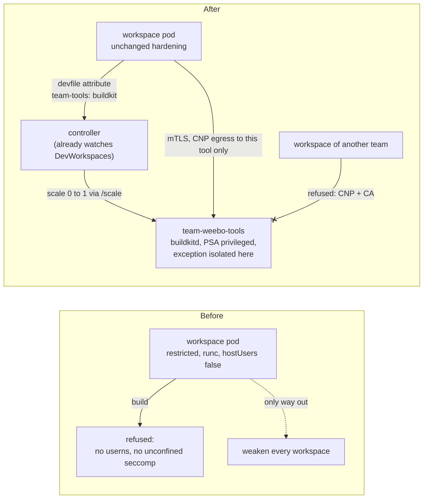
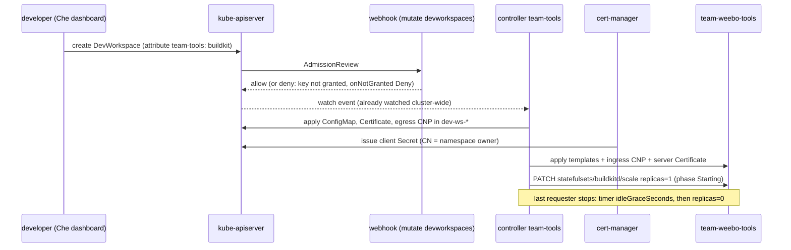
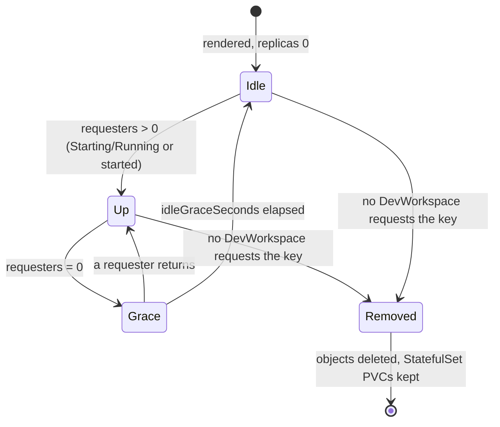
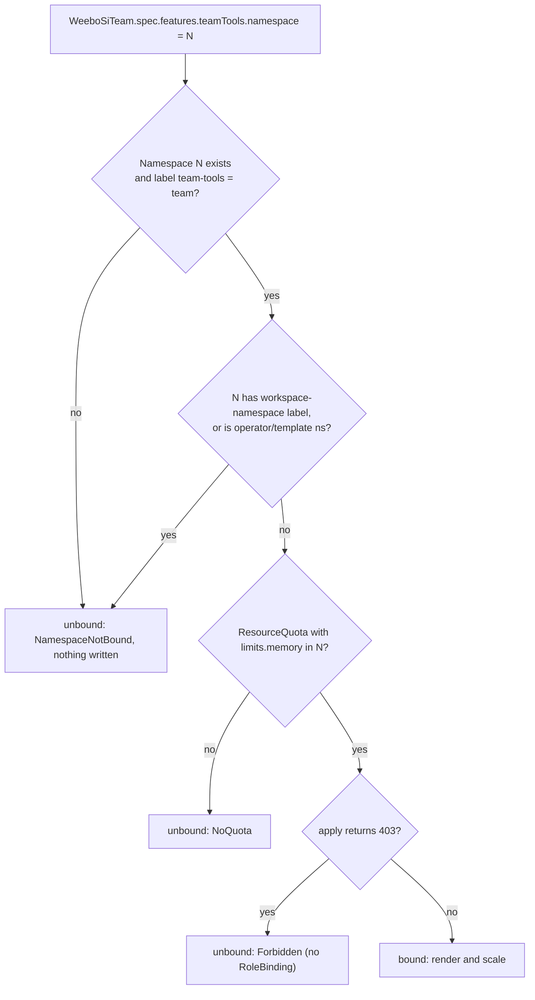
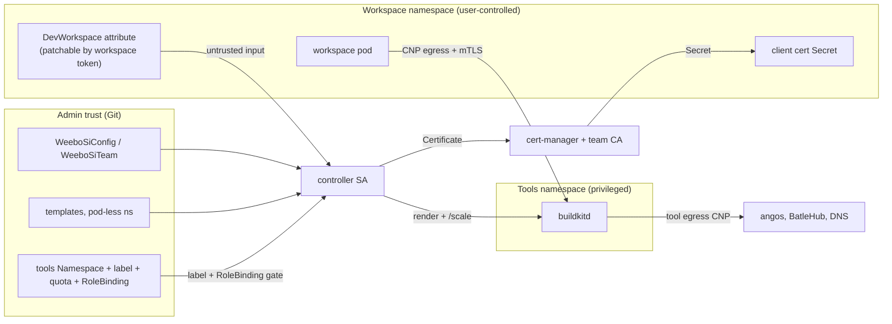

# RFC 0020 — team tools

> Reference material (~11 000 words). A reviewer short on time reads *Summary*, *Security
> considerations*, *Unresolved questions* and the BuildKit section of *Design*.

## Summary

A hardened workspace runs under restricted PSA, `hostUsers: false` (on runc: youki cannot do user
namespaces, V-06 [R26]) and KubeArmor. That is the point of this repository, and it also means a
workspace can neither build a container image (BuildKit wants a nested user namespace and unconfined
seccomp and AppArmor) nor run an Android emulator (it wants `/dev/kvm`). Today the choice is
"impossible" or "weaken every workspace".

`team-tools` is a new reconcile feature that moves those tools out of the workspace into a
**tools namespace per team**, declared by the admin in Git, and starts them **on demand**. An
admin writes a catalogue of tools whose objects are templates, real objects in the template
namespace (the [RFC 0004](./0004-network-profiles.md) / [RFC 0014](./0014-resource-quotas.md)
pattern). A team is granted some keys. A workspace asks for a tool with a devfile attribute; the
controller, which already watches DevWorkspaces, renders the tool into the team's tools
namespace, scales it to 1 through the `/scale` subresource while a requester runs and back to 0
after an idle grace, and writes the client side (endpoint ConfigMap, per-user client
certificate, egress policy) into the requesting workspace namespace. Every other tool stays a
sidecar in the workspace pod and needs no code at all.

### Before / after

```text
# before: the workspace has no way to build
$ docker buildx build -t registry.pkg.weebo.poc/weebo/app:dev --push .
ERROR: Cannot connect to the Docker daemon ... (Che: disableContainerBuildCapabilities=true)

# after: the devfile asks, the team's buildkitd starts, mTLS as the user
# devfile.yaml
attributes:
  hardening.weebo.io/team-tools: buildkit
$ echo $BUILDKIT_HOST                      # from the generated ConfigMap, mounted as env
tcp://buildkitd.team-weebo-tools.svc:1234
$ C=/home/user/.config/weebo/buildkit     # the client certificate Secret, mounted as files
$ docker buildx create --name team --driver remote \
    --driver-opt cacert=$C/ca.crt,cert=$C/tls.crt,key=$C/tls.key "$BUILDKIT_HOST"   # once
$ docker buildx build --builder team -t registry.pkg.weebo.poc/weebo/app:dev --push .
...
#12 pushing layers to registry.pkg.weebo.poc/weebo/app:dev  done
```



The diagram shows the one thing this RFC buys: the exception moves to one namespace per team,
and the refused path (another team's workspace) is refused twice, by the network and by TLS.

## Motivation

1. **No workspace can build an image today, nor in the target state.** The CheCluster sets
   `disableContainerBuildCapabilities: true` [R25]. The plan's target state for the workspace pod is
   PSA `restricted`, `hostUsers: false` and a KubeArmor policy; today the namespaces are at
   `baseline` [R17], and `hostUsers: false` under youki is blocked by the runtime itself [R26].
   Rootless `buildkitd` needs `seccomp=unconfined` and `apparmor=unconfined` for `unshare` and
   `mount` [R22]. Falsifiable: `buildctl build` inside a hardened workspace on
   `dev-ws-batleforc-test` fails; V-16 (PASS, 2026-11-24) showed the daemon needs PSA `privileged`.
2. **No workspace can run an Android emulator** (deferred: no entry in this RFC). It needs
   `/dev/kvm`, exposed by a device plugin (V-17), and 2 to 4 GiB per instance. Granting a device to
   a workspace pod is exactly the exception the hardening plan refuses.
3. **The only existing remedy weakens every workspace.** Raising a namespace's PSA level or adding a
   KubeArmor exception applies to every pod of that namespace, so to every workspace of that user,
   whether it builds or not. Falsifiable: `pod-security` (RFC 0013) writes one level per namespace,
   not per workspace.
4. **Nothing starts and stops a shared tool on demand.** A tool left at one replica costs RAM on a
   single 64 GiB node [R17]; a tool at zero replicas is a manual `kubectl scale` per build. The
   controller already watches every DevWorkspace cluster-wide [R13, R14], so the signal exists and
   nobody reads it for this.
5. **A per-team tool needs a client side no admin wants to write by hand.** The workspace needs the
   endpoint, a client certificate and an egress rule towards exactly that tool. Without automation
   those are per-user objects in per-user namespaces, created and garbage-collected by hand.

**Outcome we are buying:** a workspace stays fully hardened and still builds images (motivation 2,
emulators, is deferred to a later catalogue entry and only shapes the model), against a per-team
daemon that exists only while somebody needs it, reachable only from that team, with every
privileged exception confined to a namespace the admin named in Git.

## Goals and non-goals

**Goals.** A catalogue of team tools as templates; a team grant (`allowed`, `default`); a tools
namespace declared and labelled by the admin; on-demand scale from DevWorkspace phase; the
client side rendered into requesting namespaces; network isolation between teams on both sides;
per-user client certificates; BuildKit as the reference entry.

**Non-goals.**

- **Sidecars.** Postgres, Redis, a dev S3, Playwright, sccache stay devfile components in the
  workspace pod. They need no code: same pod, so they inherit image-policy, PSA, KubeArmor, the
  network profiles and the quota with no exception to write. The rule deciding sidecar versus
  team tool is in *Guide-level explanation*; implementing a sidecar library is weebo-si's devfile
  work (plan phase 8), not this brick.
- **Creating the tools namespace.** The admin writes it in Git with the team. The controller gets
  no cluster-wide `namespaces/create` (see *Unresolved questions → Resolved*, 3).
- **Activity-based scale-down.** v1 scales on requesters only; reading `buildkitd` build counts or
  `adb` connections is future work.
- **One instance per user.** Shared inside a team is accepted (Resolved, 7).
- **The Android emulator entry.** A second catalogue entry, future, blocked on V-17 and a device
  plugin. The model is shaped so it fits, nothing more.
- **A TCP activator** (KEDA, Knative). The cold start is absorbed by client retries; see
  *Alternatives*.
- **Image policy on tool pods.** The pod floor and `image-rewrite` cover workspace namespaces
  only [R10]; tool images are admin-written templates. Listed under *Deliberately untouched*.

## Guide-level explanation

### The rule: sidecar by default

A tool is a **sidecar** unless it meets at least one of these, in which case it is a **team
tool**:

| Criterion | Example | Why it moves out |
| --- | --- | --- |
| Needs a privilege or a device the workspace lacks | BuildKit (nested userns, unconfined seccomp and AppArmor), emulator (`/dev/kvm`) | The decisive one: the workspace pod must never need an exception. |
| Too heavy for one copy per developer, idle most of the time | emulator, 2 to 4 GiB each | One shared copy, started on demand. |
| Its state only has value shared | BuildKit's layer cache | A per-user cache is a cold cache. |

A sidecar runs under `restricted`, `hostUsers: false` and the workspace's fixed uid (RFC 0018), holds state
the developer can throw away, and is reached on `localhost`.

### What the admin writes

The tools namespace, in Git next to the team, labelled with the team it serves, with its quota
and the RoleBinding that lets the controller act there (*Security → Privileges*):

```yaml
apiVersion: v1
kind: Namespace
metadata:
  name: team-weebo-tools
  labels:
    hardening.weebo.io/team-tools: weebo            # proof of admin intent, must equal the team
    pod-security.kubernetes.io/enforce: privileged  # V-16, 2026-11-24; an explicit Git decision
    # NOT hardening.weebo.io/workspace-namespace: a tools namespace is not a workspace namespace
---
apiVersion: v1
kind: ResourceQuota
metadata: {name: tools-quota, namespace: team-weebo-tools}
spec:
  hard: {requests.cpu: "4", limits.memory: 12Gi, requests.storage: 60Gi, pods: "6",
         services.nodeports: "0", services.loadbalancers: "0"}
---
apiVersion: rbac.authorization.k8s.io/v1
kind: RoleBinding
metadata: {name: weebo-si-team-tools, namespace: team-weebo-tools}
roleRef: {apiGroup: rbac.authorization.k8s.io, kind: ClusterRole, name: weebo-si-team-tools}
subjects:
  - {kind: ServiceAccount, name: weebo-si-operator-controller, namespace: weebo-si-hardening}
```

The tool, as templates in the pod-less template namespace RFC 0014 settled on. A template is a
real object, so the workload template is written at `replicas: 0`:

```yaml
apiVersion: apps/v1
kind: StatefulSet
metadata: {name: buildkitd, namespace: weebo-si-hardening-templates}
spec:
  replicas: 0                                   # required; validated
  selector: {matchLabels: {app: buildkitd}}
  template:
    metadata: {labels: {app: buildkitd}}
    spec:
      hostUsers: false
      automountServiceAccountToken: false       # required; validated (T-40)
      containers:
        - name: buildkitd
          image: registry.pkg.weebo.poc/moby/buildkit:v0.35.1-rootless
          args: [--addr, "tcp://0.0.0.0:1234", --config, /etc/buildkit/buildkitd.toml,
                 --tlscacert, /certs/ca.crt, --tlscert, /certs/tls.crt, --tlskey, /certs/tls.key]
                 # no --oci-worker-no-process-sandbox: the exception, only if V-16 fails (Resolved, 12)
          securityContext:
            runAsUser: 1000
            procMount: Unmasked                 # with hostUsers: false below; tried first in V-16
            seccompProfile: {type: Unconfined}
            appArmorProfile: {type: Unconfined}
          volumeMounts: [...]                    # certs (server Secret), config, cache
  volumeClaimTemplates:                          # the team cache: survives scale to zero
    - metadata: {name: cache}
      spec: {accessModes: [ReadWriteOnce], resources: {requests: {storage: 40Gi}}}
```

Plus a `Service`, a `ConfigMap` holding `buildkitd.toml`, and the tool's own egress
`CiliumNetworkPolicy` (what `RUN` steps may reach). The configuration names them and grants them:

```yaml
apiVersion: hardening.weebo.io/v1alpha1
kind: WeeboSiConfig
metadata: {name: cluster}
spec:
  features:
    teamTools:
      mode: DryRun
      idleGraceSeconds: 600
      onNotGranted: Default
      catalog:
        - key: buildkit
          workload: {kind: StatefulSet, name: buildkitd}
          service: {name: buildkitd, port: 1234}
          clientEnv: BUILDKIT_HOST                # value generated: tcp://buildkitd.<ns>.svc:1234
          tls:
            serverSecretName: buildkitd-tls
            clientDuration: 24h
            clientMountPath: /home/user/.config/weebo/buildkit
          toolTemplates:
            - {kind: StatefulSet, name: buildkitd, namespace: weebo-si-hardening-templates}
            - {kind: Service, name: buildkitd, namespace: weebo-si-hardening-templates}
            - {kind: ConfigMap, name: buildkitd-toml, namespace: weebo-si-hardening-templates}
            - {kind: CiliumNetworkPolicy, name: buildkitd-egress, namespace: weebo-si-hardening-templates}
          requesterTemplates:
            - {kind: ConfigMap, name: buildx-client, namespace: weebo-si-hardening-templates}
---
apiVersion: hardening.weebo.io/v1alpha1
kind: WeeboSiTeam
metadata: {name: weebo}
spec:
  namespaceSelector: {matchLabels: {weebo.io/team: weebo}}
  features:
    teamTools:
      namespace: team-weebo-tools
      issuerRef: {kind: ClusterIssuer, name: team-weebo-tools-ca}
      allowed: [buildkit]
      default: []                                 # nobody gets a tool without asking
```

And a developer asks, in the devfile:

```yaml
attributes:
  hardening.weebo.io/team-tools: buildkit
```

### Behaviour rules

- **The uninteresting case.** No `teamTools` block, or `mode: Off`, or a team with no
  `teamTools` block, or a workspace with no attribute and an empty team `default`: nothing is
  rendered, nothing scales, the workspace is untouched. A namespace with no team gets no tool,
  ever: there is no cluster `default` because there is no tools namespace to put it in.
- **Attribute absent versus empty.** Absent means "the team `default`". Present and empty
  (`""`) means "no tool", even if the team has a default.
- **Request.** The attribute is a comma-separated list of keys, at most 8, deduplicated in order.
  Each is checked against the team's `allowed`. An ungranted key is dropped and logged under
  `onNotGranted: Default`. Under `Deny`, admission refuses only a `CREATE` naming it, or an
  `UPDATE` that starts the workspace (`spec.started` false to true); any other `UPDATE` (a
  grant revoked while the workspace exists, a label change by DWO) is admitted, the key is
  dropped, and an Event plus an admission warning say so, so a revocation never wedges an
  existing DevWorkspace.
- **Verdict on the DevWorkspace.** As RFC 0019 does, the admission gate writes the annotation
  `hardening.weebo.io/team-tools: granted=<keys>;dropped=<keys>` (`Enforce` only), the
  developer's channel for "why is my tool missing".
- **Attribute added to a running workspace.** The tool is rendered and scaled, but DWO mounts
  the client objects only at pod creation: an Event `TeamToolRestartNeeded` asks for one
  restart.
- **Render.** While at least one DevWorkspace of the team requests a key (any phase, including
  stopped), the tool templates exist in the tools namespace and the requester objects exist in
  every requesting workspace namespace. Rendering early is what lets DWO automount the client
  objects on the workspace's first start.
- **Scale.** Desired replicas of the tool's workload is 1 while at least one requesting
  DevWorkspace of the team has `spec.started: true` or `status.phase` in `Starting`/`Running`.
  When that count reaches 0, it stays 1 for `idleGraceSeconds` (default 600), then 0. Written
  only through the `/scale` subresource.
- **Cold start.** The tool starts with the IDE; if it is not ready yet, `buildx` and `buildctl`
  retry the connection. Nothing waits on the controller.
- **Unrequest.** When no DevWorkspace of the team requests the key any more (attribute removed,
  workspaces deleted), the tool's rendered objects are deleted except the PVCs of the
  StatefulSet, which Kubernetes keeps by default: the cache survives. Requester objects are
  deleted when their namespace has no requester; per-workspace egress policies go with their
  DevWorkspace through `ownerReferences`.
- **Shared within a team.** Every requester of a team reaches the same daemon and cache.

### Validation

| Check | Kind | Where it is seen |
| --- | --- | --- |
| Catalogue `key` a DNS label of at most 40 characters, at most 32 entries, at most 16 templates per entry, attribute key list at most 8 | hard, CRD CEL | `kubectl apply` refused |
| Every template ref exists, is of an allowed kind, lives in the template namespace | hard, `validate()` | entry not applied; `WeeboSiConfig` `Degraded`; `entries{state="invalid"}` |
| Tool template kinds ⊆ {`Deployment`, `StatefulSet`, `Service`, `ConfigMap`, `CiliumNetworkPolicy`}; requester kinds ⊆ {`ConfigMap`} | hard, `validate()` | same |
| `workload` names exactly one `Deployment`/`StatefulSet` among the tool templates, with `spec.replicas: 0` written explicitly | hard, `validate()` | same |
| Workload pod spec: `automountServiceAccountToken: false` and no projected service-account-token volume, `serviceAccountName` absent or `default`, no `privileged: true`, no `capabilities.add`, no `hostNetwork`/`hostPID`/`hostIPC`, no `hostPort`, no `hostPath` volume, `runtimeClassName` absent or in the chart's `teamTools.allowedRuntimeClasses` (default `[]`) | hard, `validate()` | same |
| A client certificate is minted only for a requesting namespace labelled `hardening.weebo.io/workspace-namespace=true`, not labelled `hardening.weebo.io/exclude`, and carrying `che.eclipse.org/username`; otherwise no certificate (fail closed) | hard, per reconcile | requester `Pending`; Event `TeamToolNoIdentity` on the DevWorkspace |
| `service.port` is a port of the `Service` template | hard, `validate()` | same |
| Team `allowed`/`default` keys exist in the catalogue, `default` ⊆ `allowed` | hard, `validate()` | team block ignored; `WeeboSiTeam` `Degraded` |
| Team `namespace` exists, carries `hardening.weebo.io/team-tools=<team>`, does not carry `hardening.weebo.io/workspace-namespace`, is neither the operator nor the template namespace | hard, per reconcile | team `unbound`, nothing written there; `WeeboSiTeam` condition `TeamToolsReady=False`, reason `NamespaceNotBound` |
| Tools namespace holds at least one `ResourceQuota` constraining `limits.memory` | hard, per reconcile | team `unbound`, reason `NoQuota` |
| A write in the tools namespace returns 403 (RoleBinding missing) | hard, per reconcile | team `unbound`, reason `Forbidden` |
| A requested key the team is not granted | warning (`Default`) or refusal (`Deny`) | log `result=not_granted`; a Kubernetes `Event` on the DevWorkspace; refusal text in the client |

The chassis has no admission `warnings` field today [R5]; RFC 0019's PR 1 adds it and lands before
this feature's admission PR. From then, `onNotGranted: Default` also emits an admission warning,
visible in `kubectl` only (the Che dashboard drops warnings, V-14). Until then, and for dashboard
users always, a warning is seen in the verdict annotation, an Event on the DevWorkspace, the
`WeeboSiTeam` status and the log. An invalid entry **keeps** what is already rendered: "the new
configuration is broken" never means "delete the running tool".

### Mocks

Nominal, the team status (`kubectl get weebositeam weebo -o yaml`, the new block):

```text
status:
  teamTools:
    - key: buildkit
      namespace: team-weebo-tools
      replicas: 1
      requesters: 2
      state: Running
  conditions:
    - type: TeamToolsReady
      status: "True"
      reason: Bound
```

Decides that the team status names counts, never which users are requesting (privacy).

Empty, no requester for a granted tool:

```text
status:
  teamTools:
    - {key: buildkit, namespace: team-weebo-tools, replicas: 0, requesters: 0, state: Idle}
```

Error, the namespace is not bound:

```text
  conditions:
    - type: TeamToolsReady
      status: "False"
      reason: NamespaceNotBound
      message: 'namespace team-weebo-tools does not carry hardening.weebo.io/team-tools=weebo;
        nothing is rendered there'
```

DryRun log:

```text
INFO  feature=team-tools mode=DryRun team=weebo tool=buildkit requesters=1
      diff=create:StatefulSet/buildkitd,create:Service/buildkitd,create:CiliumNetworkPolicy/weebo-team-tool-buildkit-ingress
      scale=0->1 (not written)
```

The warning, `onNotGranted: Default`, as an Event on the DevWorkspace:

```text
$ kubectl get events -n dev-ws-batleforc-test --field-selector involvedObject.kind=DevWorkspace
TYPE      REASON              OBJECT                   MESSAGE
Warning   TeamToolNotGranted  devworkspace/python-web  team tool "android" is not granted to team
                                                       weebo; ignored
```

The refusal, `onNotGranted: Deny`, as the developer sees it creating the workspace:

```text
$ kubectl apply -f devworkspace.yaml
Error from server (Forbidden): error when creating "devworkspace.yaml": admission webhook
"devworkspaces.hardening.weebo.io" denied the request: team tool "android" is not granted to
team weebo
$ echo $?
1
```

A grant revoked while the workspace exists (`allowed: []` after the fact), on the next `UPDATE`
(here a stop), under `Deny`: admitted, warned (once RFC 0019 PR 1 is in), the tool dropped:

```text
$ kubectl patch dw python-web --type merge -p '{"spec":{"started":false}}'
Warning: team tool "buildkit" is no longer granted to team weebo; dropped
devworkspace.workspace.devfile.io/python-web patched
$ kubectl get dw python-web -o jsonpath='{.metadata.annotations.hardening\.weebo\.io/team-tools}'
granted=;dropped=buildkit
```

Inside the workspace, nominal (what the generated ConfigMap and the certificate give):

```text
$ env | grep BUILDKIT_HOST
BUILDKIT_HOST=tcp://buildkitd.team-weebo-tools.svc:1234
$ ls /home/user/.config/weebo/buildkit
ca.crt  tls.crt  tls.key
```

Cold start: the first build right after the IDE opens may find the daemon still starting. The
expected client behaviour, to be replaced by the real text in the proof:

```text
$ docker buildx inspect --bootstrap team        # waits until the daemon answers
Name:   team
Driver: remote
Status: running
$ docker buildx inspect --bootstrap team        # still refused after ~2 min: check the verdict
ERROR: ... connect: connection refused
$ kubectl get dw python-web -o jsonpath='{.metadata.annotations.hardening\.weebo\.io/team-tools}'
granted=buildkit;dropped=
$ echo $?   # of the inspect
1
```

Granted but refused after two minutes means the tool did not start: the team status
(`state`, `TeamToolsReady`) says why.

The cross-team refusal at the client (T-39), from a workspace of team `data`:

```text
$ buildctl --addr tcp://buildkitd.team-weebo-tools.svc:1234 debug workers
error: failed to get workers: connection error: desc = "transport: Error while dialing: dial tcp
10.43.12.7:1234: i/o timeout"
$ echo $?
1
```

The first mock decides what the status carries; the last two decide that the refusal is a
network timeout, not a TLS error, because the packet never reaches the daemon.

## Design

### Contract

#### `spec.features.teamTools` (`WeeboSiConfig`)

| Field | Type | Default | Meaning |
| --- | --- | --- | --- |
| `mode` | `FeatureMode` | — | required, per the chassis |
| `namespaceSelector` | `Option<Selector>` | none | per the chassis: narrows which *requesting* namespaces are read |
| `catalog` | `Vec<ToolEntry>` (≤ 32) | — | required, may be empty |
| `workspaceSelection.attribute` | `String` | `hardening.weebo.io/team-tools` | DevWorkspace attribute naming a key list; `""` disables requests |
| `onNotGranted` | `OnNotGranted` | `Default` | reused from `network_profiles.rs` [R3] |
| `idleGraceSeconds` | `u32` | `600` | time a tool stays up after its last requester stops |

`ToolEntry`:

| Field | Type | Meaning |
| --- | --- | --- |
| `key` | `ToolKey` (DNS label ≤ 40) | catalogue key, the attribute's vocabulary |
| `workload` | `{kind: Deployment\|StatefulSet, name: String}` | the tool template scaled on demand |
| `service` | `{name: String, port: u16}` | the port the ingress and egress policies open |
| `clientEnv` | `Option<String>` (env var name) | key of the generated endpoint ConfigMap |
| `tls` | `Option<{serverSecretName, clientDuration, clientMountPath}>` | server and per-user client certificates; absent means no mTLS, allowed and logged at `info` (Resolved, 14) |
| `toolTemplates` | `Vec<TemplateRef>` (≤ 16) | rendered into the tools namespace |
| `requesterTemplates` | `Vec<TemplateRef>` (≤ 16) | `ConfigMap` only, rendered into requesting namespaces |
| `idleGraceSeconds` | `Option<u32>` | per-tool override |

`TemplateRef` is `{kind, name, namespace}`, the namespace equal to the template namespace.

#### `spec.features.teamTools` (`WeeboSiTeam`)

| Field | Type | Default | Meaning |
| --- | --- | --- | --- |
| `namespace` | `NamespaceName` | — | required; the tools namespace, which must carry `hardening.weebo.io/team-tools=<team name>` |
| `issuerRef` | `{kind: ClusterIssuer, name}` | — | required when any allowed entry has `tls`; this team's CA. `kind` is `ClusterIssuer` only (CEL), since a namespaced `Issuer` cannot serve workspace namespaces |
| `allowed` | `Vec<ToolKey>` | `[]` | keys this team may request |
| `default` | `Vec<ToolKey>` | `[]` | keys a workspace with no attribute gets; ⊆ `allowed` |

The team is matched to namespaces by its `namespaceSelector` [R2]; the `weebo.io/team` label is
weebo-si's convention, not the operator's contract.

#### Labels, annotations, names

| Key / name | On | Written by |
| --- | --- | --- |
| `hardening.weebo.io/team-tools=<team>` | the tools Namespace | the admin, read only |
| `hardening.weebo.io/team-tools: <keys>` | DevWorkspace `spec.template.attributes` | the developer |
| `hardening.weebo.io/managed-by=weebo-si-operator` | every rendered object | controller [R8] |
| `hardening.weebo.io/team-tool=<key>` | every rendered object | controller |
| *(never)* `hardening.weebo.io/profile` | rendered policies | must stay absent; see the invariant |
| `weebo-team-tool-<key>-ingress` | CNP, tools namespace | controller |
| `weebo-team-tool-<key>-server` | `Certificate`, tools namespace | controller |
| `weebo-team-tool-<key>` | endpoint `ConfigMap`, workspace namespace | controller |
| `weebo-team-tool-<key>-client` | `Certificate` and its `Secret`, workspace namespace | controller, cert-manager |
| `weebo-team-tool-<key>-<devworkspaceId>` | egress CNP, workspace namespace | controller |

Field manager `weebo-si-team-tools` for every apply; `/scale` writes under
`weebo-si-team-tools-scale`.

#### Admission

`team-tools` adds the **fourth** registry to `/mutate/v1alpha1/devworkspaces` (webhook
`devworkspaces.hardening.weebo.io`, `failurePolicy: Fail` [R27]). The global order, stated
identically in RFC 0019: network-profiles workspace gate → devfile-contract (RFC 0019) →
dwoc-pin → team-tools. Its verdicts: deny a `CREATE` or a start naming an ungranted key under
`Deny`; otherwise allow, with the verdict annotation as its only mutation and the warnings above.

Being the fourth, this RFC carries the fold RFC 0019 deferred: `mutate_devworkspaces` becomes
one loop over an ordered list of registries, first denial wins, mutations and warnings of every
registry concatenated. Today the network-profiles branch drops its `Allow(_)` payload
(`router.rs:183` [R11]); the router test `every_registry_allow_payload_is_kept` pins that no
registry's mutations or warnings are lost. `bound_warnings` / `MAX_WARNINGS` (RFC 0019) run
once, on the merged list, after the loop, not per `admit()`.

#### Observability

| Metric | Type | Labels |
| --- | --- | --- |
| `weebo_si_team_tools_replicas` | gauge | `team`, `tool` |
| `weebo_si_team_tools_requesters` | gauge | `team`, `tool` |
| `weebo_si_team_tools_scale_total` | counter | `team`, `tool`, `direction` ∈ `up`/`down`, `result` ∈ `ok`/`error` |
| `weebo_si_team_tools_up_without_requester` | gauge | `team`, `tool` (1 when replicas > 0, requesters 0, past grace + 60 s) |
| `weebo_si_team_tools_reconcile_total` | counter | `result` ∈ `applied`/`unchanged`/`deleted`/`not_granted`/`invalid`/`unbound`/`forbidden`/`error` |
| `weebo_si_team_tools_entries` | gauge | `state` ∈ `valid`/`invalid` |

`team` is a `WeeboSiTeam` name and `tool` a catalogue key, both admin-written and bounded. No
metric carries a namespace or a user.

**Stability.** Feature id `team-tools`, the CRD fields, label keys, object names, field managers,
attribute key and metric names are the contract.

### Architecture

**Hexagonal: yes.** The three conditions of `hexagonal.md` hold [R15]: a real decision (grant
resolution, a scale state machine with a grace timer, a validation table), two external systems
(the Kubernetes API, cert-manager), and we want the scale decision tested without either.

Crates `weebo-si-team-tools` (domain: `ToolCatalog`, request resolution, `validate()`, the
`desired()` of three subjects, `ScaleDecision`) and `weebo-si-team-tools-adapters` (stores,
loop, metrics). Ports, in domain vocabulary:

- `ToolTemplateStore` — templates by ref, as domain values with the fields validation reads.
- `ToolsNamespaceStore` — one tools namespace: its labels, its quota presence, its rendered
  objects, apply/delete, and `scale(workload, replicas)`.
- `RequesterStore` — one workspace namespace: endpoint ConfigMap, copied ConfigMaps, client
  `Certificate`, egress CNPs; apply/delete.
- The chassis's `NamespaceView`, `FeatureGate` (teams through `FeatureGate::teams()` and
  `Context::teams()` [R28]), and `compute_owned_diff` [R6].
- `Clock` — a new port in `weebo-si-team-tools`, the same shape as endpoint-auth's [R28]; not
  shared, because the chassis has none and a domain crate must not depend on another feature's.

Three reconcile subjects, each an `OwnedScope`:

| Subject | Owns | Triggered by |
| --- | --- | --- |
| `TeamTool {team, key}` | everything in the tools namespace labelled `team-tool=<key>` | DevWorkspace events of the team, templates, the tools Namespace, the workload's `status` |
| `RequesterNamespace {ns, key}` | the namespace-scoped client objects | DevWorkspace events in `ns` |
| `RequestingWorkspace {devworkspaceId, key}` | the per-workspace egress CNP | the DevWorkspace itself |



The sequence proves the controller never needs a new watch on workspaces or a new signal: the
event it already receives is the trigger, and the only write in the tools namespace that changes
over time is one `/scale` patch.



The state machine proves T-41's claim: every path out of `Up` with zero requesters goes through
`Grace` to `Idle`, so a tool cannot stay up without a requester longer than the grace, plus one
controller restart (the timer is in memory, see *Data and state*).

**The invariant.** *Because a team-tools policy never carries `hardening.weebo.io/profile`,
network-profiles cannot see it, so it can neither delete it as a stale profile object nor count it
as a namespace baseline.* `KubePolicyStore::from_cilium` returns `None` for a managed CNP without
that label [R7, `kube_policy_store.rs:188`], and both `managed_in` and `has_baseline`
(`kube_policy_store.rs:291`) go through it. Carrying the label would be a real bug, not a cosmetic
one: the egress CNP selects `controller.devfile.io/devworkspace_id`, which is exactly the
`PodSelector::DevWorkspaceId` the network-profiles workspace pass owns [R6], so that pass would
delete it on its next reconcile. The test `a_team_tools_policy_is_invisible_to_network_profiles` in
the network-profiles adapter pins it. The second invariant: *because the controller can only write
in a namespace the admin both labelled and bound with a RoleBinding, a mistyped `namespace:
kube-system` renders nothing*: the label check is the feature's, the 403 is the apiserver's.



The flowchart proves the binding fails closed at each of three independent gates, two of which
the admin controls in Git and one of which the apiserver enforces.

### Data and state

- **Watches.** DevWorkspaces cluster-wide (existing [R13]); the template namespace's five kinds; per
  bound tools namespace, a namespaced watch of the rendered kinds filtered by `managed-by` and of
  `resourcequotas` (metadata only); managed CNPs, ConfigMaps and `certificates.cert-manager.io`
  cluster-wide filtered by `hardening.weebo.io/team-tool`. The `Certificate` and ConfigMap watches
  start only when `teamTools` is configured **and** the CRD and the RBAC are present, as the Cilium
  backend's watch does [R7]; a cluster without cert-manager runs every other feature unchanged.
- **The grace timer is in memory.** Keyed by `(team, key)`, set when requesters reach 0. A
  controller restart re-arms it from "now", so a tool may stay up one extra grace period. A
  controller in a crash loop re-arms it on every restart and keeps the tool up indefinitely; that is
  why the T-41 alert does not rely on the controller's own series (*Observability*). Persisting it
  in an annotation was rejected: one more write per idle transition for ten saved minutes.
- **`replicas` has exactly one writer.** The workload is created with `replicas: 0` by a plain
  create, then updated by server-side apply with `spec.replicas` stripped from the body, and scaled
  only through `/scale`. Because the apply manager never owned `replicas`, a template update cannot
  reset it to the API default of 1. `a_template_update_never_resets_replicas` (envtest) pins that.
- **The cache PVC** is created by the StatefulSet's `volumeClaimTemplates` and is never deleted by
  the feature, including at `Off`: it holds the only state worth keeping. Deleting it is an admin's
  `kubectl delete pvc`.
- **Nothing else is persisted.** The rendered set is derived from `spec`, templates and
  DevWorkspaces; the undo is deleting by label. `/readyz` waits only for the static caches
  (templates); a tools namespace cache that is not synced yet, or whose RoleBinding was removed,
  must not make the whole operator unready. It makes that team's tools `held` (no scale, no delete),
  because an empty cache must never read as "no requester, scale everything to 0".
- **Client certificate readiness.** A requester namespace's state is `Pending` until its
  `Certificate` is `Ready`, and the DevWorkspace gets the restart-once Event if it started before
  (Resolved 11 stays the policy for the first-start race).

### Detailed design

| File | Change |
| --- | --- |
| `crates/weebo-si-crd/src/team_tools.rs` (new) | `TeamToolsConfig`, `ToolEntry`, `ToolKey`, `TemplateRef`, `TeamTeamTools`, `ResolvedTeamToolsConfig = Resolved<TeamToolsConfig, ToolGrant>`; CEL `maxItems`/`maxLength` |
| `crates/weebo-si-crd/src/spec.rs` | `Features::team_tools` [R1] |
| `crates/weebo-si-crd/src/team.rs` | `TeamFeatures::team_tools` [R2]; `WeeboSiTeamStatus::team_tools: Vec<TeamToolStatus>` |
| `crates/weebo-si-crd/src/labels.rs` | `TEAM_TOOL_LABEL`, `TEAM_TOOLS_NAMESPACE_LABEL` |
| `crates/weebo-si-team-tools/src/` (new) | `resolve.rs` (attribute parsing, grant), `validate.rs` (the table), `scale.rs` (`ScaleDecision`, the grace state machine, pure over a clock port), `feature/` (three subjects, `ReconcileFeature::desired` [R4]), `workspace_gate.rs` (admission `Deny` on CREATE or start, verdict annotation, shaped like `WorkspaceAdmission` [R11]) |
| `crates/weebo-si-team-tools-adapters/src/` (new) | `kube_template_store.rs`, `kube_tools_namespace_store.rs` (namespaced watches started per bound namespace, create-then-apply, `/scale`), `kube_requester_store.rs`, `metrics.rs`, `controller.rs` |
| `crates/weebo-si-network-profiles-adapters/src/kube_policy_store.rs` | no change; one test pinning the invariant |
| `crates/weebo-si-webhook/src/router.rs` | `mutate_devworkspaces` folded into one loop over the ordered registries; `team_tools` the fourth |
| `crates/weebo-si-operator` | wiring, `--team-tools-template-namespace` |
| `charts/weebo-si-operator/templates/rbac.yaml` | `teamTools.rbac.enabled`: ClusterRole `weebo-si-team-tools` (unbound) and the cluster-wide additions; see *Privileges* |

No policy-guard change: the egress CNP carries `managed-by` and lives in a workspace namespace,
so the existing `CiliumNetworkPolicy` row already refuses anyone but the operator [R9, R10].

### BuildKit: the reference entry

- **Rootless on runc, exception isolated.** `moby/buildkit:<v>-rootless` with `seccomp` and
  `AppArmor` `Unconfined`, `procMount: Unmasked` and `hostUsers: false`, which keeps BuildKit's
  process sandbox [R22]; V-16 tries this first (Resolved, 12). Upstream's Kubernetes example uses
  `--oci-worker-no-process-sandbox` instead [R23]; that flag lets a `RUN` step kill, and depending
  on seccomp ptrace, any process of the daemon container, including reading the mounted TLS server
  key [R22]. V-16 already answered the PSA level (`privileged`, PASS 2026-11-24); the items still to
  run under V-16, gating PR 4, are: the sandbox mode, whether buildkitd logs the peer CN, whether it
  reloads a renewed server certificate without a restart (if not, the server certificate lasts 90
  days and the tool's rollout on renewal is documented), and the daemon's RAM under a build. It is
  **the exception**, used only if V-16 shows the first option fails, and then recorded as a residual
  with its owner (E1). The tools namespace runs on runc via its own RuntimeClass choice in the
  template, never the workspace DWOC.
- **mTLS per user, mandatory for this entry.** The reference BuildKit entry always carries `tls`;
  the generic allowance for an entry without it (Resolved, 14) does not extend to a build daemon,
  which executes code on the caller's behalf. The server certificate
  (`weebo-team-tool-buildkit-server`, dnsNames the service FQDN) and each client certificate are
  issued by the team's `issuerRef`, a CA no other team's daemon trusts. The client `Certificate`
  lives in the workspace namespace, `commonName` set to the namespace's `che.eclipse.org/username`
  annotation (writable by admins only [R18]), `organizations: [<team>]`, 24 h, and a
  `secretTemplate` carrying `controller.devfile.io/mount-to-devworkspace` so DWO mounts it, as
  registry-config's objects are [R12]. No Che user nor workspace token can create a `Certificate` or
  `CertificateRequest` [R19], so nobody but the controller (and cluster admins) can mint one.
- **Mirrors.** `image-rewrite` cannot reach inside BuildKit; `buildkitd.toml` names angos as the
  mirror per upstream (`[registry."docker.io"] mirrors = [...]`) [R23]. Push goes to angos' `weebo`
  repository with the developer's own registry credentials, which registry-config or the developer
  provides in the workspace; the daemon holds none.
- **`RUN` egress like a workspace.** The tool's egress CNP template allows DNS, angos and BatleHub,
  the same destinations as the `dev-registries` network profile, and nothing else.
- **Entitlements off.** `insecure-entitlements` (`network.host`, `security.insecure`, `device`) is
  disabled by default [R23]; the template sets none and passes no `--allow-insecure-entitlement`.
  T-40 checks it; the validation table does not parse TOML.
- **Cache** on the StatefulSet's PVC, sized under the tools quota; survives scale to zero.
- **Android emulator** is the second entry, future: a `StatefulSet` per emulator with the
  device-plugin resource, `adb` port on the ingress CNP, screen through endpoint-auth `team` access
  (RFC 0009). Blocked on V-17.

### Proof against a real client

Real consumers, pinned: Che dashboard `ghcr.io/weebo-si/che-dashboard:develop` (floating fork,
digest recorded at proof time), DevWorkspace Operator `v1.1.1`, kubectl client `v1.37.2` against
server `v1.36.2` [R16, R21], `buildctl`/`docker buildx` from BuildKit `v0.35.1` [R24] inside the
workspace image. The proof is a new `team-tools` suite in `weebo-si-e2e` on kind with
cert-manager, then the cluster tests below on `dev-ws-batleforc-test`.

1. With no requester, `kubectl get sts buildkitd -n team-weebo-tools -o jsonpath='{.spec.replicas}'`
   prints `0`, and no pod exists in the namespace.
2. Starting a workspace whose devfile carries `hardening.weebo.io/team-tools: buildkit` from the
   Che dashboard: within one reconcile, the StatefulSet's `managedFields` shows
   `weebo-si-team-tools-scale` owning `f:spec.f:replicas` at `1`, and
   `weebo_si_team_tools_scale_total{direction="up",result="ok"}` moved by one.
3. Inside the workspace, `env | grep BUILDKIT_HOST` prints
   `tcp://buildkitd.team-weebo-tools.svc:1234`, and the client certificate is mounted at
   `/home/user/.config/weebo/buildkit` with `CN=batleforc-test`.
4. `docker buildx build --push` from the workspace pushes to
   `registry.pkg.weebo.poc/weebo/...`; angos' access log shows the push, and a `FROM docker.io/...`
   is pulled through the angos mirror (angos log), never from `registry-1.docker.io` (Hubble shows
   no flow from the tools namespace to it).
5. **Refusal, cross team (T-39).** From a workspace of another team, `buildctl --addr
   tcp://buildkitd.team-weebo-tools.svc:1234 debug workers` exits 1 with `i/o timeout`; Hubble
   shows the flow `DROPPED (Policy denied)` at the tools namespace ingress, so the TLS handshake
   never started. With the CNP removed on kind, the same call fails with `tls: unknown
   certificate authority`: the second layer holds alone.
6. **Refusal, ungranted key.** `kubectl apply` of a DevWorkspace naming `android` under
   `onNotGranted: Deny` exits 1 with the message in *Mocks*; nothing is rendered in the tools
   namespace.
7. **Refusal, forged namespace.** A `WeeboSiTeam` pointing `teamTools.namespace` at
   `kube-system` yields `TeamToolsReady=False, reason NamespaceNotBound`, and the apiserver
   audit log shows no write by the controller in `kube-system`.
8. A client certificate issued with a short duration in kind (1 h, cert-manager's minimum)
   is renewed, and a build after renewal succeeds without a workspace restart (the 24 h case,
   compressed).
9. Stopping the workspace: the replica count stays `1` for 600 s, then reads `0`; the PVC
   `cache-buildkitd-0` still exists (T-41).
10. **Refusal, springboard (T-40).** A `RUN curl https://example.com` fails (Hubble `DROPPED`
   at the tools egress); `RUN cat /var/run/secrets/kubernetes.io/serviceaccount/token` fails with
   `No such file`; `RUN --mount=type=bind,source=/etc,target=/x` reads the build context's
   `/etc` path, not the daemon's.
11. A devfile sidecar with `privileged: true`, an image outside angos, or no limits is refused
    as T-01, T-29 and T-11 are (T-42): the sidecar has no pass, and this feature did not touch
    that path.

12. **Adoption from phase 0.** Objects created by the phase-0 chart (no `managed-by`) are taken
    over by the controller's force apply; the StatefulSet keeps its pod and its PVC (no delete,
    no re-create), checked by pod UID and PVC UID before and after.

Mapping: observations 1–3, 5–9 and 12 to the kind suite `team-tools`; 4, 10 to the cluster only
(angos, Hubble); V-16 before PR 4, V-17 before any Android entry; T-39 = 5, T-40 = 10, T-41 = 9,
T-42 = 11.

**Deliberately untouched.**

- Image policy and image-rewrite on tool pods: their webhooks select
  `hardening.weebo.io/workspace-namespace` [R10]; tool images are admin templates.
- `pod-security`, `podIdentity`, `kubearmor-policy` workspace rules on the tools namespace: it
  must not carry the workspace label, so they do not apply, by design.
- policy-guard on the tools namespace: no Che user has a RoleBinding there; RBAC is the guard.
- Che's `disableContainerBuildCapabilities`: stays `true`. Nothing builds in the workspace.
- network-profiles' reconcile and its `OwnedScope`: unchanged, protected by the invariant.
- DWOC and `dwoc-pin`: the tools namespace is not a workspace and has no DWOC.

## Security considerations

**Rating:** high. The feature creates workloads that run with privileges the rest of the
platform forbids, writes credentials into user namespaces, and adds cluster-wide write verbs.



The boundaries crossed: the DevWorkspace attribute (user-written) into the controller; the
workspace pod into the privileged namespace; a `RUN` step into the network.

| # | Threat | Where | Mitigation + enforcing fn | Negative test | Residual |
| --- | --- | --- | --- | --- | --- |
| S1 | Workspace of team B reaches team A's tool (T-39) | network, tools ns ingress | ingress CNP generated from team A's `namespaceSelector` + `workspace-namespace=true`, port only: `team_tools::render::ingress_policy`; client cert from team A's CA only: `buildkitd --tlscacert` | `ingress_admits_only_the_team_selector` (unit); e2e obs. 5 both layers | A namespace mislabelled `weebo.io/team=weebo` joins the team; labels are admin/Che-written [R18] |
| S2 | Spoofing a user: client cert with another CN | cert issuance | only the controller writes `Certificate`; CN from `che.eclipse.org/username`, not from the DevWorkspace: `requester::client_certificate`; users cannot create `Certificate`/`CertificateRequest` [R19] | `the_cn_comes_from_the_namespace_annotation_not_the_attribute`, `no_username_means_no_certificate` | A cluster admin can mint any cert; accepted |
| S3 | Minting a team client cert through cert-manager's ingress-shim: a user creates an Ingress annotated `cert-manager.io/cluster-issuer: team-weebo-tools-ca` (users may create Ingresses [R29]; the shim is on [R29]) | workspace ns Ingress | endpoint-auth's Ingress admission (`/mutate/v1/ingresses` [R30]) admits `cert-manager.io/cluster-issuer`/`issuer` only from an allow-list (default `[vault-issuer]`) and refuses `cert-manager.io/common-name` and the other subject keys outside an allow-list: `endpoint_auth::ingress_issuer_allowed` | `an_ingress_naming_a_team_ca_issuer_is_refused` | Pre-existing, unverified: the same path may yield a `vault-issuer` certificate for another hostname unless OpenBao's PKI role restricts domains; owner batleforc, check in the runbook |
| T1 | Forged request: the workspace token patches its own DevWorkspace attribute [R18] | admission + reconcile | the request is checked against the team grant: `resolve::requested_keys`; gains only tools the team is granted, started for itself | `an_ungranted_key_is_dropped` / `_denied_under_deny` | It can keep a granted tool up while its workspace runs; bounded by the tools quota |
| T2 | Tampering with the egress CNP to reach elsewhere | workspace ns | managed-by label: policy-guard's CNP row refuses non-operator writes [R9]; invisible to network-profiles (invariant) | existing guard table test + `a_team_tools_policy_is_invisible_to_network_profiles` | none new |
| T3 | Admin typo or hostile config points a team at `kube-system` | tools ns binding | label `team-tools=<team>` check + workspace-label refusal: `bind::check_tools_namespace`; RoleBinding only where the admin bound it | `an_unlabelled_namespace_is_never_written` + e2e obs. 7 | none |
| T4 | A template smuggles a privileged pod (hostPath, hostNetwork, privileged, token) | templates | `validate::workload_pod_spec` refuses them | one test per refused field | PSA `privileged` on the ns would admit them if an admin wrote them outside the feature |
| R1 | Who built what is unknown | buildkitd | per-user client cert; Hubble flow from the user's namespace | obs. 3; `the_client_certificate_cn_is_the_namespace_owner` | buildkitd's own logging of the peer CN checked in V-16; Hubble flows are the audit trail if absent (Resolved, 13) |
| T5 | A teammate poisons another's build: a shared `--mount=type=cache` or a cached layer is written by one build and read by the next; registry credentials sent with a build transit the shared daemon | shared daemon | none beyond the team boundary (S1); accepted with intra-team sharing (Resolved, 7) | — (accepted) | owner batleforc; one daemon per user stays future work |
| I1 | A teammate reads another teammate's build cache or secrets | shared daemon | accepted within a team (Resolved, 7) | — | accepted by the team owner |
| I2 | The client key leaks from the workspace | workspace ns | 24 h certificate, the key is the user's own credential, readable only in their namespace | `the_client_certificate_lasts_24h` | A compromised workspace builds as its user for ≤ 24 h |
| D1 | Tools exhaust the single node | tools ns | binding refused without a `ResourceQuota` on `limits.memory`: `bind::has_memory_quota` | `a_namespace_without_quota_is_unbound` | Quota sizing is the admin's |
| D2 | Tool stuck on with no requester (T-41) | scale | grace state machine: `scale::ScaleDecision`; alert on `up_without_requester` | `zero_requesters_reach_idle_after_grace` + obs. 8 | +1 grace after a restart |
| D3 | Many keys in the attribute | admission/reconcile | at most 8 keys parsed; a ninth stops the read and is reported as `<invalid>` (refused under `Deny`, warned under `Default`): `resolve::parse_keys` | `a_ninth_key_is_reported_as_invalid` | none |
| E1 | BuildKit as a springboard (T-40): `RUN` egress, SA token, bind mounts | tools ns | tool egress CNP template; `automountServiceAccountToken: false` validated; bind mounts only from context or stages (BuildKit semantics); insecure entitlements off [R23] | obs. 10; `a_workload_with_a_token_is_invalid`, `a_projected_token_volume_is_invalid`, `added_capabilities_are_invalid` | Only if V-16 forces `--oci-worker-no-process-sandbox`: a teammate's `RUN` step can signal or ptrace daemon processes and read the server key. The exception, owned by the RFC owner (batleforc), recorded in the runbook with the V-16 result |
| T6 | A hand edit of a rendered object in the tools namespace persists (added 2026-11-25) | tools ns | the tools namespace is admin-only (RBAC) | — (accepted) | Drift detection compares the stored fingerprint annotation, not the live body: an edit is not reverted while that annotation is unchanged, until the template or the render inputs change |
| E3 | A template runs the tool as root or in the host user namespace (added 2026-11-25) | tools ns | templates are admin-written; the tools quota and CNPs bound the namespace | — (accepted) | Tool pods are outside the pod-identity webhooks (the tools namespace carries no `workspace-namespace` label), and `validate::pod_spec_violations` does not check `runAsUser: 0`, `allowPrivilegeEscalation`, `procMount` or `hostUsers`; a template mistake there is not refused |
| E2 | Compromised controller writes privileged pods, ConfigMaps or certificates anywhere | RBAC | Deployment/StatefulSet write only through per-namespace RoleBindings the admin creates in tools namespaces; ConfigMap and `Certificate` write only through a RoleBinding in each workspace namespace, rendered by `2.helm/user-app` | `the_controller_cannot_write_outside_a_bound_namespace` (e2e kind with the chart's RBAC: `kubectl auth can-i create deployments -n kube-system --as=<controller SA>` = no) | Within a bound workspace namespace, a `Certificate` naming any allow-listed `ClusterIssuer` |

**Privileges (RBAC delta), controller role only.**

- *Per tools namespace, through an admin-created RoleBinding* to a new, **unbound** ClusterRole
  `weebo-si-team-tools`: `deployments`, `statefulsets`, `services`, `configmaps`,
  `ciliumnetworkpolicies`, `certificates.cert-manager.io`: get, list, watch, create, update,
  patch, delete; `deployments/scale`, `statefulsets/scale`: get, patch, update;
  `resourcequotas`: get, list, watch. **Chosen over a ClusterRole binding plus a namespace check
  in code**, because then the boundary is the apiserver's, and a bug in our label check, or a
  compromised controller, still cannot create a `StatefulSet` in `kube-system`. The cost is one
  RoleBinding per team in Git, next to the Namespace the admin already writes, and per-namespace
  watches instead of one cluster-wide watch. The pattern exists: identity's Role in Argo's
  namespace [R13].
- *Per workspace namespace*, through a RoleBinding to a second unbound ClusterRole
  `weebo-si-team-tools-requester` (`configmaps`, `certificates.cert-manager.io`: create, update,
  patch, delete), rendered in each workspace namespace by weebo-si's `2.helm/user-app` next to
  the namespace it already creates. Kubernetes RBAC cannot scope a write by namespace label, so
  the RoleBinding is the scope; a namespace without it reports `forbidden`, nothing else breaks.
  On the cluster today the controller cannot create ConfigMaps or `Certificate`s [R21].
- *Cluster-wide, read only*: `configmaps` and `certificates.cert-manager.io` get, list, watch,
  for the label-filtered watches; `ciliumnetworkpolicies` write already granted [R13, R21].
- *Template namespace*: read on the five template kinds, chart Role.
- Today the controller cannot patch `deployments/scale` anywhere nor create `Certificate`s [R21].
- Webhook role: unchanged; the admission gate reads the in-memory configuration.

**Trust boundary.** Admin-written: configuration, templates, the tools Namespace, its label,
quota and RoleBinding. User-written: the DevWorkspace attribute, which only chooses among
granted keys. The `che.eclipse.org/username` annotation is not user-writable [R18].

**Bypass.** Building elsewhere: a user who reaches no daemon cannot build; one who exfiltrates
their cert can build as themselves, which they already may. Requesting a tool in a namespace
outside the feature's `namespaceSelector`: not read, so not rendered. Pointing `BUILDKIT_HOST`
elsewhere: the egress CNP allows only the tool; network-profiles governs the rest.

*Note (2026-11-25).* The egress CNP sets `enableDefaultDeny: {egress: false, ingress: false}`
(Cilium ≥ 1.15; the cluster runs 1.19): it only adds the path to the tool. Without it, its
`egress` section would put the workspace into default-deny egress, cutting DNS and the kube-api
in a namespace where network-profiles is not enforcing.

**Blast radius.** A rendering bug starts a privileged daemon in a bound tools namespace, under
its quota; never outside it (RoleBinding). A scale bug leaves a tool up (alerted) or down
(builds fail until the next reconcile). A certificate bug issues a client cert with a wrong CN
to a user of the same team; cross-team is still refused by the network.

**Secrets.** The controller never reads a Secret: cert-manager writes the key into the Secret
named by the `Certificate`, and DWO mounts it. The team CA key stays in cert-manager's
namespace. The workspace token can read the client Secret in its own namespace (it has
`secrets get` [R18]); that is the user's own credential.

## Supply chain

No new Rust dependency (kube-rs already serves `/scale` and dynamic objects). New runtime
dependencies, both outside the operator binary: cert-manager, already on the cluster at
`v1.21.3` [R20], becomes a requirement of entries with `tls`; and the `moby/buildkit` rootless
image (`v0.35.1` at the time of writing [R24]), pulled through angos and pinned by tag in the
admin's template, never by the operator. The kind e2e suite adds both images to its preload
list.

| Component | Version | Pinned by | Licence | CVE status | Maintenance |
| --- | --- | --- | --- | --- | --- |
| `moby/buildkit` rootless image | `v0.35.1-rootless` [R24] | digest, in the admin's template (`@sha256:…`), recorded in the runbook | Apache-2.0 | **not run**: `trivy` is not usable on this workstation (the mise shim has no version configured), so no scan backs this row; PR 6 runs `trivy image` in CI before the image enters the preload list | active upstream, release `v0.35.1` on 2026-11-19 [R24] |
| cert-manager | `v1.21.3` (cluster) [R20] | the cluster's chart | Apache-2.0 | already in operation, unchanged by this RFC | active upstream |

## Data and privacy

- **Usernames** appear in the client certificate's `commonName` and Secret, in the user's own
  namespace; in the requesting namespace name (already the case everywhere); in controller logs
  at `info` (`ns=dev-ws-batleforc-test`), retained as ClickStack retains every operator log.
- **Never** in a metric label: labels are `team` and `tool`, both admin-written and bounded.
- **The team status** carries counts (`requesters: 2`), never names.
- **Build content** (source, layers, cache) lives on the team PVC, visible to every teammate's
  build by design (Resolved, 7); deleted with the PVC by an admin.

## Operational considerations

| Failure | Direction | Why |
| --- | --- | --- |
| Controller down | tool stays at its current replicas; no new client objects | Fail static: a running build is not killed; T-41's alert fires if it stays up |
| Template cache not synced | tools `held`: no scale, no delete | an empty cache must not read as "delete everything" |
| cert-manager down | no new client cert; existing ones keep working until expiry | fail closed for new users: no cert, no TLS |
| Webhook down | DevWorkspace writes refused (`failurePolicy: Fail`, existing) | unchanged |
| Tools namespace unbound | nothing rendered, requesting workspaces start without the tool | fail closed: no tool rather than a tool elsewhere |
| Node out of memory | tool pod Pending, quota refuses extra replicas | quota bounds the blast |

**Rollout.** Phase 0 (below) first, by hand. Then: `mode: DryRun` with the catalogue and the
`weebo` team, `namespaceSelector` on `dev-ws-batleforc-test`; read the DryRun diff and scale
lines for ≥ 7 days. Then `Enforce` on `dev-ws-batleforc-test`, run V-16, T-39, T-40, T-41. Then
remove the selector.

**Rollback.** `mode: Off`: every rendered object is deleted except the cache PVC; workspaces keep
running without the tool. Surgical: remove the key from the team's `allowed`.

**Observability.** To ClickStack via the existing OTel collectors: the six metrics, the reconcile
logs, Events on DevWorkspaces. Alerts: T-41 has two, because the controller's own gauge dies
with the controller: `weebo_si_team_tools_up_without_requester == 1` for 10 min, **and**
kube-state-metrics' `kube_statefulset_replicas` / `kube_deployment_spec_replicas` > 0 on a
`hardening.weebo.io/team-tool` workload while the controller's metrics are stale (no scrape for
10 min) or its pod restarted more than 3 times in 30 min (a crash loop re-arms the grace timer
forever). Also `reconcile_total{result="forbidden"|"unbound"}` increase and
`entries{state="invalid"} > 0`.

**Upgrade.** Old and new controllers compute the same objects from the same inputs; SSA under
one field manager converges; the scale writer is idempotent. CRD fields only grow.

**Capacity.** buildkitd: one pod per team, its RAM is what the V-16 run measures (expected low
GiB under a build; recorded in the runbook from the probe, not estimated here). Controller cost:
one namespaced watch set per bound team, a timer per tool.

## Other concerns

- **Accessibility:** no UI; status, Events and CLI text are plain text, readable by a screen
  reader as any `kubectl` output.
- **i18n:** messages in English, like every operator message.
- **Compliance:** per-user client certificates add an identity to builds; no new regulated data.
- **Licensing:** BuildKit is Apache-2.0, cert-manager Apache-2.0; neither is linked.
- **Documentation:** brick page `docs/bricks/team-tools.md`, `weebosiconfig.md` and
  `weebositeam.md` sections, a runbook "add a team tools namespace" in weebo-si.

## Alternatives considered

| Alternative | Cost that rejects it |
| --- | --- |
| Do nothing | Motivations 1 and 2 stay true: no image build and no emulator in any hardened workspace. |
| Weaken the workspace (PSA `privileged` or KubeArmor exception for builders) | Applies to the whole namespace (motivation 3), so to every workspace of that user; undoes RFC 0013 for them. |
| BuildKit as a sidecar | Same pod, so the sidecar's privileges are the workspace pod's: the exception this RFC exists to avoid. |
| Literal plan, v1 as an Argo Application per team (`2.helm/team-tools`, `ignoreDifferences` on `/spec/replicas`) | No on-demand, no grant check, no per-user mTLS automation; kept as phase 0 in *Integration*. |
| KEDA or Knative activator | A new operator and CRDs on the cluster plus a TCP proxy on the data path, to obtain a signal the controller already receives. |
| The operator creates the tools namespace | Needs cluster-wide `namespaces/create`; PSA `privileged` would become an operator decision instead of a Git one. |
| ClusterRole bound cluster-wide + namespace check in code | Boundary in our code instead of the apiserver's; a bug writes privileged pods anywhere. |
| A network profile for the egress to the tool | The egress must follow the request and the port is only known to the catalogue entry; an admin profile would be granted statically, request or not. |
| Activity-based scale-down in v1 | A metrics client and a parser for each tool, for a few minutes of saved RAM. |
| One instance per user | N daemons and N caches on one node; the cache stops being useful. Future work. |

## Drawbacks and risks

- **The tools namespace is privileged.** That is the point, and also the largest new exposure on
  the node: a buildkitd escape is a host-level problem under PSA `privileged`. Rootless,
  `hostUsers` where V-16 allows, and the quota reduce it; they do not remove it.
- **Shared within a team.** Cache poisoning by a teammate is possible and accepted.
- **First start race.** A workspace created and started in one step may start before its client
  objects exist, since DWO mounts what exists when it builds the pod (Resolved, 11).
- **cert-manager becomes load-bearing** for every tool with `tls`.
- **New cluster-wide write on `certificates`.**

## Unresolved questions

### Resolved

| # | Question | Decision |
| --- | --- | --- |
| 1 | What is a team tool versus a sidecar? | **Sidecar by default; team tool only if it needs a privilege or device the workspace lacks, is too heavy per developer and mostly idle, or its state only has value shared.** Sidecars inherit every control because they share the pod; this RFC covers team tools only. |
| 2 | Shape of the feature? | **A new reconcile feature `teamTools` (crate pair), a catalogue of templates in the template namespace, tool templates into the tools namespace, requester templates into requesting namespaces, team grant `allowed` + `default` (empty).** The house pattern (RFC 0004, 0014), reviewable as real objects. |
| 3 | Who creates the tools namespace? | **The admin, in Git; the operator acts only on a namespace labelled `hardening.weebo.io/team-tools=<team>` and never on one labelled as a workspace namespace.** No cluster-wide namespace create; PSA `privileged` is a Git decision; the label is proof of intent against `kube-system`. |
| 4 | On demand how? | **Desired replicas 1 while ≥ 1 requesting DevWorkspace of the team is started/Starting/Running, 0 after `idleGraceSeconds` (600), written via `/scale`, never by Argo; v1 on requesters only.** The controller already has the signal; activity metrics cost a client and a parser. |
| 5 | Network | **Ingress CNP in the tools namespace admitting only the team's workspace namespaces on the tool port; an operator-written egress CNP per requesting workspace, protected by policy-guard and invisible to network-profiles.** Egress must follow the request; the port is the catalogue's. |
| 6 | BuildKit specifics | **Rootless on runc in the tools namespace, mTLS per user via cert-manager, angos mirrors in `buildkitd.toml`, push to angos `weebo`, `RUN` egress as a workspace, cache on a team PVC; Android is a future second entry.** |
| 7 | Sharing | **Shared within a team is accepted; cross-team isolated by namespace, network and mTLS; one-instance-per-user is future work.** |
| 8 | The plan's Argo-chart v1 | **An integration phase 0 in weebo-si, shippable before this RFC; it lacks on-demand, grant check and per-user mTLS.** |
| 9 | RBAC in tools namespaces | **Unbound ClusterRole, bound per tools namespace by an admin RoleBinding.** The apiserver enforces the boundary; the label is intent, the RoleBinding is capability. |
| 10 | (was Still open 1) Client `Certificate` and ingress CNP: templated or generated? | **Generated from catalogue and team fields, not templated.** A `Certificate` template would itself be issued, and the ingress peers must follow the team's `namespaceSelector` [R2]. Accepted as recommended. |
| 11 | (was Still open 2) First-start race with DWO automount | **Render at the DevWorkspace's first event, measure the lost race in the kind suite, document "restart once" if it happens.** An admission hold cannot wait on objects its own create triggers. Accepted as recommended. |
| 12 | (was Still open 3) Process sandbox in buildkitd | **V-16 tries `procMount: Unmasked` with `hostUsers: false` first; `--oci-worker-no-process-sandbox` is the exception, used only if that fails, and recorded as a residual with its owner (E1).** Keeping the sandbox keeps a `RUN` step away from the daemon's processes and server key. Accepted as recommended. |
| 13 | (was Still open 4) Does buildkitd log the client CN? | **Checked in V-16; if absent, Hubble flows per namespace are the audit trail.** No code depends on the answer. Accepted as recommended. |
| 14 | (was Still open 5) An entry with a `service` but no `tls` | **Allowed and logged at `info`; the reference BuildKit entry keeps mTLS mandatory.** An emulator's `adb` has no TLS and the network already scopes it to the team; a build daemon runs code for its caller. Accepted as recommended. |
| 15 | (from last review, UX) Refuse what under `onNotGranted: Deny`? | **Only a `CREATE`, or an `UPDATE` that starts the workspace; every other `UPDATE` is admitted with the key dropped, an Event and a warning.** Refines the draft, which refused every `UPDATE`: a revoked grant must not wedge the DevWorkspace. |
| 16 | (from last review, stability) Phase 0 → phase 1 | **Argo `Delete=false,Prune=false`, then removal from the chart, then adoption by force server-side apply; never delete-then-create.** Keeps the pod and the cache PVC. |
| 17 | (from last review, security) cert-manager ingress-shim can mint a team client cert | **endpoint-auth's Ingress admission allow-lists issuer annotations (default `[vault-issuer]`) and refuses subject-forging keys; lands before any team CA.** Users can create Ingresses and the shim is on [R29]. |
| 18 | (from last review, security) `issuerRef.kind` | **`ClusterIssuer` only, by CEL.** A namespaced `Issuer` cannot serve dynamic workspace namespaces. |
| 19 | (from last review, security) ConfigMap and `Certificate` writes | **Per workspace namespace through a RoleBinding rendered by `2.helm/user-app`; cluster-wide read only.** Goes against the draft's cluster-wide write; the apiserver scopes the blast. |
| 20 | (from last review, cross-RFC) Registry order and the router | **Order network-profiles → devfile-contract → dwoc-pin → team-tools; this RFC folds the route into one loop, keeps every registry's payload, bounds warnings once after the merge.** One order stated in 0019 and 0020; the fourth registry is the point RFC 0019 deferred to. |

### Still open

None: every question raised by this draft is resolved above.

## Future work

- Activity-based scale-down (buildkitd build count, `adb` connections).
- One instance per user, for sensitive tools.
- The Android emulator entry (V-17, device plugin, ws-scrcpy behind endpoint-auth `team`).
- Image policy on tool pods, by extending the pod floor's selector to tools namespaces.
- Admission `warnings` in the chassis, so `onNotGranted: Default` reaches the developer's client.

## Test plan

- **Unit** (`weebo-si-team-tools`): attribute parsing (absent, empty, 9 keys, duplicates); grant
  resolution and `onNotGranted`; one test per validation row; `ScaleDecision` over a fake clock (up,
  grace, return, idle, removed); ingress peer derivation from a `Selector` with `matchLabels` and
  `matchExpressions`; CN from the annotation.
- **One negative test per STRIDE row:** S1 `ingress_admits_only_the_team_selector`; S2
  `the_cn_comes_from_the_namespace_annotation_not_the_attribute`; T1 `an_ungranted_key_is_dropped`,
  `an_ungranted_key_is_denied_under_deny`; T2
  `a_team_tools_policy_is_invisible_to_network_profiles`; T3
  `an_unlabelled_namespace_is_never_written`, `a_workspace_namespace_is_never_a_tools_namespace`; T4
  `a_privileged_template_is_invalid` (and hostPath, hostNetwork, hostPID, hostIPC); I2
  `the_client_certificate_lasts_24h`; D1 `a_namespace_without_quota_is_unbound`; D2
  `zero_requesters_reach_idle_after_grace`; D3 `a_ninth_key_is_reported_as_invalid`; E1
  `a_workload_with_a_token_is_invalid`, `a_projected_token_volume_is_invalid`,
  `added_capabilities_are_invalid`; E2 e2e kind with the chart RBAC
  `the_controller_cannot_write_outside_a_bound_namespace`; S3
  `an_ingress_naming_a_team_ca_issuer_is_refused` (endpoint-auth); R1
  `the_client_certificate_cn_is_the_namespace_owner`; T5 accepted, no test.
- **Router:** `every_registry_allow_payload_is_kept` (four registries, mutations and warnings of
  each survive the fold); `warnings_are_bounded_once_after_the_merge`.
- **Envtest:** `a_template_update_never_resets_replicas`; "invalid entry keeps rendered objects";
  `Off` deletes everything but the PVC.
- **e2e kind + Che** (`team-tools` suite, with cert-manager and buildkit): observations 1–3, 5–9 and
  12, plus E2. The RBAC test lives here, not in envtest: the chart's RBAC is what it proves, and the
  default `EnvTest::start` runs `AlwaysAllow` [R31].
- **Cluster:** V-16, V-17 (before Android), T-39, T-40, T-41, T-42 on `dev-ws-batleforc-test`.
- **Must stay green:** every e2e suite, including those that run without cert-manager installed (the
  conditional watches must not fail them); the policy-guard verdict table; `cargo test`
  workspace-wide.

## Implementation plan

- [x] PR 1 — `weebo-si-crd`: `TeamToolsConfig`, team block, status, labels, CEL (incl.
      `issuerRef.kind: ClusterIssuer`). A configuration validates and does nothing; the feature
      is listed in `crates/weebo-si-operator/src/features.rs` only in PR 4, with its wiring.
- [x] PR 2 — `weebo-si-team-tools`: resolution, validation table, `ScaleDecision`, three
      subjects' `desired()`, admission gate type; all unit tests above.
- [x] PR 3a — endpoint-auth: the Ingress issuer allow-list and subject-key refusal (S3). Lands
      before any team CA exists, so the shim path is closed first.
- [x] PR 3 — chart: unbound ClusterRoles `weebo-si-team-tools` and
      `weebo-si-team-tools-requester`, cluster-wide read of `certificates` and `configmaps`
      behind `teamTools.rbac.enabled` (default `false`), template-namespace Role,
      `--team-tools-template-namespace`. Lands **before** any writer so the boundary exists
      first.
- [x] PR 4 — `weebo-si-team-tools-adapters`: stores, `/scale`, controller loop, metrics,
      status, `features.rs` entry; envtest; the network-profiles invariant test. Gated by the
      remaining V-16 items. Security controls (binding gate,
      quota gate, template validation) are in PR 2 and wired here, never after.
- [x] PR 5 — webhook: fold `mutate_devworkspaces` into one loop over the ordered registries,
      `TeamToolsAdmission` as the fourth, verdict annotation, router tests. After RFC 0019 PR 1
      (chassis `warnings`).
- [x] PR 6 — e2e `team-tools` suite on kind with cert-manager and BuildKit.
- [x] PR 7 — docs: brick page, CRD pages; RFC to `Implemented`.
- [ ] On the cluster and in weebo-si (not done in this branch): the remaining V-16 items, phase 0
      and phase 1 of *Integration in weebo-si*, ≥ 7 days of `DryRun`, T-39 to T-42, and the
      `trivy image` scan of the BuildKit image (CI does not run one yet).

### Estimate

An analogy with comparable work in this repository, not a measurement. The references, from
`git show --shortstat` summed over each RFC's commits:

| Reference | Scope | Lines changed | Calendar |
| --- | --- | --- | --- |
| RFC 0014 resource-quotas | reconcile feature, templates in operator ns | ≈ +6 800 | 2026-10-31 → 2026-11-01 |
| RFC 0013 pod-security | reconcile feature + dry-run audit + e2e | ≈ +11 500 | 2026-10-31 → 2026-11-01 |
| RFC 0017 image-rewrite | admission mutation on an existing feature | ≈ +5 750 | 2026-11-12 |

| PR | Size | Compared to | Why |
| --- | --- | --- | --- |
| 1 CRD | S (≈ 800) | RFC 0014's CRD slice | two blocks, one status list, CEL |
| 2 domain | M (≈ 3 500) | RFC 0014's domain crate | similar validation table, plus a state machine and three subjects |
| 3a endpoint-auth issuer allow-list | S (≈ 600) | RFC 0017 (smaller) | one admission rule on an existing feature |
| 3 chart RBAC | S (≈ 400) | RFC 0014's RBAC item | two ClusterRoles, one flag |
| 4 adapters | L (≈ 5 500) | RFC 0013's adapters | per-namespace watches, create-then-apply, `/scale`, cert-manager objects |
| 5 admission + router fold | M (≈ 1 500) | network-profiles' `WorkspaceAdmission` | same gate shape, plus the loop over four registries |
| 6 e2e | M (≈ 2 500) | RFC 0013's e2e | two new preloaded images (cert-manager, buildkit) |
| 7 docs | S (≈ 600) | — | |

Total ≈ +15 500 lines, between RFC 0013 (≈ +11 500, two days) and twice RFC 0014 (≈ +6 800, two
days): about three to five working days of implementation by the same method. **Integration and
validation on the cluster** are calendar-bound: phase 0 one day; the remaining V-16 items before PR
4 merges; ≥ 7 days of `DryRun`; then `Enforce` on `dev-ws-batleforc-test` with T-39 to T-42.

### Integration in weebo-si

- **Phase 0, before this RFC ships:** an Argo Application per team, as identity does per user
  with `che-user-<user>`, rendering a new chart `2.helm/team-tools`: the `team-weebo-tools`
  Namespace (PSA from V-16), its quota, buildkitd at `replicas: 0`, its CNPs, the server
  certificate. Argo ignores `/spec/replicas` (`ignoreDifferences`) so selfHeal does not reset a
  manual scale. It lacks on-demand start and stop (a human runs `kubectl scale`), a grant check
  (any workspace of the team the CNP admits can connect), and per-user mTLS automation (client
  certs issued by hand).
- **Phase 1, with this RFC:** the same chart keeps only the Namespace, label, quota, RoleBinding
  and the team `ClusterIssuer`; the StatefulSet and its siblings move to templates in
  `2.argo/helm/che/hardening` (`feature-templates.yaml`), `teamTools` in
  `2.argo/helm/che/hardening/values.yaml` with `mode: DryRun` and `namespaceSelector` on
  `dev-ws-batleforc-test`, the `weebo` team block (`allowed: [buildkit]`), and
  `teamTools.rbac.enabled: true` in the operator's values. Argo stops managing the workload, so
  `ignoreDifferences` goes away.
- **Phase 0 → phase 1 adoption** (runbook, e2e observation 12): first set
  `argocd.argoproj.io/sync-options: Delete=false,Prune=false` on the phase-0 chart's
  StatefulSet, Service, ConfigMap and CNPs and sync; then remove them from the chart, so Argo
  forgets them without deleting; then enable `teamTools`. The controller adopts each object
  lacking `managed-by` by server-side apply **with force** under `weebo-si-team-tools`, never
  delete-then-create, so the pod and the cache PVC survive. A conflicting object it cannot
  adopt (wrong kind or selector) is reported `invalid`, not replaced.
- **Per workspace namespace:** `2.helm/user-app` renders the RoleBinding to
  `weebo-si-team-tools-requester` next to the namespace (`dev-ns.yaml`).
- **Runbook:** "add a team tools namespace" (namespace, label, quota, RoleBinding, issuer),
  "rotate a team CA", the V-16 results, and the OpenBao PKI role check (S3 residual).

## References

| # | Source | Pinned at | Supports |
| --- | --- | --- | --- |
| R1 | `crates/weebo-si-crd/src/spec.rs:26` `Features` | c412ee3 | one field per feature |
| R2 | `crates/weebo-si-crd/src/team.rs:73`, `:87`, `:198` | c412ee3 | team = name + `namespace_selector`; `TeamFeatures`; `WeeboSiTeamStatus` |
| R3 | `crates/weebo-si-crd/src/network_profiles.rs:204`, `:239` | c412ee3 | `OnNotGranted`, `WorkspaceSelection` reused |
| R4 | `crates/weebo-si-chassis/src/feature/reconcile.rs:22` | c412ee3 | `ReconcileFeature::desired`, mode-blind |
| R5 | `crates/weebo-si-chassis/src/feature/value.rs:98` | c412ee3 | `Decision` has no `warnings` |
| R6 | `crates/weebo-si-chassis/src/managed/scope.rs:32`, `:49` | c412ee3 | `OwnedScope`, `compute_owned_diff` |
| R7 | `crates/weebo-si-network-profiles-adapters/src/kube_policy_store.rs:104`, `:188`, `:291` | c412ee3 | label-filtered watch; `from_cilium` needs `profile`; `has_baseline` |
| R8 | `crates/weebo-si-crd/src/labels.rs:8` | c412ee3 | `MANAGED_BY_LABEL` |
| R9 | `crates/weebo-si-policy-guard/src/guard.rs:30-40`, `resource.rs:23` | c412ee3 | guard keys on `managed-by`; CNP row exists |
| R10 | `charts/weebo-si-operator/templates/validatingwebhookconfiguration.yaml:50`, `mutatingwebhookconfiguration.yaml:126` | c412ee3 | guard and pod webhooks select `workspace-namespace` |
| R11 | `crates/weebo-si-webhook/src/router.rs:62`, `:95`, `:183`; `crates/weebo-si-network-profiles/src/feature/workspace_gate.rs:44` | c412ee3 | mutate route, second registry, admission `Deny` shape |
| R12 | `crates/weebo-si-registry-config-adapters/src/registry_template_store.rs:242` | c412ee3 | automount label copied, DWO mounts it |
| R13 | `charts/weebo-si-operator/templates/rbac.yaml:127`, `:134`, `:234`, `:274-300` | c412ee3 | devworkspaces watch; CNP write; configmaps under registryConfig flag; Role in a foreign namespace |
| R14 | `crates/weebo-si-network-profiles-adapters/src/controller.rs:215` | c412ee3 | DevWorkspace reconcile already exists |
| R15 | `docs/architecture/hexagonal.md:19-35` | c412ee3 | the three conditions |
| R16 | Probe, `task k -- get deploy …` (versions: DWO v1.1.1, Kubernetes 1.36.2, Cilium 1.19.10, single node) | 2026-11-24 | pinned real client |
| R17 | Probe, `task k -- get ns dev-ws-batleforc-test --show-labels` (`workspace-namespace=true`, `weebo.io/team=weebo`, PSA baseline); plan's 64 GiB node | 2026-11-24 | namespace labels, node size |
| R18 | Probe, `task k -- auth can-i patch devworkspaces` (yes) / `patch namespace` (no), as the workspace SA and as `labsso:batleforc-test@weebo.internal`; `devworkspace-default-role` grants `secrets get` | 2026-11-24 | forged attribute; annotation admin-only |
| R19 | Probe, `task k -- auth can-i create certificates.cert-manager.io -n dev-ws-batleforc-test --as=labsso:batleforc-test@weebo.internal` → no; same for `certificaterequests.cert-manager.io` → no | 2026-11-24 | users cannot mint certs |
| R20 | Probe, `task k -- get clusterissuers` (outbound, vault-intercept-issuer, vault-issuer); `certificates.cert-manager.io` CRD label version `v1.21.3` | 2026-11-24 | cert-manager present |
| R21 | Probe, `task k -- auth can-i … --as=system:serviceaccount:weebo-si-hardening:weebo-si-operator-controller`: `patch deployments/scale -n kube-system` no, `create certificates.cert-manager.io` no, `create ciliumnetworkpolicies` yes, `create configmaps` no (in `dev-ws-batleforc-test`); `task k -- version`: client v1.37.2, server v1.36.2 | 2026-11-24 | RBAC delta baseline |
| R22 | moby/buildkit `docs/rootless.md`, `gh api repos/moby/buildkit/contents/docs/rootless.md?ref=v0.35.1` | v0.35.1, read 2026-11-24 | unconfined seccomp/AppArmor, `--oci-worker-no-process-sandbox` caveats, `procMount` note |
| R23 | moby/buildkit `docs/buildkitd.toml.md` and `examples/kubernetes/deployment+service.rootless.yaml` | v0.35.1, read 2026-11-24 | `insecure-entitlements` off by default, `[registry] mirrors`, `[grpc.tls]`, TLS args |
| R24 | <https://github.com/moby/buildkit/releases> | read 2026-11-24 | v0.35.1 latest, 2026-11-19 |
| R25 | Probe, `task k -- get checluster -A -o jsonpath='{.items[0].spec.devEnvironments.disableContainerBuildCapabilities}'` → `true` | 2026-11-24 | Che disables container builds |
| R26 | Probe, `task hardening:validate -- V-06`: a pod with `hostUsers: false` and `runtimeClassName: youki` → `FailedCreatePodSandBox … RuntimeClass handler "youki" does not support user namespaces`; cause: `youki features` reports `mountExtensions.idmap.enabled: false` (`crates/youki/src/commands/features.rs:82-83`, v0.7.0, v0.8.0 and main), read by containerd v2.3.7 `supportsCRIUserns` (`internal/cri/server/service.go:440`) | 2026-11-24 | the workspace target state is not reachable on youki today |
| R27 | `charts/weebo-si-operator/templates/mutatingwebhookconfiguration.yaml:30` | c412ee3 | webhook name `devworkspaces.hardening.weebo.io`, `failurePolicy: Fail` |
| R28 | `crates/weebo-si-chassis/src/port/feature_gate.rs:22`, `feature/registry.rs:72`; `crates/weebo-si-endpoint-auth/src/port.rs:142` | c412ee3 | teams via `FeatureGate::teams()`/`Context::teams()`; endpoint-auth's `Clock` port |
| R29 | Probes (coordinator, last review): cert-manager controller args carry no `--controllers` exclusion (ingress-shim on); workspace Ingresses carry `cert-manager.io/cluster-issuer: vault-issuer`; `task k -- auth can-i create ingresses -n dev-ws-batleforc-test --as=labsso:batleforc-test@weebo.internal` → yes (workspace SA → no) | 2026-11-24 | S3 |
| R30 | `charts/weebo-si-operator/templates/webhookconfiguration-endpoints.yaml:65`, `:89` | c412ee3 | endpoint-auth already admits Ingresses at `/mutate/v1/ingresses` |
| R31 | `crates/weebo-si-envtest-support/src/lib.rs:23`, `:67`, `:129` | c412ee3 | `start` is `AlwaysAllow`; `start_rbac` exists |

## Revision against the tree (2026-11-26)

Shipped on the branch `feat/rfc-0018-0021` (PR #24): the CRD blocks and status, the
`allowedIssuers` allow-list of endpoint-auth (S3, default `[vault-issuer]`), the chart RBAC behind
`teamTools.rbac.enabled`, `weebo-si-team-tools` and its adapters (controller, stores, `/scale`,
metrics), the admission gate as the fourth registry of the DevWorkspace route, the `team-tools`
e2e suite on kind with cert-manager and BuildKit, and [`docs/bricks/team-tools.md`](../bricks/team-tools.md).

**What differs from the text above:**

1. **Refusals print a bare `Error from server:`**, not the mock's `Error from server (Forbidden)`:
   the route's denials carry no status reason (seen on kind, Kubernetes 1.35).
2. **The BuildKit entry needs a `buildkitd-subid` ConfigMap template.** The rootless image's
   `/etc/subuid` is `user:100000:65536`, beyond the 65536 ids a `hostUsers: false` pod owns, so
   rootlesskit's `newuidmap` failed and `buildkitd` crash-looped. The template maps every pod id
   but 0 and 1000; the process sandbox and `hostUsers: false` stay.
3. **The per-workspace egress CNP is additive** (`enableDefaultDeny` off), as the 2026-11-25
   changelog row records.
4. **Template validation refuses more than the table lists**: a template named like a system
   object (`kube-*`, `openshift-*`), a template with `immutable: true`, and a workload whose
   `persistentVolumeClaimRetentionPolicy.whenDeleted` is `Delete`. A rendered `Service` drops the
   template's allocated `clusterIP` and `nodePorts`.
5. **The node pulls the BuildKit image itself in the e2e suite** instead of `kind load`.

**Not done here:** the remaining V-16 items, *Integration in weebo-si* (phases 0 and 1), the
`DryRun` week, T-39 to T-42, and the `trivy` scan of the BuildKit image.

## Changelog

| Date | Change |
| --- | --- |
| 2026-11-24 | Draft |
| 2026-11-24 | Last review applied (6 lenses): Resolved 15–20, STRIDE S3 and T5, validation and RBAC tightened, adoption runbook, router fold. |
| 2026-11-24 | Still-open 1–5 resolved by the owner as recommended (Resolved 10–14); BuildKit template keeps the process sandbox by default, mTLS mandatory for the BuildKit entry. |
| 2026-11-24 | Accepted by the owner |
| 2026-11-25 | Implementation review: the egress CNP is additive (`enableDefaultDeny` off); residual risks T6 (hand edits kept) and E3 (tool pod-spec checks) added. |
| 2026-11-26 | `Implemented` (PR #24): PRs 1–7 shipped; *Revision against the tree* records the bare `Error from server:`, the `buildkitd-subid` template and the extra template checks. V-16, the weebo-si phases and the BuildKit image scan are still owed. |
