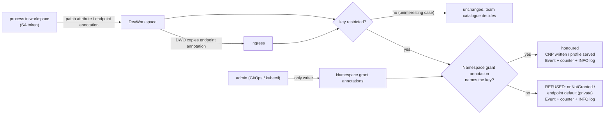
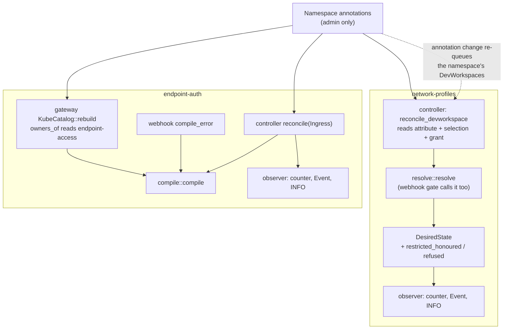
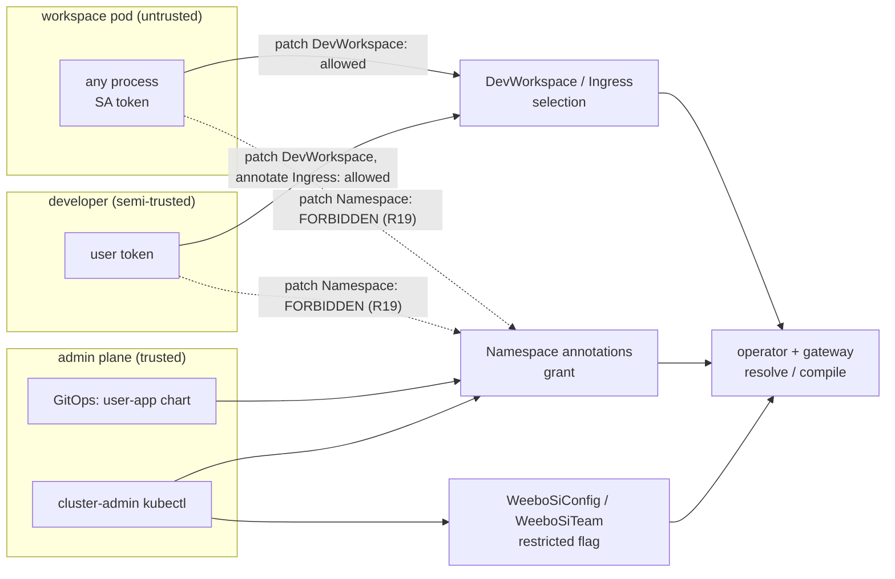

# RFC 0021 — namespace-only grants

> Reference material: past 4 000 words. Read *Summary*, *Guide-level explanation* and
> *Security considerations* first; the rest is the record a reviewer checks against.

## Summary

Two features let a workspace pick, by itself, a catalogue key that widens what it can do:
`network-profiles` reads a DevWorkspace attribute naming egress profiles such as `internet`
[R1] [R2], and `endpoint-auth` reads an `Ingress` annotation naming an access profile such as the
anonymous `open` [R9] [R10] ([RFC 0004](./0004-network-profiles.md) [R26] and RFC 0009 [R27]
define both). Both values are written by the developer, and the workspace's own
ServiceAccount token can patch the DevWorkspace they come from [R19]. This RFC adds one field to
both catalogues, `restricted`, and one rule: a restricted key is honoured only if the workspace's
**Namespace** also names it in an admin grant annotation — `hardening.weebo.io/network-grants` or
`hardening.weebo.io/endpoint-access`, which grant and never select — and neither the user nor the
workspace token can write a Namespace [R19]. Selection does not move; only the grant does. Removing
a grant takes effect at the next reconcile of the namespace's workspaces, in seconds. Every use of
a restricted key, honoured or refused, leaves a counter, an Event and a log line ClickStack alerts
on.

### Before / after

```yaml
# The same request, before and after. The team catalogue holds `internet` and `open`.
# DevWorkspace (patched by a process inside the workspace, with the workspace's own token):
spec:
  template:
    attributes:
      hardening.weebo.io/network-profiles: internet
    components:
      - name: app
        container:
          endpoints:
            - name: api
              exposure: public
              annotation:
                hardening.weebo.io/access: open
# Before: CNP weebo-internet-<id> written; the Ingress answers anybody on the Internet.
# After, Namespace dev-ws-alice carries neither grant annotation:
#   no internet CNP (onNotGranted applies), the Ingress resolves to the team default `private`.
# After, an admin annotated the Namespace (grant only; selection is untouched):
#   hardening.weebo.io/network-grants: internet
#   hardening.weebo.io/endpoint-access: open
#   both honoured, each with an Event and a ClickStack alert.
```



Before this RFC the left half was the whole story: the team catalogue was the grant, and the
workspace held the pen. After it, the right-hand question is asked of a value only an admin can
write.

## Motivation

1. **A workspace can grant itself `internet`.** The DevWorkspace attribute
   `hardening.weebo.io/network-profiles` takes precedence over the namespace annotation of the same
   name [R1] [R2], and a team's reachable set is exactly its catalogue: `TeamNetworkProfiles` has no
   `allowed` list and `resolve` derives `allowed` from the team's own entries plus the baseline
   [R3]. The cluster's team `weebo` catalogues `internet` [R23]. The workspace ServiceAccount's
   Role grants `patch` on `devworkspaces` [R20] [R19]. So any process in the workspace — an npm
   `postinstall`, an AI agent — runs `kubectl patch devworkspace … internet` with the mounted
   token and the next reconcile writes `weebo-internet-<id>` [R6]. Falsifiable: test **T-07** of
   the cluster plan [R25] is expected to produce that CNP today — read from the code, not probed.
2. **A workspace can publish an unauthenticated endpoint to the Internet.** The access key of an
   endpoint is the `hardening.weebo.io/access` annotation, which DevWorkspace Operator copies from
   the devfile endpoint onto the `Ingress` and which `policy-guard` lets the developer edit
   directly [R9] [R27]. Team `weebo` catalogues `open` with `anonymous: true` [R23], so `compile`
   accepts it for every namespace of the team [R10]. The DevWorkspace patch of (1) reaches it too:
   DWO regenerates the `Ingress` from the patched devfile. Falsifiable: test **T-27** [R25] is
   expected to get an anonymous `200` from outside today — read from the code, not probed.
3. **Neither use leaves an alertable trace.** A granted key is a normal outcome: the only existing
   signal is `weebo_si_network_not_granted_total`, which counts the *refused* case [R8]; an
   honoured `internet` or `open` logs nothing specific. The cluster plan asks for an alert on every
   `open` Ingress admitted [R25].

**Outcome we are buying:** a key an admin marks `restricted` cannot be reached by anything
running inside the workspace or by the developer, only by an annotation on the Namespace; every
use of such a key is visible in ClickStack with namespace and key; nothing changes for any key not
marked restricted.

## Goals and non-goals

Goals: the three motivations above; T-07, T-12 and T-27 [R25] pass on `dev-ws-batleforc-test`.

Non-goals:

- **Taking `patch devworkspaces` away from the workspace token.** It is DevWorkspace Operator's and
  Che's role [R20]; the IDE needs it. Phase 3's KubeArmor `fromSource` rule narrows *who* in the pod
  can read the token [R25]. This RFC makes the token's write harmless for restricted keys instead.
- **A new grant CRD, or a per-namespace field on `WeeboSiTeam`.** The Namespace already is an
  admin-only object for these subjects [R19]; a new kind is new RBAC to get right.
- **Extending `policy-guard` to Namespace annotations.** The plan mentions it [R25]; RBAC already
  refuses the user and the token [R19], so a webhook would be a second answer to a settled question.
- **Changing selection.** The attribute still wins over the namespace annotation as a *selection*
  [R1]; only the *grant* of restricted keys moves.
- **Restricting keys that are not marked.** `dev-registries`, `anthropic`, `team`, `shared` behave
  exactly as today.
- **`dwocPin`, `imagePolicy`, `kubearmorPolicy`, `registryConfig`, `resourceQuotas`.** dwocPin's
  selection is already a namespace annotation only [R18]; the others are not widening keys a
  workspace picks for itself today. Each can adopt `restricted` later with the same rule.
- **Detecting what an honoured `open` endpoint serves.** The alert says it exists; what crosses it
  is the gateway's existing decision log [R27].

## Guide-level explanation

An admin marks a catalogue entry restricted, in the cluster catalogue or a team's:

```yaml
# 2.argo/helm/che/hardening/values.yaml (rendered into WeeboSiConfig `cluster` and WeeboSiTeam `weebo`)
config:
  features:
    networkProfiles:
      catalog:
        - key: internet
          restricted: true          # new; default false
          variants:
            - backend: Cilium
              templateRef: { name: weebo-net-internet, namespace: weebo-si-hardening }
teams:
  weebo:
    features:
      networkProfiles:
        catalog:
          - key: internet           # identical to the cluster entry, restricted included
            restricted: true
            variants: [...]
      endpointAuth:
        catalog:
          - { key: open, anonymous: true, restricted: true, delegation: [] }   # explicit
          - { key: team, anonymous: false, delegation: [Team] }
```

Then grants it per namespace, through the Namespace object — in practice through the
`2.helm/user-app` chart that renders `dev-ws-<user>` [R24], i.e. GitOps:

```yaml
kind: Namespace
metadata:
  name: dev-ws-alice
  annotations:
    # network-profiles: new, grant-only (namespaceGrant.annotation). Lists restricted profile keys
    # this namespace may use; it never selects one. Selection stays the workspace attribute, then
    # hardening.weebo.io/network-profiles, then the team default — exactly as today.
    hardening.weebo.io/network-grants: internet
    # endpoint-auth: new, grant-only, a comma-separated list of access keys this namespace may use.
    hardening.weebo.io/endpoint-access: open
```

The developer changes nothing: the devfile attribute and endpoint annotation keep their meaning.
A workspace that wants `internet` still names it in its attribute (or the namespace's existing
`hardening.weebo.io/network-profiles` selection names it); the grant only makes that request
honourable.

### Behaviour rules

| Case | network-profiles | endpoint-auth |
| --- | --- | --- |
| Key not restricted (the uninteresting case, every key today) | unchanged: team catalogue is the grant | unchanged |
| Key restricted, team catalogue lacks it | unchanged: not granted (existing path) | unchanged: `NotGranted`, refused at admission in Enforce, indexed closed |
| Key restricted, selected, in team catalogue, grant annotation names it | **honoured**, counter `result=honoured`, Normal Event | **honoured**, same |
| Key restricted, selected, in team catalogue, grant annotation absent or silent on it | **refused**: treated as not granted → `onNotGranted: Default` drops the request and applies the team default; `Deny` refuses the DevWorkspace at CREATE | **refused**: the endpoint (or the path rule) resolves to the endpoint's default (`private` for team `weebo` [R23]); the `Ingress` is admitted; Warning Event says why |
| Restricted key named in a `default` | config violation `RestrictedKeyInDefault`, condition `Degraded`; at runtime filtered out like any refused key | same, and if the endpoint default itself is filtered the endpoint is indexed closed (`private`, owner only) [R10] |
| Grant annotation names a key the team lacks | ignored: the grant unlocks, it never widens past the team catalogue | same |
| Grant annotation names a key nothing selects | nothing: a grant never selects; the team default is unchanged | same |
| `namespaceGrant.annotation: ""` | restricted grants disabled: every restricted key refused (fail closed) | n/a (annotation is a constant) |

A grant annotation is read as a set: order, whitespace and duplicates do not matter, an unknown
key is ignored. An absent annotation and an empty one mean the same: nothing unlocked.

**Why the default is `false`, for every entry.** `restricted` defaults to `false`, anonymous
entries included. That is not the closed side, and it is chosen deliberately: an upgrade of the
operator must not change what any existing catalogue grants, so nothing changes until an admin
writes `restricted: true` in Git — on `internet` and on `open` in the cluster's values, in the
integration step. The safe side is reached by an explicit, reviewed line rather than by a silent
default flip on upgrade. To keep the anonymous entry from being forgotten, an `anonymous: true`
entry without `restricted: true` logs a warning at every config load. Flipping the default for
anonymous entries is a later release, once deployed values carry the field (*Future work*).

### Upgrade: what an `open` user sees

Nothing, on the upgrade itself. When the values commit marks `open` `restricted: true`, an endpoint
naming `open` in a namespace without `hardening.weebo.io/endpoint-access: open` stops answering
anonymously: an unauthenticated browser is sent to sign in, a `curl` gets the gate's `401`, and the
owner still reaches it. Their `Ingress` gets a Warning Event `RestrictedGrantRefused`. The intended
path is to annotate the namespaces that need it before that commit (*Rollout*, step 2).

### Validation

| Problem | Kind | Where seen |
| --- | --- | --- |
| A default names a restricted key — network-profiles: a team `default` or the cluster `baseline` (it has no cluster `default`); endpoint-auth: the cluster or a team `default` | hard error `RestrictedKeyInDefault`, condition `Degraded` | `kubectl get weebosiconfig cluster` conditions, operator log `WARN` |
| A team re-declares a cluster entry with a different `restricted` | existing `CatalogKeyConflict`; the cluster entry stands [R4] | same condition as every conflict today |
| An `anonymous: true` entry without `restricted: true` | warning, not an error (an admin may mean it) | operator log `WARN … anonymous entry open is not restricted` at each config load |
| `namespaceGrant.annotation` equal to `namespaceSelection.annotation` | hard error, CEL on the CRD | the apiserver refuses the `WeeboSiConfig` write |
| A restricted entry with no namespace granting it anywhere | not checked (namespaces are not config) | the counter shows `result=refused` only |

Today no admission warning can be emitted: the chassis `Decision` has no `warnings` field [R15].
Once RFC 0019 PR 1 (chassis `warnings`) is in — it lands before this RFC's PR 2 — the restricted
refusal also emits an admission warning on the DevWorkspace write, computed before the gate's
CREATE-only check and refusing nothing. It is visible to `kubectl` only: the Che dashboard drops
admission warnings (V-14 [R25]); the Event and the log line remain the channels for everyone else.

### Mocks

Nominal refusal, T-07, from a terminal inside the workspace (the token is the mounted one):

```text
$ kubectl patch devworkspace python-web -n dev-ws-batleforc-test --type merge \
    -p '{"spec":{"template":{"attributes":{"hardening.weebo.io/network-profiles":"internet"}}}}'
devworkspace.workspace.devfile.io/python-web patched          # exit 0: the patch is not refused
$ kubectl get cnp -n dev-ws-batleforc-test -l hardening.weebo.io/managed-by -o name
ciliumnetworkpolicy.cilium.io/weebo-base
ciliumnetworkpolicy.cilium.io/weebo-dev-registries-workspace3f2a
ciliumnetworkpolicy.cilium.io/weebo-anthropic-workspace3f2a     # no weebo-internet-*
$ kubectl get events -n dev-ws-batleforc-test --field-selector reason=RestrictedGrantRefused
TYPE      REASON                   OBJECT                    MESSAGE
Warning   RestrictedGrantRefused   devworkspace/python-web   network profile internet is restricted and
  namespace dev-ws-batleforc-test does not grant it (annotation hardening.weebo.io/network-grants);
  onNotGranted=Default applied the team default [dev-registries,anthropic]
```

The operator log line ClickStack alerts on:

```text
INFO feature=network-profiles restricted=internet namespace=dev-ws-batleforc-test
     workspace=python-web mode=Enforce result=refused reason=no_namespace_grant
```

Honoured, after an admin annotated the namespace:

```text
$ kubectl annotate ns dev-ws-batleforc-test hardening.weebo.io/network-grants=internet  # cluster-admin
$ kubectl get cnp -n dev-ws-batleforc-test -o name | grep internet          # within seconds
ciliumnetworkpolicy.cilium.io/weebo-internet-workspace3f2a
$ kubectl get events -n dev-ws-batleforc-test --field-selector reason=RestrictedGrantHonoured
Normal    RestrictedGrantHonoured  devworkspace/python-web   network profile internet is restricted;
  granted by namespace annotation hardening.weebo.io/network-grants
INFO feature=network-profiles restricted=internet namespace=dev-ws-batleforc-test
     workspace=python-web mode=Enforce result=honoured
```

T-12, the user trying to grant themselves (refused by RBAC, not by this RFC):

```text
$ kubectl annotate ns dev-ws-batleforc-test hardening.weebo.io/endpoint-access=open
Error from server (Forbidden): namespaces "dev-ws-batleforc-test" is forbidden: User
"labsso:batleforc-test@weebo.internal" cannot patch resource "namespaces" in API group "" in the
namespace "dev-ws-batleforc-test"                                             # exit 1
```

Endpoint, refused then honoured:

```text
$ curl -s -o /dev/null -w '%{http_code}\n' https://batleforc-test-python-web-api.weebo.poc/
401                                         # no grant: resolved `private`, anonymous refused
Warning   RestrictedGrantRefused   ingress/python-web-api   access key open is restricted and
  namespace dev-ws-batleforc-test does not grant it (annotation hardening.weebo.io/endpoint-access);
  served as private
$ curl -s -o /dev/null -w '%{http_code}\n' https://batleforc-test-python-web-api.weebo.poc/
200                                         # after the admin annotation: open, anonymous allowed
INFO feature=endpoint-auth restricted=open namespace=dev-ws-batleforc-test ingress=python-web-api
     mode=Enforce result=honoured
```

Under `onNotGranted: Deny`, a DevWorkspace **created** with a restricted key and no grant:

```text
$ kubectl create -f python-web.yaml
Error from server (Forbidden): error when creating "python-web.yaml": admission webhook
"devworkspaces.hardening.weebo.io" denied the request: workspace python-web requests network
profile(s) [internet], which are restricted: namespace dev-ws-batleforc-test does not grant them
(annotation hardening.weebo.io/network-grants)
```

Empty state — no entry is restricted: no Event, no log line, the counter is absent from
`/metrics` until its first increment. Error state — `RestrictedKeyInDefault`:

```text
$ kubectl get weebosiconfig cluster -o jsonpath='{.status.conditions[?(@.type=="Degraded")].message}'
networkProfiles: team weebo's default names restricted profile internet
```

Each mock decides the wording a reviewer argues about before it is built.

## Design

### Contract

#### CRD fields

| Where | Field | Rust type | Default | Meaning |
| --- | --- | --- | --- | --- |
| `networkProfiles.catalog[]` (cluster and team) — `Profile` [R3] | `restricted` | `bool` (`#[serde(default)]`) | `false` | Honoured only if the namespace's `namespaceGrant.annotation` names it |
| `networkProfiles` — `NetworkProfilesConfig` | `namespaceGrant.annotation` | `NamespaceGrant { annotation: String }` (`#[serde(default)]`) | `hardening.weebo.io/network-grants` | Namespace annotation granting restricted keys; never selects. `""` disables restricted grants: every restricted key refused |
| `endpointAuth.catalog[]` (cluster and team) — `AccessEntry` [R9] | `restricted` | `bool` (`#[serde(default)]`) | `false`, anonymous entries included | Honoured only if the namespace's `hardening.weebo.io/endpoint-access` names it |

The booleans need no bound. One CEL rule is added on `networkProfiles`:
`!has(self.namespaceGrant) || self.namespaceGrant.annotation == '' ||
self.namespaceGrant.annotation != self.namespaceSelection.annotation` — the grant annotation may
not be the selection annotation, or a grant would select again.

#### Annotations

| Object | Key | Writer | Value |
| --- | --- | --- | --- |
| Namespace | `hardening.weebo.io/network-profiles` (= `namespaceSelection.annotation`, existing [R1]) | admin | unchanged: selection when no attribute; grants nothing |
| Namespace | `hardening.weebo.io/network-grants` (= `namespaceGrant.annotation`, new) | admin | comma list of restricted profile keys this namespace may use; selects nothing |
| Namespace | `hardening.weebo.io/endpoint-access` (new constant `ENDPOINT_ACCESS_NAMESPACE_ANNOTATION`) | admin | comma list of access keys this namespace may use when restricted |
| DevWorkspace attribute, Ingress `hardening.weebo.io/access` / `rules` | unchanged [R1] [R9] | developer, workspace token | selection only |

`hardening.weebo.io/endpoint-auth` stays what it is — `managed` / `bypass` on the routing object
[R9] — and is not reused. Both new names say what they hold (`…-grants`, `…-access`) next to the
existing `hardening.weebo.io/network-profiles` and `hardening.weebo.io/dwoc` [R18].
`hardening.weebo.io/endpoint-access` is already grant-only — endpoint selection lives on the
routing object, never on the Namespace — so it stays a constant rather than a config field: there
is no selection annotation for it to collide with.

#### Metrics, Events, logs

| Signal | Name | Labels / fields | Emitted by |
| --- | --- | --- | --- |
| Counter | `weebo_si_restricted_grant_total` | `feature` ∈ {`network-profiles`, `endpoint-auth`}, `key` (catalogue-bounded), `result` ∈ {`honoured`, `refused`} | controller, when an object's honoured or refused set differs from its last pass (not every pass) |
| Event | reason `RestrictedGrantHonoured` (Normal), `RestrictedGrantRefused` (Warning) | regarding the DevWorkspace or the Ingress | controller `Recorder` [R14] |
| Log | `INFO feature=… restricted=<key> namespace=<ns> workspace=<name>\|ingress=<name> mode=<mode> result=…` | — | controller |
| Admission decision result | `denied_restricted` (new, beside `denied_not_granted` [R5]) | existing admission metric | webhook, `onNotGranted: Deny` CREATE only |
| Config violation | `RestrictedKeyInDefault { team: Option<TeamName>, key }` in both features (`None` = the cluster `baseline` or `default`) | — | `validate()` → `Degraded` |

Never `namespace`, `user` or `workspace` as a metric label. No webhook path, route, CLI flag or exit
code changes.

### Architecture

**Hexagonal: no new ports, no new adapters.** The decision is a pure function over values both
features already hold — the catalogue entry, the team grant, and a namespace annotation read
from a store the adapters already keep: network-profiles reads its namespace annotation through
`namespace_view` today [R7], so the grant is one more read of the same store, and the gateway reads
namespace annotations in `owners_of` [R12]. The one adapter change with an effect on timing is a
Namespace → DevWorkspace watch mapping in the network-profiles controller, below. Per
[`hexagonal.md`](../architecture/hexagonal.md), a change with no new I/O stays in the domain
crates it touches (`weebo-si-network-profiles::resolve`, `weebo-si-endpoint-auth::compile`) and
the adapters only carry one more value in.



This proves the one-function rule both features already keep: the webhook and the reconcile
reach the network-profiles verdict through the same `resolve` [R5] [R6], and the webhook, the
gateway and the controller reach the endpoint verdict through the same `compile` [R11]. Putting
the restricted check *inside* those two functions is what makes admission, enforcement and audit
unable to disagree.

```mermaid
sequenceDiagram
    participant P as process in workspace
    participant API as apiserver
    participant DWO as DevWorkspace Operator
    participant C as weebo-si controller
    participant GW as endpoint-gateway
    P->>API: PATCH devworkspace (attribute internet, endpoint access open)
    API-->>P: 200 (RBAC allows, R19)
    API->>C: watch event DevWorkspace
    C->>C: resolve(): internet restricted, network-grants silent → not granted
    C->>API: no weebo-internet CNP; Event RestrictedGrantRefused
    DWO->>API: update Ingress (access: open)
    API->>GW: watch event Ingress
    GW->>GW: compile(): open restricted, endpoint-access silent → default private
    C->>API: Event RestrictedGrantRefused on Ingress
```

This proves the refused bytes are never served: no CNP is written for `internet`, and the gateway
indexes the endpoint as `private` before the first anonymous request arrives.

**Invariant.** For every workspace, the honoured set ⊆ team allowed ∩ (non-restricted keys ∪ keys
named by the Namespace grant annotation). Because the grant annotation is the only input that can
put a restricted key on the right-hand side, and the workspace token and the user cannot patch the
Namespace [R19], nothing running in the workspace can make a restricted key honoured.

**Cluster restriction wins.** `restricted` is part of the entry, and entries are compared whole when
 catalogues merge: a team re-declaring the cluster's `internet` with `restricted: false` is a
 *different* definition, reported as `CatalogKeyConflict`, and the cluster's restricted entry is the
 one that stands [R4]. A key defined only by a team is that team definition's call — and
 `WeeboSiTeam` is cluster-scoped and admin-owned, with no write verbs granted by the chart
 [R16] [R17].

**Revocation is event-driven.** Today the Namespace loop reconciles only the baseline, and a
workspace pass runs on a DevWorkspace event or the 300 s requeue [R7]. This RFC adds to the
DevWorkspace `Controller` a `watches` on Namespaces whose mapper returns every DevWorkspace of the
changed namespace, filtered to annotation changes. That watch is a second one: `KubeNsStore::spawn`
consumes its own watcher and exposes no stream [R31], so `namespace_view` may lag the event that
re-queued the pass. The grant is therefore read, in `reconcile_devworkspace`, with one `GET` of
the Namespace (the controller already holds `get namespaces` [R16]) rather than from
`namespace_view`; selection keeps its cached read. A shared stream (`reflect_shared`) would save
the GET and is not worth a change to `KubeNsStore` for one read per pass. Because removing a grant
is a Namespace event and the pass reads the live object, the `internet` CNP is deleted at the
next reconcile of that namespace's workspaces, in seconds; the 300 s requeue stays as the backstop
for a missed event. Connections already established survive the deletion (Cilium conntrack):
an immediate cut needs a workspace restart, which the runbook says.

**Cold cache.** The controller's gate answers `Off` for a namespace the watch has not yet seen
when the feature has a `namespaceSelector` [R32] — the cluster sets one [R23] — so no pass, and no
destructive write, runs on an unknown namespace. Without a selector the pass runs; its `GET` then
either returns the namespace or fails the pass, which is retried: a grant is never read as absent
because a cache was cold.

### Data and state

No new object. The grant annotation is read live (network-profiles) or from the namespace store
the gateway already keeps [R12]; losing the annotation loses the grant, the closed direction. One
in-memory map per feature in the controller remembers each object's last honoured/refused set,
keyed by object UID, so the counter, the Event and the log fire on a change, not on every pass.
Lost on restart: each object meeting a restricted key reports once more after a restart, which the
alert's (namespace, key) deduplication absorbs. Entries are dropped when the object is deleted.

### Detailed design

**`crates/weebo-si-crd/src/network_profiles.rs`**

- `Profile` gains `#[serde(default)] pub restricted: bool`.
- `NetworkProfilesConfig` gains `#[serde(default)] pub namespace_grant: NamespaceGrant`, a struct
  shaped like `ProfileNamespaceSelection` [R1] with `annotation` defaulting to
  `hardening.weebo.io/network-grants`.
- `NetworkProfilesConfigViolation::RestrictedKeyInDefault { team: Option<TeamName>, key:
  ProfileKey }`, pushed by `ResolvedNetworkProfilesConfig::validate` [R3] for each team default
  naming a restricted entry (`Some`) and for a restricted `baseline` (`None`). `Display`: `team
  {team}'s default names restricted profile {key}` / `baseline {key} is restricted`.
- The CEL rule of *Contract* on `NetworkProfilesConfig`.

**`crates/weebo-si-crd/src/endpoint_auth.rs`**

- `AccessEntry` gains `#[serde(default)] pub restricted: bool`.
- `pub const ENDPOINT_ACCESS_NAMESPACE_ANNOTATION: &str = "hardening.weebo.io/endpoint-access";`
  beside the other constants [R9].
- `EndpointAuthConfigViolation::RestrictedKeyInDefault { team: Option<TeamName>, key: AccessKey }`
  for the cluster `default` and each team `default`.

**`crates/weebo-si-network-profiles/src/resolve.rs`** [R2]

- One new parameter, `namespace_grant: Option<&str>`, beside the unchanged `namespace_annotation`
  (selection). Compute `unlocked = parse_keys(namespace_grant)`; `effective_allowed =
  grant.allowed` minus every key whose
  catalogue entry is restricted and not in `unlocked`. The rest of the function runs against
  `effective_allowed` exactly as it runs against `allowed` today; the grant default is filtered the
  same way.
- `Provenance` gains `restricted_honoured: Vec<ProfileKey>` and `restricted_refused:
  Vec<ProfileKey>`; `NotGranted` gains `restricted: bool` so the gate can word the refusal and
  return `denied_restricted`.

**`crates/weebo-si-network-profiles/src/feature/`** — `Workspace` and `WorkspaceAdmission` gain
`namespace_grant: Option<String>`; `DesiredState` carries the two lists to `ReconcileOutcome`;
`workspace_gate.rs` words the restricted refusal [R5]. **`…-adapters/src/controller.rs`** —
`reconcile_devworkspace` reads `namespace_grant.annotation` with one `GET` of the Namespace,
next to the cached selection read [R7]; `spawn` adds the Namespace → DevWorkspace `watches`
mapping described under *Architecture*; `warn_not_granted` gains a sibling `report_restricted`
that, when the object's restricted sets differ from the remembered ones, increments the counter,
publishes the Event and logs. The webhook adapter building `WorkspaceAdmission` reads the grant
from `namespace_view`: admission already refuses on a namespace its cache has not observed
(`NamespaceNotObserved`). **`network_metrics.rs`** is untouched (the counter is shared, see
below).

**`crates/weebo-si-endpoint-auth/src/compile.rs`** [R10]

- `AccessProfile` (in `policy.rs` [R29]) gains `restricted: bool`; `Catalogue::new` takes it.
- `RawEndpoint` gains `namespace_grant: BTreeSet<CatalogueKey>`.
- In `compile`, after the key is chosen and before `resolve_profile`: a restricted key absent from
  `namespace_grant` is replaced by `default` and recorded in a new
  `EndpointPolicy::restricted: Vec<(CatalogueKey, RestrictedResult)>`; `compile_rule` does the same
  per rule. A `default` that is itself restricted and not granted returns `NotGranted`, which is
  indexed closed as today [R10].
- Rationale for falling back rather than refusing: an ungranted *ordinary* key is refused at
  admission so the developer fixes a typo [R11]; a restricted key is a deliberate admin gate with a
  safe answer, and refusing DWO's `Ingress` would stop the workspace from starting.

**`bins/endpoint-gateway/src/adapters/kube_catalog.rs`** [R12] — `Owner` gains `grant`, read in
`owners_of` from the new annotation; `raw_endpoint` copies it. No counter here: the gateway
recompiles every endpoint on every rebuild, so counting there would count rebuilds.

**`crates/weebo-si-endpoint-auth-adapters/src/`** — `endpoint_auth.rs::compile_error` [R11] fills
`namespace_grant` from `namespace_view`; `controller.rs::reconcile` [R13] gains the namespace view,
compiles, and calls the shared reporter. **`crates/weebo-si-controller/src/events.rs`** [R14] gains
the two `ReasonCode`s, `RestrictedGrantHonoured` with `Severity` informational and
`RestrictedGrantRefused` warning. **`crates/weebo-si-operator`** composition root registers
`weebo_si_restricted_grant_total` once and hands it to both adapters.

### Proof against a real client

Real consumers, pinned [R21]: Che dashboard `ghcr.io/weebo-si/che-dashboard:develop` (floating, the
digest is recorded with the campaign), DevWorkspace Operator `v1.1.1`, `kubectl` client `v1.37.2`
against Kubernetes `1.36.2`, Cilium `1.19.10`, on namespace `dev-ws-batleforc-test` with a
workspace started from the dashboard; today the namespace carries no grant annotation and no
workspace [R22]. The kubeconfig inside the workspace is the mounted SA token.

1. **T-07, refusal.** From the workspace terminal, `kubectl patch devworkspace <ws> --type merge -p
   '{"spec":{"template":{"attributes":{"hardening.weebo.io/network-profiles":"internet"}}}}'` exits
   0 (RBAC allows it [R19]). Within one reconcile pass, `kubectl get cnp -n
   dev-ws-batleforc-test` lists no `weebo-internet-*`; the operator log carries `INFO
   feature=network-profiles restricted=internet … result=refused reason=no_namespace_grant`;
   `weebo_si_restricted_grant_total{feature="network-profiles",key="internet",result="refused"}`
   moved by ≥ 1; from the workspace `curl -m 5 https://example.com` still times out. The refused
   egress was never opened.
2. **Honoured.** A cluster-admin sets `hardening.weebo.io/network-grants=internet` on the namespace;
   the attribute set in (1) still selects `internet`. Within seconds (the Namespace event re-queues
   the workspace), `weebo-internet-<id>` exists, a `RestrictedGrantHonoured` Normal Event is on the
   DevWorkspace, and the `result="honoured"` series moved. `curl https://example.com` answers.
3. **T-12, refusal by RBAC.** `kubectl annotate ns dev-ws-batleforc-test
   hardening.weebo.io/endpoint-access=open`, run as `labsso:batleforc-test@weebo.internal` and
   again with the workspace token, exits 1 with `Forbidden … cannot patch resource "namespaces"`
   [R19]. This RFC adds no defence here; the test records that the assumption still holds.
4. **T-27, refusal.** A devfile endpoint with `annotation: {hardening.weebo.io/access: open}`; the
   workspace starts (the `Ingress` is admitted). `kubectl get ingress -n dev-ws-batleforc-test -o
   yaml` shows `hardening.weebo.io/access: open`; an unauthenticated `curl` from outside the
   cluster gets `401`, the gateway decision log names profile `private`, and a
   `RestrictedGrantRefused` Warning Event is on the `Ingress`. No anonymous byte was served.
5. **T-27, honoured.** The admin sets `hardening.weebo.io/endpoint-access=open`; within the gateway
   debounce (≈ 100 ms [R12]) the same `curl` gets `200`; the counter
   `{feature="endpoint-auth",key="open",result="honoured"}` moved and ClickStack's alert fires on
   the INFO line.
6. **Removal.** The admin removes both grant annotations. The endpoint is back to `401` within
   ≈ 100 ms; the `internet` CNP is deleted at the next reconcile, which the Namespace event
   triggers — observed in seconds, asserted ≤ 30 s by the e2e — and `curl https://example.com`
   from the workspace times out again on a new connection (an established one survives until
   the workspace restarts, Cilium conntrack).
7. **`onNotGranted: Deny`, refusal (kind only).** With the feature set to `Deny`, `kubectl create`
   of a DevWorkspace naming `internet` without a grant exits 1 with the *Mocks* text from webhook
   `devworkspaces.hardening.weebo.io` [R33]; no DevWorkspace object exists afterwards. The cluster
   runs `Default` [R23], so this one is not repeated there.

Mapping: (1)(2) → new `weebo-si-e2e/tests/workspace.rs` case
`a_restricted_profile_is_honoured_only_through_the_namespace`; (6) network half → new case
`removing_a_network_grant_removes_the_profile_within_30_seconds`; (4)(5) → new
`weebo-si-e2e/tests/endpoint_auth.rs` case `an_open_endpoint_needs_the_namespace_grant`, beside
`an_open_rule_serves_one_path_to_anybody_and_nothing_else`; (3) is a cluster-only check (kind has
no Che user); (7) → a `Deny` variant of the `workspace.rs` case. Cluster ids: **T-07** (1),
**T-12** (3), **T-27** (4)(5).

**Deliberately untouched:**

- **dwocPin's namespace annotation `hardening.weebo.io/dwoc`** [R18]. It is already the only
  selection channel for dwocPin and already admin-only [R19]; there is no workspace-side selection
  to gate.
- **The workspace token's `patch` on DevWorkspaces** [R20]. DWO and Che need it; phase 3's
  KubeArmor `fromSource` rule narrows which process may read the token [R25]. Out of scope here.
- **`WorkspaceGate` stays CREATE-only** [R5]. An UPDATE naming a restricted key is not refused at
  admission; the reconcile is the enforcement point and writes nothing for it (Resolved R-11).
- **Selection precedence** (attribute over `hardening.weebo.io/network-profiles` [R1]) and
  `onNotGranted` semantics [R2]: the grant annotation is read beside them, never instead of them.
- **`policy-guard`** — no Namespace rule; RBAC answers T-12.

## Security considerations

**Rating:** Medium. The change closes two self-grant paths; its own failure modes are fail-closed,
and the residual is the set of identities that may patch a Namespace.



| # | Threat | Where | Mitigation + enforcing fn | Negative test | Residual |
| --- | --- | --- | --- | --- | --- |
| S1 | Self-grant of `internet` by DevWorkspace patch (T-07) | `resolve::resolve` [R2] | restricted key not in the grant annotation is removed from `effective_allowed`; `onNotGranted` applies | unit `a_restricted_key_requested_by_the_attribute_without_the_namespace_grant_is_not_granted`; e2e (1) | none known |
| S2 | Self-grant of `open` via devfile endpoint / Ingress annotation / path rule (T-27) | `compile::compile`, `compile_rule` [R10] | restricted key not in `namespace_grant` resolves to `default`, per endpoint and per rule | unit `an_open_rule_without_the_namespace_grant_serves_the_default`; e2e (4) | none known |
| S3 | User or token annotates own Namespace (T-12) | apiserver RBAC [R19] | no new defence; RBAC refuses `patch namespaces` | cluster check (3) | an identity with namespace `patch` (cluster-admin, Argo CD, the weebo-si controller [R16], `eclipse-che:che-operator` — probed yes; `che`, `che-dashboard`, the DWO controller and the weebo-si webhook — probed no [R19]) can grant; accepted: they are already admin-equivalent |
| S4 | Team definition marks a cluster-restricted key `restricted: false` | `merge_catalogs` [R4] | entry compared whole; first (cluster) definition stands, `CatalogKeyConflict` reported | unit `a_team_cannot_unrestrict_a_cluster_entry` (merge.rs, alongside `a_team_cannot_shadow_a_cluster_entry`) | a team-only key is the team definition's choice; `WeeboSiTeam` is admin-owned [R17] |
| S5 | Restricted key slipped into a `default` | `validate` + runtime filter | `RestrictedKeyInDefault` → `Degraded`; resolve/compile filter it anyway | unit `a_restricted_default_is_a_violation_and_is_filtered` | none |
| S6 | Grant removed, CNP / profile outlives it | Namespace → DevWorkspace mapping in the network-profiles controller; gateway rebuild [R12] | the Namespace event re-queues the namespace's workspaces; the 300 s requeue [R7] is the backstop | e2e `removing_a_network_grant_removes_the_profile_within_30_seconds`; e2e (6) | reconcile latency, measured in the e2e (asserted ≤ 30 s); up to 300 s only if the Namespace event is lost; endpoint-auth ≈ 100 ms; connections established before revocation survive (Cilium conntrack) until the workspace restarts — the runbook restarts it for an immediate cut |
| S7 | Repudiation: an honoured `open` nobody noticed | controller reporter | counter + Event + INFO line; ClickStack alert | unit on the reporter; e2e (5) asserts the counter | an alert pipeline outage hides it; Events stay in the namespace for the apiserver TTL |
| S8 | Information disclosure via metric labels | metric registration | labels bounded: `feature`, catalogue `key`, `result` | unit `the_restricted_counter_never_carries_a_namespace` | none |
| S9 | Tampering in DryRun period goes unseen | reporter runs in every mode | log carries `mode=DryRun`, counter moves | e2e DryRun variant of (1) | none |
| S10 | Denial of service: a grant typo locks a namespace out | resolve/compile | refusal is the default profile, never a stopped workspace (Default) or endpoint (fallback) | e2e (4): workspace starts | under `onNotGranted: Deny`, CREATE refused — the admin's chosen mode |
| S11 | Admin confuses selection and grant, granting `internet` by rewriting `network-profiles` and dropping the team default | annotation contract | grant and selection are two annotations; the grant never selects, so granting never changes what an attribute-less workspace gets | unit `a_grant_never_selects` | none |

- **Privileges.** No RBAC delta for the webhook. The controller already has `events create/patch`
  [R16]; the endpoint-auth controller pass reads namespaces through the store it already lists.
  The gateway already watches namespaces [R12].
- **Trust boundary.** Attacker-controlled: the DevWorkspace attribute, the devfile endpoint
  annotation, the Ingress `access` and `rules` annotations [R9]. Admin-controlled: the Namespace
  annotations and the catalogues. This RFC moves the grant of restricted keys entirely to the second
  side.
- **Bypass.** (a) A devfile endpoint is not the only way to an Ingress: a hand-written Ingress
  goes through the same `compile` [R27]. (b) Path rules: `compile_rule` applies the same check, so
  `rules: [{path: /, access: open}]` is downgraded. (c) Objects that predate the upgrade: the
  gateway recompiles everything on rebuild and the controller sweeps every Ingress [R13]. (d)
  Namespace excluded by `hardening.weebo.io/exclude`: excluded from every feature already.
- **Blast radius.** A bug that ignores `restricted` restores today's behaviour (team-wide grant) —
  not worse than now. A bug that over-applies it downgrades endpoints to the default and drops
  `internet`: closed, loud (Events).
- **Secrets.** None read, none logged. The annotation values are catalogue keys.

## Supply chain

No new dependency, image, action or tool: the change is two struct fields and two set operations
in crates already built, and `cargo deny` / `task audit` inputs are unchanged.

## Data and privacy

The namespace name carries the username (`dev-ws-<user>` [R24]); so do workspace and Ingress
names. They appear in the INFO log line and in the Event's regarding object, both already the case
for every existing operator log and Event, retained by ClickStack under its existing policy and
by the apiserver for the Event TTL. They never appear as metric labels: the counter's labels are
`feature`, catalogue `key`, `result`. The Namespace annotation itself holds catalogue keys only.

## Operational considerations

| Failure | Direction | Reasoning |
| --- | --- | --- |
| Namespace store not yet synced (annotation unknown) | closed: restricted keys refused | an unknown grant is not a grant; the next pass after sync honours it |
| Annotation malformed (`internet;;open`) | closed for unparsed keys | parsed as a comma list, unknown segments ignored |
| Config has `RestrictedKeyInDefault` | closed (key filtered) + `Degraded` | same rule as the runtime |
| ClickStack down | enforcement unaffected; alert lost | Events and counter remain |
| Namespace watch event lost (watch restart) | closed for grants, open for revocations ≤ 300 s | a new grant waits for the requeue; a removed grant lingers until the requeue backstop |
| Gateway older than operator during rollout | old gateway ignores `restricted` → old behaviour for ≤ one rollout | see Upgrade |

- **Rollout.** The restriction has no mode of its own — a feature never learns its mode and one
  field carries it. It rides each feature's mode: in `DryRun`, network-profiles writes nothing and
  still reports; endpoint-auth in `DryRun` attaches no gate, so no traffic reaches it [R28], and
  the controller pass still reports. Both features are already `Enforce` on the cluster [R23], so
  the staged rollout is by data, test namespace first:
  1. Ship the code. `restricted` defaults to `false` everywhere, so no behaviour changes; the
     warning log names the anonymous `open` entry.
  2. Inventory current users: `kubectl get devworkspaces -A -o json | jq -r '.items[] |
     select(.spec.template.attributes["hardening.weebo.io/network-profiles"] // "" |
     test("internet")) | .metadata.namespace'`; the namespaces whose existing selection annotation
     names it: `kubectl get ns -o json | jq -r '.items[] |
     select(.metadata.annotations["hardening.weebo.io/network-profiles"] // "" |
     test("internet")) | .metadata.name'`; and the same over Ingress `hardening.weebo.io/access`
     and `rules`. Grant every namespace found **except** `dev-ws-batleforc-test`.
  3. Write `restricted: true` on `internet` (cluster and team entry, one commit) and on `open`.
     Only ungranted namespaces are affected — `dev-ws-batleforc-test` first. Run §6.P there.
  4. Watch `result="refused"` for ≥ 7 days; each one is either an attack, or a namespace step 2
     missed.
- **Rollback.** One line: remove `restricted: true` from the entry (or revert the values commit);
  the next config load restores the team-wide grant.
- **Observability.** Counter `weebo_si_restricted_grant_total`; Events
  `RestrictedGrantHonoured`/`Refused`; INFO lines shipped by the existing OTel collector to
  ClickStack. Alerts (integration, in weebo-si): any `feature=endpoint-auth result=honoured` new
  (namespace, key) pair; any new (namespace, key) pair with `result=refused` (an attempt, or a
  missed grant).
- **Upgrade.** No behaviour change on upgrade: every `restricted` defaults to `false`. Old and new
  side by side: the CRD gains optional fields, so an old operator ignores them and a new one reads
  absent as `false`. Values that write `restricted: true` must wait for the new CRD and operator.
  During the gateway rollout, an old replica may still serve `open` anonymously for the length of
  the rolling update; acceptable since the current state already serves it.
- **Capacity.** Per pass: one set built from a short annotation, one set difference over a
  catalogue of ≤ a dozen keys [R23] — negligible beside the template fetch. Log volume: one INFO
  line per change of an object's restricted sets, not per pass, plus one per such object after a
  controller restart. Event volume: folded into a series by the `Recorder` [R14]. One extra
  `GET namespace` per network-profiles workspace pass. The
  Namespace mapping adds one workspace pass per DevWorkspace of a namespace per annotation change
  — an estimate of one to three workspaces per `dev-ws-<user>`, not measured; namespace
  annotations change rarely (admin grants, the operator's own pod-security bookkeeping).

## Other concerns

- **Accessibility:** no UI; the Event and log texts in *Mocks* are plain sentences.
- **i18n:** English messages, like every operator message.
- **Compliance:** improves traceability of anonymous exposure (an audit question, now answerable
  from ClickStack).
- **Licensing:** no change.
- **Documentation:** `docs/guide/` page on restricted keys and namespace grants (the Guide above);
  RFC 0004 and RFC 0009 get a pointer to this RFC; weebo-si runbook for granting `open`/`internet`.

## Alternatives considered

| Alternative | Why not |
| --- | --- |
| Do nothing | T-07 and T-27 stay open: any compromised dependency gets `internet` egress and an anonymous Internet endpoint. |
| The plan read literally: remove `internet` / `open` from the team catalogue, grant by namespace annotation [R25] | The team catalogue *is* the reachable set [R3]; a key absent from it cannot be named by any namespace annotation without a second mechanism that widens grants — which is this RFC's flag, with more code (a widening path instead of a narrowing one) and the invariant "annotation never widens past the team" lost. |
| A per-namespace grant list on `WeeboSiTeam` | One CRD edit per user grant, the team object grows with its membership, and its reconcile churns every namespace of the team on each grant. The Namespace is already per-user and admin-only. |
| A new `WeeboSiGrant` CRD | New kind, new RBAC to get right, new informer in the gateway — for a value the Namespace already carries. |
| Refuse the DevWorkspace PATCH at admission (extend `WorkspaceGate` to UPDATE) | Cosmetic on its own: the reconcile is where CNPs are written. Rejected, Resolved R-11. |
| Reuse `hardening.weebo.io/network-profiles` as the grant | It also selects for attribute-less workspaces, so granting `internet` would replace the team default unless the admin rewrote the full list — a footgun on a security control. Rejected, Resolved R-10. |
| Accept the 300 s requeue as revocation latency | A security revocation that waits five minutes leaves `internet` open after the admin believes it closed; the fix is one watch mapping. Rejected, Resolved R-12. |
| Refuse the `Ingress` at admission when `open` is ungranted (reuse `NotGranted`) | DWO's `Ingress` would be refused and the workspace would not start [R11]; the plan wants a fallback to `private` [R25]. |
| Restrict by user (`overrides`) in endpoint-auth [R9] | Overrides may only narrow [R10]; granting `open` to one user would need a widening override — the exact shape RFC 0009 rejected. |
| Kyverno policy on DevWorkspace/Ingress | A second engine to answer what `resolve`/`compile` already answer, and it cannot see the team catalogue. |

## Drawbacks and risks

- **One more annotation key and one more read.** network-profiles now has a selection annotation
  and a grant annotation; an admin must know which is which (the Guide says it in one line each).
- **More workspace passes.** Every annotation change on a Namespace re-reconciles its
  DevWorkspaces (*Capacity*).
- **The default is the open side.** Until values write `restricted: true`, nothing is restricted;
  a new anonymous entry added without it is team-wide, as today. The config-load warning is the
  only nudge until the default flips (*Future work*).
- **Two edits in one commit.** The cluster and team `internet` entries must change together:
  entries are compared whole (`merge.rs:53` [R4]), so a team copy left behind is a
  `CatalogKeyConflict` until it catches up — closed (the cluster entry stands), but `Degraded`.
- **In-memory audit state.** The change-only reporting forgets on restart and re-reports once.
- **Established connections outlive a network revocation** until the workspace restarts.

## Unresolved questions

### Resolved

| # | Question | Decision |
| --- | --- | --- |
| R-1 | One concept or one per feature? | **One shared `restricted` flag on catalogue entries, granted by a Namespace annotation** — the probe shows neither user nor workspace token can patch a Namespace while both can patch the DevWorkspace [R19]; it is the only admin-only channel that already exists, needing no new CRD field per namespace and no new RBAC. |
| R-2 | Does selection move? | **No; only the grant changes.** A restricted key selected without the namespace grant is not granted: network-profiles applies `onNotGranted`; endpoint-auth falls back to the endpoint default (`private` for team `weebo`) and the Event says why. Non-restricted keys: no change. |
| R-3 | Default of `restricted` | **`false` for network profiles; `anonymous` for access entries** — existing catalogues keep working; the one entry that removes authentication is closed unless it says otherwise. *Superseded by R-13 (last review).* |
| R-4 | How is each use audited? | **Counter `weebo_si_restricted_grant_total{feature,key,result}`, Event on the DevWorkspace/Ingress, INFO log with namespace and key** — bounded labels; ClickStack alert is integration. |
| R-5 | dwocPin's namespace annotation | **Untouched** — already the only selection channel and already admin-only. |
| R-6 | The workspace token's `patch devworkspaces` | **Untouched** — DWO/Che's role; phase 3 KubeArmor `fromSource` narrows who uses the token. |
| R-7 | Which annotation for endpoint-auth? | **`hardening.weebo.io/endpoint-access`** — `hardening.weebo.io/endpoint-auth` is taken (`managed`/`bypass` on the routing object [R9]). |
| R-8 | Team entry vs cluster entry on `restricted` | **Cluster restriction wins** — by the existing merge rule, first definition stands [R4]. |
| R-9 | endpoint-auth fallback target | **The endpoint's effective default (team default narrowed by overrides), not a hard-coded `private`** — it is `private` on the cluster [R23]; a restricted default is itself a violation and indexes closed. Reading of the owner's decision R-2 (a statement, 2026-11-24) against `compile` [R10]. |
| R-10 | (was Still open 1) One namespace annotation for selection and grant, or a grant-only one? | **A dedicated, grant-only `hardening.weebo.io/network-grants`, configurable as `namespaceGrant.annotation`; `""` disables restricted grants** — against the draft's recommendation: the shared annotation made a grant also replace the team default for attribute-less workspaces, a footgun on a security control; the cost is one more key and one more read. endpoint-auth's `hardening.weebo.io/endpoint-access` was already grant-only and keeps its shape. |
| R-11 | (was Still open 2) Refuse an UPDATE adding a restricted ungranted key at admission? | **No** — as the draft recommended: the reconcile is the enforcement point and the Event is the explanation; `WorkspaceGate` stays CREATE-only. |
| R-12 | (was Still open 3) Revocation latency for network grants | **Immediate in v1: a Namespace → DevWorkspace watch mapping re-queues the namespace's workspaces on an annotation change** — against the draft's recommendation: a security revocation must apply now, and the cost is one watch mapping; it lands in the same PR as the restricted check. |
| R-13 | (from last review, stability) Default of `restricted` for anonymous entries | **`false` for every entry, anonymous included; values write `restricted: true` on `open` and `internet` explicitly** — against the earlier decision R-3: an operator upgrade must not change what a catalogue grants; the closed side is reached by a reviewed line in Git, and the default flip is a later release. |
| R-14 | (from last review, code quality) How does the re-queued pass read a fresh grant? | **One `GET` of the Namespace in `reconcile_devworkspace`, not `namespace_view`** — `KubeNsStore::spawn` exposes no stream [R31], so the mapping's watch and the cache can disagree; a GET per pass is cheaper than reshaping the store. |
| R-15 | (from last review, code quality and UX) Counting each pass or each change? | **Each change of an object's honoured/refused set, from an in-memory map; alerts on new (namespace, key) pairs** — per-pass counting made the rate a function of the requeue and the alert noisy. |
| R-16 | (from last review, security) Grant annotation equal to the selection annotation | **Refused by CEL** — a grant that also selects is the footgun R-10 removed. |

### Still open

None: the draft's three open questions were decided on 2026-11-24 and are R-10 to R-12 above.

## Future work

- Apply `restricted` to `imagePolicy`, `kubearmorPolicy` and `registryConfig` keys if one of them
  ever becomes workspace-selectable.
- A CLI `weebo-si-operator grants audit` listing namespaces whose annotation unlocks a restricted
  key, for the periodic review.
- Flip the `restricted` default to `true` for `anonymous: true` entries, in a release after the
  deployed values carry the field explicitly (R-13).

## Test plan

- **Unit** (`resolve.rs`, `compile.rs`, `merge.rs`, CRD `validate`): one test per STRIDE row S1,
  S2, S4, S5, S8, plus: non-restricted keys behave exactly as before (the existing tables run
  unchanged); annotation parsed as a set; an annotation naming a key the team lacks unlocks
  nothing; an `anonymous: true` entry without `restricted` is not restricted and logs the warning;
  the reporter fires on a change and not on an unchanged second pass; the CEL rule refuses
  `namespaceGrant.annotation` = `namespaceSelection.annotation`; a pass on a namespace the gate has
  not observed writes nothing (`config_store.rs` [R32]).
- **envtest**: `Degraded` condition text for `RestrictedKeyInDefault`; Event published with the
  two reasons.
- **e2e kind** (`weebo-si-e2e`): `workspace.rs` new case for S1 and the honoured path, plus a
  `DryRun` variant (S9), plus `removing_a_network_grant_removes_the_profile_within_30_seconds`
  (S6): grant, wait for `weebo-internet-<id>`, remove the grant, poll until the CNP is gone and
  fail past **30 s**. Why 30: the path is one watch event, one reconcile and one delete, observed in
  well under 5 s; 30 s absorbs a loaded CI kind node, and it is ten times below the 300 s requeue,
  so a regression to resync-only revocation fails the test rather than passing slowly.
  `endpoint_auth.rs` new case for S2, honoured, and removal. Unit `a_grant_never_selects` (S11).
- **Cluster**: §6.P on `dev-ws-batleforc-test`; **T-07**, **T-12**, **T-27** [R25] and T-12 re-run
  as every service account of `eclipse-che` and `devworkspace-controller` after each Che or DWO
  upgrade, since `che-operator` already holds namespace `patch` (S3).
- **Must stay green, unchanged**: every existing `resolve.rs` and `compile.rs` table, `merge.rs`
  tests, `scripts/rfc-check.sh`, and every suite whose fixture catalogues `open` — with the default
  `false` they need no edit: gateway conformance (`bins/endpoint-gateway/tests/conformance.rs:156`,
  `:647`), the `crates/weebo-si-e2e/tests/endpoint_auth.rs:65` team fixture and its `:609` case,
  `an_open_rule_serves_one_path_to_anybody_and_nothing_else` [R34]. A fixture that later marks
  `open` restricted must add `hardening.weebo.io/endpoint-access` to its namespace in the same
  change.

## Implementation plan

- [x] **PR 1 — CRD**: `restricted` on `Profile` and `AccessEntry`, `NamespaceGrant` and its CEL
  rule, the endpoint-access annotation constant, `RestrictedKeyInDefault` in both `validate`s, CRD
  regen, merge test S4. Nothing reads the flag yet: tree green, behaviour unchanged.
- [x] **Prerequisite — RFC 0019 PR 1** (chassis `warnings`) lands before PR 2.
- [x] **PR 2 — network-profiles**: `namespaceGrant.annotation`, `resolve` filter,
  `Provenance`/`DesiredState` lists, gate wording and `denied_restricted`, the Namespace →
  DevWorkspace watch mapping and the grant `GET`, the admission warning, shared counter + Event
  reasons + change-only reporter, unit + e2e including the
  30 s revocation case. The control lands with its own audit and its own revocation path, before
  any value marks `internet` restricted.
- [x] **PR 3 — endpoint-auth**: `AccessProfile.restricted`, `RawEndpoint.namespace_grant`,
  `compile`/`compile_rule` fallback, gateway `owners_of`, webhook `compile_error`, controller
  reporter, unit + e2e. No default changes here.
- [x] **PR 4 — docs**: guide page, pointers in RFC 0004 / 0009.
- [x] RFC flipped to `Implemented`.
- [ ] On the cluster and in weebo-si (not done in this branch): *Integration in weebo-si*
  (`restricted: true` in the values, the grants in `dev-ns.yaml`, the alerts and the runbook),
  ≥ 7 days watching `result="refused"`, T-07, T-12 and T-27.
- [ ] The config-load warning for an `anonymous: true` entry without `restricted: true`
  (*Validation*): not built, see *Revision against the tree*.

### Estimate

An analogy with comparable work in this repository [R30], not a measurement.

| PR | Size | Compared to | Why |
| --- | --- | --- | --- |
| 1 CRD | S (≈ 700) | a slice of RFC 0014's CRD part | three fields, one violation each, schema regen |
| 2 network-profiles | M (≈ 2 600) | below RFC 0017 (+5 750) | change inside an existing resolve + reporter + one watch mapping + two e2e cases, no new route |
| 3 endpoint-auth | M (≈ 3 000) | below RFC 0017 | three call sites of one function (webhook, gateway, controller) + e2e |
| 4 docs | S (≈ 400) | — | one guide page |
| **Total** | ≈ 6 700 | ≈ RFC 0014 (+6 800) | two features touched, no new object kind |
| Integration and validation on the cluster | calendar-bound | — | rollout steps 1–3, then **≥ 7 days** watching `result="refused"`, then §6.P and T-07/T-12/T-27 on batleforc-test |

### Integration in weebo-si

- `2.argo/helm/che/hardening/values.yaml` [R23]: step 3 writes `restricted: true` on team
  `weebo`'s `open`, and on `internet` in the cluster catalogue **and** the identical team entry
  **in the same commit** — entries are compared whole (`merge.rs:53` [R4]), so a team copy left
  behind is a `CatalogKeyConflict`.
- `2.helm/user-app/templates/dev-ns.yaml` [R24]: render optional
  `cheUser.namespaceGrants.{networkProfiles,endpointAccess}` into
  `hardening.weebo.io/network-grants` and `hardening.weebo.io/endpoint-access` — e.g.
  `network-grants: internet` — set per person by an admin in `WeeboSiUser` `che.values`, in Git: the
  GitOps record of every grant. The existing `network-profiles` selection is not touched. A `kubectl
  annotate` outside it is a temporary grant Argo CD does not own.
- ClickStack: two alerts on the INFO line (`result=honoured` for `endpoint-auth`; any
  `result=refused`) — beside the existing monitoring alerts.
- Runbook in `0.docs`: granting and revoking `internet`/`open` (revocation applies in seconds, 300 s
  only if the watch event is lost; restart the workspace to cut established connections), the
  campaign page for T-07/T-12/T-27.

## References

| # | Source | Pinned at | Supports |
| --- | --- | --- | --- |
| R1 | `crates/weebo-si-crd/src/network_profiles.rs:212-256` — `ProfileNamespaceSelection`, `WorkspaceSelection` ("taking precedence over the namespace annotation") | c412ee3 | selection keys, precedence |
| R2 | `crates/weebo-si-network-profiles/src/resolve.rs:89-155` | c412ee3 | resolution chain, `onNotGranted` |
| R3 | `crates/weebo-si-crd/src/network_profiles.rs:127-200,325-384,478` — `Profile`, `TeamNetworkProfiles` (no `allowed`), grants derived from team catalogue + baseline, `validate` | c412ee3 | team catalogue = reachable set |
| R4 | `crates/weebo-si-crd/src/merge.rs:1-69,142-151` | c412ee3 | first definition wins, whole-entry comparison |
| R5 | `crates/weebo-si-network-profiles/src/feature/workspace_gate.rs:103-157` | c412ee3 | gate is CREATE-only, `denied_not_granted` |
| R6 | `crates/weebo-si-network-profiles/src/feature/network_profiles.rs:220-290` | c412ee3 | reconcile writes CNPs from `resolve` |
| R7 | `crates/weebo-si-network-profiles-adapters/src/controller.rs:117-131,215-313,391-424` | c412ee3 | attribute + annotation read, `warn_not_granted`, 300 s requeue, Namespace loop does baseline only |
| R8 | `crates/weebo-si-network-profiles-adapters/src/network_metrics.rs:85-91` | c412ee3 | `weebo_si_network_not_granted_total{team,profile}` |
| R9 | `crates/weebo-si-crd/src/endpoint_auth.rs:30-57,98-137,190-208,932-981,1087-1137` | c412ee3 | annotations, `DEVELOPER_ANNOTATIONS`, `AccessEntry`, `TeamEndpointAuth`, `EndpointSelection`, violations, resolve |
| R10 | `crates/weebo-si-endpoint-auth/src/compile.rs:14-17,264-349,379-426,443-460` | c412ee3 | compile, `NotGranted`, closed policy |
| R11 | `crates/weebo-si-endpoint-auth-adapters/src/endpoint_auth.rs:518-603,663-708` | c412ee3 | admission compiles with the same function, Enforce-only refusal |
| R12 | `bins/endpoint-gateway/src/adapters/kube_catalog.rs:98-150,215-290,421-477` | c412ee3 | namespace watch, 100 ms debounce rebuild, compile + closed index, `owners_of`, `raw_endpoint` |
| R13 | `crates/weebo-si-endpoint-auth-adapters/src/controller.rs:44-71,222` | c412ee3 | per-Ingress reconcile, 300 s requeue, `Recorder` |
| R14 | `crates/weebo-si-controller/src/events.rs:34-83` | c412ee3 | `ReasonCode`, Events folded into series |
| R15 | `crates/weebo-si-chassis/src/feature/value.rs:98` | c412ee3 | `Decision` has no `warnings` |
| R16 | `charts/weebo-si-operator/templates/rbac.yaml:11-50,117-125,151-153` | c412ee3 | webhook read-only, `weebositeams` get/list/watch only, controller `events`, controller `namespaces patch` |
| R17 | `charts/weebo-si-operator/crds/weebositeams.hardening.weebo.io.yaml:13`; `docs/rfc/0011-teams-and-users.md:412-418` | c412ee3 | `WeeboSiTeam` cluster-scoped, admin-owned |
| R18 | `crates/weebo-si-crd/src/dwoc_pin.rs:157`; [RFC 0002](./0002-weebo-si-operator.md) | c412ee3 | `hardening.weebo.io/dwoc` |
| R19 | Probe: `task k -- auth can-i patch devworkspaces / patch namespace/dev-ws-batleforc-test --as system:serviceaccount:dev-ws-batleforc-test:workspace<id>-sa` (yes / no) and `--as labsso:batleforc-test@weebo.internal` (patch namespace: no); service accounts `eclipse-che:che-operator` yes, `eclipse-che:che` no, `eclipse-che:che-dashboard` no, `devworkspace-controller:devworkspace-controller-serviceaccount` no, `weebo-si-hardening:weebo-si-operator-controller` yes, `weebo-si-hardening:weebo-si-operator-webhook` no | 2026-11-24 | admin-only Namespace channel |
| R20 | Probe: `task k -- get role devworkspace-default-role -n dev-ws-batleforc-test -o yaml` | 2026-11-24 | token may patch DevWorkspaces |
| R21 | Probe: image tags of DWO (`devworkspace-controller:v1.1.1`), Che (`ghcr.io/weebo-si/*:develop`), Kubernetes 1.36.2, Cilium 1.19.10; `kubectl version --client` v1.37.2 | 2026-11-24 | pinned consumers |
| R22 | Probe: `task k -- get ns dev-ws-batleforc-test -o jsonpath='{.metadata.annotations}'` — Argo CD tracking id, no `network-profiles` annotation; no DevWorkspace present | 2026-11-24 | starting state of the proof |
| R23 | weebo-si `2.argo/helm/che/hardening/values.yaml:68-106,459-463,553-613` | weebo-si ea27af7c | `internet` catalogued, `onNotGranted: Default`, team `open` anonymous, default `private`, features in Enforce |
| R24 | weebo-si `2.helm/user-app/templates/dev-ns.yaml:1-17` | weebo-si ea27af7c | namespace rendered by GitOps, `dev-ws-<user>` |
| R25 | weebo-si `0.docs/content/todo/durcissement-workspaces.md:266-296,747,752,770` | weebo-si ea27af7c | phase 3 items, T-07, T-12, T-27 |
| R26 | [RFC 0004](./0004-network-profiles.md) | c412ee3 | network-profiles vocabulary |
| R27 | [RFC 0009](./0009-endpoint-auth.md) lines 323-423 | c412ee3 | DWO copies the endpoint annotation; rules; hand-written Ingress; two write paths |
| R28 | [RFC 0009](./0009-endpoint-auth.md) line 2394 | c412ee3 | endpoint-auth `DryRun` sees no traffic |
| R29 | `crates/weebo-si-endpoint-auth/src/policy.rs:64-91` | c412ee3 | `AccessProfile`, `private()` |
| R30 | `git show --shortstat` summed over `rfc-0013`, `rfc-0014`, `rfc-0017` commits | c412ee3 | estimate references |
| R31 | `crates/weebo-si-runtime/src/ns_store.rs:35-53` — `KubeNsStore::spawn` drives its own `watcher`/`reflector` | c412ee3 | no shared Namespace stream |
| R32 | `crates/weebo-si-runtime/src/config_store.rs:868-1013` — `resolve_mode`, `unobserved_is_off`, `mode()` | c412ee3 | controllers see `Off` for an unobserved namespace under a `namespaceSelector` |
| R33 | `charts/weebo-si-operator/templates/mutatingwebhookconfiguration.yaml:30` | c412ee3 | webhook name `devworkspaces.hardening.weebo.io` |
| R34 | `bins/endpoint-gateway/tests/conformance.rs:156,647`; `crates/weebo-si-e2e/tests/endpoint_auth.rs:65,293,609` | c412ee3 | suites whose fixtures use `open` |

## Revision against the tree (2026-11-26)

Shipped on the branch `feat/rfc-0018-0021` (PR #24): `restricted` and the namespace grants in the
CRD with the CEL rule, the network-profiles and endpoint-auth halves with their reporting, the e2e
rows, the guide [`guides/namespace-grants.md`](../guides/namespace-grants.md) and the pointers in
RFC 0004 and RFC 0009.

**What differs from the text above:**

1. **Refusals print a bare `Error from server:`**, not the mock's `Error from server (Forbidden)`:
   the DevWorkspace route's denials carry no status reason (seen on kind, Kubernetes 1.35). The
   namespace-patch mock (a plain RBAC refusal) does print `Forbidden`.
2. **A restricted network `baseline` is reported but still written.** `RestrictedKeyInDefault`
   sets `Degraded` as *Validation* says, but only `resolve` filters restricted keys and the
   baseline does not go through it, so every namespace keeps it.
3. **The admission warning has a fixed form**, `network profile(s) [<keys>]: restricted, no
   namespace grant (<annotation>); <effect>`, where the effect is `not applied` under
   `onNotGranted: Default` and `Deny: baseline only` under `Deny`. It is cut to the chassis's
   120 characters by counting the keys that do not fit as `+N more`, never the clause or the
   effect.
4. **Not built:** the `WARN` at each config load for an `anonymous: true` entry without
   `restricted: true`. Nothing in the tree emits it; it is a bug against this text until it is.

**Not done here:** *Integration in weebo-si*, the observation week, T-07, T-12 and T-27.

## Changelog

| Date | Change |
| --- | --- |
| 2026-11-24 | Draft |
| 2026-11-24 | Last review applied (6 lenses) |
| 2026-11-24 | Accepted by the owner |
| 2026-11-26 | `Implemented` (PR #24): PRs 1–4 shipped; *Revision against the tree* records the bare `Error from server:`, the restricted baseline still written, the warning's form, and the anonymous-entry warning not built. |
